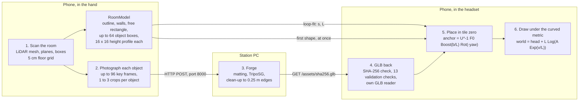
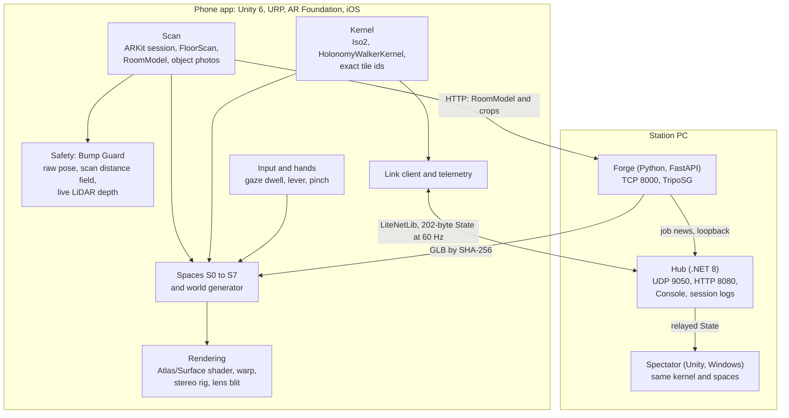

# ATLAS: scanning anything into non-Euclidean space

An entry for Huawei Custom Challenge #1, "Beyond Euclid", at StormHacks 2026.
The plan of record is `documents/ATLAS_Master_Plan.md`; where this README and a document disagree with the code, the code wins and the difference is stated here.

## Abstract

ATLAS takes what a phone can scan and places it in a space whose metric is not Euclidean.
A hand-held LiDAR sweep of any room produces a room model (floor outline, walls, free floor and oriented boxes for the objects standing on it); photographs of each object, taken automatically from the same sweep, are sent to a PC service that generates a triangle mesh with an image-to-3D model (TripoSG) and returns it; the room becomes tile zero of a regular tiling of the hyperbolic plane, each object is placed in that tile by one isometry, and a single vertex-shader function draws every vertex at its true geodesic distance and bearing from the walker.
The walker then crosses the result on foot, with no translation or rotation gain: each real step of $d$ metres becomes a geodesic step of $d/L$ curvature radii, and the curvature radius $L$ is itself fitted to the scanned floor so that a square lap of the walker's own room closes after five corners instead of four.
Around this pipeline the repository contains eight spaces covering the four families the challenge names (hyperbolic, spherical, four-dimensional and impossible), a deterministic world generator addressed by exact integer tile ids, a safety layer that reads only the physical room, a hands-free interaction model, and a PC "Station" (Hub, Forge, Spectator).
The status is stated plainly throughout: the geometry, the generator, the frame loop and the Station protocol are proven by engine-free tests and by Unity batch-mode tests; the scan has run to the end on a phone once; the generative model has run once on a laptop GPU; no generated mesh has been recorded arriving on a phone, and no person has yet walked a curved space in the headset.

## Contents

1. [Motivation and the challenge](#1-motivation-and-the-challenge)
2. [Headline contribution: scanning anything into non-Euclidean space](#2-headline-contribution-scanning-anything-into-non-euclidean-space)
3. [System overview](#3-system-overview)
4. [Mathematical foundations](#4-mathematical-foundations)
5. [From Euclidean motion and a Euclidean room to curved space](#5-from-euclidean-motion-and-a-euclidean-room-to-curved-space)
6. [Catalogue of spaces](#6-catalogue-of-spaces)
7. [World generation](#7-world-generation)
8. [Computer graphics and rendering](#8-computer-graphics-and-rendering)
9. [Scanning and the room model](#9-scanning-and-the-room-model)
10. [Generative 3D: the Forge](#10-generative-3d-the-forge)
11. [Human-computer interaction](#11-human-computer-interaction)
12. [Safety](#12-safety)
13. [The Station, the link and telemetry](#13-the-station-the-link-and-telemetry)
14. [Use cases (blades)](#14-use-cases-blades)
15. [Verification and current state](#15-verification-and-current-state)
16. [Repository layout](#16-repository-layout)
17. [Getting started](#17-getting-started)
18. [Limitations and future work](#18-limitations-and-future-work)
19. [References](#19-references)
20. [Credits and licence notes](#20-credits-and-licence-notes)

## 1. Motivation and the challenge

The challenge asks for an interactive application in a world where Euclidean rules no longer apply, with one requirement: non-Euclidean geometry must be a central, meaningful part of the experience.
It names four families (hyperbolic, spherical or elliptic, 4D projections, impossible or Escher-like spaces) and weighs geometric creativity (30 %), user experience and interaction (30 %), graphics and technical execution (25 %, with 30 frames per second as the real-time target) and documentation (15 %).
It also asks three technical questions: which coordinate system is used, how curved geodesics are mapped to a flat screen, and how the user navigates.

Most curved-space demonstrations are authored for a fixed stage and are steered with a controller.
ATLAS takes the opposite position on both points.
Nothing is authored for a fixed stage: the scan of the walker's own room decides the size, the curvature and the content of every space.
And nothing is steered: the walker's body is the input, one metre walked is one metre moved along a geodesic, and the property that defines curvature (holonomy: a closed walk that returns you rotated) is felt in the legs rather than read from a screen.

The design separates two layers.
The *world layer* is what is seen; it may be flat, curved, glued or four-dimensional.
The *physical layer* is the scan; it is never drawn in a curved space and only the safety system reads it.
In flat spaces the two coincide. In curved spaces they cannot, because a flat floor cannot be laid on a curved one without slipping, and Section 12 describes what protects the walker when they diverge.

| Challenge family | ATLAS space |
|---|---|
| Hyperbolic | S2 Curved Walk, S3 Aligned Cells, S7 Network Atlas |
| Spherical | S4 Small Planet |
| 4D projections | S6 Slicer |
| Impossible, Escher-like | S1 Glued (torus, Klein bottle, 3-torus), S5 Impossible Rooms |

## 2. Headline contribution: scanning anything into non-Euclidean space

### 2.1 The pipeline



The six stages are separate pieces of code with separate proofs.

1. **Scan the room.** A sweep of the phone feeds a classified LiDAR mesh, planes and furniture boxes into a 5 cm floor grid, from which the room model is built (Section 9).
2. **Photograph any object.** There is no separate "photograph this" action. During the sweep a ring of key frames is kept in memory; when the room is confirmed, one to three views of each object box are selected, cropped and handed over. An object need not be furniture that ARKit recognises: any obstacle between 0.10 m and 2.0 m above the floor that covers at least four grid cells receives a box of category `unknown`, and the generator needs no category.
3. **Generate its mesh.** The Forge mattes the crop, runs TripoSG, and forces the result into an asset contract whose central rule is that no triangle edge exceeds 0.25 m (Section 10).
4. **Bring it back.** The phone downloads the GLB by its hash, validates it off the main thread and reads it into the shared vertex layout. Until then, and whenever the Forge cannot deliver, a first shape built on the phone stands in its place.
5. **Place it in a tile.** Room metres are the chart metres of tile zero. Each object receives its own anchor isometry (Section 2.2).
6. **Draw it under the curved metric.** One vertex function maps each vertex through the exponential map, the anchor, and the logarithm map at the walker (Section 2.2 and Section 8).

### 2.2 Taking a Euclidean vertex into the curved space

Let $\kappa \in \lbrace -1, 0, +1 \rbrace$ be the sign of the curvature, and let $\ell$ be the number of metres per kernel unit: the curvature radius $L$ in the hyperbolic case, the sphere radius $R$ in the spherical case, and 1 when $\kappa = 0$.
A point of the model surface is written $p = (x, z, w)$ with base point $o = (0, 0, 1)$ (Section 4.1).
A scanned or generated mesh arrives as ordinary vertices $v = (v_x, v_y, v_z)$ in metres about a local origin; write $v_{xz} = (v_x, v_z)$ for its floor part.

The floor part is read as a tangent vector at the origin of the object's own chart and lifted to the model by the exponential map:

```math
\mathrm{Exp}_\kappa(t)=\begin{cases}\left(\sinh r\,\dfrac{t}{r},\ \cosh r\right)&\kappa=-1\\[4pt] (t,\ 1)&\kappa=0\\[4pt] \left(\sin r\,\dfrac{t}{r},\ \cos r\right)&\kappa=+1\end{cases}\qquad r=\lVert t\rVert,\quad t=\frac{v_{xz}}{\ell}
```

It is then moved by a $3\times 3$ isometry $A$, the *anchor*, which says where the object's chart origin sits as seen from the walker.
With $U$ the walker's frame inside the tile the walker currently stands in, $F_0$ the chain of tile steps from that tile to tile zero (the scanned room), $b$ the object's scanned base point in room metres and $\psi$ its yaw:

```math
A_{\text{shell}} = U^{-1}F_0,\qquad A_{\text{obj}} = U^{-1}\,F_0\;\mathrm{Boost}_\kappa\!\left(\frac{b_{xz}}{\ell}\right)\mathrm{Rot}(-\psi)
```

where $\mathrm{Boost}_\kappa$ is the translation along a geodesic defined in Section 4.2 and $\mathrm{Rot}$ is a rotation about the base point.
Finally the point is brought back to metres around the walker by the logarithm map (the inverse of $\mathrm{Exp}$, Section 4.3), and height passes through:

```math
\begin{pmatrix}x_{ws}\\ z_{ws}\end{pmatrix}=h_{xz}+\ell\,\mathrm{Log}_\kappa\!\Big(A\;\mathrm{Exp}_\kappa\!\big(\tfrac{v_{xz}}{\ell}\big)\Big),\qquad y_{ws}=v_y+A_{[1][3]}
```

Here $h$ is the head position and $A_{[1][3]}$ is a spare entry of the uploaded $4\times4$ matrix that carries the height of the object's base above the floor (zero for tiles and for the room shell).

Three properties follow.
First, the picture is an azimuthal-equidistant chart centred on the head: the geodesic distance and the bearing from the walker to every vertex are exact.
Second, an object is laid out by the exponential map about *its own* base, so distances from the base centre are preserved exactly and only circumferential lengths stretch, by the factor $\sinh(d/L)/(d/L)$ at distance $d$ from the base in the hyperbolic case. The room shell, by contrast, is exp-mapped about the room centre and stretches tangentially with distance from it (the project's geometry audit estimates about 22 % at the corners of a 3 m room for $L \approx 1.88$ m). This is why objects carry their own anchors.
Third, the map moves vertices, not edges: an edge is drawn as a straight chord between two correctly placed vertices. The 0.25 m edge rule bounds that error, and it is the single obligation a mesh must meet to enter a curved space. The room shell builder, the first-shape builders, the generated props and the Forge all enforce it.

*Implemented in:* `ATLAS/Assets/Atlas/Rendering/Shaders/Resources/AtlasWarp.hlsl` (the vertex function), `Rendering/Warp/WarpAnchor.cs` (anchors, computed in double and cast to float last), `Rendering/Tiles/CurvedRoomView.cs` (shell and object anchors), `Kernel/Walk/TileZeroPlacement.cs` (placement isometries). Paths below are relative to `ATLAS/Assets/Atlas/` unless they begin with `station/`, `tools/` or `docs/`.

### 2.3 What is proven, and what is not

| Stage | Proven by | Not yet shown |
|---|---|---|
| 1. Room scan | Engine-free tests of the floor grid against an independent Python reference (`tools/rooms/roommath.py`); six generated fixtures; one scan run to the end on a phone on 4 October 2026 with the RoomPlan wall bridge off | Accuracy against a tape measure; the wall bridge (it crashed the scan on the device and is off by default) |
| 2. Object photos | Headless tests of view scoring, cropping and the fallback tiers | Three device scans on 4 October 2026 sent the Forge no photos. The selection rule was loosened in response; that fix is tested headless only |
| 3. Generation | Forge test suite and Station rehearsal with a *procedural* stand-in generator; TripoSG itself ran once, on an RTX 4060 Laptop (8 GB), at about 87 s per object | TripoSG output against a real scan profile; peak memory; a full room; the hosted fallback (no vendor wired) |
| 4. GLB back | Validator and reader tests; rehearsal downloads and validates byte for byte as the phone would | A generated mesh arriving on a phone |
| 5. Placement | Tests assert kerb vertices land on their Home positions at $U = I$, object bases sit at $\mathrm{Exp}(b/L)$, and distances from the base centre are kept to 1 mm | Any device run |
| 6. Drawing | A float C# mirror of the shader matches the double-precision kernel within 1 mm out to 3 kernel units for both signs of curvature; the HLSL compiles for Metal in Unity batch mode | The shader's output on a GPU (the GPU half of the test is skipped without a graphics device); a person walking it |

### 2.4 Scope of the claim

The headline needs four qualifications, and each is a statement about the code.

- **Scanned content exists once.** The room and its objects live in tile zero only. They are not replicated through the tiling by group elements; the other tiles hold generated shells and props (Section 7). Tile meshes, Glued cells, the walker's avatar and the planet's faces are the things replicated by isometries.
- **Scanned objects are bent only in the hyperbolic Curved Walk (S2).** On the Small Planet (S4) the code constructs the room view with `ShowObjects = false` and `ShowKerbs = false`, so nothing scanned is drawn on the sphere; the scan sets the entry point and the radius. The Master Plan still describes furniture on the planet; the code does not do it. In Aligned Cells, Glued and Impossible Rooms the scanned objects are drawn once, flat, at their true place.
- **"Anything" is bounded.** An object must be found as a furniture box or as an obstacle blob; box sides lie between 0.02 m and 6 m; a room holds at most 64 objects, of which at most 32 receive generated meshes within a budget of 120,000 triangles (16 objects on an 8 GB card). The room model is a 2.5-dimensional description (floor grid, extruded walls, oriented boxes with height profiles), not a full 3D capture.
- **A LiDAR iPhone is required** for the designed scan routes (the project names iPhone 15 Pro Max and 14 Pro Max).

## 3. System overview



The phone renders and decides everything; it is complete without the Station.
The app is a Unity 6000.3.25f1 project using the Universal Render Pipeline 17.3.0 and AR Foundation 6.5.0 with the ARKit XR plugin 6.5.0, built for iOS 17.0 with IL2CPP and Metal.
The Station runs the Hub (.NET 8, LiteNetLib 2.1.4), the Forge (Python 3.11, FastAPI) and a Windows build of the same Unity project as Spectator.

The hand-written code under `ATLAS/Assets/Atlas/` is divided into assemblies whose permitted references are held as a table and checked in three places (`docs/contracts/README.md`, `tools/headless/verify.py` and `Tests/Architecture/AssemblyGraphTests.cs`).
The rules that matter most: `Atlas.Kernel` and `Atlas.Link` reference no other Atlas assembly and no engine types beyond Unity.Mathematics (the Link uses only System and LiteNetLib); `Atlas.Safety` references only `Atlas.World` and may not reference Link, Telemetry or Hands; blades may not reference the App or each other.

Each frame runs in a fixed order, driven by `App/Frame/FrameLoopCore.cs`:

1. sense (pose, depth, hands, input);
2. Bump Guard, on the raw pose, before anything that can be skipped;
3. pose filter (a floor step longer than 0.20 m in one frame, a non-finite sample or tracking that is not Normal is dropped);
4. kernel step, exactly once;
5. space tick;
6. upload of anchors and globals to materials;
7. two eye cameras, then one lens blit;
8. State message, performance probe, quality ladder.

Steps 1 to 7 never wait for the network.

## 4. Mathematical foundations

The kernel (`Kernel/`, assembly `Atlas.Kernel`) is a constant-curvature kernel in two dimensions with a Euclidean height axis.
It works in double precision throughout; the only casts to single precision are at upload to the GPU.

### 4.1 Models and metric

One matrix type, `Iso2`, serves three geometries, distinguished by the sign $\kappa$:

```math
\kappa\,(x^2+z^2)+w^2=1,\qquad \langle a,b\rangle_\kappa=a_xb_x+a_zb_z+\kappa\,a_wb_w,\qquad o=(0,0,1)
```

For $\kappa=-1$ this is the upper sheet of the unit hyperboloid $x^2+z^2-w^2=-1$ with the Minkowski form $\eta=\mathrm{diag}(1,1,-1)$, a model of the hyperbolic plane $\mathbb{H}^2$.
For $\kappa=+1$ it is the unit sphere $\mathbb{S}^2$.
For $\kappa=0$ it is the plane $w=1$ in homogeneous coordinates.
The sign carries no magnitude: the Gaussian curvature in physical units is $K=\kappa/\ell^2$, where $\ell$ is $L$ or $R$ in metres, and lengths are divided by $\ell$ on the way into the kernel and multiplied by it on the way out.
Height never enters the kernel, so the walked spaces are $\mathbb{H}^2\times\mathbb{E}$ and $\mathbb{S}^2\times\mathbb{E}$.

Other models appear only where they are convenient.
The Klein (gnomonic) model is used to author tile meshes, because geodesics are straight lines in it.
The Poincare disc is used only for map pictures (the Station's flat twin and the Network blade).
A view of the round 3-sphere $\mathbb{S}^3$ exists only as a shader mode for the Small Planet.
"4D" in ATLAS is flat $\mathbb{R}^4$. There is no $\mathbb{H}^3$, Nil, Sol or other Thurston geometry in the kernel.

*Implemented in:* `Kernel/Iso2.cs`, `Kernel/Geometry2.cs`, `Kernel/Curvature.cs`.

### 4.2 Isometries

A translation by a tangent vector $\Delta$ (already divided by $\ell$) along the geodesic through $o$ is

```math
\mathrm{Boost}_\kappa(\Delta)=\begin{pmatrix}1+\tilde c\,u_x^2 & \tilde c\,u_xu_z & s\,u_x\\ \tilde c\,u_xu_z & 1+\tilde c\,u_z^2 & s\,u_z\\ -\kappa s\,u_x & -\kappa s\,u_z & c\end{pmatrix},\qquad d=\lVert\Delta\rVert,\quad u=\frac{\Delta}{d}
```

```math
(c,\ s,\ \tilde c)=\begin{cases}(\cosh d,\ \sinh d,\ 2\sinh^2\tfrac d2)&\kappa=-1\\ (1,\ d,\ 0)&\kappa=0\\ (\cos d,\ \sin d,\ -2\sin^2\tfrac d2)&\kappa=+1\end{cases}
```

It is a Lorentz boost in $SO(2,1)$ for $\kappa=-1$, a rotation in $SO(3)$ for $\kappa=+1$ and a translation in $SE(2)$ for $\kappa=0$.
The quantity $\tilde c = c-1$ is computed in half-angle form to avoid cancellation for small steps, and $d=0$ returns the identity.
A rotation about the base point is common to all three geometries:

```math
\mathrm{Rot}(\theta)=\begin{pmatrix}\cos\theta&-\sin\theta&0\\ \sin\theta&\cos\theta&0\\ 0&0&1\end{pmatrix}
```

A positive $\theta$ turns $+x$ towards $+z$, which is a Unity yaw of $-\theta$; hence a scanned object's yaw $\psi$ enters as $\mathrm{Rot}(-\psi)$.
Inverses are closed-form and no numerical inversion is ever performed:

```math
M^{-1}=\begin{cases}\eta M^{\mathsf T}\eta&\kappa=-1\\ M^{\mathsf T}&\kappa=+1\\ \begin{pmatrix}A^{\mathsf T}&-A^{\mathsf T}t\\ 0&1\end{pmatrix}&\kappa=0,\ M=\begin{pmatrix}A&t\\ 0&1\end{pmatrix}\end{cases}
```

*Implemented in:* `Kernel/Iso2.cs` (`Boost`, `Rot`, `Inverse`).

### 4.3 Exponential map, logarithm map and distance

The exponential map at $o$ is given in Section 2.2. Its inverse, with $n=\lVert p_{xz}\rVert$, is

```math
\mathrm{Log}_\kappa(p)=\begin{cases}\operatorname{asinh}(n)\,\dfrac{p_{xz}}{n}&\kappa=-1\\[4pt] p_{xz}/p_w&\kappa=0\\[4pt] \operatorname{atan2}(n,\,p_w)\,\dfrac{p_{xz}}{n}&\kappa=+1\end{cases}
```

and the geodesic distance, in kernel units, is

```math
d_\kappa(p,q)=\begin{cases}2\operatorname{asinh}\!\left(\tfrac12\sqrt{\max\!\big(0,\ \langle p-q,\,p-q\rangle_\eta\big)}\right)&\kappa=-1\\[4pt] \left\lVert p_{xz}/p_w-q_{xz}/q_w\right\rVert&\kappa=0\\[4pt] \operatorname{atan2}\!\big(\lVert p\times q\rVert,\ p\cdot q\big)&\kappa=+1\end{cases}
```

These are the forms the code uses.
The plan writes the spherical logarithm with $\arccos(p_w)$ and the distances as $\cosh d=-\langle p,q\rangle_\eta$ and $\cos d=p\cdot q$; the code's forms are mathematically equal and better conditioned near zero.
At the spherical antipode the logarithm returns $(\pi, 0)$.

*Implemented in:* `Kernel/Geometry2.cs`; single-precision versions in `AtlasWarp.hlsl`, where $\sinh$ and $\cosh$ come from one `exp` and $\operatorname{asinh}(s)$ is written $\ln(s+\sqrt{s^2+1})$.

### 4.4 Parallel transport and holonomy

The walker's state is never a global coordinate. It is a pair (tile id, $U$), where $U$ is an isometry mapping the walker's frame into the frame of the tile the walker stands in.
There is no separate parallel-transport routine and no sub-stepped geodesic integrator.
Transport is implicit in *right*-multiplying the frame by a boost: the step is taken in the walker's own frame, so the frame is carried along the geodesic, and the rotation part of $U$ accumulates the holonomy of the path.

The holonomy is read out by decomposing a frame into a translation and a rotation:

```math
U=\mathrm{Boost}_\kappa(t)\,\mathrm{Rot}(\theta),\qquad t=\mathrm{Log}_\kappa(Uo),\qquad \theta=\operatorname{atan2}\big((\mathrm{Boost}_\kappa(t)^{-1}U)_{10},\ (\mathrm{Boost}_\kappa(t)^{-1}U)_{00}\big)
```

For the lap walk (Section 5.3) the same decomposition is applied to $\mathrm{flag}^{-1}U$, the walker's frame relative to the starting flag; the angle shown on the head-up display is the rotation of the world after the loop.
By the Gauss-Bonnet theorem a closed loop rotates a transported frame by $\lvert K\rvert$ times the enclosed area.

*Implemented in:* `Kernel/Walk/WalkerHeading.cs`, `Kernel/Walk/LapWalk.cs`.

### 4.5 Regular tilings and exact arithmetic

The floor is tiled by the regular tiling with four-sided tiles and $q$ tiles at each corner, written {4,q}: {4,3} is the cube on the sphere, {4,4} the flat grid, {4,5} and {4,6} tilings of the hyperbolic plane.
For $q \ge 5$ the in-radius $r$ and circumradius $r_c$ of a tile, in kernel units, satisfy

```math
\cosh r=\frac{\cos(\pi/q)}{\sin(\pi/4)},\qquad \cosh r_c=\cot\frac{\pi}{4}\cot\frac{\pi}{q},\qquad \sigma_q = 2r = 2\operatorname{asinh}\sqrt{\cos(2\pi/q)}
```

so the spacing of neighbouring tile centres is $\sigma_5 = 1.0612750619$ (where $\cosh\sigma_5=\varphi$, the golden ratio) and $\sigma_6 = 1.3169578969$ (where $\cosh\sigma_6 = 2$). For the cube, $r=\pi/4$, $\sigma_3=\pi/2$ and $r_c=\arctan\sqrt2$.

The neighbour of a tile with frame $M$ across edge $k$ has frame $M S_k$, with

```math
S_k=R^k\,T\,H,\quad R=\mathrm{Rot}(\tfrac{\pi}{2}),\quad H=\mathrm{diag}(-1,-1,1),\quad T_{\lbrace 4,5\rbrace}=\begin{pmatrix}\varphi&0&\sqrt\varphi\\ 0&1&0\\ \sqrt\varphi&0&\varphi\end{pmatrix},\quad T_{\lbrace 4,6\rbrace}=\begin{pmatrix}2&0&\sqrt3\\ 0&1&0\\ \sqrt3&0&2\end{pmatrix}
```

where $T$ is the boost by one centre spacing along $+x$ and the half-turn $H$ makes the neighbour's edge 0 face back.

For {4,5} every frame entry lies in the ring $\mathbb{Z}[\varphi]$, stored as a pair of checked 64-bit integers $u+v\varphi$. Because $\varphi^2=\varphi+1$, multiplication by $\varphi$ is $(u,v)\mapsto(v,u+v)$, and a neighbour step needs additions only.
A tile id is the centre of the tile, six integers $(X_u,X_v,Y_u,Y_v,T_u,T_v)$:

```math
M\,o=(\sqrt\varphi\,X,\ \sqrt\varphi\,Y,\ T),\qquad X,Y,T\in\mathbb Z[\varphi],\qquad \varphi\,(X^2+Y^2)-T^2=-1
```

Tile zero is $(0,0,0,0,1,0)$. Each tile has one canonical frame (the lexicographically smallest of its four rotations), so de-duplication is an exact dictionary lookup with no tolerance.
A bare id received from elsewhere is resolved to its frame by greedy descent to tile zero. The invariant on the right is evaluated in tests, not at run time.
The {4,6} tiling uses doubles snapped to an integer and $\sqrt3$ lattice after each product; the cube uses exact integer matrices.

*Implemented in:* `Kernel/Tiling/ExactFrame.cs`, `TileId.cs`, `TileGraph.cs`, `CubeTiling.cs`.

### 4.6 Numerical stability

- **Renormalisation every frame.** After each step $U$ is put back on the group by Gram-Schmidt orthonormalisation with respect to $\mathrm{diag}(1,1,\kappa)$, position column first. The drift measure is $\mathrm{Defect}(M)=\max_{i,j}\lvert(M^{\mathsf T}JM-J)_{ij}\rvert$ with $J=\mathrm{diag}(1,1,\kappa)$; a pose is valid when it is below $10^{-6}$.
- **Re-rooting.** $U$ always describes a place inside one tile (Section 5.1), so its entries stay of order one however far the walk goes.
- **No accumulated chains.** The chain $F_t$ from the walker's tile to tile $t$ is rebuilt from 16 constant step matrices on every query.
- **Double until upload.** Anchors $U^{-1}F_t$ are formed in double and cast to float last.
- **Range.** Exact {4,5} ids overflow checked 64-bit arithmetic after about 42 straight tile steps from tile zero and throw; {4,6} throws "precision exhausted" after roughly 26.

The project's geometry audit (4 October 2026, by Python ports, not by running Unity) reports a boost-inverse residual of at most $4\times10^{-11}$, exact frames matching doubles to $4\times10^{-15}$, and a defect of $2\times10^{-16}$ after 200,000 sphere steps. It found no wrong kernel formula and two defects in the Curved Walk, both listed in Section 18.

## 5. From Euclidean motion and a Euclidean room to curved space

### 5.1 A physical step becomes a geodesic step

The AR session frame is placed so that the room anchor sits at the world origin with yaw only; Unity world space is therefore the room frame.
Each frame the kernel receives the head's floor point $h_{xz}$ in room metres and forms the displacement itself:

```math
d = h_{xz}^{\text{now}}-h_{xz}^{\text{prev}},\qquad U\leftarrow\mathrm{GS}_\kappa\!\big(U\cdot \mathrm{Boost}_\kappa(d/\ell)\big)
```

where $\mathrm{GS}_\kappa$ is the renormalisation of Section 4.6. The displacement is set to zero (dropped, not clamped) if $\lVert d\rVert>0.2$ m, if it is not finite, or if tracking is not Normal.
Nothing is scaled or redirected: a real metre is a metre of geodesic.

Let $p=Uo$ be the walker's position in the current tile and $e_k$ the four edge directions. The signed excursion past edge $k$ is

```math
\sigma_k=(p\cdot e_k)\cosh r-p_w\sinh r\quad(\kappa=-1),\qquad \sigma_k=\frac{p\cdot e_k-p_w}{\sqrt2}\quad(\kappa=+1)
```

and when the largest $\sigma_k$ exceeds $\sinh 0.02$ (or $\sin 0.02$) the walker is re-rooted: $U\leftarrow G_k^{-1}U$ and the tile id advances to the neighbour, where $G_k=S_kR^j$ maps the neighbour's canonical frame into the current one. The 0.02-unit hysteresis prevents flicker on an edge; at most four crossings are taken per frame.

One kernel, `HolonomyWalkerKernel`, serves every dial position by dispatching on $q$: a flat walker at $q=4$, the holonomy rig on the {4,5} or {4,6} graph at $q=5,6$, and a sphere walker on the cube at $q=3$.

*Implemented in:* `Kernel/Walk/HolonomyRig.cs`, `Kernel/Walk/SphereWalker.cs`, `Kernel/FlatWalkerKernel.cs`, `Kernel/Walk/HolonomyWalkerKernel.cs`, `Scan/Pose/RoomFrame.cs`.

### 5.2 The room becomes tile zero

The scan yields a free rectangle of width $W_f$ and depth $D_f$ (already 0.30 m inside walls and furniture). The *loop-fit rule* turns it into a lap square of side $s$ and into curvature radii:

```math
s=\operatorname{clamp}\big(\min(W_f,D_f)-0.4,\ 1.0,\ 3.2\big)\ \text{m},\qquad L_5=\frac{s}{\sigma_5},\quad L_6=\frac{s}{\sigma_6},\quad R_3=\frac{s}{\pi/2}
```

The radii are chosen so that $s$ equals the centre spacing of the tiling: the scanned room then fits one tile, and "tiles per corner" equals "corners to close the walk". A 3 m by 3 m room gives $s = 2.0$ m and $L_5\approx1.885$ m.
The dial then applies provisional comfort floors, $L\ge1.4$ m and $R\ge1.2$ m, unless the parameter `curved.strong` is set. When a floor overrides the fitted value the lap no longer closes exactly (Section 18).
A room whose free short side is under 1.5 m is in standing mode.

Registration is a plain statement about coordinates: room metres are the chart metres of tile zero. On entry the walker is registered at $U=\mathrm{Boost}_0(h_{xz})$, a translation, so at $K=0$ the virtual room is exactly where the real one is, and the warp is bypassed.
Curvature is then turned on by a ramp that is linear in $K$ and lasts 4 s of standing time:

```math
K(\tau)=K_{\text{from}}+(K_{\text{target}}-K_{\text{from}})\,\frac{\tau}{4\ \text{s}},\qquad K=\frac{\kappa}{L^2},\qquad \ell(K)=\frac{1}{\sqrt{\lvert K\rvert}}
```

The ramp time $\tau$ advances only in frames where the three-dimensional head speed is at most 0.1 m/s; curvature never changes under a moving walker. The ramp exists between $K=0$ and $K=-1/L^2$ only; the sphere is entered by a step change behind a fade.

Once curvature is on, registration is given up by design. The room's floor is hidden (tile zero's own floor is drawn), its walls sink to 0.9 m kerbs, and solid geometry fades within 0.3 m of the head, because a virtual wall is no longer where the real wall is.

*Implemented in:* `World/Room/LoopFit.cs`, `World/Room/RoomModel.cs` (`ApplyLoopFit`), `Kernel/Walk/TileZeroPlacement.cs`, `Spaces/CurvedWalk/CurvedWalkCore.cs`.

### 5.3 The 3-4-5 walk

The instruction "walk $s$, turn left a quarter turn" is the isometry $W=\mathrm{Boost}_\kappa\big((s/\ell,0)\big)\,\mathrm{Rot}(\pi/2)$. Beacons are placed at $\mathrm{flag}\cdot W^k$, with the flag at the lap-square corner $(-s/2,-s/2)$ of tile zero.
$W$ is a rotation by an angle $\phi$ about some point, with

```math
\cos\frac{\phi}{2}=\frac{\cosh(s/2L)}{\sqrt2}\ \ (\kappa=-1),\qquad \cos\frac{\phi}{2}=\frac{\cos(s/2R)}{\sqrt2}\ \ (\kappa=+1)
```

so the walk closes after $n$ sides when $\phi=2\pi/n$: three on the sphere at $s/R=\pi/2$, four in the plane, five at $s/L=\sigma_5$, six at $s/L=\sigma_6$. The closure condition is a derivation in the plan; the code hard-codes the resulting spacings and verifies closure by replay tests. After a closed five-corner lap the world has turned by 90 degrees.

*Implemented in:* `Kernel/Walk/LapWalk.cs`; tests in `Tests/CurvedWalk/DialWalkTests.cs`.

### 5.4 The curved scene comes back to the screen

Rendering answers the challenge's question about mapping curved geodesics to a flat screen with the vertex map of Section 2.2 and nothing else: every vertex is placed at head $+\ \ell\,\mathrm{Log}(A\,\mathrm{Exp}(v/\ell))$, and an ordinary perspective projection follows. Sideways lengths at geodesic distance $d$ therefore appear at scale $(d/L)/\sinh(d/L)$, which is how the exponential growth of hyperbolic space becomes visible as crowding towards the horizon. Both eyes share one chart centre (the head), so stereo is Euclidean stereo of the mapped scene rather than per-eye hyperbolic stereo.

## 6. Catalogue of spaces

Each space is an `ISpaceModule` configured from one input, the room model, with an engine-free core class so its logic runs in headless tests. Ids are defined in `World/Spaces/SpaceId.cs`. "Registered" means virtual walls coincide with real ones.

| Id | Name | Geometry | What the scan decides | Registered |
|---|---|---|---|---|
| S0 | Home | Flat $\mathbb{E}^2\times\mathbb{E}$ | Everything: the room rebuilt 1:1 | Yes |
| S1 | Glued | Flat quotients: torus $T^2$, Klein bottle, 3-torus $T^3$ | Cell size, about 1.5 m | Yes |
| S2 | Curved Walk | $\mathbb{H}^2\times\mathbb{E}$ on {4,5} or {4,6} | Tile zero, $L$, the Home tiles | Until curvature is on |
| S3 | Aligned Cells | {4,5} as a flat cone-point model | Cell grid on the free floor | Yes |
| S4 | Small Planet | $\mathbb{S}^2\times\mathbb{E}$, optional $\mathbb{S}^3$ view | Entry point and radius | No |
| S5 | Impossible Rooms | Flat rooms joined by portals | Booth, hall and corridor sizes | Yes |
| S6 | Slicer | Flat $\mathbb{R}^4$ and $\mathbb{R}^3\times S^1$ | Body radius and the length of the $w$ lane | Yes |
| S7 | Network Atlas | Flat floor carrying a Poincare-disc map of $\mathbb{H}^2$ | Disc radius | Yes |

The honest naming rule of the project applies: only S2, S3 and S4 are curved. Glued, portal and 4D spaces are flat spaces that wrap, overlap or have an extra dimension.

### 6.1 S0 Home

The scanned room at 1:1, with full walls, every object, a centre mark and the outline of the lap square. It is the reference against which every other space is compared, and it is what Curved Walk equals at $K=0$.

### 6.2 S1 Glued

The universal cover of a flat quotient is drawn as a lattice of cell copies fixed to the real floor; the walker is never moved. A deck transformation is an optional mirror in $x$ followed by a translation $\tau$:

```math
g(p)=\big((-1)^m p_x,\ p_y,\ p_z\big)+\tau,\qquad \mathrm{Copy}(i,j,k)=A^{i}B^{j}C^{k}
```

with $A$ a shift by one cell along $x$, $B$ a shift along $z$ (carrying the mirror, $m=1$, for the Klein bottle) and $C$ a vertical shift of 2.6 m for the 3-torus. A copy of the walker, carrying the tracked hands, stands in every other cell and is mirrored in odd Klein rows. The real room is drawn once.

*Implemented in:* `Spaces/Glued/GluedLattice.cs`.

### 6.3 S2 Curved Walk

The pipeline of Section 2 and the mapping of Section 5. The dial has snaps $q=3,4,5,6$ and is locked while the walker moves; $q=3$ hands over to the Small Planet and $q=4$ ramps back to flat. Only {4,5} has a generated world (Section 7); at {4,6} bare tile shells are drawn.

### 6.4 S3 Aligned Cells

After the Holonomy project (TU Delft), the free floor is cut into flat square cells of side $g$, each showing one tile of {4,5}; crossing a cell edge steps the tile graph. Each cell is flat and all the curvature sits at the corner posts, where five tiles meet around a point at which four floor cells meet:

```math
\text{cone angle}=5\cdot\frac{\pi}{2},\qquad K_{\text{post}}=2\pi-\frac{5\pi}{2}=-\frac{\pi}{2},\qquad L_{\text{eq}}=\frac{g}{\sqrt{2\pi/5}}\approx0.892\,g
```

Four quarter-turns around one post put the walker in the same cell on a different tile; five return the starting tile. Which tile a pixel shows is decided per fragment by up to four *sight-line gates*: a fragment at floor position $x$ is kept when $\sigma_i\,[(g_i-e)\times(x-e)]\ge0$ for every gate, with $e$ the eye, $g_i$ a post and $\sigma_i=\pm1$.
By default the space runs a duck maze: a tree of 20 tiles grown through the tile graph by the growing-tree algorithm on a 4 by 4 floor grid, with a rubber duck at depth 8 to 12. Twenty tiles fit on sixteen cells because cells are reused by different tiles. Maze walls are visual; walking through one is counted, not prevented.

*Implemented in:* `Spaces/AlignedCells/CellFrame.cs`, `SightLines.cs`, `PostLoops.cs`, `DuckMaze.cs`; `Rendering/Shaders/Resources/AtlasGates.hlsl`.

### 6.5 S4 Small Planet

Six cube-face tiles, authored in Blender, on a sphere of radius $R=\max(R_{\text{dial}},\ \texttt{planet.R})$ with `planet.R` = 2.0 m by default, all always drawn. Fragments beyond 2.6 rad of geodesic distance from the head are discarded, because the logarithm map smears near the antipode. With `planet.view3d` on, the shader treats space as the round 3-sphere whose floor is a great 2-sphere, so that the far ground rises overhead: with vertex and eye heights $h_r, e_r$ as angles and $p$ the vertex's floor point,

```math
c=\cos h_r\cos e_r\,p_w+\sin h_r\sin e_r,\qquad v=\big(\cos h_r\,p_x,\ \cos e_r\sin h_r-\sin e_r\cos h_r\,p_w,\ \cos h_r\,p_z\big),\qquad \mathrm{Log}_E(q)=\operatorname{atan2}(\lVert v\rVert,c)\,\frac{v}{\lVert v\rVert}
```

The three-corner lap closes only when $s=\pi R/2$, about 3.14 m at the default radius, so in most rooms it does not close unless `planet.R` is lowered. Scanned furniture is hidden here (Section 2.4).

### 6.6 S5 Impossible Rooms

Flat rooms joined by stencil portals. Every room is authored in the room frame on the same real floor, so every portal transform is the identity and nobody is teleported. Two layouts exist: a 1.0 m booth that contains a hall larger than the whole floor, and a corridor ring whose rooms between them cover eight corners, so that four right turns end on the same floor in a different room and the corridor closes only after two laps. The portal depth is one.

*Implemented in:* `Spaces/Portal/PortalLayoutGenerator.cs`, `Rendering/Portals/PortalRenderer.cs`.

### 6.7 S6 Slicer

Four-dimensional bodies (tesseract, 5-cell, 16-cell, 24-cell, a 4D ball and the worldtube of a breathing sphere in $\mathbb{R}^3\times S^1$) are stored as tetrahedral meshes and cut every frame by a hyperplane with normal $n$ and offset $w_0$. For vertices $x_i$ with $f_i=n\cdot x_i-w_0$, each edge whose ends have opposite signs contributes the point

```math
q_{ab}=x_a+\frac{f_a}{f_a-f_b}\,(x_b-x_a)
```

and a tetrahedron yields a triangle (1-3 split) or a quadrilateral (2-2 split). The perspective shadow is $\pi(p)=p_{xyz}\cdot f/\max(f-p_w,\ 0.05f)$ with $f=2$. Walking a lane on the floor moves $w_0$ by an absolute mapping, so the same spot is always the same slice; the cross-section is named exactly from the polytope's combinatorics. The cut runs on the CPU in Burst jobs; it is not a shader technique.

*Implemented in:* `Kernel/Mesh4D/Slicer4D.cs`, `Projector4D.cs`, `Rotation4D.cs`, `Polytopes4D.cs`; `Spaces/Slicer/`.

### 6.8 S7 Network Atlas

Described in Section 14; it lives in `Blades/Network/` rather than `Spaces/`.

## 7. World generation

There is no single world generator. There are several deterministic, engine-free generators that share one addressing scheme, the exact tile id, and all of them take the scanned room as input. No wave-function-collapse solver, constraint solver or graph grammar exists in the code; the research notes list those as possible upgrades.

### 7.1 Hashing

The content of a tile is a pure, memoised function of (tile id, seed, room footprint). The hash is a SplitMix64 fold over the six id words $w$, in unchecked 64-bit arithmetic, starting from $h_0=\texttt{0x9E3779B97F4A7C15}\oplus\text{seed}$:

```math
h\leftarrow h+w+\texttt{0x9E3779B97F4A7C15};\quad h\leftarrow(h\oplus(h\gg30))\cdot\texttt{0xBF58476D1CE4E5B9};\quad h\leftarrow(h\oplus(h\gg27))\cdot\texttt{0x94D049BB133111EB};\quad h\leftarrow h\oplus(h\gg31)
```

It uses integers only, so the phone (IL2CPP) and the Station (.NET) generate the same world.

*Implemented in:* `Kernel/Tiling/TileId.cs` (`ContentSeed`).

### 7.2 The Curved Walk world

`WorldGenerator` covers {4,5} only and works in stages.

1. **Home.** The scanned outline is sampled on a 0.05 m grid; each sample $p$ is lifted to $P=\mathrm{Exp}(p/L)$ and descended tile by tile using the edge functions of Section 5.1. The tiles reached are flagged Home and receive no props.
2. **Towers.** Landmarks come from a number-theoretic lattice, not a search: the residue of $(X,Y,T)$ modulo the prime $\sqrt5$ of $\mathbb{Z}[\varphi]$, where $\varphi\equiv3$, so $\mathrm{Res}(u+v\varphi)=(u+3v)\bmod 5$. Fifteen classes occur, and the class used is the first, starting from the seed, that contains no Home tile. Tests assert that the worst distance to the nearest tower has $\cosh d = 1+3\varphi$, that is $d=2.4529$ kernel units.
3. **Base roll.** Other tiles take a 4-bit roll of the hash: Plaza 8/16, Corridor 3/16, Garden 2/16, Doorway 2/16, span proposal 1/16.
4. **Spans, doors and kerbs.** A span proposer pairs with a Plaza or Garden neighbour; a Doorway must face another region or becomes a Plaza; a Corridor keeps a closed kerb only if, at one of the kerb's end corners, the other four edges of that corner's 5-cycle are open, which leaves an open detour and keeps the walkable graph connected. A test asserts every tile of the depth-10 ball is reachable.
5. **Regions.** A tile's region is $\arg\max(X,Y,-X,-Y)$, compared exactly in $\mathbb{Z}[\varphi]$; it tints the fog.

Props (tower beacon, garden planters, door frame, half-beams) are built flat, subdivided with the edge limit reduced by $\rho/\sinh\rho$ so that no edge exceeds 0.25 m in the curved metric, then placed by $\mathrm{Exp}$ about their base and written back in the tile's chart. A world hash folds the seed, the tower class, the Home tiles and the 597 tiles of the depth-6 ball; golden values are recorded for three seeds. In the app the seed is the constant 1.

*Implemented in:* `World/Generation/WorldGenerator.cs`, `TowerLattice.cs`, `Regions.cs`, `ZPhiMath.cs`; `Rendering/Tiles/Props/WorldPropMeshBuilder.cs`; checked by `World/Lint/WorldLint.cs`.

### 7.3 Tile meshes

A tile floor is a regular grid of points $k$ in the Klein square of half-width $\tanh r$ (or $\tan r$ on the sphere), where tile edges are straight, so neighbouring tiles share edges exactly. Each point is stored at its chart position, which the warp's $\mathrm{Exp}$ undoes:

```math
x_{\text{chart}}=L\,\operatorname{atanh}(\lVert k\rVert)\,\frac{k}{\lVert k\rVert}\ \ (\kappa=-1),\qquad x_{\text{chart}}=R\,\arctan(\lVert k\rVert)\,\frac{k}{\lVert k\rVert}\ \ (\kappa=+1)
```

*Implemented in:* `Rendering/Tiles/TileChart.cs`, `TileMeshGenerator.cs`.

### 7.4 Other generators

The duck maze (Section 6.4), the portal layouts (seeded by a hash of the room id so the phone and the Station agree), the Glued and Aligned cell grids (`World/Room/CellGridRules.cs`) and the airway embedding of Section 14.

## 8. Computer graphics and rendering

### 8.1 Pipeline

Rendering is forward URP in linear colour with no HDR, no lights, no shadows and no post-processing, with the SRP Batcher on.
Every surface uses one shader, `Atlas/Surface`: one pass, one variant, no keywords. Its vertex stage calls the warp, the only place a position is made; its fragment stage applies sight-line gates, the portal clip plane, the far-side clip on the sphere, and then the look.
There is no GPU instancing and no `MaterialPropertyBlock`: one pooled material instance per tile, room or object keeps the batcher valid, at the cost of one draw call each.
There is no ray marching and no per-pixel non-Euclidean rendering anywhere; a ray-cast renderer is listed in the mesh design document as a future option.

The warp has four modes, selected per material: 0 none (the ordinary object transform, so that at $K=0$ the room equals the real one), 1 hyperbolic, 2 spherical, 3 the $\mathbb{S}^3$ view. In modes 1 to 3 the Unity Transform is ignored, which is why a mesh's scale must be baked in. Normals are neither transformed nor used for lighting.

### 8.2 Culling, level of detail and fog

Unity's frustum culling is disabled for warped renderers (they are given 1000 m bounds), and a CPU draw rule runs once per frame for both eyes. With $d_t$ the walker-to-tile distance and $\rho$ the draw radius (default 3 kernel units, clamped to 2 to 3.5): a tile is rejected if $\cosh d_t>\cosh(\rho+r_c)$, always drawn if $\cosh d_t\le\cosh r_c$, and otherwise drawn unless its bounding disc lies wholly outside a view cone widened by 12 degrees sideways and 4 degrees vertically. At most 128 tiles are drawn. Floor grids of 16, 8 or 4 cells per side serve as levels of detail, always with 16 boundary segments so neighbours of different detail share an identical edge.

Fog is linear in horizontal distance from the head, which under the warp equals $L$ times geodesic distance, from $(\rho-1)L$ to $\rho L$. The fog colour is also the background at the horizon, so geometry at the fog radius merges with the sky and hides the edge of the finite draw set.

*Implemented in:* `Rendering/Tiles/TileSelection.cs`, `TileDrawRule.cs`, `TileRenderer.cs`.

### 8.3 Portals and gates

Portals use the stencil buffer with no extra camera, no render texture and no recursion. Each visible doorway takes a stencil reference from 1 to 15; a mask writes the reference at the doorway's depth, a second mask pushes depth to the far plane where the reference is set, and the room behind is drawn by a Render Objects feature with stencil test Equal and clipped at the doorway plane. Aligned Cells uses the per-fragment gates of Section 6.4 and no stencil.

### 8.4 The look

The look is a deliberate diagram. Colour comes from a 128 by 128 palette texture generated in code; shade is baked into the red channel of the vertex colour from one fixed light direction with a floor of 0.55; grid lines are drawn from screen-space derivatives; opacity is a 4 by 4 ordered-dither clip, so everything stays opaque and depth-writing. The same contract (position, normal, palette UV, baked colour) is what the Forge writes, so a generated mesh needs no material.

### 8.5 Display

In headset mode the view is fully generated: a hand-built two-camera stereo rig (no XR plug-in stereo) renders eye textures of 1118 by 1032 pixels with 4x MSAA, and one full-screen pass applies barrel pre-distortion $r'=r\,(1+K_1r^2+K_2r^4)$. The camera image is not drawn and there is no depth-based occlusion of rendered geometry; the walking experience is not see-through AR. The camera image appears only with the phone in the hand, during the scan and onboarding. The lens coefficients ($K_1=0.34$, $K_2=0.55$) are placeholders from a public Cardboard profile.

*Implemented in:* `Rendering/Stereo/StereoRig.cs`, `LensModel.cs`, `Resources/AtlasLensBlit.shader`.

### 8.6 Budgets and the quality ladder

The code holds hard limits of 300 draw calls and 500,000 triangles per frame for both eyes (Curved Walk: 240 and 370,000). A thermal ladder trades render scale, MSAA, draw radius, Glued copies and furniture level before frame rate, one rung at a time and at most one automatic step per 20 s, with a floor of 30 frames per second. These are budgets enforced as counts in code and tests. No frame rate has been measured on a phone.

## 9. Scanning and the room model

This is stage 1 and stage 2 of the pipeline in Section 2.

### 9.1 Sensing

Always on: ARKit world tracking, the lowest-resolution 60 Hz video format, and LiDAR environment depth (for the safety layer). Only during a scan: plane detection, the LiDAR scene mesh with a class per face, RoomPlan furniture boxes and ray casts for corner taps. These are switched off the moment the walker confirms, because meshing and plane detection are a heat source.

### 9.2 Four routes, one solver

The solver takes the highest route that succeeds: (1) an outline from tapped corners or the walked path; (2) FloorScan on the classified mesh; (3) furniture boxes merged with the grid's own obstacle blobs; (4) RoomPlan walls, doors and windows through a Swift plugin. Route 4 is off by default: on the device on 4 October 2026 the second capture session crashed the scan, and with it off the same scan ran to the end. Two documents in the repository still say the opposite; the code's default is off.

### 9.3 FloorScan

The mesh is rotated into a frame aligned with the dominant wall direction, found by folding angles modulo a quarter turn (with $\alpha_k$ the direction and $w_k$ the weight of wall segment $k$):

```math
\theta=\tfrac14\operatorname{atan2}\Big(\sum_k w_k\sin4\alpha_k,\ \sum_k w_k\cos4\alpha_k\Big)
```

and rasterised into a grid of cell size $c=0.05$ m. With $y_0$ the floor height, a triangle is floor if it is floor-classed and within 0.08 m of $y_0$, and an obstacle if any part of it lies between 0.10 m and 2.0 m above $y_0$. Then

```math
\mathrm{FREE}=\mathrm{FLOOR}\setminus\operatorname{dilate}_{3\times3}\big(\mathrm{OBST}\cup\overline{\mathrm{INSIDE}}\big),\qquad \mathrm{WALK}=\text{the component of }\lbrace\mathrm{sdf}>0.25\ \text{m}\rbrace\text{ at the walker}
```

where INSIDE is the confirmed outline and sdf is the exact Euclidean signed distance to the edge of FREE. Unseen cells are never free. The free rectangle is the axis-aligned rectangle in WALK with the largest short side (capped at 3.6 m), then the largest area; its centre becomes the room origin and carries the AR anchor. The same distance field is later the static layer of the safety system (Section 12).

*Implemented in:* `Scan/FloorScan/FloorScanCore.cs`, `FloorGridMath.cs`; reference in `tools/rooms/roommath.py`.

### 9.4 The room model

`RoomModel` (schema `docs/contracts/roommodel.schema.json`, version 1) carries the anchor, outline, distance field, walkable polygon, free rectangle, lap square, curvature radii, cell grids, standing flag, walls with openings, and up to 64 objects. An object is an oriented box with a category, a base point, a size, a yaw, a mesh state, a triangle target and a 16 by 16 height profile obtained by casting rays straight down onto the scanned mesh. The profile is what later lets the Forge orient and score a generated mesh against what the LiDAR saw. No space holds a room size of its own.

### 9.5 Object photographs

During the sweep a new key frame is kept when the camera has moved 0.25 m or turned 15 degrees and is turning slower than 30 degrees per second; at most 96 are held, in memory only. When the room is final each of the 32 largest objects is projected into every key frame and scored by projected area share $a$, centredness $C$ and sharpness $\sigma^2$ relative to the ring's median $\tilde\sigma^2$:

```math
S=0.4\,\min\!\Big(\frac{a}{0.35},1\Big)+0.3\,C+0.3\,\operatorname{sat}\!\Big(\frac{\sigma^2}{\tilde\sigma^2}\Big)
```

Up to three views at least 30 degrees apart in azimuth are cropped (12 % padding, at most 768 pixels, JPEG at most 200 kB). Each crop travels with its camera intrinsics and a camera-to-box matrix. Full frames never touch disk.

*Implemented in:* `Scan/Photo/KeyFrameRing.cs`, `PhotoScore.cs`, `PhotoCaptureCore.cs`.

## 10. Generative 3D: the Forge

This is stage 3 and stage 4 of the pipeline in Section 2. The Forge (`station/forge`, Python 3.11, FastAPI on TCP 8000) turns a photograph into a mesh that the warp of Section 2.2 can bend.

### 10.1 The model

The image-to-3D model is TripoSG (VAST-AI-Research, MIT licence), pinned to commit `fc5c409` of 18 April 2025, with weights `VAST-AI/TripoSG` (7.95 GB).
The adapter loads `TripoSGPipeline.from_pretrained(...)` onto the GPU in half precision and calls it with an image, a seeded generator, 50 inference steps and guidance scale 7.0 (seed 42); all of these are part of the cache key.
This repository drives the model as a diffusers-style pipeline with denoising steps and classifier guidance and does not describe its internals; for the architecture the reader is referred to the TripoSG publication (Section 19).
The pipeline turns latents into a mesh through one of two decoders: `flash` (the default, which needs the compiled `diso` extension) and `hierarchical` (marching cubes), on an octree of depth 9. If the default decoder fails the object is generated once more with the other.

Background removal (`rembg`) is mandatory: the crop is cut to its matte, composited on white and padded to a square with a 10 % margin. TripoSG is never given an unmatted picture.

Two other generators sit behind the same interface: a deterministic procedural generator that builds a category-shaped mesh from the box size alone (used by tests, by the rehearsal and by machines with no GPU), and a hosted fallback that is an interface only, with no vendor wired.

### 10.2 Jobs

A job passes through queued, matting, generating, cleaning, then ready or failed. One worker owns the GPU and takes the largest box first. Each generated mesh is immediately welded, decimated, oriented and scaled, which yields its fit to the scanned profile; a poor fit sends the next photograph to the generator, for at most three generations per object, and the best fit is finished.

### 10.3 From a raw mesh to the asset contract

The raw mesh has about a million triangles in an arbitrary frame. Clean-up is deterministic, so the same input gives the same bytes and the same hash.

1. **Weld and decimate** to the object's triangle target by quadric edge collapse; drop fragments under 0.5 % of the surface.
2. **Orient by fit.** Candidates are up-axis choices times four quarter-turns about the vertical. For each, the mesh's own 16 by 16 height profile $g$ is ray-cast and compared with the scanned profile $p$ over the set $S$ of cells the scan saw:
   ```math
   F=\frac{1}{255\,\lvert S\rvert}\sum_{c\in S}\lvert g_c-p_c\rvert
   ```
   $F$ is a mean height error in fractions of the box height. Scores within 0.02 are a tie; a fit above 0.20 counts as poor.
3. **Scale to the scanned box.** With $b_k$ the box side and $e_k$ the mesh extent on axis $k$, and $a=0.15$ the permitted non-uniform stretch:
   ```math
   \lambda_k=\ln\frac{b_k}{e_k},\qquad u=\exp\!\Big(\tfrac13\sum_k\lambda_k\Big),\qquad s_k=u\cdot\operatorname{clip}\!\Big(\frac{e^{\lambda_k}}{u},\ 1-a,\ 1+a\Big)
   ```
   The origin is then moved to the centre of the base.
4. **Regrid.** Edges are bisected at shared midpoints until none exceeds 0.25 m. This is the step that makes a generated object fit for a curved space.
5. **Colour.** Each face takes the cosine-weighted mean, in linear light, of the photographs that see it, mapped to the nearest of 64 object palette cells by squared distance in OKLab; at most six cells per object.
6. **Bake.** Half-Lambert face shade times ambient occlusion goes into the vertex colour.
7. **Light copy and validation.** A second copy of 1,500 to 5,000 triangles is made; both are validated (one mesh, no material or texture, triangle range, edge length, palette cells, bounds within 10 % of the box).

The triangle budget is shared by box surface area $a_i$ among the $n\le32$ largest objects, in whole-number arithmetic so that the phone, the Forge and the Python reference agree:

```math
t_i=\operatorname{clamp}\!\Big(\Big\lfloor\frac{120000\,a_i}{\sum_j a_j}\Big\rfloor,\ 3000,\ 15000\Big)
```

The Forge contains no watertightness or manifold check.

*Implemented in:* `station/forge/forge/generators/triposg.py`, `imaging.py`, `cleanup.py`, `profile.py`, `colour.py`, `budget.py`, `validator.py`, `glb.py`.

### 10.4 The return path

The photographs do not travel over the UDP link. The phone posts the room model and the crops by HTTP directly to the Forge; the Forge reports job changes to the Hub on loopback, and the Hub relays them over the link (without the Hub the phone polls every 2 s). The phone downloads `GET /assets/<sha256>.glb`, verifies the hash, runs 13 validation checks off the main thread and reads the file with its own reader (the glTFast package is not used for furniture). The mesh cross-fades in over 0.3 s.

Before any of this, every object already shows a first shape built on the phone: a fitted template for chairs, couches and beds, a shape cut from the scan profile, or a gridded box. If a job fails the first shape stays.

*Implemented in:* `Telemetry/Assets/AssetClientCore.cs`, `GlbValidator.cs`, `GlbMeshReader.cs`, `FittedShapes.cs`.

### 10.5 Measured

TripoSG ran once, on 4 October 2026, on the Station's RTX 4060 Laptop (8 GB), at about 87 s per object against the plan's target of 60 s. The decoder dominates: 30 steps instead of 50 saved 7 s; octree depth 8 cut the time to 50 s but left holes through a chair seat. Peak memory is not recorded. The plan names an RTX 5070; no run on that card exists.

## 11. Human-computer interaction

The interaction model follows the scan-then-walk loop: the phone is in the hand for the scan and in a strapped lens headset for the walk, and the walk must work with free hands and no mandatory controller.

**Scan (phone in hand).** Onboarding is an engine-free state machine drawn as a card over the live camera picture. A first-time walker answers three prompts: Start (a safety note), Done (a sweep of about 30 s over floor, walls and furniture, with live feedback on floor area, object count and percentage unseen, and corrective hints) and Looks right (the free-floor outline, with draggable corners). Fallbacks are an outline by hand, a saved room and a sample room. A switch decides whether object photographs go to the Forge.

**Locomotion.** Natural walking only. The identity mapping between real and virtual displacement is the comfort strategy as well as the geometric one: there are no gains and no vignette, curvature changes only under a standing walker, and walls are at most 0.9 m high in curved spaces. Keyboard walking exists in the Editor only.

**Pointing.** The gaze ray is the head's forward axis (head gaze, not eye tracking). A head-locked reticle shows a ring that fills with dwell progress. Up to 64 gaze targets fire on a dwell of 0.7 s (adjustable from 0.6 to 0.8 s), with a 0.15 s grace for glances away and a minimum angular target size of 2.5 degrees. The reticle moves in depth to the focused target, eased linearly in inverse distance, to avoid diplopia.

**The lever.** Any touch on the screen, which the headset's lever produces, fires the focused target at once.

**Twins.** Each of 17 actions and 6 axes has both a gamepad binding and a gaze-only route, enforced by a table that a test checks for completeness. Every curved view also has a flat twin: a plan or disc picture of the same state.

**Hands.** A Swift plugin runs Apple Vision's hand-pose request on ARKit's own camera frames and returns 21 two-dimensional joints per hand; a lift makes them three-dimensional from LiDAR depth and a per-walker hand model; One-Euro filters smooth them. Because the headset view is fully generated, hands must be drawn to be seen. As the code stands, fingertip touch is switched off, near panels are switched off, and the hands' single act is a pinch (thumb-index gap under 0.30 of palm width for three detections) that toggles the on-device menu. The hands design document predates these changes and differs from the code on several defaults.

**Panels.** The menu follows the head's position but keeps its own heading, because a panel that turned with the head could never be looked at off its centre.

**Feedback.** Hands feedback is audio only. Phone haptics are reserved for the safety cue, which outranks everything: while it warns, hands fade out and stop interacting.

The interaction layer is verified headless. No user study has been run, and nothing on screen teaches the gestures; the operator explains them.

*Implemented in:* `App/Onboarding/`, `Input/Core/GazeDwell.cs`, `InputTwins.cs`, `Hands/Core/`, `App/Menu/`, `ATLAS/Assets/Plugins/iOS/AtlasHands.swift`.

## 12. Safety

Turning a scan of a real room into a curved space and asking someone to walk it is defensible only if something independent of the picture protects them. That is Bump Guard (`Safety/`, assembly `Atlas.Safety`).

**Independence.** Bump Guard works in real room coordinates on the raw pose, as step 2 of every frame. No space feeds it anything and no space can move the wall it warns about, so the same thresholds hold in every space. Its thresholds are compile-time constants with no parameter, link message or menu row. An architecture test forbids the assembly from referencing Link, Telemetry or Hands. On a device where it fails to install, the headset view is refused.

**Response.** A warning cue and haptic pulses only. There is no passthrough reveal, no guardian grid and no freezing of the world; an older specification in the repository describes those and is superseded.

**Clearance.** For a floor point $p$, $\mathrm{clear}(p)=\min\big(s(p),\ d_{\mathrm{dyn}}(p)\big)$. The static term $s$ is the scan's distance field (Section 9.3), bilinearly sampled, with any point off the grid counted as blocked. The dynamic term is the distance to the nearest cell of a 5 cm grid stamped from the live depth image: a return between 0.10 m and 2.0 m above the floor that lies more than 0.30 m nearer than the static map predicts along its ray marks a cell. A cell is cleared only after three depth images see a ray pass through it, or after 30 s; leaving the field of view clears nothing.

**Levels.** With $v$ the head velocity (from the raw pose over 0.2 s, clamped to 2.0 m/s) and paths sampled every 0.05 m:

```math
\text{STRONG}:\ \mathrm{clear}(h)<0.20\ \text{m}\ \lor\ \min_{\tau\in[0,\,0.4\,\text{s}]}\mathrm{clear}(h+v\tau)<0.05\ \text{m}
```
```math
\text{WARN}:\ \mathrm{clear}(h)<0.30\ \text{m}\ \lor\ \min_{\tau\in[0,\,0.8\,\text{s}]}\mathrm{clear}(h+v\tau)<0.05\ \text{m}
```

Levels rise in the same frame and fall only after the thresholds plus 0.05 m have held for 0.3 s. Walking straight at a wall at 1.0 m/s, headless tests assert WARN at 0.90 m and STRONG at 0.50 m from the wall.

**Tracking loss.** Whenever tracking is not Normal the static map is distrusted from the first frame and live depth alone warns, in the head frame, from seven 10-degree sectors; after 0.5 s a "stand still" cue is shown.

**The cue.** A head-locked chevron at the hazard's bearing, drawn with no depth test, no fog and no fade, with a spatialised tick or tone and phone haptic pulses (2 per second for WARN, 6 for STRONG). The Console's STOP button fires the same cue.

**Heat** is handled by the quality ladder of Section 8.6; LiDAR depth is never switched off while someone walks.

**Stated limits.** LiDAR looks only where the head looks, so hazards to the side or behind are covered only if they were in the scan; nothing under 0.10 m is seen; glass and mirrors can be missed. The plan asks for a level floor and recommends a spotter. Bump Guard has been run only on synthetic depth and recorded walks; the on-phone acceptance check (20 of 20 real approaches warned) has not been made, and the project's own status document says nobody should wear the headset on this build until it has.

*Implemented in:* `Safety/Core/BumpGuardCore.cs`, `BumpDepthKernel.cs`, `DynamicLayer.cs`, `BumpConstants.cs`, `Safety/Cue/`.

## 13. The Station, the link and telemetry

**Link.** `Atlas.Link` is engine-free C#; the Hub and the replay tool compile the same source files, so byte layouts cannot diverge. The transport is LiteNetLib over UDP, with a reliable ordered channel for control and a sequenced channel for state. Clock offset is estimated by a four-timestamp exchange, $\text{offset}=\lfloor((t_2-t_1)+(t_3-t_4))/2\rfloor$, taking the minimum-round-trip sample of the last 16. A watchdog marks the link degraded after 500 ms of silence and offline after 3 s.

**No video crosses the link.** The phone sends a room outline, a 202-byte `State` message at 60 Hz (head pose, space id, the six-word tile id, the nine doubles of $U$, eight parameters) and world events. The Spectator runs the same kernel and the same space modules and redraws the walker's view from them. It never integrates motion: each State resets its kernel onto the named tile.

**World hash.** The scanned room is tied to the curved world by the first 16 hex digits of the SHA-256 of `spaceId|4,q|seed|generatorVersion|geometryHash|L in mm`. The Spectator recomputes it from its own copy of the room and draws nothing on a mismatch.

**Flat twin.** For curved spaces the Spectator draws the tiling as a Poincare disc, $(u,v)=(x,z)/(1+w)$, and bends the scanned room's straight walls through the exponential map of tile zero, which shows the room as one tile of the tiling.

**Hub and Console.** The Hub relays State, adopts the phone's session id, writes session logs and serves a dependency-free browser Console with pages for tuning parameters, operating (space switch, STOP), a performance dashboard, a floor map, a one-eye view stream, assets, the network disc and pairing by QR code (`atlas://<station-ip>:9050`). The Console has no password.

**Telemetry.** A 3,600-frame ring on the phone produces one 34-column row per second (frame-time percentiles, CPU and GPU times, draw calls, triangles, memory, thermal state, link statistics), written as identical CSV bytes on the phone and the Hub. `tools/perf/summarise.py` turns it into the plan's metrics table. No device measurement is committed.

*Implemented in:* `Link/`, `Telemetry/`, `Spectator/`, `station/hub/`; described in `station/README.md` (stale in places; the code has more operator commands and routes than it lists).

## 14. Use cases (blades)

Five blade assemblies under `Blades/` place a dataset in one of the spaces. No non-blade assembly references a blade, so a blade is live only if it installs itself. All of them are tested headless only.

**Network Atlas (most complete; self-installing as S7).** A 200-node synthetic network generated by the hyperbolic random graph model of Krioukov et al. (2010), with nodes at polar coordinates $(r,\theta)$ in $\mathbb{H}^2$. Distances follow the hyperbolic law of cosines, nodes are drawn at $\tanh(r/2)$ in the Poincare disc laid on the scanned floor, and the view is re-centred by the Mobius isometry $M_a(z)=(z-a)/(1-\bar a z)$:

```math
\cosh d_{ab}=\cosh r_a\cosh r_b-\sinh r_a\sinh r_b\cos\Delta\theta
```

Greedy forwarding sends a packet to the neighbour nearest the destination. In the bundled seed-7 network, the study recorded in the data file delivers 100 % of packets under the hyperbolic metric and 74.1 % under the straight-line metric of the flat picture (seed 83: 99.5 % and 73.5 %). These are results for networks generated by this model, with seeds selected by a scan, not for the real Internet. A walk-through version is written but not registered.

**Lung.** A binary airway tree addressed by strings over L and R is embedded on {4,5} by "Rule S": one turn tile and one straight tile per generation, giving a fork spacing of $\operatorname{arccosh}(1+2\varphi)=2.1226$ units, above the bound of 1.7627 that the project's research note attributes to Sarkar for a collision-free embedding. A needle-direction sky on $\mathbb{S}^2$ includes a spherical-triangle angle-sum check. The 4D breathing worldtube exists as plan and Station pipeline only. All lung data in the build is a synthetic placeholder; the airway is model-generated in every variant. Education and research visualisation only; no clinical claim is made.

**FieldFit.** Visual-field remapping of the rendered Home on the sphere of view directions, in stereographic radius $s=2\tan(e/2)$ for eccentricity $e$, with a blind-spot finder and a text layout that flows round the blind spot by the Joukowski map $w=z+a^2/z$. The lens cannot turn on in the app as wired, because its parameters are declared only in tests. A teaching prototype, not a low-vision aid.

**Playground.** A ten-beat guided tour with equation cards showing the loop relation $\cosh(s/2L)=\sqrt2\cos(\pi/q)$ live against measurement. Its installer has no caller in this checkout.

**SharedHouse.** An empty assembly; the two-sheet branched-cover design exists only in the plan.

A separate offline tool, `station/pipelines` (CLI `atlas`), builds medical case packages from the public TCIA 4D-Lung study and generates the network files.

## 15. Verification and current state

The tree is on branch `main`. Test counts below are the last recorded runs in the repository's own documents; they predate the tracked hands, Network Atlas and the duck maze (the tree now has 56 assembly definitions, 29 of them tests), and no suite was run in preparing this document.

**Proven by engine-free tests.** `tools/headless/verify.py all` checks the assembly rules, compiles every assembly against the real Unity managed assemblies in three configurations (phone, Station, Editor) and runs the engine-free tests on .NET 8. Last recorded: 1,995 tests in 24 test assemblies, 1,994 passing, one skipped by decision. It covers the kernel mathematics, exact tile ids and golden world hashes, the float mirror of the warp against the double reference (1 mm to 3 units), the room as tile zero, and end-to-end scenarios that step the real frame loop on recorded pose logs: a five-corner lap in Curved Walk closing under 0.25 m, the Bump Guard cue rising 0.83 s before predicted contact at 1 m/s (the requirement is 0.6 s), and zero managed allocation over 100 frames in seven spaces. It cannot check shaders, scenes, native iOS code, IL2CPP or a device. The technical guide also records one Network Atlas app test failing.

**Proven in Unity batch mode.** On the Mac, Unity 6000.3.25f1 imports the project, compiles it, and passes the EditMode suite (last recorded 2,114 tests, 2,113 passing, one skipped), including a test that compiles every pass of every Atlas shader for Metal.

**Proven for the Station.** Hub tests (42), Console tests (59), Forge tests, and a rehearsal that starts the real Hub and the real Forge with the procedural generator and a replayed phone over loopback UDP (168 checks). It uses neither a phone, a GPU nor TripoSG.

**Shown on a device.** Release builds were built and installed on a phone on 4 October 2026 and logged as not yet looked at. The scan ran to the end on a phone once, with the wall bridge off; its accuracy was not measured.

**Not done.**

- No rendered frame has been reviewed in play mode by a person, per the project's status document.
- No curved space has been walked by a person. Gate G2 (three walkers, with a spotter) is open.
- No frame rate, frame time or thermal figure has been measured on a phone. 60 frames per second is a target.
- The warp shader's output has not been checked on a GPU by a test.
- Bump Guard has not been checked against real walls.
- No generated mesh has been recorded arriving on a phone.
- The Spectator's Windows build has no recorded run; LiteNetLib under IL2CPP on a device is not verified.

`tools/e2e/gates.py` prints, for each gate G0 to G7 of the plan, which lines are proven and which wait for a phone, the headset, the Editor or a person. Every headless line is reported proven; every device line is open; no gate is passed.

## 16. Repository layout

| Folder | Contents |
|---|---|
| `ATLAS/` | The Unity project (6000.3.25f1, URP, AR Foundation 6.5, iOS): the phone app and the Spectator |
| `ATLAS/Assets/Atlas/Kernel/` | Geometry kernel, tilings, walker, 4D meshes, lens mathematics |
| `ATLAS/Assets/Atlas/World/` | Room model, loop-fit, world generator, lint, space ids |
| `ATLAS/Assets/Atlas/Rendering/` | The surface shader, warp, tiles, portals, stereo, quality ladder |
| `ATLAS/Assets/Atlas/Scan/` | AR session, FloorScan, room builder, object photos, pose |
| `ATLAS/Assets/Atlas/Safety/` | Bump Guard |
| `ATLAS/Assets/Atlas/Input/`, `Hands/` | Gaze, twins, tracked hands |
| `ATLAS/Assets/Atlas/Spaces/`, `Blades/` | The spaces and the use cases |
| `ATLAS/Assets/Atlas/Link/`, `Telemetry/`, `Spectator/` | Link, performance probe, asset client, flat twin, Spectator |
| `ATLAS/Assets/Atlas/App/` | Composition root, frame loop, onboarding, menu |
| `ATLAS/Assets/Atlas/Tests/` | EditMode and engine-free tests |
| `station/hub/` | The Hub: .NET 8 console that terminates the phone link and serves the operator Console |
| `station/forge/` | The Forge: Python service that turns object photos into furniture meshes |
| `station/pipelines/` | Offline CLI for medical case packages and network files |
| `tools/` | `build_ios.sh`, the headless verification harness, scene and `.meta` generators, ReplayPhone, room and perf tools, the Station rehearsal |
| `docs/contracts/` | The interfaces between the four lanes (`lane-b-kernel.md` is the kernel page) |
| `docs/laneB/`, `docs/verification/`, `docs/evidence/` | Integration notes, check lists for the Editor and the phone, evidence tables |
| `recordings/` | Recorded walks replayed in the Editor and in tests (rooms are fixtures in `ATLAS/Assets/Atlas/World/Resources/AtlasRooms/`) |
| `documents/` | The plan, the technical guide, the geometry audit, research memos and handouts |
| `art/` | Source assets and Blender build steps |

The work was divided into four lanes: A (platform, look, flat and 4D spaces), B (kernel and curved worlds), C (scan, room and safety) and D (link, Station and Forge).

## 17. Getting started

### 17.1 First time

```
tools/setup_git.sh                      # Git LFS and UnityYAMLMerge, once per clone
```

Open `ATLAS/` with Unity 6000.3.25f1. The Editor applies the render set-up on load; commit the files it regenerates. Press Play in `Assets/Atlas/Scenes/Atlas_Boot.unity`: everything else is built in code. In play mode the Welcome card offers a sample room, which reaches Home without a scan.

### 17.2 Checking without the Editor

```
python3 tools/headless/verify.py all --tag mine    # assembly rules, three build configurations, every engine-free test
```

`python3 tools/e2e/gates.py` runs that plus the Station's suites and rehearsal and prints, for each gate of the plan, what is proven without a device and what waits for one. It needs the .NET 8 SDK and the Unity managed assemblies; `tools/headless/README.md` says how to point it at them and what `--tag`, `--config`, `--filter` and `wait` do.

### 17.3 Building to a phone

On the Mac build seat, with the project closed in the Editor and a phone connected:

```
ATLAS_TEAM_ID=XXXXXXXXXX tools/build_ios.sh
```

It exports the Xcode project with Unity in batch mode, builds it with `xcodebuild -allowProvisioningUpdates` and installs the app with `xcrun devicectl`. The team id is needed once; `docs/build-seat.md` has the rules of the build seat and the queue.

### 17.4 Running the Station

```
dotnet run --project station/hub        # UDP 9050, Console on http://<station>:8080
```

The Forge is set up and started as `station/forge/README.md` describes. With no phone, `tools/ReplayPhone` plays a recorded or synthetic walk into the Hub. `tools/e2e/run_station_rehearsal.sh` runs the Hub, the Forge and ReplayPhone together and checks their logs. The Station's own suites are `dotnet test station/hub.tests` and, in `station/console-tests`, `npm test`. On a Windows Station, `station/setup_firewall.ps1` opens UDP 9050 and TCP 8080 and 8000.

## 18. Limitations and future work

**Known defects in the code.**

- During the curvature ramp the walker's position is preserved about the centre of the tile the walker stands in, not about tile zero. Ramping while standing more than about 1 m from the room centre leaves the room 0.2 to 0.9 m out of place (geometry audit). The plan's instruction to stand on the centre mark is not enforced in code.
- The comfort floor ($L\ge1.4$ m) breaks lap closure in small rooms: below a lap side of about 1.5 m at $q=5$ the lap uses side $s$ but $L$ is no longer $s/\sigma_5$.
- The Small Planet's default radius does not close the three-corner lap in most rooms.
- The replay tool's synthetic walk appears to write a tracking value that the wire encoding reads as "lost"; this was found by reading and has not been confirmed by a run.

**Limits of the method.**

- Curved Walk and Small Planet do not stay registered to the real room, and there is no re-registration after tracking loss.
- The warp bends the floor plane only; an edge between two vertices is a straight chord; normals are not transformed; stereo shares one chart centre.
- An object in curved space stretches circumferentially with its size; nothing bounds this beyond the 6 m box limit.
- The scanned room is not shown beyond the draw radius around tile zero.
- The reach of exact tile ids is about 42 tile steps from tile zero.
- The generated world exists for {4,5} only, with a fixed seed.

**Not built, though described in plan documents.** A Euclidean "ghost room" overlay; the Ascending Room, Penrose Gallery and other exhibits of the impossible-spaces plan; the breath-room ring of the 4D plan; the Shared House; eight further medical blades; the hosted generation fallback; interpolation in the Spectator.

**Future work.** The device half of every gate; measurement of comfort (to replace the provisional floors), of frame time and heat, of scan accuracy and of lens parameters; generation within the 60 s target; a fix for the two Curved Walk defects; per-eye geodesic rendering by ray casting; scanned objects on the sphere.

## 19. References

Works named by the repository's code and documents.

- D. Krioukov, F. Papadopoulos, M. Kitsak, A. Vahdat, M. Boguna. Hyperbolic Geometry of Complex Networks. Physical Review E 82, 036106 (2010). arXiv:1006.5169.
- TripoSG, VAST-AI-Research. arXiv:2502.06608; code at github.com/VAST-AI-Research/TripoSG.
- G. Casiez, N. Roussel, D. Vogel. The One-Euro filter. CHI 2012.
- R. Sarkar. Tree embedding in the hyperbolic plane. Graph Drawing 2011 (as cited in `documents/research/R3_graph_generation.md`).
- R. Kleinberg. Greedy embedding in hyperbolic space. INFOCOM 2007 (as cited in the same note).
- E. Suma et al. Impossible Spaces. 2012 (as cited in the project documents).
- Holonomy, TU Delft (the model for Aligned Cells); HyperRogue VR; Hart and Segerman, hyperbolic virtual reality; J. Weeks, Body coherence in curved-space virtual reality games (prior art cited in `documents/research/R1_freewalk_hyperbolic_scan.md`).
- J. P. Hansen, I. S. MacKenzie et al., ETRA 2018 (head-gaze pointing throughput, as cited in the hands-free memo).
- G. Steele, D. Lea, C. Flood. SplitMix (2014).
- P. Felzenszwalb. Euclidean distance transform (as named in the FieldFit code).
- J. Lamping, R. Rao. The hyperbolic browser (cited for the re-centre interaction).
- G. Hugo et al. (2016). 4D-Lung, The Cancer Imaging Archive. doi:10.7937/K9/TCIA.2016.ELN8YGLE.

Standard results used without attribution to a page: the hyperboloid, Klein and Poincare models of the hyperbolic plane; the hyperbolic law of cosines; the Gauss-Bonnet theorem and Girard's theorem; the Schwarz lemma; the OKLab colour space; the Joukowski map.

Project documents: `documents/ATLAS_Master_Plan.md`, `documents/ATLAS_Technical_Guide.tex`, `documents/ATLAS_Geometry_Audit.tex`, `documents/ATLAS_Mesh_Design.md`, `documents/ATLAS_Hands_Design.md`, `documents/ATLAS_Whats_Left.md`, `docs/contracts/lane-b-kernel.md`, `docs/contracts/lane-c-room.md`, `docs/contracts/lane-d-link.md`, `docs/maths.md` (Network blade only), `docs/versions.md`.

## 20. Credits and licence notes

The repository has no `LICENSE` file at its root. The notes below record third-party terms as the repository's documents state them.

- **Rubber duck** (S3 duck maze): "Free Rubber Duck 3d Model" by Ryan King Art, CC BY 4.0, modified (merged, decimated to 2,400 triangles, rescaled, recoloured). Full attribution in `CREDITS.md`.
- **TripoSG** and **LiteNetLib**: MIT.
- **diso** (TripoSG's default decoder): CC BY-NC 4.0, which restricts commercial use.
- **TCIA 4D-Lung**: CC BY 3.0; credit is required wherever the data is shown. The data is not in the repository.
- **HyperRogue** (GPL-2.0) was read for ideas only; the plan states that none of its code is in the repository.
- **Unity packages** and their versions are listed in `docs/versions.md`.

The plan describes a team of four engineers working in Unity and C#. Education and research visualisation only: nothing in this repository is for clinical use.
