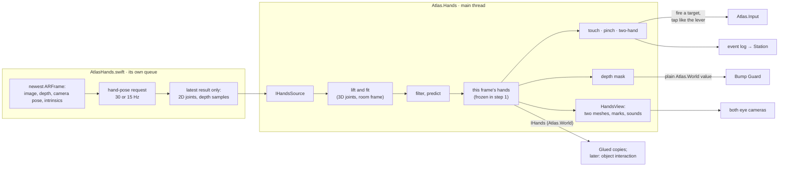
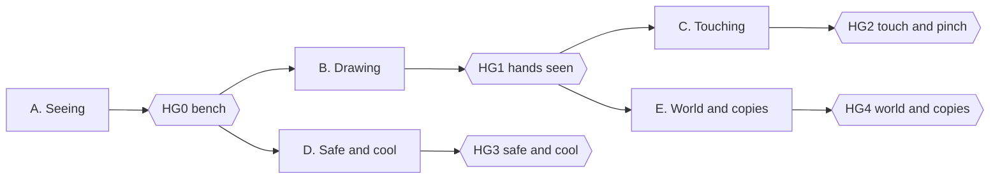

# ATLAS: Tracked Hands

**Design of one feature, end to end: see your hands in the headset and touch the world with them.**

| | |
|---|---|
| Date | 4 October 2026 |
| Status | Design. Nothing in this document is implemented |
| Written against | `main` at `e56b23f` |
| Scope | The phone app (`ATLAS/`). The Station gets events only |
| How it is built | One new module, `Atlas.Hands`, plus a short list of small additive edits to existing files (§3.7). Built by one person off `main` |
| Read with | Master Plan §0.5 (rules), §4.10 (Bump Guard), §6.3 (the frame), §8 (look and budgets). The earlier, never-built hand design is in the Engineering Spec §4.5, §6.8 and §7.1 |

---

## Contents

- [0. Read me first](#0-read-me-first)
- [1. What the walker experiences](#1-what-the-walker-experiences)
- [2. What exists today](#2-what-exists-today)
- [3. Architecture](#3-architecture)
- [4. Sensing: from the camera to joints](#4-sensing-from-the-camera-to-joints)
- [5. Drawing the hands](#5-drawing-the-hands)
- [6. Interaction](#6-interaction)
- [7. Living with the rest of the app](#7-living-with-the-rest-of-the-app)
- [8. Station, events and parameters](#8-station-events-and-parameters)
- [9. Verification](#9-verification)
- [10. Build order](#10-build-order)
- [11. Risks and fallbacks](#11-risks-and-fallbacks)
- [12. Open items](#12-open-items)
- [Appendix A. Task tables for coding agents](#appendix-a-task-tables-for-coding-agents)
- [Appendix B. Constants](#appendix-b-constants)
- [Appendix C. The native interface](#appendix-c-the-native-interface)
- [Appendix D. Sources](#appendix-d-sources)
- [Appendix E. The questions and answers behind the decisions](#appendix-e-the-questions-and-answers-behind-the-decisions)

| If you want to… | Read |
|---|---|
| Know what was decided and why | §0.4, Appendix E |
| Know what the walker gets | §1 |
| Start building | §3 (architecture and the list of edits), §10 (order), Appendix A (tasks) |
| Know what must be measured on the phone first | §9.3 |
| Check the safety argument | §7.1 |
| Decide something that is still open | §12 |

---

## 0. Read me first

### 0.1 What this is

The phone sits in a strapped lens headset with its rear camera and LiDAR looking forward. Today the walker's hands do nothing: the headset view is generated, the camera picture is never shown in it, and input is the gamepad, gaze dwell and the headset lever.

This document designs tracked hands for that view. The rear camera detects the walker's hands whenever they are in its view. Each hand is drawn where the walker feels it. A fingertip presses targets, a pinch confirms what the walker looks at, a fingertip leaves a mark where it meets a surface, and the walker's copies in the Glued rooms carry the hands too. A hand that leaves the camera's view fades away.

It is a design, not a plan for the whole team. The lead builds it alone off `main`, so the feature is kept in one new module with a short, explicit list of edits to existing code. The Master Plan and the contract pages are not changed by this document; §0.5 lists what they would need.

### 0.2 The feature in six sentences

1. A native detector reads each ARKit camera frame off the main thread and returns 21 joints for up to two hands.
2. The joints are lifted to 3D with the LiDAR depth of the same frame and a hand model with fixed bone lengths, moved into room coordinates with the camera pose of that frame, then filtered and predicted to the present.
3. Each hand is a smooth mesh built in code, re-posed every frame, and drawn by both eye cameras through the app's one shader with no warp, so it sits in the real room's coordinates in every space.
4. Touch and pinch feed the existing action map as one more source beside the gamepad, gaze and lever; nothing that exists loses a route.
5. The hands are cut out of the depth image before Bump Guard reads it, and they fade out whenever Bump Guard warns.
6. Detection slows and then stops as the phone warms, before the picture loses more quality.

### 0.3 Words

"Hand" is already taken in this codebase: `DisplayMode.Hand`, `InputContext.InHand` and the boot option `-atlasHand` all mean *the phone is held in the hand*. To keep the two apart:

| Word | Meaning here |
|---|---|
| **Hands** (always plural in names) | This feature. Assembly `Atlas.Hands`, parameters `hands.*`, events `hands.*`, native functions `atlas_hands_*`. No boot option named `-atlasHands` is ever added: it is one letter from `-atlasHand` |
| In the hand, hand mode | Unchanged: the phone is held, the camera picture fills the screen (scan, onboarding) |
| Hands session | A headset session with no gamepad connected. Hands are tracked. Input is gaze dwell, the headset lever and hands |
| Pad session | A headset session with a gamepad connected. Hand tracking is off and nothing is drawn |
| Active | The detector is running (§3.5) |
| Tracked | A hand has a pose this frame, fresh or held through the grace period |
| Visible | A tracked hand is being drawn with opacity above zero |
| Capture time | The moment the camera frame behind a detection was taken |
| Lift | Turning 2D joints into 3D with depth and bone lengths |
| Reach zone | The volume in front of the walker where a hand is both comfortable and seen by the camera (§6.1) |
| Near panel | A menu or chip panel placed inside the reach zone in a hands session |
| World touch | A fingertip meeting a surface of the world: hover glow, then a contact mark |

### 0.4 What the lead decided

These came from seven rounds of questions on 4 October (Appendix E has every question and answer). The last column says where each one is carried out.

| # | Decision | Where |
|---|---|---|
| H1 | Hands appear in the headset view only. Nothing changes while the phone is in the hand | §3.5 |
| H2 | A solid, smooth, stylised hand in one neutral colour for both hands. The mesh is built in code: no model file | §5 |
| H3 | A hands session is automatic. No gamepad connected in the headset means hands are tracked; a gamepad connected means hand tracking is off and nothing is drawn | §3.5 |
| H4 | On everywhere in the headset: every space, the menu, the use cases. This replaces "only in a space that uses it" (Master Plan rule 5 and §8.6 lever 7) | §3.5, §7.3 |
| H5 | Hands add, twins stay. Every existing action keeps its gamepad route and its gaze route. Hands are one more route | §6.7 |
| H6 | First version: touch targets with a fingertip; pinch = Confirm on the target being looked at; a two-hand pinch is recognised and reported but bound to nothing; world touch (hover glow and contact mark); the walker's copies in the Glued rooms show the hands | §6, §5.6 |
| H7 | Later, not now: grabbing and moving objects, reactions per kind of object, anything bound to two-hand gestures, any hand ray. Far targets are never aimed by hand; they keep gaze dwell, the lever and pinch | §6.8 |
| H8 | Hands fade in and out at the border of the camera's view. On a brief loss the hand holds its last pose for a short grace period instead of blinking | §5.4 |
| H9 | Feedback is sound only. The phone's haptics stay reserved for Bump Guard | §6.6 |
| H10 | The hands are masked out of the depth image before Bump Guard reads it. Limits: confident detections only, nothing beyond about 0.8 m, the scanned room map is never masked | §7.1 |
| H11 | While Bump Guard warns, hands fade out and touches are suspended | §7.2 |
| H12 | Heat: hands give way first. Detection runs 30 times a second, 15 at the first ladder step, and stops at Serious | §7.3 |
| H13 | The Station gets status and events. No hands are drawn on the Spectator | §8 |
| H14 | In a hands session the menu and the prompt chips come within reach, about 0.45 m away, with rows sized for a fingertip. Gaze dwell keeps working on them | §6.1 |
| H15 | Nothing on screen teaches hands. The operator explains | §1 |
| H16 | The design is isolated: one module, few and small edits elsewhere, no split across lanes, no rewrite of the plan | §3 |

Hardware confirmed by the lead: the headset is strapped and both hands are free.

### 0.5 What this changes in the Master Plan

Nothing is edited by this document. If the feature is accepted into the plan, these lines change:

| Place | Today | Becomes |
|---|---|---|
| §0.5 rule 5 | "hand tracking is not in the Core build and no task depends on it; if the optional HoloKit spike … is ever merged, hand tracking runs only in a space that uses it" | Hands are an extra route to actions and never the only one. Hand tracking runs in every headset session that has no gamepad, and gives way first on heat |
| §8.6 lever 7 | "Hand tracking, if it is ever added, is on only in a space that uses it" | Hand tracking drops to 15 Hz at Fair and stops at Serious |
| Appendix C.3, HoloKit row | "Optional hand-tracking spike on a branch; needs iOS 18+" | Not used. Hands use Apple Vision through our own plugin (§4) |
| Appendix D.1, "Hand input" row | "Not built" | Points to this document |
| `docs/contracts/README.md` F1 table | No `Atlas.Hands` row | One row, and `Atlas.Hands` added to the App row (§3.2) |
| `docs/contracts/lane-d-link.md` §1.1 and the event table | No `hands` area, no `hands.*` events | The `hands` parameter area and the events of §8.1 |

Rules 1, 2, 3, 4 and 6 to 10 stand unchanged, and this design is checked against each in §7 and §9. Rule 10 (no camera frames are stored) holds: the detector reads each frame in memory and keeps only joint positions.

---

## 1. What the walker experiences

A hands session, as the walker lives it. The operator has said one sentence beforehand: *"Hold your hands up in front of you; you can press things with a finger, and pinching selects what you are looking at."*

1. **Headset on, no gamepad.** The room rebuilt in the diagram look, as today.
2. **Hands appear.** The walker raises their hands. As each one enters the camera's view it fades in over about a tenth of a second: a smooth, plain, light-coloured hand, in the place the real hand is felt, moving with it.
3. **The edge.** The camera sees less than the eyes do (see the figure below). A hand moved out to the side or dropped to the waist fades away before it reaches the edge of the picture. Brought back, it fades in. A hand lost for an instant (a fast flick, a moment behind the other hand) holds its last pose for a quarter of a second and then fades.
4. **Pressing.** The menu and the prompt chips are no longer a metre away. In a hands session they sit about 45 cm in front of the walker and below the line of sight, where looking at them brings the hands into the camera's view. A chip brightens as a fingertip comes near, and when the fingertip pushes through its face it clicks and fires. Gaze dwell on the same chip still works.
5. **Pinching.** Signs and beacons out in the world are too far to touch. The walker looks at one, as today, and pinches thumb to index finger: it fires at once, with no dwell wait.
6. **Touching the world.** In a space that matches the real room (Home, and the room's own walls and furniture wherever they are drawn), reaching for a wall or a table shows a soft glow under the fingertip as it comes close and a small ring where it lands. The real wall is there to be felt.
7. **The Glued rooms.** The copies of the walker carry the walker's hands. Waving shows the same wave in every copy, mirrored in the mirrored rows.
8. **Walking.** Raised hands do not set off the bump warning. If the warning does fire, for a wall or a person, the hands fade out, the chevron shows, and the hands return when the way is clear.
9. **Heat.** If the phone warms, the hands first update less often, then switch off. The operator sees why on the Console. Everything else carries on; every action still works by gaze and lever.

**Where hands can be seen.** Each eye sees about 100° across and 96° up and down (placeholder lens numbers). The rear camera is expected to see about 72° across and, in the low-resolution 16:9 video format the app selects, only about 44° up and down (57° in a 4:3 format). Neither camera number has been measured on the phone yet (§9.3).

```text
            what one eye sees: about 100° x 96°
   +-----------------------------------------------+
   |                                               |
   |          what the camera sees (16:9)          |
   |        +-----------------------------+        |
   |        |   about 72° x 44°           |        |   a hand is tracked
   |        |   hands are tracked here    |        |   only inside the
   |        +-----------------------------+        |   inner box
   |                                               |
   |   hands held here are not seen: nothing drawn |
   +-----------------------------------------------+
```

At 45 cm the camera's window is about 65 cm wide and 37 cm tall. A whole hand is about 19 cm long, so a hand pressing something must have that thing in the upper or middle part of the window. This is why near panels are placed where the walker looks down at them (§6.1), and why the choice of video format is one of the first things measured (§9.3).

---

## 2. What exists today

Facts the design stands on. Paths are under `ATLAS/Assets/Atlas/` unless they start elsewhere.

### 2.1 The view

| Fact | Where | What it means for hands |
|---|---|---|
| Two eye cameras render into two eye textures; one lens blit puts both on the screen. "No camera image, no post-processing. The AR camera only carries the pose." | `Rendering/Stereo/StereoRig.cs:10-15` | The walker cannot see their real hands. Hands must be drawn |
| Display mode is `Hand` (phone held, camera picture) or `Headset`. In `Headset` the tracked camera and its background are disabled; the AR managers keep running | `StereoRig.cs:179-187` | Hands exist only in `Headset` (H1) |
| Eye cameras: near plane 0.05 m, every layer except 23 and 30, one shared renderer, no depth or colour texture | `StereoRig.cs:22-29, 93-117` | A hand 0.2 m away is inside the clip range. Hands are drawn by the eye cameras themselves |
| Each eye's field of view is clamped to 50.28° to each side and 48° up and down. Lens numbers are Cardboard-class placeholders | `Rendering/Stereo/LensModel.cs:61-72`; `documents/ATLAS_Whats_Left.md:38-39` | The eyes see far more than the camera does |
| The eye midpoint is the tracked camera plus `IStereoRig.HeadOffset`, which is (0, 0, 0) and unmeasured | `StereoRig.cs:219-223`; `documents/ATLAS_Whats_Left.md:38` | Until it is measured, a near hand is drawn several degrees from where it is felt (§5.5) |
| Head-locked things (menu at 1.2 m, signs and cue at 1.0 m, reticle at 2.0 m) are on layer 7 and drawn after everything with no depth test | `App/Menu/MenuLayout.cs:91`; `App/Commands/SpaceSigns.cs:34-37`; `Input/GazeReticle.cs:14`; `Safety/Cue/BumpCueScheduler.cs:25` | Nothing is within reach today, and a layer-7 panel would paint over a finger in front of it |
| One surface shader. `_WarpMode` 0 means no warp; opacity is `_BaseTint.a` through an ordered dither; there is no lighting term; opaque, depth write on | `Rendering/Shaders/Resources/AtlasSurface.shader:39-42`; `AtlasCore.hlsl:9-22, 93-107, 121-143`; `AtlasWarp.hlsl:39-41` | A hand needs no new shader: no warp, dithered fade, shape shown by baked shade |
| Budgets per frame, both eyes: 300 draw calls, 500,000 triangles, 60 set-passes, 1 kB of managed allocation. Main thread 4.3 ms target, 7.5 cap | Master Plan §8.5 | Two hands must cost a few draw calls and a few thousand triangles |

### 2.2 The sensors

| Fact | Where | What it means for hands |
|---|---|---|
| The video format is the 60 Hz ARKit format with the fewest pixels (1280 × 720 expected; never logged from a phone) | `Scan/Session/ArSessionRig.cs:241-293` | A 16:9 format narrows the camera's view up and down |
| LiDAR depth: environment depth, mode Fastest, no smoothing, read every frame on the CPU as 256 × 192 floats in metres | `ArSessionRig.cs:160-173`; `Scan/Pose/ArDepthSource.cs:72-138` | Depth for the lift is already there. Its confidence image is not read today |
| ARKit re-chooses its configuration from the features requested each frame; switching the scan features off once dropped tracking to rotation only | `ArSessionRig.cs:135-153` (commit `c78365b`) | The hands feature must request no new AR feature (no person segmentation, no other depth mode) |
| No colour camera image is read in the headset today. The only reader is the object-photo capture during a scan | `Scan/Photo/ObjectPhotoCapture.cs:63-79` | The detector is the first. Whether a colour frame can be had while the tracked `Camera` is disabled is a phone check (§9.3) |
| The native `ARSession` pointer is reachable (`XRSessionSubsystem.nativePtr`) and a Swift plugin already takes it, switched off | `Scan/Routes/WallBridge.cs:82-97`; `Scan/ARKit/RoomPlan/ArKitWallBridge.cs:33-50`; `Assets/Plugins/iOS/AtlasRoomPlan.swift:96-102` | The route to `ARFrame` exists and has a pattern to copy. It has never run on a phone |
| Poses and depth carry the app clock at the moment they are read, not the camera frame's timestamp. There is no pose history | `ArDepthSource.cs:132-135` | The detector must hand over the camera pose of its own frame (§4) |
| Phones: iPhone 15 Pro Max (A) and 14 Pro Max (B), both LiDAR. Build target iOS 17.0. A commit message reports iOS 27 on a phone | Master Plan line 10, Appendix C.4; commit `295874e` | Apple Vision's hand pose request is available on the build target |

### 2.3 Input

| Fact | Where | What it means for hands |
|---|---|---|
| One action map. 17 actions and 6 axes; every one has a gamepad binding and a gaze route, checked by `InputTwins.IsComplete` | `Input/Core/InputTwins.cs:100-190` | Hands must not be needed for any of them (H5) |
| `InputSource { None, Gamepad, Gaze, Lever, Keyboard }`. The values are stable because they are written to the event log | `Input/AtlasAction.cs:22` | A new value 5 is added; none is renumbered |
| Gaze targets: at most 64, a sphere or a flat rectangle, in room coordinates or in the head's frame; dwell 0.6 to 0.8 s | `Input/Core/GazeRegistry.cs:13`; `Input/Core/GazeTypes.cs:8-74`; `Input/IAtlasInput.cs:32-38` | Pressing one with a fingertip is a point-against-shape test |
| The headset lever (a touch on the screen) fires the target under the gaze | `Input/Core/InputTwins.cs:108-110`; `GazeTypes.cs:76-85` | A pinch does exactly what the lever does |
| `IAtlasInput` has one real implementation and six test fakes | `Input/AtlasInput.cs`; six files under `Tests/` | Adding a member to it breaks seven classes. The design adds none (§3.7) |
| `Atlas.Input` references no other Atlas assembly | `Input/Atlas.Input.asmdef` | Hands call input, never the reverse |

### 2.4 Safety

| Fact | Where | What it means for hands |
|---|---|---|
| Bump Guard runs first in the frame, on the raw pose and the newest depth image. Its numbers are constants in code; it has no parameter and no off switch, and its assembly references `Atlas.World` only | Master Plan §4.10; `Safety/Core/BumpConstants.cs`; `App/Frame/FrameLoopCore.cs:280-281` | The mask must reach it as a plain `Atlas.World` value |
| Depth nearer than 0.3 m is "no return". A return more than 0.3 m nearer than the room map predicts, between 0.10 and 2.0 m above the floor, stamps a 5 cm cell that stays until it is seen empty three times or for 30 s | `BumpConstants.cs:54-63, 94` | A hand closer than 0.3 m is invisible to Bump Guard. Farther out it is an obstacle |
| WARN when clearance at the head is under 0.30 m or the path over the next 0.8 s is blocked; STRONG under 0.20 m or 0.4 s | `BumpConstants.cs:13-21` | A hand held out ahead of a walking head blocks the path (§7.1) |
| The cue is a chevron on layer 7 at 1.0 m, and haptic pulses from the phone | Master Plan §4.10; `Safety/Cue/` | Hands must never cover it (H11) and never use the haptics (H9) |

### 2.5 The frame and the wiring

| Fact | Where | What it means for hands |
|---|---|---|
| One driver runs the frame in order: sense hooks, Bump Guard, pose filter, kernel, space tick, upload hooks; then state and after-frame hooks | `App/Frame/FrameLoopCore.cs:212-355` | Hands take one sense hook, one upload hook and one after-frame hook |
| The sense hooks today are the pose pipeline, then input. A hook that throws is reported once and Bump Guard still runs | `App/AtlasApp.cs:230-237`; `FrameLoopCore.cs:241-256` | The hands hook goes between the two |
| The composition root builds everything in a fixed order and publishes services through `AtlasServices` | `App/AtlasApp.cs:159-380`; `World/Services/AtlasServices.cs` | One installer call, placed after Bump Guard is built |
| Which assembly may reference which is written in three places and tested | `docs/contracts/README.md` F1; `tools/headless/verify.py:76-95`; `Tests/Architecture/AssemblyGraphTests.cs:20-36` | A new assembly means one new row in each, and one more name in the App row |
| Parameters are declared in code through the registry and appear on the Console and the on-device menu by themselves | `Link/Params/ParamRegistry.cs`; `App/Params/AppParams.cs` | `hands.*` parameters need no Console code |
| Events go through `IEventLog` (in `Atlas.World`); the Console prints any event | `World/Services/IEventLog.cs`; `station/hub/wwwroot/js/app.js:660-714` | Hand events reach the operator with no Station change |
| Native plugins are `Assets/Plugins/iOS/Atlas*.swift` or `.mm`, called through `[DllImport("__Internal")]` under `#if UNITY_IOS && !UNITY_EDITOR`, with a neutral stand-in elsewhere | `Scan/ARKit/RoomPlan/ArKitWallBridge.cs:27-37` | The detector follows the same shape |

### 2.6 What has and has not been run

The code compiles for the phone, the Station and the Editor and passes its headless tests. Recent commits show runs on a phone (`c78365b`, `295874e`), but the lens numbers, the camera-to-eye offset, the orientation of the depth image against its intrinsics, and one render pass per eye are all still unconfirmed on a device (`docs/verification/UNITY_SIDE_BRIEF.md`). No native plugin has been proven on a phone. The hands feature adds its own list of things to measure first (§9.3) and does not assume any of these.

---

## 3. Architecture

### 3.1 One module, a few seams



Everything inside the two boxes is new. The four arrows that leave them are the seams with existing code, and each is a small additive edit listed in §3.7. Nothing existing calls into `Atlas.Hands` except the composition root, once, to install it.

### 3.2 Assemblies and folders

```text
ATLAS/Assets/Atlas/Hands/                  Atlas.Hands
  Core/        engine-free: lift, hand model, filter, visibility, gestures, touch, depth mask, mesh skinning
  Sources/     IHandsSource and its stand-ins: Null, Replay (recorded frames), Editor (mouse and keys)
  View/        HandsView: the two dynamic meshes, contact marks, sounds
  HandsInstaller.cs    the one entry point the composition root calls
ATLAS/Assets/Atlas/Hands/ARKit/            Atlas.Hands.ARKit   (Editor and iOS only)
  VisionHandsSource.cs   the phone's source: DllImport to the plugin
ATLAS/Assets/Plugins/iOS/AtlasHands.swift  the native detector
ATLAS/Assets/Atlas/World/Hands/            new files in Atlas.World: the types other assemblies may see
ATLAS/Assets/Atlas/Tests/Hands/            Atlas.Hands.Tests   (engine-free tests; picked up by tools/headless/verify.py)
```

| Assembly | May reference | Referenced by | Notes |
|---|---|---|---|
| `Atlas.Hands` | Kernel, Link (parameter types only, as a space does), World, Rendering, Input | `Atlas.App` only | No platform filter: it must compile for the phone, the Station and the Editor, because `Atlas.App` does |
| `Atlas.Hands.ARKit` | Kernel, World, Hands, AR Foundation, ARKit | Nothing. It registers itself before the scene loads, as `Atlas.Scan.ARKit` does | Editor and iOS only |
| `Atlas.World` (new folder `Hands/`) | unchanged | everyone, as today | Holds `IHands`, the joint and pose types and `DepthMask`, so that a space and Bump Guard can read hands without referencing `Atlas.Hands` |

The reference table exists in three places that must agree: `docs/contracts/README.md` (F1), `tools/headless/verify.py` (`ALLOWED`) and `Tests/Architecture/AssemblyGraphTests.cs` (`Allowed`). Each gets one new row for `Atlas.Hands`, one for `Atlas.Hands.ARKit`, and `Atlas.Hands` added to the App row. Code is C# 9 (the headless projects compile with `LangVersion 9.0`). Every new file gets its `.meta` from `tools/gen_meta.py`.

The core follows the house rule for engine-free code (contract README F2): plain classes on `Unity.Mathematics`, time passed in, no allocation per frame, so that almost all of the feature is tested without Unity and without a phone.

### 3.3 The frame: where each stage runs

The frame order is fixed by `FrameLoopCore.RunUpdate`. Hands add three hooks and change none.

| Step | What runs today | What hands add |
|---|---|---|
| (off the main thread) | ARKit delivers camera frames at 60 Hz | The native detector takes the newest frame at its own rate and keeps only its latest result |
| 1 Sense | The pose pipeline (head pose, XR Origin placed, newest depth image), then input | **`HandsSenseStep`, added between the two.** Polls the latest result; lifts, filters and predicts; runs visibility, pinch, two-hand and touch; freezes this frame's hands; hands touch and pinch to input before input's own tick; publishes the depth mask |
| 2 Bump Guard | Raw pose and depth | Reads the mask through the App's guard step (§7.1) |
| 3, 4 | Pose filter, kernel | Nothing |
| 5 Space tick | The entered space | A space may read `IHands` (Glued does, §5.6) |
| 6 Upload | The space's own upload, then the look, the rig, the signs | **`HandsUploadStep`**: skins the two meshes, sets their opacity, places contact marks and near panels |
| 7 Render | Each eye camera, then the lens blit | Hands are ordinary objects in both eyes |
| 8a State | The 202-byte `State` | Nothing. `State` is not changed |
| 8b After frame | Telemetry, menu, flow, signs | **`HandsAfterFrame`**: edge events to the event log, sounds, counters |

Input and rendering therefore see the same hands in the same frame, and Bump Guard sees the mask that belongs to the depth image it is about to read. A hook that throws in step 1 is reported once and the frame goes on (`FrameLoopCore.cs:244-256`); the hands step also treats any exception of its own as "no hands this frame", so a fault can never leave a stale hand on screen or a stale mask in front of Bump Guard.

### 3.4 Coordinate frames and time

| Frame | What it is | Used for |
|---|---|---|
| Image | Pixels of the captured camera image, origin top left | The detector's 2D joints, after undoing the detector's own orientation convention |
| Camera at capture | Unity camera space of the rear camera at capture time: x right, y up, z forward, metres | The lift. The same convention as `DepthFrame.Unproject` |
| Session | ARKit's world, in Unity's left-handed form | Carrying a pose from capture time to now: it does not move when the head moves |
| World | The room frame once a room is active (the pose pipeline moves the XR Origin so the room anchor is the origin); the session frame before that | Everything the app draws and tests. Hand joints are stored here |
| Head | The eye midpoint: the tracked camera plus `HeadOffset` | Head-locked targets; the Glued copies |

A joint goes from the picture to the room in three moves:

```text
p_camera  = unproject(pixel, depth)                         with the intrinsics of the captured frame
p_session = T_session←camera(capture) · p_camera            the camera pose of that same ARFrame, from the plugin
p_world   = T_world←session(now) · p_session                the XR Origin as the pose pipeline placed it this frame
```

The camera pose comes from the same `ARFrame` as the image and the depth, so the three always belong together; this is why the detector reads the frame natively and does not pair an image with whatever pose the main thread holds (§2.2: today's poses carry the app clock at read time, and there is no pose history). The second move makes a hand independent of head motion: turning the head between capture and display does not drag the hand with it. What remains is the hand's own motion during the delay, which the filter's prediction covers (§4).

**Time.** The plugin reports, with each result, how old its frame was when the result was polled (both measured on ARKit's clock). The sense step sets `capture time = frame.Time − age` on the app clock. No clock is synchronised and nothing else in the app changes.

**The eyes are not the camera.** A hand is placed in the room from what the camera saw, and drawn from where the eyes are. Those differ by `HeadOffset`, which is zero today. §5.5 makes measuring it the first thing that is done once a hand is on screen.

### 3.5 When hands run: the session gate

The detector is **active** only while every row holds. The gate is evaluated in the sense step, every frame.

| Condition | Read from | Reason |
|---|---|---|
| The display mode is `Headset` | `IStereoRig.Mode` | H1. In the hand, the walker's hands are holding the phone |
| No gamepad is connected | `IAtlasInput.GamepadPresent`, held for 1 s before it counts | H3 |
| `hands.enabled` is true | The registry | The kill switch (Console, on-device menu) |
| The hands source is available | `IHandsSource.Available` | A phone with ARKit and LiDAR; in the Editor, the mouse-and-keys stand-in |
| The head comes from the AR camera | `pose.source` | With a replayed or keyboard-driven head the physical camera no longer matches the view. (The Editor stand-in is tied to the Editor's own head and is exempt) |
| The quality tier is Nominal, High or Fair | `FrameContext.Tier` | H12 |

| Tier | Detector |
|---|---|
| Nominal, High | 30 times a second |
| Fair | 15 times a second |
| Serious, Critical | Stopped. The native queue is idle and no frame is read |

A hand is **visible** when the detector is active, the hand is tracked, and Bump Guard's level is `Clear` (H11; a lost ARKit tracking state raises the level, so it hides hands too). Leaving the active state stops the native detector, so an inactive gate costs nothing. Every change of state is logged once with its reason (§8.1).

H4 says hands are on everywhere, so no space is asked whether it wants them. The gate has no per-space row.

### 3.6 The types other code may see

These go in `Atlas.World` (new folder `World/Hands/`), beside `IDepthSource` and `SensorFrame`, so that a space and Bump Guard can use them without referencing `Atlas.Hands`. Names are binding; bodies are free.

```csharp
namespace Atlas.World
{
    public enum HandSide : byte { Left = 0, Right = 1 }

    /// <summary>The 21 joints: the wrist, then each finger from its base to its tip.</summary>
    public enum HandJoint : byte
    {
        Wrist = 0,
        ThumbCmc = 1,  ThumbMcp = 2,   ThumbIp = 3,    ThumbTip = 4,
        IndexMcp = 5,  IndexPip = 6,   IndexDip = 7,   IndexTip = 8,
        MiddleMcp = 9, MiddlePip = 10, MiddleDip = 11, MiddleTip = 12,
        RingMcp = 13,  RingPip = 14,   RingDip = 15,   RingTip = 16,
        LittleMcp = 17, LittlePip = 18, LittleDip = 19, LittleTip = 20
    }

    /// <summary>One hand in one frame. Valid from step 1 of a frame until step 1 of the next.</summary>
    public struct HandPose
    {
        public bool Tracked;       // a pose exists: fresh, or held through the grace period
        public float Confidence;   // 0..1; touch and the depth mask gate on it
        public float Opacity;      // 0..1; what is drawn (enter, exit, edge, warning)
        public float AgeSeconds;   // now minus the capture time of the detection behind the pose
        public float Scale;        // this walker's hand size relative to the template
        public float3 PalmCentre;  // world, metres
        public float3 PalmNormal;  // world, unit, out of the palm
        public float Pinch;        // 0 open .. 1 closed
        public bool Pinching;      // after hysteresis
    }

    public struct TwoHandPinch
    {
        public bool Active;        // both hands are pinching
        public float Distance;     // metres between the two pinch points
        public float Angle;        // radians: the line between them, about the view axis; continuous while Active
        public float3 Midpoint;    // world
    }

    public interface IHands
    {
        /// <summary>The detector is running (section 3.5).</summary>
        bool Active { get; }
        ref readonly HandPose Pose(HandSide side);
        /// <summary>World, metres. Meaningful while Pose(side).Tracked.</summary>
        float3 Joint(HandSide side, HandJoint joint);
        ref readonly TwoHandPinch TwoHand { get; }
        /// <summary>Hides both hands and suspends touch until the next frame. For a space that cannot show them correctly this frame.</summary>
        void HideThisFrame();
    }

    /// <summary>Where the walker's hands are in the depth image Bump Guard is about to read (section 7.1).</summary>
    public struct DepthMask { /* up to two hands: a box and a forearm strip in depth pixels, and a depth gate each */ }

    /// <summary>Whether panels should sit within reach, and where (section 6.1).</summary>
    public interface IReachLayout
    {
        bool Near { get; }
        /// <summary>Room-frame pose of the near anchor: its origin is the panel centre, +z points away from the walker.</summary>
        float3 Position { get; }
        quaternion Rotation { get; }
        /// <summary>Multiplies a panel's own layout, which was made for its usual distance.</summary>
        float Scale { get; }
    }
}
```

`IHands` and `IReachLayout` are published through `AtlasServices`. Code that wants hands asks with `AtlasServices.TryGet<IHands>` and carries on without them when the answer is no, which is what happens on the Station, in a pad session's first frame, and in every test that does not install them.

### 3.7 Every edit to existing code

New files are not listed here: they are the folders of §3.2 and their tests. This table is the whole footprint in files that exist today. All edits are additions; nothing existing changes meaning when hands are absent.

| # | File | Edit | Why |
|---|---|---|---|
| E1 | `App/Atlas.App.asmdef` | Reference `Atlas.Hands` | The composition root installs it |
| E2 | `docs/contracts/README.md` (F1 table), `tools/headless/verify.py` (`ALLOWED`), `Tests/Architecture/AssemblyGraphTests.cs` (`Allowed`) | A row for `Atlas.Hands` and one for `Atlas.Hands.ARKit`; `Atlas.Hands` added to the App row | The three copies of the reference table must agree, and a test reads two of them |
| E3 | `App/AtlasApp.cs` | Call `HandsInstaller.Install` just before the line that adds `InputSenseStep` (so the hands sense step runs between the pose pipeline and input); add the upload hook after `RigUploadStep`; hand the Bump Guard step the mask source; a `Hands` property; stop hands in `Shutdown` before `Pose.Dispose()` | Wiring. The installer is given what it may not reference itself as plain delegates: "is Bump Guard warning", "which pose source is live" |
| E4 | `World/Pose/SensorFrame.cs` | One new field, `public DepthMask Mask;` (empty by default) | The mask travels to Bump Guard inside the value it already receives |
| E5 | `App/Frame/FrameSteps.cs` (`BumpGuardStep`) | Copy the sensor frame, set its `Mask` from the hands module when there is one, and pass the copy to `IBumpGuard.Tick` | Safety stays unaware of where the mask came from |
| E6 | `Safety/Core/BumpDepthKernel.cs`, `BumpDepthJob.cs`, `BumpGuardCore.cs`, `BumpConstants.cs` | The depth loop skips samples inside the mask, and forgets very young dynamic cells under them (§7.1). The mask's hard limits are constants beside the others | H10 |
| E7 | `Input/AtlasAction.cs` | `InputSource.Hands = 5` | A source for the event log. No existing value moves |
| E8 | `Input/Core/AtlasInputCore.cs` | `RawInput` gains the fingertips and the pinch edge of this frame; `Tick` runs the touch state machine (new file `Input/Core/HandsTouch.cs`) against the registered targets and fires through the same `Fire` as gaze and lever | Touch and pinch become twins of dwell and lever by construction (§6) |
| E9 | `Input/AtlasInput.cs` | Implements a new small interface `IHandsInput` (new file): `SetHands(...)` before the tick, hover and press state back after it | `IAtlasInput` itself gains no member, so its six test fakes are untouched |
| E10 | `App/Menu/MenuView.cs` and `OnDeviceMenu.cs`; `App/Commands/SpaceSigns.cs` and its view; the Playground's `PromptChip` and caption views; the dial chips of `Spaces/CurvedWalk` and `Spaces/SmallPlanet` | Each asks `IReachLayout` where to put itself. When `Near` is true it uses the near anchor and scale and draws depth-tested instead of on the always-on-top HUD layer | H14 |
| E11 | `App/Menu/MenuModel.cs` | `"hands.enabled"` added to `KillSwitchIds` | Reachable from the on-device menu with the Station off |
| E12 | `Spaces/Glued/GluedSpace.cs`, `GluedMeshes.cs` | The avatar mesh carries two simple hands when `IHands` reports them (§5.6) | H6 |
| E13 | `Editor/AtlasUsageText.cs` | The camera usage text mentions hands | The privacy string should say what the camera is used for |
| E14 | Tests that mirror the composition root: `Tests/App/BootstrapUnityTests.cs`, `Tests/App/E2E/RehearsalRig.cs` | Expect the `IHands` service; add the hands step to the rehearsal | So the end-to-end tests run with hands present |
| E15 | `docs/contracts/lane-d-link.md` (parameter areas, event table), `docs/contracts/lane-c-room.md` (input sources) | The `hands` area, the events of §8.1, the new source | Documents kept in step with code |
| O1 (optional) | `Spaces/Portal/PortalSpace.cs` | Call `IHands.HideThisFrame()` while a doorway's box mask covers an eye | Removes the one-eye flaw of §7.4 |
| O2 (optional) | `station/hub/wwwroot/js/app.js` | Fold `hands.on/off/enter/exit` into a status tile | A nicer Console; no message changes |

Three of these touch code that other people are changing quickly: `AtlasApp.cs`, `AtlasInputCore.cs` and the Playground views. They are kept to a few lines each for that reason, and E3 is one block.

---

## 4. Sensing: from the camera to joints

### 4.1 The detector

**Apple Vision's hand-pose request** (`VNDetectHumanHandPoseRequest`), run by our own Swift plugin on the camera frames ARKit already produces.

| Why | |
|---|---|
| It needs nothing new | Part of iOS since version 14; left and right since 15; choice of compute device since 17, the build target. No package, no model file, no licence question |
| It does not fight ARKit for the camera | It reads the pixel buffer of ARKit's own frame. Detectors that open the camera themselves cannot run beside an AR session |
| It asks ARKit for nothing | No person segmentation, no extra depth mode. §2.2: any new AR feature request can change ARKit's configuration |
| It returns what the lift needs | 21 joints per hand as image points with a confidence each, for up to two hands |
| It was the earlier design's choice | Spec §7.1, with a cost estimate of about 19 ms on the 15 Pro and 25 ms on the 14 Pro |

What it does not give is depth: its joints are points in the picture. §4.3 adds the third dimension from LiDAR and a hand model. That is the weakest link of the whole feature, so the detector sits behind `IHandsSource` and the lift accepts a source that brings its own per-joint depth. If the bench (§9.3) shows fingertip depth is not good enough to press with, the fallback is a learned 3D detector (MediaPipe's hand landmarker, as a native framework fed the same pixel buffer) behind the same interface; everything after the lift is unchanged. That fallback is not designed here.

HoloKit's SDK, named in the plan as an optional spike, is not used: it would add a dependency to do what one Swift file does.

### 4.2 The native side

One file, `Assets/Plugins/iOS/AtlasHands.swift`, following `AtlasRoomPlan.swift`: functions exported with `@_cdecl`, called from C# through `[DllImport("__Internal")]` under `#if UNITY_IOS && !UNITY_EDITOR`. Appendix C has the exact interface.

1. **Start.** C# passes `XRSessionSubsystem.nativePtr` (the same pointer and struct the RoomPlan bridge uses) and a rate. The plugin keeps an unretained reference to the `ARSession` and never configures, runs or pauses it.
2. **Its own serial queue and a timer at the requested rate.** On each tick, if the previous request is still running the tick is skipped and counted. Otherwise the plugin reads `session.currentFrame`. A frame with the same timestamp as the last one processed is skipped.
3. **One request per tick.** `VNImageRequestHandler` on the frame's `capturedImage`, orientation `up` (the app is fixed to landscape left, which is the sensor's own orientation), `maximumHandCount = 2`, compute device left to the bench to choose.
4. **Depth sampling, while the frame is in hand.** For every joint: the median of the 3 × 3 depth pixels around it, their spread, and the lowest confidence among them. For each hand's palm: up to 64 depth samples spread over the quadrilateral wrist, index knuckle, little-finger knuckle and thumb base, high confidence only.
5. **Publish and let go.** The result is written into a back buffer and swapped under a lock. The frame, the pixel buffer and the depth buffers are released before the tick returns. Nothing is kept from one tick to the next except the last timestamp. No image is ever copied, stored or sent (rule 10).
6. **Poll.** C# calls `atlas_hands_poll` once per frame from the sense step. It copies the newest result if there is a new one and returns at once either way. The main thread never waits for the detector.

Each result carries the camera pose, intrinsics and timestamp of its own frame, and the time on the same clock when it was polled (§3.4).

**Rate.** C# sets 30, 15 or 5 Hz, or 0 to idle. At 0 the timer is cancelled and the plugin does nothing.

**When things go wrong.** No session pointer, no frame for 2 s, or a request that throws: the plugin returns a negative code from `poll`, the sense step treats it as "no hands", logs `hands.fault` once, and tries `start` again after 5 s. A session interruption or relocalisation needs no handling of its own: frames stop or jump, hands are lost for a moment and come back through the normal enter path.

### 4.3 The lift: from 21 points in a picture to 21 points in the room

Engine-free (`Hands/Core/HandsLift.cs`), tested on recorded and synthetic frames. Per hand, per detection:

**1. Reject early.** Fewer than 12 joints above confidence 0.3, or the wrist and all four knuckles below it: no hand.

**2. Find the palm in depth.** Fit a plane to the palm's depth samples (least squares, one pass of outlier rejection at 2.5 cm). The fit is valid with at least 12 samples left and a distance to the plane's centre between 0.32 m and 0.90 m. A valid fit gives the palm's distance and its tilt directly from LiDAR, which is the most trustworthy depth there is on a hand: the palm is its largest flat area.

**3. If the plane is not valid** (hand nearer than LiDAR's range, low confidence, no depth in the frame): distance from the hand's known size. Two spans are measured in the picture, the palm's width (index knuckle to little-finger knuckle) and its length (wrist to middle knuckle). Each gives `distance = focal length × true span ÷ span in pixels`. Tilt can only shorten a span in the picture, which makes that estimate too far, so the smaller of the two estimates is taken. The palm's tilt is carried over from the last valid fit, or assumed to face the camera. Confidence is capped at 0.5 in this branch, which is below what touch and the mask require.

**4. Place the palm.** The wrist, the four knuckles and the thumb base are put where their rays meet the palm plane.

**5. Raise the fingers, bone by bone.** For each finger from knuckle to tip, and the thumb from its base: the child joint lies on its ray from the camera, at the bone's known length from its parent. That is a quadratic with two answers, one nearer the camera and one farther. If it has none (noise made the bone look longer than it is), take the point on the ray closest to the parent. To choose between two answers, score each and take the lower:

| Evidence | Score |
|---|---|
| LiDAR at the joint, when its 3 × 3 spread is under 3 cm and confidence is not low | Distance of the answer from the measured depth, when the two answers differ by more than 2 cm |
| The last frame | Distance from where this joint was, in the palm's own frame |
| Anatomy | A penalty for bending a finger backwards past 20°, and for a first bone that rises out of the back of the hand |
| No evidence at all | The answer that keeps the finger straighter |

The eight combinations of a finger's three bones are scored together and the best chain wins. Fingertips are never placed by LiDAR alone: a depth pixel at a fingertip is as likely to be the wall behind it.

**6. Measure the hand.** Whenever the palm plane is valid and nearly square to the camera, the two palm spans are measured in metres and fed to a running median. Its ratio to the template is the walker's `Scale`, clamped to 0.80 to 1.25 and shared by both hands. Bone lengths in step 5 are the template's times this scale. Until 30 good measurements exist the scale is 1.

**7. Into the room.** Camera space at capture, then session, then world, as in §3.4.

**What accuracy to expect.** Sideways, a joint is as good as the detector: a few millimetres at 45 cm. In depth, the palm is as good as LiDAR, about a centimetre. A fingertip's depth depends on the finger's direction: for a finger pointing away from the camera the bone lengths fix it well; for a finger lying across the picture, small errors in the picture become one to two centimetres in depth per bone. The design assumes **fingertip depth is right to about 2 to 3 cm**, and §6 is built to tolerate exactly that. This number is the first thing the bench replaces with a measurement.

### 4.4 Filtering, prediction and loss

Detections arrive 30 or 15 times a second, about 70 to 110 ms after the light hit the sensor (exposure, ARKit's delivery, the wait for a timer tick, the request itself, the wait for the next frame, then display). Frames are drawn 60 times a second. Engine-free, in `Hands/Core/HandsFilter.cs`:

1. **Associate.** Each detection is matched to the existing hand whose predicted palm is nearest, within 20 cm. Otherwise it starts a new hand.
2. **Filter.** A One-Euro filter (Casiez et al., 2012) on the palm's position and orientation in the room frame, and a second one on each finger joint in the palm's own frame. Filtering in the room frame means head motion is not smoothed, only hand motion; filtering fingers relative to the palm means a moving hand does not smear its fingers.
3. **Predict.** Each drawn frame shows the palm moved along its filtered velocity by the result's age, limited to 50 ms. Fingers are not predicted. On a recorded session this must give a smaller error against the later detections than no prediction, or it is switched off (§9.1).
4. **Brief loss.** A hand missing from a result keeps its pose, coasting on a velocity that decays in 0.1 s. After 0.10 s it starts to fade; at 0.25 s it is no longer tracked (H8). If it comes back within that time and within 15 cm, the filter carries on; otherwise it restarts.
5. **Left and right.** Vision labels each hand, and the label can be wrong for a frame. A hand's side is the majority of its last 15 labels, and two hands never share a side: the one with the weaker vote takes the other. Because both hands are one colour and the mesh is drawn two-sided (§5.2), a wrong side for a few frames changes nothing a walker can see.
6. **Confidence.** The lowest of: the mean joint confidence, 1 when the palm plane was valid and 0.5 when not, a term that falls as the lift's bones had to be stretched, and a term that falls as the palm nears the picture's border.
7. **Too far to be the walker.** A hand whose palm is more than 0.9 m from the camera is ignored. It is someone else's.

### 4.5 Sources off the phone

```csharp
public interface IHandsSource
{
    bool Available { get; }
    void SetRate(int hz);                               // 30, 15, 5, 0
    bool TryRead(out HandsDetection detection);         // the newest result once; false when nothing is new
    void Stop();
}
```

| Source | Where | What it is for |
|---|---|---|
| `VisionHandsSource` | `Atlas.Hands.ARKit`, the phone | The plugin of §4.2 |
| `NullHandsSource` | Everywhere else by default | `Available` is false. The Station and any phone without LiDAR |
| `ReplayHandsSource` | Tests, and the Editor on request | Plays a recorded hand log (below) against the clock it is given. The headless tests of the lift, the filter, touch and the mask run on it |
| `EditorHandsSource` | The Editor | Two hands driven by mouse and keys: the mouse moves the active hand across the view, the wheel moves it nearer and farther, keys choose the hand and a pose (open, pointing, pinch, fist). It produces picture points and depths through made-up intrinsics, so the real lift runs on them. Rule "Editor first" (contract README F9) |

`Atlas.Hands.ARKit` announces its source from a method marked `RuntimeInitializeOnLoadMethod(BeforeSceneLoad)` into a static slot in `Atlas.Hands`, the way `ArKitWallBridge` registers with `WallBridge`.

**The hand log.** `ATLAS-HANDLOG 1`: a text header, then one binary record per detection, exactly the fields of the native result plus the head pose of the frame that polled it. It is written on the phone only when the developer parameter `hands.record` is on, by a writer thread fed from a ring so the frame never waits for storage (the pose-log recorder already works this way). It holds joint positions and depths and no image, so rule 10 holds; like a pose log it is motion data of a person and is recorded only with their consent (`recordings/README.md`). A synthetic generator produces the fixtures committed to `recordings/`, and a test checks that each committed file equals what the generator writes, as the pose logs do.

---

## 5. Drawing the hands

### 5.1 The mesh

A hand is generated once at boot from a table of dimensions; nothing is loaded from disk (H2).

| Part | How it is made | Size |
|---|---|---|
| Four fingers | A tube of 8 sides with a ring just before and just after each joint, tapering from knuckle to tip, closed with a rounded cap | About 104 triangles each |
| Thumb | The same, from its base | About 104 triangles |
| Palm | A slab: an outline through the wrist's two corners, the thumb base and the four knuckles, given the hand's thickness with a bevelled rim. The finger tubes start inside it, so no seam needs stitching | About 100 triangles |
| Wrist cuff | A short elliptical tube closing the hand behind the wrist. The forearm is not drawn: nothing tracks the elbow | About 60 triangles |
| **One hand** | | **About 700 triangles, 450 vertices** |

The template is a right hand; the left is its mirror. Template dimensions (bone lengths, radii, palm outline) are adult averages listed in Appendix B and scaled by the walker's measured `Scale`.

### 5.2 Posing it: skinning in code

Every vertex belongs to one bone, or to two near a joint with weights that sum to one, and stores its position in that bone's own frame. Each frame, in a Burst job in the upload step (`Hands/Core/HandsSkin.cs`, engine-free apart from the job wrapper):

1. **A frame per bone, from joint positions alone.** The detector gives no rotations, so they are built. A bone's axis runs from its joint to the next. For the first bone of each finger the "up" direction is the palm's normal made perpendicular to the axis. For each later bone the frame is the previous one turned by the smallest rotation that takes the old axis to the new: fingers bend but do not twist, so this is what a real finger does. The thumb starts from the palm's normal turned 60° about the line from the wrist to the index knuckle.
2. **Rings land on joints.** A vertex's position along its bone is scaled by the measured distance between the two joints over the template's, so a slightly long or short bone from a noisy lift moves the ring and does not tear the mesh.
3. **Blend, shade, write.** Position is the weighted sum over its bones. The normal is rotated the same way and gives the vertex its baked shade from the look's own light direction, exactly as the Slicer shades its moving cross-section on the CPU (`SlicerMeshKernel.ShadeTwoSided`). That is how a one-colour hand under a shader with no lighting still reads as a rounded shape.
4. **Upload.** `AtlasMesh.Upload` into a mesh made once with `AtlasMesh.CreateDynamic`, with bounds taken from the joints plus the largest radius. No allocation.

Two meshes, one per hand, each on its own `MeshRenderer` under an object that is never a child of room content, a room piece or a space's root (in Impossible Rooms those subtrees are re-layered and switched off as rooms change).

### 5.3 Material and look

| Setting | Value | Reason |
|---|---|---|
| Shader and material | `Atlas/Surface`, one material per hand rented from `MaterialPool` | Rule 8: one shader, pooled materials, no property blocks. Two materials because each hand fades by itself |
| Layer | 0 (the world) | Depth-tested against the world and against near panels |
| `_WarpMode` | 0 | Room coordinates, no warp (§7.4) |
| Fog weight, fade weight | 0, 0 | Never fogged (Glued's fog can start half a metre out); stays visible through a space switch |
| Near fade | 0.12 m | The part of a hand closer to an eye than this dissolves by dither, so nothing is sliced by the near plane at 5 cm |
| Cull | Off | Both faces drawn, so a hand labelled as the wrong side never shows a hole |
| Colour | Palette cell `AvatarBody`, tint (1, 1, 1) to start | One neutral colour (H2). The tint is the knob if it reads too dark or too light against a space |
| Lines | None | A plain surface |
| Opacity | `_BaseTint.a`, set every frame from `HandPose.Opacity` | The shader's ordered dither. No blending, no sorting |

### 5.4 Appearing and disappearing

A hand's opacity is the smallest of five factors, each a ramp so that nothing pops (H8):

| Factor | Rises to 1 | Falls to 0 |
|---|---|---|
| Presence | Over 0.12 s, once the hand has been detected twice running with confidence at least 0.5 | Over 0.15 s, starting 0.10 s into a loss (§4.4) or when confidence drops below 0.3 |
| Edge of the camera's view | As the palm's centre moves more than 8 % of the picture's height inside the border | To 0 at the border itself |
| Bump Guard | 0.3 s after the level returns to `Clear` | Over 0.1 s when the level leaves `Clear` (H11) |
| Gate | When active | Over 0.2 s when the gate goes inactive, before the detector stops |
| `HideThisFrame` | Next frame | At once |

The edge factor is why a hand never ends in a hard cut where the camera's view ends: it has already faded.

### 5.5 Putting the hand where it is felt

A hand's place in the room comes from the camera. What the walker sees is drawn from the eyes, which are `HeadOffset` away from the camera, and `HeadOffset` is zero today. On these phones in landscape the rear cameras sit towards one end, several centimetres to the side of the screen's centre and several in front of the eyes. For a hand at 45 cm, each centimetre of error in that offset moves the drawn hand about 1.3° from the felt one. Far content hides this. A hand does not.

1. **Start from geometry.** Before the first hands session, set `render.headOffsetX/Y/Z` from a ruler: the distance from the main rear camera's lens to the midpoint between the headset's lenses, sideways and up, and the distance from the phone's back to the eyes. One set of numbers per phone.
2. **Check with the hand itself.** In Home, touch a real edge whose virtual twin is on screen: a table corner. Adjust the three numbers from the Console until the drawn fingertip meets the drawn corner when the real fingertip meets the real one, at three places. This is the wall test of task P1-C07 done with a finger, and it settles the camera-to-eye offset for everything else in the app too.
3. **Pass mark.** The drawn fingertip within 2 cm of the virtual corner at each of three touch points (§9.4).

### 5.6 The copies in the Glued rooms

Every copy of the walker is one shared avatar mesh (a head, a torso, shoulders and upper arms in a left and a right colour; about 182 triangles of a 600 budget), drawn once per copy per eye, turned by the walker's heading and mirrored in the mirrored rows.

- The avatar mesh becomes a dynamic mesh. Each frame `GluedSpace` appends two simple hands to it when `IHands` has them: for each hand a palm box and five fingers of three four-sided segments, and one box as a forearm from the avatar's elbow to the wrist. About 170 triangles per hand; the avatar stays under 600.
- The joints are expressed in the avatar's own frame: relative to the head and turned back by the walker's heading. Every copy then shows them through its own transform, so mirrored copies wave the other hand with no extra work.
- Draw calls do not change: the hands ride in the avatar's draw.
- The copies' hands take the avatar's left and right arm colours, not the neutral colour of the walker's own hands, so the mirror image is visible on them. (H2's "one neutral colour" was asked about the walker's own hands; §12 lists this as the lead's to overrule.)
- When a hand is not tracked its triangles collapse to nothing. The Playground's Glued exhibit already tells the walker to "turn round and wave"; with this the copies do.

### 5.7 Cost

| | Per frame, both eyes | Budget |
|---|---|---|
| Draw calls: two hands | 4 | 300 |
| Draw calls: contact marks | Up to 4 | |
| Triangles: two hands | About 2,800 | 500,000 |
| Triangles: Glued copies' hands at 5 × 5 | About 16,300 more inside the existing avatar draws | S1 row: 250,000 |
| Pooled materials | 2 for hands, 1 for marks | 256 |
| Skinning, upload | 900 vertices per frame; inside the 0.3 ms target of §7.3 | |

---

## 6. Interaction

Hands add routes to what input already does. They add no action, and every route they add ends at a target that gaze dwell can also fire (H5).

### 6.1 The reach zone and near panels

**The reach zone** is where a hand is both comfortable and seen. It is defined in the camera's frame, because the camera is what must see the hand:

| | Value | From |
|---|---|---|
| Distance from the camera | 0.35 to 0.60 m | LiDAR is valid from about 0.30 m; an arm is comfortable to about 0.60 m. The older spec's rule R4 |
| Sideways | Within 25° of the camera's axis | Inside the camera's 36° half-width with room for the hand's own width |
| Up and down | From 12° above the axis to 5° below it, in the 16:9 format | The picture ends 22° below the axis, and a pressing hand hangs about 17° below its fingertip at this distance. In a 4:3 format the lower limit becomes 10° below |

The consequence: a panel fixed in the view 25° below the line of sight, where the older spec put its interactables, would have the pressing hand half out of the camera's view in the 16:9 format. So near panels are not fixed in the view.

**Near panels are anchored to the body, and the walker looks down at them.** `IReachLayout` holds one anchor in the room frame:

- Placed `hands.reach` (0.45 m) from the head along a line 25° below the horizontal, in the direction the walker faces, tilted to face the head.
- It stays put in the room. It moves, easing over 0.3 s, only when the head has moved more than 0.25 m from where it was when the anchor was set, or the heading differs by more than 40° for more than 0.5 s.
- It never moves while a fingertip is within 15 cm of it or a press is under way.

Looking down at the panel brings it to the middle of both the view and the camera's picture, which is where the hand must be to press it. Gaze dwell works on it for the same reason.

**What goes there** in a hands session (H14): the on-device menu panel, the open-menu chip, the four space signs, the Playground's prompt chips, and the dial chips of Curved Walk and Small Planet. Each view lays itself out as today and then applies the anchor and `Scale`. The scale is 0.75: the menu's 0.70 × 0.50 m panel becomes 0.53 × 0.38 m, its rows 3 cm tall on a 3.2 cm pitch, a sign's target 10 cm across. At 0.45 m that is a larger angle than the same panel at 1.2 m, which is what a fingertip needs.

In near mode a panel is drawn on the world layer with depth testing, not on the always-on-top HUD layer, so a finger in front of it covers it and a finger pushed through it disappears behind it. Things that stay far (the reticle, the telemetry HUD, the Bump Guard cue) stay on the HUD layer and still draw over everything, hands included. For the cue that is the right way round.

With a gamepad connected, `Near` is false and every panel is exactly where it is today.

### 6.2 Touch

The touch state machine lives in `Atlas.Input` (`Input/Core/HandsTouch.cs`), beside the targets it tests and the dwell it must stay consistent with. The hands module gives input, before input's tick, each hand's index fingertip in room and head coordinates, its velocity, and the hand's confidence. Only index fingertips press. A press point 4 mm back from the tip joint stands for the pad of the finger.

For each fingertip and each enabled target of the current context within 0.75 m of the head, in the target's own frame (z is the distance in front of its face, towards the walker):

```text
OUTSIDE --(inside the outline + 1.5 cm, 0 < z <= 8 cm)--------------------------> HOVER
HOVER   --(z >= 2.5 cm seen at least once: the finger came from the front)------> ARMED
ARMED   --(z <= 0.5 cm, inside the outline + 1 cm, moving in, confidence >= 0.6)-> PRESSED : fire once
PRESSED --(z >= 3 cm, or 3 cm outside the outline)-----------------------------> OUTSIDE
any     --(hand lost, Bump Guard warning, context change)----------------------> OUTSIDE, nothing fires
```

| Rule | Why |
|---|---|
| The outline is tested generously and depth loosely | Sideways the fingertip is good to millimetres, in depth to centimetres (§4.3). The press is "inside the outline and through the face", with the face 3 cm thick |
| A press must be armed from the front | A hand passing through a panel from behind or sweeping across it sideways fires nothing |
| One target per fingertip: the one whose centre is nearest sideways | Adjacent rows cannot both fire |
| `Once` targets fire once per press. `Repeat` targets repeat at their own interval while pressed. `Hold` targets drive their axis while pressed | The three modes a gaze target already has (`GazeMode`) keep their meaning |
| Firing goes through the same `Fire` as dwell and lever, with `InputSource.Hands`, the target's action, tag and callback | This is what makes touch a twin of dwell |
| A fired target's dwell progress is reset | No second firing from the gaze that was resting on it |
| `LookDown` targets and targets farther than 0.75 m are never candidates | They cannot be touched |

**What the walker sees and hears.** The target's owner does not change. The hands view draws a small ring on the target's face under the fingertip from the moment of hover, shrinking and brightening as the finger comes in, and flashing on the press; the press plays a click (§6.6). The ring is one of the marks of §6.5.

Any gaze target that happens to be within reach is touchable by the same rule with no change to its owner: the Slicer's handles and chips, once the walker has walked up to them, are an example.

### 6.3 Pinch

A pinch confirms what the walker is looking at. It is the headset lever done with fingers.

- **Measure.** The gap between thumb tip and index tip, taken in the picture and scaled to metres at the palm's distance (so that it does not depend on two noisy fingertip depths), divided by the palm's width.
- **Close** when the measure is under 0.25 for three detections running. **Open** when it is over 0.40. These are the older spec's numbers.
- **Fire on closing**, once: input treats it as a lever tap with `InputSource.Hands`. The target under the gaze fires; with nothing under the gaze, `Confirm` fires, as it does for the lever.
- **Not while touching.** A hand whose index fingertip is hovering a target does not pinch. Touch wins.
- **Not in the first 0.3 s** after a hand appears, not above 1 m/s of hand speed, not within 0.4 s of that hand's last pinch, not below confidence 0.6.
- Either hand.

Gaze with pinch matched button clicks for speed in the study the hands-free memo cites, where dwell was slowest. This is the low-effort route in a hands session: far targets need no reach and no wait.

### 6.4 Two hands

When both hands are pinching, `TwoHandPinch.Active` is true and the module reports the distance between the two pinch points, the angle of the line between them about the view axis (unwrapped, so a full turn reads as 2π), and their midpoint. A `hands.two` event marks the start and the end. **Nothing is bound to it** (H6): no space reads it yet. The first hand's pinch has already fired its `Confirm` when the second closes; the second fires nothing.

### 6.5 World touch

A hover glow as a fingertip nears a surface, and a contact mark where it lands.

**Which surfaces.** Only surfaces whose place is known without reading the picture back (the render rules forbid sampling depth):

| Space | Surfaces in the first version |
|---|---|
| Home; and any space that is registered to the real room while it shows the room (Glued, Aligned Cells, Impossible Rooms' own room, the Slicer) | The room model's walls (with their openings left out), the floor, and the furniture boxes. These are where the real things are, so the finger really stops there |
| Curved Walk and Small Planet once the walker has moved | None. Their walls are not real walls, and the content near the head is faded out by design |
| Anything else | A space may publish `IHandsSurface` (one method: the closest surface point and normal to a given point). None does yet (H7) |

**The test.** For each index fingertip: the closest point on those surfaces, analytically (planes and boxes; a few dozen at most).

| Distance to the surface | Drawn |
|---|---|
| Under 8 cm | Glow: a soft disc on the surface at the closest point, growing from 1 to 3 cm across and brightening as the finger closes in |
| Under 1.5 cm | Contact: a ring 3 cm across, and a soft tap sound on the first frame |
| After leaving | The ring fades over 0.4 s |

**How they are drawn.** One small disc mesh per fingertip, laid on the surface 2 mm proud of it, an emissive palette cell on a pooled `Atlas/Surface` material, opacity by dither. The touch ring of §6.2 is the same object on a target's face. At most two exist.

A side effect worth having: in Home, the gap between the drawn fingertip and the mark it leaves on a real wall is the registration error of scan plus hands, visible at a glance.

### 6.6 Sound

Three short sounds made in code at boot, as the Bump Guard cue makes its own: a click for a press, a softer tap for a contact, a two-note tick for a pinch. They play from one audio source at the head, quietly. They must not be mistakable for Bump Guard's tick and tone; that is checked by ear on the phone (§9.4). `hands.sound` turns them off. The phone's haptics are never used (H9).

### 6.7 Who fires what

| Situation | Result |
|---|---|
| Bump Guard level is not `Clear` | Hands fire nothing. Gaze, lever and gamepad work as always |
| A fingertip presses a target while the gaze dwells on it | One firing, from the touch. The dwell resets |
| A pinch closes while the same hand hovers a target | Nothing. Touch has priority |
| A pinch closes with the gaze on a target | The target fires, source `Hands` |
| The lever is tapped | As today |
| A gamepad is connected | No hands at all (H3) |

The twin table (`InputTwins`) does not change and its test (`IsComplete`) keeps passing: hands are not a column in it. A hand reaches an action only by firing a gaze target or `Confirm`, so every hand route has a gaze route by construction, and every action keeps its gamepad route. Rule 5 holds.

### 6.8 What is left for later

Object interaction (H7) will build on what the first version publishes and needs no change to it:

- `IHands`: joints, palm, pinch, two-hand pinch, for any space to read in its tick.
- `IHandsSurface`: a space's own touchable surfaces.
- `HideThisFrame`: a space's veto.

The older spec's robustness rules for hand techniques (Spec §6.8, R1 to R7) are the starting point for that work: hands give clutches and short relative strokes, changes count only while a pinch is held so that lost frames pause and do not jump, and every technique keeps a twin.

---

## 7. Living with the rest of the app

### 7.1 Bump Guard: masking the hands out

**The problem, from the code.** Bump Guard samples every fourth depth pixel. A return between 0.3 and 5 m that is more than 0.3 m nearer than the room map predicts, between 0.10 and 2.0 m above the floor, stamps a 5 cm cell of the dynamic layer; the cell stays until three later images see through it or 30 s pass. The level is WARN when the head is within 0.30 m of a cell or the path of the next 0.8 s runs into one. A hand held 0.3 to 0.6 m ahead of a walking head is such a return, in the head's path. (A replay of the logic by an exploration agent gives WARN at 0.5 m/s and STRONG at 1 m/s for a hand 0.4 to 0.5 m ahead; a headless test must reproduce this before the fix is written, §9.1.)

**The mask** (`DepthMask`, built in the hands sense step for the depth image of this frame):

| Element | Definition |
|---|---|
| Whose hands | Hands that are tracked with confidence at least 0.6 from a detection no older than 0.2 s. At most two |
| Where it is computed | From the hand's predicted joints now, projected into this frame's depth image with the depth frame's own intrinsics and camera pose. It is therefore aligned with the image Bump Guard reads, up to prediction error |
| Hand region | The bounding box of the 21 projected joints, grown by 35 % of its longer side, and by the hand's speed in the picture times the result's age (at most 20 depth pixels) |
| Forearm region | A strip from the wrist, away from the fingers, to the border of the image; as wide as 1.2 palm widths plus the same growth |
| Depth gate | A sample inside a region is masked only if its depth is at most the palm's depth + 0.20 m, and never beyond 0.80 m. Anything farther is left alone, whatever its position in the picture |
| Size limit | If the two hands' regions cover more than 35 % of the image, the mask is dropped for that frame |
| Lifetime | From the first qualifying detection, through the grace period of a brief loss, plus 0.15 s |

**What Bump Guard does with it** (the only change inside `Atlas.Safety`): in the depth loop, a sample that falls in the mask

1. is left out of the seven sectors, the dynamic layer and the rescan check, as if it had no return; and
2. if a dynamic cell lies where that sample points and the cell's last hit is less than 1 s old, the cell is forgotten. This removes the cells the hand itself stamped in the tenth of a second before it was detected. A cell older than a second is never touched by this rule.

The static room map is not involved at any point. An empty mask leaves every result bit for bit as it is today.

**The safety case.**

| How the mask could hide a hazard | What bounds it |
|---|---|
| A wrong detection: something that is not a hand is masked | Confidence gate, the 0.80 m cap, the depth gate (only what is at the "hand's" own depth), the 35 % limit. What remains is an object the size of a hand within arm's reach that the detector is confident is a hand |
| A real obstacle directly behind the hand | Not masked: it is deeper than the gate. The hand hides it from LiDAR whether or not there is a mask |
| A hand resting on a real, unscanned obstacle | Samples on the hand and within 20 cm behind it are masked inside the hand's region only. The rest of the obstacle is outside the region and still stamps cells. Its older cells are kept (rule 2 only forgets cells under a second old) |
| Another person's hand close to the camera | Masked if within 0.80 m and confidently a hand. Their arm and body are not |
| Scanned walls and furniture | Unaffected. They are in the static map |
| Stale mask after the hand has gone | Lifetime at most 0.4 s past the last detection |
| A fault in the hands module | The App's guard step passes an empty mask when the hands step threw this frame or has no fresh snapshot |

| How hands can still raise a false warning | Accepted? |
|---|---|
| A hand in view for the few frames before its first detection (longer at 15 Hz and in idle) | Yes. Rule 2 above removes the cells it leaves |
| A hand below confidence 0.6, or with gloves, or half out of the picture | Yes. Unmasked hands behave as today |
| Both hands so close they exceed the size limit | Yes |
| Hands when the detector is off (Serious tier, pad session) | Yes. As today |

**Invariants, each a headless test:** an empty mask changes nothing; no sample deeper than its gate is ever masked; no cell older than 1 s is ever forgotten by rule 2; the static clearance is identical with and without a mask; a mask over the size limit is ignored.

**Before anyone walks with it:** the approach protocol of Master Plan §11.4.5 is repeated with both hands raised, with a spotter (§9.4). Until that passes, hands sessions are run standing still.

### 7.2 While Bump Guard warns

The hands module is told the level through a delegate from the composition root (it may not reference `Atlas.Safety`). While the level is not `Clear`: hands fade out within 0.1 s, touch and pinch are suspended, near panels stay where they are. When the level returns to `Clear`, hands come back over 0.3 s. Bump Guard's own relaxing margin (0.05 m and 0.3 s) already prevents this from flickering.

The mask keeps being applied while hands are hidden: hidden hands are still in front of the LiDAR.

### 7.3 Heat and frame time

Rule 2 stands: 60 frames a second in stereo, and quality drops in steps before frame rate does. Hands are now the first step (H12).

| What | Number | Status |
|---|---|---|
| Detector cost per request | About 19 ms on the 15 Pro Max and 25 ms on the 14 Pro Max, on the Neural Engine, off the main thread | The older spec's estimate (Spec §5.3, cost table). Not measured in this app |
| Main-thread cost of hands, both hands tracked | Target 0.3 ms, cap 0.6 ms per frame: sense step (poll, lift, filter, gestures, touch, mask) and upload step (skinning, marks) together | A budget set here. It sits inside the frame's 4.3 ms target and 7.5 ms cap for the main thread |
| Managed allocation per frame | 0 bytes | Tested headless, as for input and the frame loop |
| Draw calls | 2 per eye for the hands, at most 2 per eye for contact marks: 8 per frame | Against 300 |
| Triangles | See §5.7 | Against 500,000 |
| Rise in frame-time p95 with hands on | Must be at most 1.0 ms; should be at most 0.5 ms | The same must as the depth-cost row of Master Plan §11.2 |

How the ladder is honoured without touching it: the sense step reads `FrameContext.Tier` every frame and sets the detector's rate from the table in §3.5. The ladder's own code, rows and tests do not change. Two more guards sit inside the hands module:

- **Self-governor.** If the detector cannot hold its rate (the age of its results stays above 60 ms at 30 Hz for 2 s) or the hands' own main-thread time goes over its cap for 2 s, the rate falls to 15 Hz and stays there until the gate next goes inactive. One event is logged.
- **Idle stop.** If no hand has been seen for 20 s the detector drops to 5 Hz, and returns to full rate on the first detection. A walker who never raises a hand pays almost nothing.

What must be measured before any of this is believed is in §9.3: the detector's real latency next to ARKit and LiDAR depth, the drop in frame rate, and the difference in time-to-Fair in the 15-minute soak with hands on and off (the same comparison the plan already makes for LiDAR depth).

### 7.4 Other modes and spaces

| Situation | What hands do | Why |
|---|---|---|
| Phone in the hand: onboarding, scan, object photos | Inactive. No frame is read by the detector | H1. The scan and the photo capture are untouched |
| A gamepad connects during a hands session | Hands fade out after 1 s and the detector stops. Near panels return to their usual distance | H3 |
| A space switch (the world fades to black and back) | Hands stay visible | Their material has fade weight 0, like head-locked content. Seeing your hands while the world changes is steadying |
| Curved Walk, Small Planet (the warp is on) | Drawn as everywhere: room coordinates, no warp | The warp is centred on the head, so real-space things near the head are already where the picture puts them. Content there fades within 0.3 m of the eye; hands do not |
| Aligned Cells | Drawn as everywhere; never clipped by the sight-line gates | A pooled material has its gates off by default |
| Impossible Rooms (doorways) | Drawn in the walker's own room. The part of a hand that passes a doorway's plane inside its outline is hidden; it is not drawn on the far side | Showing a hand through a doorway was offered ("the geometry responds") and not chosen. Known flaw: while an eye is within 10 cm of a doorway plane the doorway's box mask covers that eye, so a hand can be missing in one eye for the few frames of walking through. §11 lists the fix |
| Glued rooms | The walker's own hands as everywhere; the copies carry the hands (§5.6) | H6 |
| Slicer | As everywhere. Its handles and chips are gaze targets in room coordinates, so walking up to one and touching it works with no change to the Slicer | §6.2 |
| FieldFit (eye targets overridden) | Hands are drawn into whatever the eye cameras draw into, so they pass through FieldFit's remap with the rest of the picture | No special case |
| Replay or keyboard head (`pose.source`) on a phone | Inactive | The physical camera no longer matches the view |
| Editor | The mouse-and-keys stand-in drives two hands in front of the Editor's head, so touch, pinch and the mask can be exercised with no phone | House rule "Editor first" (contract README F9) |
| Perf tour and soak | Follow the gate. A tour with a gamepad connected measures the app without hands; one without measures it with them | No change to the tour |
| The Station's Spectator | No hands | H13. Head-locked panels of a hands session are not drawn there either, as today's HUD is not |

---

## 8. Station, events and parameters

### 8.1 Events

Hands log edges only, through `IEventLog`, on the main thread in the after-frame hook. Nothing is logged per frame. The Hub records every event and the Console prints any event it does not know in its list, so H13 needs no Station code.

| Event | When | Data |
|---|---|---|
| `hands.on` | The gate becomes active | `hz` |
| `hands.off` | The gate leaves active | `reason`: `pad`, `mode`, `param`, `heat`, `source`, `pose` |
| `hands.rate` | The detector's rate changes while active | `hz`, `why`: `tier`, `governor`, `idle` |
| `hands.enter` | A hand becomes tracked | `hand`: `L` or `R` |
| `hands.exit` | A hand stops being tracked, after the grace period | `hand`, `cause`: `edge`, `lost`, `visibleMs` |
| `hands.touch` | A fingertip fires a target | `hand`, `label` of the target, `tag` |
| `hands.pinch` | A pinch fires | `hand`, `label` of the target under the gaze, or `none` |
| `hands.two` | A two-hand pinch starts or ends | `phase`: `start` or `end`; at the end, the change in distance (metres) and angle (degrees) |
| `hands.stats` | With every `hands.off`, and when the app stops | Detections per second achieved, result age p50 and p95 in ms, share of time each hand was visible, presses, pinches, frames with a mask |
| `hands.fault` | The sense step caught an exception, or the plugin reported an error | `code`. Once per kind per session |

`hands.enter` and `hands.exit` are limited to one pair per hand per second so that a hand hovering at the edge of the camera's view cannot flood the Console's list; the excess is counted in `hands.stats`. World-touch marks are not logged.

When input fires an action for a touch or a pinch, the action carries `InputSource.Hands`, so the existing consumers that log or react to the source of an action see hands with no further change.

**Console status.** With the events alone the operator reads the state from the list: `hands.on`, `hands.enter L`, `hands.exit L`, `hands.off heat`. A dedicated tile (two dots, left and right, and the rate) is a small optional edit to `station/hub/wwwroot/js/app.js` that folds those four events into a status; it changes no message and is listed as optional in §3.7.

### 8.2 Parameters

Declared by `HandsInstaller` in a new `hands` area, so they appear on the Console and in the on-device menu by themselves. `hands.enabled` is added to the menu's kill-switch list so it can be reached with the Station off.

| Parameter | Kind, default | What it does |
|---|---|---|
| `hands.enabled` | Bool, true | The kill switch. False stops the detector and hides everything |
| `hands.rate` | Enum `auto`, `30`, `15`; default `auto` | `auto` follows the tier (§3.5). The fixed values are for the bench |
| `hands.debug` | Bool, false | Draws the 21 raw joints of each hand as dots and the mask outline, and shows result age and rate on the dev overlay |
| `hands.sound` | Bool, true | The clicks of §6.6 |
| `hands.reach` | Float, 0.45 m, range 0.30 to 0.60 | Distance of near panels (§6.1) |

Under the demo lock the Station cannot change a parameter, so in a locked demo `hands.enabled` is changed from the on-device menu, or not at all. An operator command would get past the lock, at the price of edits in six files on both sides of the link; it is not part of this design.

Every tuning constant of the lift, the filter, touch and the mask is a constant in code (Appendix B), as Bump Guard's are. They become parameters only if the bench shows one needs tuning live.

### 8.3 What the link and the Station do not get

`State` stays 202 bytes and unchanged. The 1 Hz telemetry row keeps its 34 columns. No new message, no new command. Recorded sessions therefore replay on the Hub and the Spectator exactly as before, and `tools/ReplayPhone` needs no change.

---

## 9. Verification

Almost all of the feature is plain C# with time passed in, so most of it is proven without Unity and without a phone, by `python3 tools/headless/verify.py all`. What only a phone can answer is collected in the bench (§9.3) and done first.

### 9.1 Headless tests

| Test | What it proves | Pass condition |
|---|---|---|
| `Hands_Lift_SyntheticPoses` | The lift recovers 3D joints from picture points and depth | Open, pointing-away, pinch and fist poses at 0.35, 0.45 and 0.60 m, turned up to 40° each way, projected through 1280 × 720 intrinsics with 2 px joint noise and 1 cm depth noise: palm within 1.5 cm, index fingertip within 3 cm, at the 95th percentile |
| `Hands_Lift_PointingAwayGoesAway` | The two-answer choice of §4.3 step 5 | A finger pointing away from the camera is placed away in 100 of 100 noisy trials |
| `Hands_Lift_NoDepth` | The size fallback | Distance within 10 % for a palm square to the camera; confidence at most 0.5 |
| `Hands_Scale_Converges` | Hand-size calibration | Within 3 % of a synthetic hand 15 % larger than the template after 30 good frames; never outside 0.80 to 1.25 |
| `Hands_Filter_BriefLossHolds` | H8's grace | A 0.2 s gap produces no jump over 1 cm and no change of `Tracked` |
| `Hands_Filter_PredictionBeatsNone` | Prediction is worth having | On the recorded hand logs, predicted palm error against the next detection is smaller than unpredicted. If not, prediction ships off |
| `Hands_Sides_NeverShare` | Left and right | Two hands never have the same side; a single wrong label does not flip a side |
| `Hands_Visibility_Ramps` | §5.4 | Each factor's rise and fall times within one frame of the table |
| `Hands_Gate_Table` | §3.5 | Every row switches `Active`; rate is 30, 15, 0 by tier; the self-governor and idle rules fire as written |
| `Hands_Pinch_Hysteresis` | §6.3 | Closes under 0.25 after three detections, opens over 0.40, no chatter on a noisy ramp, none of the suppressed cases fires |
| `Hands_TwoHand_AngleUnwraps` | §6.4 | A full turn reads 2π with no step |
| `Input_HandsTouch_StateMachine` | §6.2 | With 3 cm of depth noise: 20 scripted presses give 20 firings and no extra; a pass from behind gives none; a sideways sweep gives none; two adjacent rows never both fire; `Once`, `Repeat` and `Hold` behave as for gaze; the dwell resets |
| `Input_Hands_AreATwinOfDwell` | H5 | A touch and a dwell on the same target raise the same action, tag and callback; only the source differs. `InputTwins.IsComplete` is still true. `IAtlasInput` has no new member |
| `BumpGuard_HandCharacterisation` | The problem is real, measured in the real kernel | Written first and expected to show WARN and STRONG from a synthetic hand with no mask. It records the numbers §7.1 quotes |
| `BumpGuard_Mask_EmptyIsIdentity` | The mask cannot change today's behaviour | With an empty mask, every output of the depth step equals today's on the recorded laps, bit for bit |
| `BumpGuard_Mask_Limits` | The safety case of §7.1 | No sample deeper than its gate is masked; none beyond 0.80 m; no cell older than 1 s is forgotten; a mask over 35 % of the image is ignored; static clearance is identical with and without a mask |
| `BumpGuard_Replay_WithHands` | The mask does its job and no more | On a recorded lap with synthetic raised hands: no warning caused by a hand. With a box placed beyond the gate behind a hand: the warning starts within one frame of where it starts with no hand |
| `Safety_Independence` (existing) | Rule 1 | `Atlas.Safety` still references `Atlas.World` only and names neither Link nor Hands |
| `Hands_Skin_Mesh` | §5.1, §5.2 | No NaN; bounds contain every vertex; each ring's centre is on its joint within 1 mm; triangle count equals the budget constant; the left hand is the mirror of the right |
| `Hands_Alloc_Zero` | Rule 8's budget | 100 steady frames on the replay source allocate 0 bytes |
| `Hands_Log_RoundTrip`, `Hands_Log_FileEqualsGenerator` | The fixtures are what the generator writes | Byte-exact, as for the pose logs |
| `E2E_Hands_*` (in the rehearsal rig) | Hands inside the real frame loop | A hand enters and leaves along the recorded lap; Bump Guard's levels match the no-hands run; `State` is still 202 bytes; the steady-state frame still allocates nothing |
| Assembly rules | §3.2 | `verify.py rules` passes with the new rows; no cycle |

### 9.2 In the Editor

With the mouse-and-keys source and the sample room:

- [ ] Both hands draw in both eyes, in front of the world and behind nearer things.
- [ ] A hand moved to the border of the stand-in's camera window fades; brought back, it fades in.
- [ ] The menu and the signs are at the near anchor, depth-tested; a finger in front of a row covers it, and the row's text is covered too.
- [ ] A press on a menu row changes the value once and clicks; the same row still fires by dwell.
- [ ] A pinch fires the sign under the gaze.
- [ ] In the Glued rooms the copies show the hands, mirrored in mirrored rows.
- [ ] `BootstrapUnityTests` finds `IHands`; the material pool's rented count returns to its start value after shutdown.
- [ ] The draw-call and triangle counters with hands on are inside §5.7.
- [ ] With a gamepad connected nothing of the above exists and every panel is where it is today.

### 9.3 The bench: what is measured on the phone before anything is built on it

The first thing built is the plugin and a text read-out, with no hand drawn. Phone in the headset, heaviest space running (Curved Walk).

| # | Measure | How | It decides |
|---|---|---|---|
| B1 | Frames reach the plugin in headset mode | `currentFrame` is not null with the tracked `Camera` disabled; image size and format, depth size, confidence map present, logged | Whether the native route works at all. Fallback: read the camera image in C# and pass its luminance plane to the plugin |
| B2 | Orientation and alignment | A hand at the left of the real view is at the left of the result; the depth sample under a joint is the hand's depth | The orientation constant; the mapping from picture to depth pixels (the depth map may be 256 × 144 in a 16:9 format) |
| B3 | Detector latency and result age | Request time and age at poll, median and 95th percentile, at 30 and 15 Hz, phones A and B | Rates; the prediction limit; whether B can run 30 Hz |
| B4 | Cost to the frame | Frame-time p95 and main-thread time, hands off against on | The 1.0 ms must of §7.3 |
| B5 | Heat | 15-minute soak, hands on against off: time to Fair | H12's steps; whether the idle rate helps |
| B6 | Camera field of view | From the intrinsics, in the selected format and in a 4:3 60 Hz format; and the frame-time and heat difference between the two | The video format for hands sessions (§12) and the reach zone's lower limit |
| B7 | LiDAR on a hand | Share of frames with a valid palm plane at 25, 35, 45 and 60 cm; spread of its distance | The 0.32 m cut-off; how often the size fallback runs |
| B8 | Fingertip depth | Touch a real table at marked points; compare the lifted fingertip with the table's plane | The 2 to 3 cm assumption that §6.2 is built on. If it is worse than 4 cm, the fallback detector of §4.1 |
| B9 | Compute device | Neural Engine, GPU, CPU: latency and cost to the frame | The request's compute device |
| B10 | Detection in real postures | Share of frames with a hand found: back of hand, pointing, pinch, fist; at chest, shoulder and chin height; head level and pitched down 20° | Where the reach zone really is; whether pinch is dependable |
| B11 | ARKit is left alone | After five minutes with the plugin running: tracking still position and rotation, depth still at 60 Hz | That reading frames requests nothing |

The numbers go in `docs/evidence/hands_bench.md`, measured values beside the assumptions of this document, and the constants of Appendix B are corrected from them before the next gate.

### 9.4 On the phone, gate by gate

A person runs these in a Release build, phone in the headset. Pass marks are proposals until the bench has run.

**HG1, hands seen**
- [ ] Both hands appear within 250 ms of entering the camera's view and are gone within 400 ms of leaving it (slow-motion video).
- [ ] After the offset is set (§5.5): the drawn fingertip is within 2 cm of a virtual table corner when the real fingertip touches the real corner, at three points.
- [ ] A still hand's fingertip moves less than 3 mm (95th percentile, from the log).
- [ ] Three people say the hands feel like their own position; none reports double vision at 30 cm and beyond.

**HG2, touch and pinch**
- [ ] 20 of 20 deliberate presses on a near chip fire once each.
- [ ] Two minutes of moving the hands about near the panel without meaning to press: at most one firing.
- [ ] 19 of 20 deliberate pinches confirm the target looked at; two minutes of walking with hands in view: at most one false pinch.
- [ ] Every action still works by gaze alone and by the lever, in the same session.
- [ ] With a gamepad connected: no hands, no near panels, and every action works by the gamepad alone.

**HG3, safe and cool** (with a spotter)
- [ ] The approach protocol of Master Plan §11.4.5 with both hands raised: a warning at least 0.6 s before contact in 20 of 20 approaches.
- [ ] A five-minute lap using the hands throughout: at most two false cues, and no STRONG caused by a hand.
- [ ] A hand held on a real, unscanned obstacle while walking towards it: the warning fires.
- [ ] During a warning the hands are gone and the chevron is fully visible.
- [ ] Forced tiers from the Console: 30 Hz at Nominal, 15 Hz at Fair, off at Serious, each within 1 s and logged.
- [ ] Frame-time p95 rises by at most 1.0 ms with hands on; no Critical thermal state in the 15-minute soak.

**HG4, world and copies**
- [ ] In Home a fingertip on a real wall leaves its mark within 2 cm of the fingertip, on the virtual wall.
- [ ] In the Glued rooms every copy shows the wave; mirrored rows show the other hand.
- [ ] The Console lists `hands.on`, `hands.enter`, `hands.touch`, `hands.pinch`, `hands.two` and `hands.off` with the right data, and `hands.stats` at the end.
- [ ] The three sounds are told apart from the Bump Guard tick and tone by three listeners.

### 9.5 Numbers

| Metric | Must | Should | How it is captured |
|---|---|---|---|
| Hand appears after entering view | 250 ms | 150 ms | Slow-motion video; `hands.enter` against the log |
| Hand gone after leaving view | 400 ms | 300 ms | The same |
| Drawn fingertip to real touch point | 2 cm | 1 cm | Three-point touch test |
| Still-hand jitter, fingertip, p95 | 3 mm | 1.5 mm | Hand log |
| Motion to display | 120 ms | 90 ms | 240 fps video of hand and screen |
| Deliberate presses that fire | 20 of 20 | | Counted |
| Accidental firings in two minutes | 1 | 0 | Counted |
| Rise in frame-time p95 | 1.0 ms | 0.5 ms | Perf probe, hands off against on |
| Hands on the main thread | 0.6 ms | 0.3 ms | Profiler markers `Atlas.Hands.Sense`, `Atlas.Hands.Upload` |
| Managed allocation per frame | 0 B | | `Hands_Alloc_Zero` |
| Bump Guard lead with hands raised | 0.6 s in 20 of 20 | | Protocol 11.4.5 |
| False cues in a five-minute lap with hands | 2 | 0 | Counted, as task P1-C09 |

---

## 10. Build order

### 10.1 Five areas

For the person building it. Each area is one piece that can be held in the head; the task tables for coding agents are in Appendix A.

| Area | What exists when it is done | Needs first | Gate |
|---|---|---|---|
| **A. Seeing** | The plugin, the sources, the lift and the filter. Joints in the room frame, shown as numbers and debug dots | Nothing | HG0 (the bench), then HG1 |
| **B. Drawing** | The mesh, its skinning, its material, the fades, the offset calibration. Hands on screen | A | HG1 |
| **C. Touching** | The input seam, touch, pinch, two-hand recognition, near panels, sounds | B | HG2 |
| **D. Staying safe and cool** | The session gate, the depth mask, the warning fade, the heat steps | A (it needs joints, not drawing) | HG3 |
| **E. World and copies** | World touch, the Glued copies, events and the hand log | B | HG4 |



D can be built beside B and C, because the mask needs joints and nothing drawn. Everything headless in every area can be written before the bench; only the constants wait for it.

### 10.2 Gates

| Gate | Passes when | Until then |
|---|---|---|
| **HG0 Bench** | Every row of §9.3 has a measured value and the four decisions it feeds are taken (detector, video format, rates, press thresholds) | No constant in Appendix B is trusted |
| **HG1 Hands seen** | The HG1 list of §9.4 | |
| **HG2 Touch and pinch** | The HG2 list | |
| **HG3 Safe and cool** | The HG3 list, with a spotter | **Hands sessions are run standing still.** Nobody walks with hands tracked on the strength of headless tests |
| **HG4 World and copies** | The HG4 list | |

### 10.3 Rules while building

- Acceptance test first, as the plan asks of every task: the headless test of a piece is written and seen to fail before the piece.
- `hands.enabled` exists from the first commit and defaults to false until HG1, so `main` behaves as today for everyone else.
- The edits of §3.7 land in three small commits (assembly rows and installer call; the input seam; the safety seam), each with its tests, so that a conflict with another lane's work on the same file is a few lines.

---

## 11. Risks and fallbacks

| # | Risk | Why it matters | Likelihood / impact | Early signal | Built-in mitigation | Fallback |
|---|---|---|---|---|---|---|
| 1 | Fingertip depth is worse than 3 cm | Pressing is the main interaction | M / H | Bench B8 | Presses judged mostly sideways; thick press zone; arming from the front | Press = hover for 0.3 s (a short dwell under the finger); or the learned 3D detector behind `IHandsSource` |
| 2 | The detector costs too much frame time or heat | Rule 2 | M / H | Bench B3 to B5 | Off the main thread; 30, 15, idle 5 Hz; off at Serious; self-governor | `hands.enabled` off by default and switched on by the operator for the parts of a demo that use hands |
| 3 | The camera's view is too short in the 16:9 format | Hands vanish when lowered; pressing needs the walker to look down | H / M | Bench B6, B10 | Body-anchored near panels; reach zone defined in the camera's frame | A 4:3 format in hands sessions, if its cost is acceptable |
| 4 | The camera-to-eye offset is wrong | The hand is drawn away from where it is felt; touch misses | H / M | First look at HG1 | §5.5: ruler, then the three-point touch test | Per-phone presets; accept and enlarge targets |
| 5 | Reading `ARFrame` from the plugin disturbs AR Foundation | Tracking is everything | L / H | Bench B1, B11 | Read-only, never retains a frame, requests no feature, copies the RoomPlan bridge's pointer handling | The C# image path (bench B1's fallback), at the cost of a copy per detection |
| 6 | The mask hides a real hazard | Safety | L / H | `BumpGuard_Mask_Limits`; HG3 | §7.1's limits; the static map is never masked; standing still until HG3 | Mask off (one constant): hands trip the warning as today |
| 7 | Hands still raise false warnings | The warning loses meaning | M / M | HG3's lap | The young-cell rule; mask grown for motion | Lengthen the detector's active rate while walking; accept |
| 8 | Left and right flip | A hand drawn inside out or mirrored | M / L | `Hands_Sides_NeverShare`; bench B10 | Majority vote; two-sided drawing; one colour | None needed |
| 9 | Near panels drawn on the world layer do not sort with their text | Text over or under a finger wrongly | M / M | Editor check of §9.2 | Text follows its panel's layer | A render step for hands after the HUD, which is a request to whoever owns the renderer |
| 10 | A hand vanishes in one eye at a doorway (Impossible Rooms) | Discomfort for a moment | H in that space / L | Seen in the Editor | Listed as O1 in §3.7 | Leave hands off in that space |
| 11 | Tired arms | Hands held up are a tiring posture | M / M | People lowering their hands in HG2 | Pinch with gaze needs no reach; panels are low and close | None needed: gaze and lever remain |
| 12 | Someone else's hands are tracked | A spotter's hand is drawn as the walker's | L / L | HG3 | Ignored beyond 0.9 m | None needed |
| 13 | Edits collide with fast-moving files (`AtlasApp.cs`, input core, Playground views) | Merge pain on `main` | M / L | A red build after a pull | Three small commits; additive lines only | Rebase |
| 14 | The phones run a newer iOS than the build target | An API behaves differently, as the camera background did | M / M | Bench B2 | Orientation and alignment are measured, not assumed | Constants per OS version |

Kill switch: `hands.enabled`, one registry parameter, reachable from the on-device menu with the Station off, as the plan asks of every addition.

---

## 12. Open items

For the lead. The right-hand column is what the design does until told otherwise.

| # | Item | Why it matters | In force meanwhile |
|---|---|---|---|
| 1 | The camera-to-eye offset for each phone in the headset | Every degree of it shows on a hand | Zero today; set by ruler, then by the touch test (§5.5) |
| 2 | Video format in hands sessions: the low-resolution 16:9 format or a 4:3 one | About 44° against 57° of height for hands; against heat | The format the app selects today. Decided by bench B6 |
| 3 | The fallback detector, if fingertip depth is not good enough | A native framework and its build steps | Apple Vision only |
| 4 | Colour of the copies' hands in the Glued rooms | The avatar's left and right colours show the mirror; neutral matches the walker's own hands | The avatar's colours |
| 5 | An operator command for hands on and off | Under the demo lock the Console cannot change a parameter | Parameter only; on-device menu under the lock |
| 6 | A Console tile for hand status | Nicer than reading the event list | Events only |
| 7 | The idle rate (5 Hz after 20 s with no hand) | Saves heat; adds up to 0.2 s before a first hand appears | On. Bench B5 says whether it earns its place |
| 8 | Applying §0.5 to the Master Plan and the contract pages | The plan still says hands are not built and run only where used | Not applied |
| 9 | Hands in Impossible Rooms | The one-eye flaw at doorways | On, with the flaw; O1 removes it |
| 10 | Whether a hands-on soak becomes a line of an existing gate | Heat is the plan's first worry about hands | Measured at HG3 only |

---

## Appendix A. Task tables for coding agents

The fine-grained layer under the five areas of §10. One row is one piece an agent can be given: it names its files and its pass condition. Paths are under `ATLAS/Assets/Atlas/` unless they start elsewhere. "E3" and the like are the edits of §3.7.

**A. Seeing**

| ID | Work package | Depends on | Output | Acceptance test | Needs |
|---|---|---|---|---|---|
| `HD-A1` | **Plugin and bridge** | none | `Assets/Plugins/iOS/AtlasHands.swift`; `Hands/ARKit/Atlas.Hands.ARKit.asmdef`, `VisionHandsSource.cs`; `Hands/Atlas.Hands.asmdef`, `Sources/IHandsSource.cs`, `HandsDetection.cs`, `NullHandsSource.cs`, `HandsPlatform.cs` (the registration slot); E1, E2 | The three headless build configurations compile; the iOS build links; on the phone in the headset, results arrive at the requested rate and are logged | Mac, phone in headset |
| `HD-A2` | **Bench read-out** | `HD-A1` | `Hands/HandsBench.cs` (text on the dev overlay, one log line per second); `docs/evidence/hands_bench.md` | Every row of §9.3 has a measured value | Phone in headset |
| `HD-A3` | **Hand log and replay** | none | `Hands/Sources/HandsLog.cs`, `ReplayHandsSource.cs`; a generator in the tests; fixtures in `recordings/` | `Hands_Log_RoundTrip`, `Hands_Log_FileEqualsGenerator` | Headless |
| `HD-A4` | **Lift** | `HD-A3` | `Hands/Core/HandModel.cs` (the template's dimensions), `PalmPlane.cs`, `HandsLift.cs` | `Hands_Lift_SyntheticPoses`, `Hands_Lift_PointingAwayGoesAway`, `Hands_Lift_NoDepth`, `Hands_Scale_Converges` | Headless |
| `HD-A5` | **Filter, sides, confidence** | `HD-A4` | `Hands/Core/OneEuro.cs`, `HandsTracks.cs`, `HandsFilter.cs` | `Hands_Filter_BriefLossHolds`, `Hands_Filter_PredictionBeatsNone`, `Hands_Sides_NeverShare` | Headless |
| `HD-A6` | **Editor source** | `HD-A4` | `Hands/Sources/EditorHandsSource.cs` | In the Editor two hands follow mouse and keys through the real lift | Editor |
| `HD-A7` | **Types, service, installer, gate** | `HD-A5` | `World/Hands/*.cs` (§3.6); `Hands/HandsInstaller.cs`, `HandsSenseStep.cs`, `Core/HandsGate.cs`; the `hands.*` parameters; E3, E11, E14 | `Hands_Gate_Table`; `verify.py rules`; `E2E_Hands_*`; `BootstrapUnityTests` finds `IHands` | Headless, Editor |

**B. Drawing**

| ID | Work package | Depends on | Output | Acceptance test | Needs |
|---|---|---|---|---|---|
| `HD-B1` | **Mesh template** | none | `Hands/Core/HandsMeshTemplate.cs` | `Hands_Skin_Mesh` (counts, mirror) | Headless |
| `HD-B2` | **Skinning and view** | `HD-B1`, `HD-A7` | `Hands/Core/HandsSkin.cs`; `Hands/View/HandsView.cs`, `HandsUploadStep.cs` | `Hands_Skin_Mesh`; both eyes in the Editor; counters inside §5.7; pool count restored on shutdown | Headless, Editor |
| `HD-B3` | **Visibility** | `HD-A7` | `Hands/Core/HandsVisibility.cs` | `Hands_Visibility_Ramps` | Headless |
| `HD-B4` | **Offset calibration** | `HD-B2` | The procedure of §5.5 carried out for phones A and B; values recorded in `docs/evidence/hands_bench.md` | Drawn fingertip within 2 cm of the virtual corner at three touch points | Phone in headset |

**C. Touching**

| ID | Work package | Depends on | Output | Acceptance test | Needs |
|---|---|---|---|---|---|
| `HD-C1` | **Input seam** | `HD-A7` | E7, E8, E9; `Input/IHandsInput.cs`, `Input/Core/HandsTouch.cs` | `Input_HandsTouch_StateMachine`, `Input_Hands_AreATwinOfDwell`; every existing input test still green; `IAtlasInput` unchanged | Headless |
| `HD-C2` | **Pinch and two-hand** | `HD-A5` | `Hands/Core/HandsGestures.cs` | `Hands_Pinch_Hysteresis`, `Hands_TwoHand_AngleUnwraps` | Headless |
| `HD-C3` | **Reach anchor** | `HD-A7` | `Hands/Core/ReachAnchor.cs` behind `IReachLayout` | `Hands_Reach_Anchor`: placed as §6.1 says; moves only past 0.25 m or 40° for 0.5 s; never while a fingertip is within 15 cm | Headless |
| `HD-C4` | **Near panels** | `HD-C3` | E10 | The Editor list of §9.2; with a gamepad connected every existing menu and sign test is green and nothing has moved | Editor |
| `HD-C5` | **Marks and sounds** | `HD-B2` | `Hands/View/HandsMarks.cs`, `HandsSounds.cs` | The ring follows the fingertip on a target's face; one click per press; at most two marks exist | Editor |

**D. Staying safe and cool**

| ID | Work package | Depends on | Output | Acceptance test | Needs |
|---|---|---|---|---|---|
| `HD-D1` | **Characterise the problem** | `HD-A3` | A hand-sized obstacle seen only by synthetic depth, in the Safety tests' scenario helpers | `BumpGuard_HandCharacterisation` records WARN and STRONG with no mask | Headless |
| `HD-D2` | **Mask builder** | `HD-A5` | `World/Hands/DepthMask.cs`; `Hands/Core/HandsMask.cs` | `Hands_Mask_Geometry`: regions, growth, gate, size limit, lifetime | Headless |
| `HD-D3` | **Bump Guard seam** | `HD-D1`, `HD-D2` | E4, E5, E6 | `BumpGuard_Mask_EmptyIsIdentity`, `BumpGuard_Mask_Limits`, `BumpGuard_Replay_WithHands`, `Safety_Independence` | Headless |
| `HD-D4` | **Warning fade and heat steps** | `HD-A7`, `HD-B3` | The gate's tier rows, the self-governor, the idle rate; the warning delegate | `Hands_Gate_Table`, `Hands_Visibility_Ramps` | Headless |
| `HD-D5` | **The phone protocol** | `HD-D3`, `HD-B2` | `docs/evidence/hands_HG3.md`, filled in | The HG3 list of §9.4 | Phone in headset, spotter |

**E. World and copies**

| ID | Work package | Depends on | Output | Acceptance test | Needs |
|---|---|---|---|---|---|
| `HD-E1` | **World touch** | `HD-C5` | `World/Hands/IHandsSurface.cs`; `Hands/Core/RoomSurfaces.cs` | `Hands_Surfaces_Closest`: walls with openings, floor, boxes; none in an unregistered space | Headless, Editor |
| `HD-E2` | **Glued copies** | `HD-A7` | E12 | The Glued budget test with hands: avatar at most 600 triangles, draw calls unchanged; mirrored rows in the Editor | Headless, Editor |
| `HD-E3` | **Events and statistics** | `HD-A7` | `Hands/HandsAfterFrame.cs` | With a real `EventLog` on a manual clock: edges only, the one-pair-per-second limit, `hands.stats` on `hands.off` | Headless |
| `HD-E4` | **Documents** | all | E13, E15; §0.5 if the lead accepts it | The contract pages name what the code has | none |

---

## Appendix B. Constants

Starting values. "Spec" is the older Engineering Spec; "derived" is arithmetic from numbers in this document; "proposed" is a first guess that the bench or the first sessions replace. They are constants in code, grouped in `Hands/Core/HandsConstants.cs` (and the mask's limits in `Safety/Core/BumpConstants.cs`).

| Constant | Value | Source |
|---|---|---|
| Detector rates | 30, 15, 5 Hz | H12; idle rate proposed |
| Idle after no hand for | 20 s | Proposed |
| Results older than this are not used | 0.2 s | Proposed |
| Joint confidence floor | 0.3 | Proposed |
| Palm plane: minimum samples, outlier distance | 12, 2.5 cm | Proposed |
| LiDAR valid range on a hand | 0.32 to 0.90 m | Spec §7.1 (0.32); proposed (0.90) |
| Palm width, palm length (template) | 0.080 m, 0.095 m | Spec §7.1 gives 8 to 8.5 cm for the knuckle span; length proposed |
| Bone lengths (template), knuckle to tip: index | 0.043, 0.025, 0.022 m | Proposed adult averages |
| middle | 0.047, 0.029, 0.024 m | Proposed |
| ring | 0.043, 0.027, 0.023 m | Proposed |
| little | 0.034, 0.019, 0.021 m | Proposed |
| thumb, base to tip | 0.045, 0.033, 0.028 m | Proposed |
| Hand scale range; samples before it is used | 0.80 to 1.25; 30 | Proposed |
| LiDAR counts at a finger joint when its 3 × 3 spread is under | 3 cm | Proposed |
| Backward bend allowed | 20° | Proposed |
| One-Euro, palm: minimum cut-off, speed coefficient | 1.5 Hz, 12 Hz per m/s | Proposed; tuned on the hand logs |
| One-Euro, fingers in the palm frame | 2.5 Hz, 20 Hz per m/s | Proposed |
| Prediction limit | 50 ms | Proposed |
| Loss: fade starts, tracking ends | 0.10 s, 0.25 s | H8 |
| Re-acquire within | 15 cm | Proposed |
| Ignore hands beyond | 0.9 m | Proposed |
| Opacity ramps: in, out, warning out, warning back, gate | 0.12, 0.15, 0.10, 0.30, 0.20 s | Proposed |
| Edge fade band | 8 % of the picture's height | Proposed |
| Near fade | 0.12 m | Derived from the 0.05 m near plane |
| Mesh: sides per finger, triangles per hand | 8, about 700 | §5.1 |
| Reach distance, anchor pitch, panel scale | 0.45 m, 25° down, 0.75 | H14; Spec §6.8 R4; derived from the menu's row size |
| Anchor moves beyond | 0.25 m, or 40° for 0.5 s | Proposed |
| Touch: hover depth, arm depth, press depth, release depth | 8, 2.5, 0.5, 3 cm | Proposed for 2 to 3 cm of depth error |
| Touch: outline margin for hover, for press, for release | 1.5, 1.0, 3 cm | Proposed |
| Touch: candidates within | 0.75 m of the head | Derived from arm's reach |
| Touch and mask: minimum confidence | 0.6 | Proposed |
| Pinch: close, open, detections to close | 0.25, 0.40, 3 | Spec §4.5 |
| Pinch: quiet after appearing, maximum hand speed, gap between pinches | 0.3 s, 1 m/s, 0.4 s | Proposed |
| World touch: glow from, contact at, ring fade | 8 cm, 1.5 cm, 0.4 s | Proposed |
| Mask: growth, depth gate, cap, size limit, life after loss | 35 %, palm + 0.20 m, 0.80 m, 35 % of the image, 0.15 s after the grace | H10; proposed |
| Mask: a cell may be forgotten only if younger than | 1 s | Proposed |
| Self-governor: result age, main-thread cap, for | 60 ms, 0.6 ms, 2 s | Proposed |

---

## Appendix C. The native interface

Exported from `AtlasHands.swift` with `@_cdecl`; imported in `VisionHandsSource.cs` with `[DllImport("__Internal")]` under `#if UNITY_IOS && !UNITY_EDITOR`. Structs are plain C layouts, mirrored in C# with `[StructLayout(LayoutKind.Sequential)]`; `atlas_hands_result_size` lets C# refuse to run against a plugin whose struct differs.

```c
// 0 on success. session points to the struct AR Foundation hands out as XRSessionSubsystem.nativePtr
// (an int version followed by the ARSession pointer), as the RoomPlan bridge already uses it.
int32_t atlas_hands_start(const void* session, int32_t hz);
void    atlas_hands_set_rate(int32_t hz);              // 30, 15, 5; 0 idles the timer
int32_t atlas_hands_poll(AtlasHandsResult* out);       // 1 a new result was copied, 0 nothing new, <0 an error code
int32_t atlas_hands_result_size(void);                 // sizeof(AtlasHandsResult)
void    atlas_hands_stop(void);

typedef struct {
    float x, y;              // pixels of the captured image, origin top left
    float confidence;        // 0..1
    float depth;             // metres: median of the 3 x 3 depth pixels at the joint; 0 when none
    float depthSpread;       // metres: largest minus smallest of those pixels
    int32_t depthConfidence; // 0 low, 1 medium, 2 high; -1 no sample
} AtlasHandsJoint;

typedef struct {
    int32_t side;            // 0 left, 1 right, -1 unknown
    float   confidence;      // the detector's, for the hand
    int32_t palmCount;       // palm depth samples that follow, at most 64
    float   palmU[64];       // picture pixels
    float   palmV[64];
    float   palmDepth[64];   // metres, high confidence only
    AtlasHandsJoint joints[21];   // in the order of HandJoint
} AtlasHandsHand;

typedef struct {
    int32_t version;         // 1
    int32_t sequence;        // +1 for every result
    int32_t handCount;       // 0, 1 or 2
    int32_t imageWidth, imageHeight;
    int32_t depthWidth, depthHeight;     // 0 when the frame had no depth
    float   fx, fy, cx, cy;              // intrinsics of the captured image
    float   cameraToSession[16];         // the frame's camera transform, column-major, ARKit's convention
    double  captureTime;                 // the frame's timestamp, seconds
    double  pollTime;                    // the same clock, when this result was copied out
    float   requestMs;                   // how long the request took
    int32_t skipped;                     // timer ticks skipped since the previous result
    AtlasHandsHand hands[2];
} AtlasHandsResult;
```

The plugin links Vision and ARKit and nothing else. ARKit is already linked by the ARKit XR plugin; Vision is a system framework. C# turns `cameraToSession` into Unity's left-handed convention (the z axis flips, as `WallBridgeJson` already does for RoomPlan's walls) and joint positions from top-left pixels into camera space as `DepthFrame.Unproject` does.

Error codes from `poll`: −1 not started, −2 no session, −3 no frame for 2 s, −4 the request failed.

---

## Appendix D. Sources

**In this repository**

| What | Where |
|---|---|
| The rules this design is checked against | `documents/ATLAS_Master_Plan.md` §0.5, §4.10, §6.2 to §6.5, §8.5 to §8.7, Appendix C.3 to C.5, Appendix D.1 |
| The earlier hand design | `documents/ATLAS_Engineering_Spec.md` §4.5, §5.3 (cost table), §6.8, §7.1 |
| Evidence on selection methods and gesture risks | `documents/ATLAS_Medical_Data_and_Handsfree_4D.md` |
| What is not yet verified on a device | `documents/ATLAS_Whats_Left.md`; `docs/verification/UNITY_SIDE_BRIEF.md` |
| Assembly rules, engine-free cores, Editor-first | `docs/contracts/README.md` F1, F2, F3, F5, F7, F9 |
| Stereo, layers, the one-pass rule | `docs/contracts/lane-a-platform.md`; `Rendering/Stereo/` |
| Input, gaze targets, twins | `docs/contracts/lane-c-room.md`; `Input/` |
| Parameters, events, messages | `docs/contracts/lane-d-link.md`; `Link/`, `Telemetry/` |
| The code read for §2 | Cited line by line in §2 |

**Outside**

| What | Where |
|---|---|
| Apple Vision hand pose request | developer.apple.com/documentation/vision/vndetecthumanhandposerequest |
| ARKit frames, scene depth and camera intrinsics | developer.apple.com/documentation/arkit/arframe |
| The One-Euro filter | G. Casiez, N. Roussel, D. Vogel, "1 € Filter: A Simple Speed-based Low-pass Filter for Noisy Input in Interactive Systems", CHI 2012 |

---

## Appendix E. The questions and answers behind the decisions

Asked of the team lead on 4 October 2026, in order. "Recommended" marks the option the designer recommended; an answer in quotation marks is the lead's own text.

| Round | Question | Answer | Decision |
|---|---|---|---|
| 1 | In which mode should tracked hands appear? | Headset VR view (recommended) | H1 |
| 1 | How should the hands look in the headset? | Solid stylised hand (the recommendation was a diagram skeleton of joints and bones) | H2 |
| 1 | What should the hands be able to do in the first version? | All four offered: pinch to confirm, touch targets directly, grab and move things, touch the world itself | H6, narrowed in rounds 4 and 5 |
| 1 | Where should hand tracking be active? | Everywhere in the headset (the recommendation was only where a space uses it, as the plan says) | H4 |
| 2 | How do hands fit rule 5, every action has a twin? | Hands add, twins stay (recommended) | H5 |
| 2 | What happens to the gamepad when hands are tracked? | No gamepad with hands (the recommendation was that pad use mutes hands) | H3 |
| 2 | How many hands, and are two-hand gestures in scope? | Two hands, two-hand gestures (the recommendation was two drawn, one-hand actions) | H6 |
| 2 | A solid hand can be built as a segmented solid or a smooth rigged mesh. Which? | Smooth rigged mesh (the recommendation was the segmented solid) | H2 |
| 3 | How should hands appear and disappear at the border of the camera's view? | Fade at the edge, short grace (recommended) | H8 |
| 3 | When a hand touches the world itself, what should happen? | Contact mark and hover glow; objects react. Not chosen: the geometry responds; hands blocked by surfaces | H6, narrowed in round 4 |
| 3 | What feedback besides what is seen? | Sound only (recommended) | H9 |
| 3 | How does a session become a hands session? | Automatic: no pad connected (recommended) | H3 |
| 4 | Which things should be grabbable in the first version? | "implement object interaction later" | H7 |
| 4 | Which two-hand gestures belong in the first version? | Not answered in this round; settled in rounds 5 and 6 | H6 |
| 4 | Which object reactions matter most first? | Your copies show your hands (only this one) | H6 |
| 4 | How should far targets be chosen in a hands session? | "just touch" | H7: no hand ray |
| 5 | With "just touch" and object interaction deferred, what is the first version's gesture set? | Touch, pinch and two-hand (the recommendation was touch only) | H6 |
| 5 | A raised hand trips Bump Guard. How should the two coexist? | Mask the hands out (recommended) | H10 |
| 5 | Should the Station see the hands? | Status and events only (the recommendation was hands in the Spectator mirror) | H13 |
| 5 | When the phone warms up, what gives way first? | Hands give way first (recommended) | H12 |
| 6 | Which two-hand gesture comes first, and what does it drive? | Recognise only (the recommendation was to drive the Slicer's two axes) | H6 |
| 6 | Menus, chips and signs sit 1 to 2 m away. How should touch reach them? | Bring panels within reach in a hands session (recommended) | H14 |
| 6 | A smooth rigged hand needs a model. Where does it come from? | Built in code (recommended) | H2 |
| 6 | When Bump Guard is warning, what happens to the hands? | Hands fade out (recommended) | H11 |
| 7 | Is the headset strapped, so both hands are free? | Strapped, both hands free | §0.4 |
| 7 | Who builds it? | "just make design isolated ill just start implementing off main" | H16 |
| 7 | How does a first-time walker learn that hands work? | The operator explains (the recommendation was a short on-screen beat) | H15 |
| 7 | How are the two hands coloured? | One neutral colour (the recommendation was the avatar's left and right colours) | H2 |

Two answers narrowed an earlier one, and the later answer is the one in force. "Grab and move things" and "objects react" were chosen in rounds 1 and 3 and then deferred in round 4 ("implement object interaction later"), with the Glued copies kept as the one reaction. "Just touch" in round 4 ruled out a hand ray; round 5 then kept pinch, which confirms the target the walker is looking at and aims nothing.
