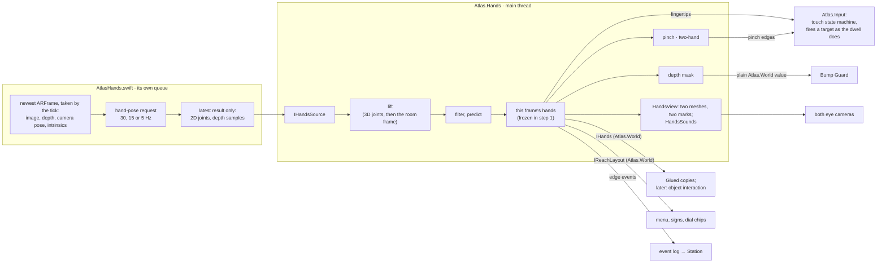
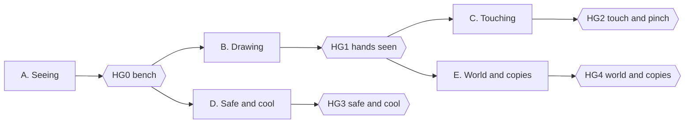

# ATLAS: Tracked Hands

**One feature, end to end: see your hands in the headset and touch the world with them. The design, brought up to what was built.**

| | |
|---|---|
| Date | 4 October 2026 |
| Status | Implemented on branch `tracked-hands`. Verified headless: the assembly rules, the three build configurations and every test assembly pass (§9.1). Not yet run in the Unity Editor and not yet run on a phone. `hands.enabled` is off by default; `hands.editor` switches the Editor's mouse-and-keys source on |
| Written against | `tracked-hands` at `515d14c` (4 October). Line numbers are of that commit. The first version of this document was written against `main` at `b039c33`, before any code. Decisions R13, R14 and R15 and the end-to-end tests were being built while this revision was written: they are described as decided, and the tests named in §9.1 hold their measured results |
| Scope | The phone app (`ATLAS/`). The Station gets events only |
| How it is built | Two new assemblies, `Atlas.Hands` and `Atlas.Hands.ARKit`, one native plugin, new files in `Atlas.World`, `Atlas.Input` and `Atlas.Safety`, plus a short list of additive edits to existing files (§3.7). Built on `tracked-hands`, off `main` |
| Read with | Master Plan §0.5 (rules), §4.10 (Bump Guard), §6.3 (the frame), §8 (look and budgets). The earlier, never-built hand design is in the Engineering Spec §4.5, §6.8 and §7.1 |

Where this document and the code differ, the code is right.

---

## Contents

- [0. Read me first](#0-read-me-first)
- [1. What the walker experiences](#1-what-the-walker-experiences)
- [2. What exists today](#2-what-exists-today)
- [3. Architecture](#3-architecture)
- [4. Sensing: from the camera to joints](#4-sensing-from-the-camera-to-joints)
- [5. Drawing the hands](#5-drawing-the-hands)
- [6. Interaction](#6-interaction)
- [7. Living with the rest of the app](#7-living-with-the-rest-of-the-app)
- [8. Station, events and parameters](#8-station-events-and-parameters)
- [9. Verification](#9-verification)
- [10. Build order](#10-build-order)
- [11. Risks and fallbacks](#11-risks-and-fallbacks)
- [12. Open items](#12-open-items)
- [Appendix A. Task tables for coding agents](#appendix-a-task-tables-for-coding-agents)
- [Appendix B. Constants](#appendix-b-constants)
- [Appendix C. The native interface](#appendix-c-the-native-interface)
- [Appendix D. Sources](#appendix-d-sources)
- [Appendix E. The questions and answers behind the decisions](#appendix-e-the-questions-and-answers-behind-the-decisions)

| If you want to… | Read |
|---|---|
| Know what was decided and why | §0.4, Appendix E |
| Know what the walker gets | §1 |
| Find your way in the code | §3 (architecture and the list of edits), Appendix A (what is done) |
| Know what is proven and what is not | §9.1 (headless), §9.2 (Editor), §9.3 (the bench) |
| Know what must be measured on the phone first | §9.3 |
| Check the safety argument | §7.1 |
| Decide something that is still open | §12 |

---

## 0. Read me first

### 0.1 What this is

The phone sits in a strapped lens headset with its rear camera and LiDAR looking forward. The headset view is generated and the camera picture is never shown in it, so the walker cannot see their own hands. Before this feature the hands did nothing: input was the gamepad, gaze dwell and the headset lever.

This document describes tracked hands for that view. The rear camera detects the walker's hands whenever they are in its view. Each hand is drawn where the walker feels it. A fingertip presses targets, a pinch confirms what the walker looks at, a fingertip leaves a mark where it meets a surface, and the walker's copies in the Glued rooms carry the hands too. A hand that leaves the camera's view fades away.

It began as a design, written before any code. The feature has since been implemented on branch `tracked-hands`, and every section now says what was built and where it differs from the first design. The feature is kept in two new assemblies with a short, explicit list of edits to existing code. The Master Plan is not changed by this document; §0.5 lists what it would need.

### 0.2 The feature in six sentences

1. A native detector takes the newest ARKit camera frame whenever a detection is due, runs Apple Vision's hand-pose request on a queue of its own, and returns 21 joints for up to two hands.
2. The joints are lifted to 3D with the LiDAR depth of the same frame and a hand model whose size and bone lengths are learnt from the walker's own hand, moved into room coordinates with the camera pose of that frame, then filtered and predicted to the present.
3. Each hand is a smooth mesh built in code, re-posed every frame, and drawn by both eye cameras through the app's one shader with no warp, so it sits in the real room's coordinates in every space.
4. Touch and pinch fire the gaze targets that dwell and the lever already fire, with the dwell's own source; nothing that exists loses a route.
5. The hands are left out of the depth image as Bump Guard reads it, and they fade out whenever Bump Guard warns.
6. Detection slows and then stops as the phone warms, before the picture loses more quality.

### 0.3 Words

"Hand" is already taken in this codebase: `DisplayMode.Hand`, `InputContext.InHand` and the boot option `-atlasHand` all mean *the phone is held in the hand*. To keep the two apart:

| Word | Meaning here |
|---|---|
| **Hands** (always plural in names) | This feature. Assemblies `Atlas.Hands` and `Atlas.Hands.ARKit`, parameters `hands.*`, events `hands.*`, native functions `atlas_hands_*`. `Hand*` is used only for one hand's data: `HandPose`, `HandJoint`, `HandSide`. No boot option named `-atlasHands` is ever added: it is one letter from `-atlasHand` |
| In the hand, hand mode | Unchanged: the phone is held, the camera picture fills the screen (scan, onboarding) |
| Hands session | A headset session with no gamepad connected and hands switched on (`hands.enabled`), in which the detector is active. Input is gaze dwell, the headset lever and hands. For Bump Guard it is any frame whose `DepthMask.Session` is not 0: the hands set it whenever their gate is active, with or without a hand in view |
| Pad session | A headset session with a gamepad connected. Hand tracking is off and nothing is drawn |
| Active | The detector is running (§3.5) |
| Tracked | A hand has a pose this frame, fresh or held through the grace period |
| Visible | A tracked hand is being drawn with opacity above zero |
| Capture time | The moment the camera frame behind a detection was taken |
| Lift | Turning 2D joints into 3D with depth and bone lengths |
| Reach zone | The volume in front of the walker where a hand is both comfortable and seen by the camera (§6.1) |
| Near panel | A menu or chip panel placed inside the reach zone in a hands session |
| World touch | A fingertip meeting a surface of the world: a ring that grows as the finger nears, then a contact mark |
| Pending cell | In a hands session, a cell of Bump Guard's dynamic layer that a near return has made and that does not count until it is seen again (R13, §7.1) |

### 0.4 What the lead decided

These came from eight rounds of questions on 4 October (Appendix E has every question and answer). Rounds 1 to 7 came before the design was written; round 8 came during implementation, after the review had run the real Bump Guard core. The last column says where each one is carried out.

| # | Decision | Where |
|---|---|---|
| H1 | Hands appear in the headset view only. Nothing changes while the phone is in the hand | §3.5 |
| H2 | A solid, smooth, stylised hand in one neutral colour for both hands. The mesh is built in code: no model file | §5 |
| H3 | A hands session is automatic. No gamepad connected in the headset means hands are tracked; a gamepad connected means hand tracking is off and nothing is drawn. (It holds once `hands.enabled` is on: R8) | §3.5 |
| H4 | On everywhere in the headset: every space, the menu, the use cases. This replaces "only in a space that uses it" (Master Plan rule 5 and §8.6 lever 7) | §3.5, §7.3 |
| H5 | Hands add, twins stay. Every existing action keeps its gamepad route and its gaze route. Hands are one more route | §6.7 |
| H6 | First version: touch targets with a fingertip; pinch fires the target being looked at; a two-hand pinch is recognised and reported but bound to nothing; world touch (a ring near a surface and a contact mark); the walker's copies in the Glued rooms show the hands | §6, §5.6 |
| H7 | Later, not now: grabbing and moving objects, reactions per kind of object, anything bound to two-hand gestures, any hand ray. Far targets are never aimed by hand; they keep gaze dwell, the lever and pinch | §6.8 |
| H8 | Hands fade in and out at the border of the camera's view. On a brief loss the hand holds its last pose for a short grace period instead of blinking | §5.4 |
| H9 | Feedback is sound only. The phone's haptics stay reserved for Bump Guard | §6.6 |
| H10 | The hands are masked out of the depth image before Bump Guard reads it. Limits: confident detections only, nothing beyond about 0.8 m, the scanned room map is never masked | §7.1 |
| H11 | While Bump Guard warns, hands fade out and touches are suspended | §7.2 |
| H12 | Heat: hands give way first. Detection runs 30 times a second, 15 at the first ladder step, and stops at Serious | §7.3 |
| H13 | The Station gets status and events. No hands are drawn on the Spectator. (The Hub's View page shows the phone's own left-eye picture, so hands appear there by themselves) | §8 |
| H14 | In a hands session the menu and the chips come within reach, with rows sized for a fingertip. Gaze dwell keeps working on them. (Asked as "about 0.45 m away"; built as 0.48 m from the rear camera, R3) | §6.1 |
| H15 | Nothing on screen teaches hands. The operator explains | §1 |
| H16 | The design is isolated: one module, few and small edits elsewhere, no split across lanes, no rewrite of the plan | §3 |
| H17 | Near returns must be seen twice. In a hands session a new depth return nearer than 0.8 m counts for Bump Guard only once it is seen again 0.15 s later, so a hand entering the view is masked before it can raise the cue. Carried out as R13 | §7.1 |
| H18 | A masked hand held on the walking line hides what is behind it, and that is accepted. No view-blocked rule is built | §7.1 |

Hardware confirmed by the lead: the headset is strapped and both hands are free.

**Decisions taken while it was built.** The design was reviewed after it was written and before it was coded. The lead's architect fixed these decisions: R1 to R11 from that review, before the code was written; R12 to R15 after the first wave of implementation was merged. They override the first design wherever the two differ, and the sections named say what was built.

| # | Decision | Where |
|---|---|---|
| R1 | No `InputSource.Hands`. A touch fires its gaze target through the same `Fire` as the dwell, with `InputSource.Gaze`. A pinch with a target under the gaze fires that target at once, also as `InputSource.Gaze`; with nothing under the gaze it fires nothing. The hands log `hands.touch` and `hands.pinch` themselves | §6.2, §6.3, §8.1 |
| R2 | Loss timing: a lost hand keeps its pose at full opacity for 0.25 s, then fades over 0.15 s, and is no longer tracked at 0.40 s | §4.4, §5.4 |
| R3 | Reach is measured from the rear camera: 0.48 m by default, 0.40 to 0.60 m. A pressing palm is nearer than LiDAR's 0.32 m, so the lift's size branch stays usable: confidence 0.7 once the walker's hand is measured, and nothing jumps where LiDAR ends | §4.3, §6.1 |
| R4 | Bump Guard's young-cell rule counts from the time a cell was first stamped. Every limit of the mask is enforced inside `Atlas.Safety` against `BumpConstants`, whatever the builder did | §7.1 |
| R5 | Sphere gaze targets are pressable: a sphere is pressed as a disc through its centre facing the head | §6.2 |
| R6 | Dwell pauses near a finger: while a trusted fingertip is within 0.20 m of a target, the dwell on that target does not advance. A touch that fires resets the dwell and repeat timers as the lever does | §6.2 |
| R7 | Near text needs a depth-tested font shader: `Atlas/NearText` is the built-in font shader with `ZTest LEqual` | §6.1 |
| R8 | The gate's "head comes from the AR camera" row reads `IPosePipeline.Source.DrivesRig`. The Editor's mouse-and-keys source is available only while `hands.editor` is on. `hands.enabled` defaults to false | §3.5, §8.2 |
| R9 | The upload and after-frame hooks have no safety net in the frame loop, so the hands catch their own exceptions there, switch off for the session and log once | §3.3 |
| R10 | The gaze reticle follows the focused target's distance while that target is nearer than 2.0 m, never nearer than 0.35 m, so it is not seen double over a near panel | §6.1 |
| R11 | Bone lengths are learnt per walker. The detector's points are not anatomical joint centres, so the lift keeps a running estimate of each bone from what it sees, and uses the template times the hand's scale until it has one | §4.3 |
| R12 | A touch presses with the unpredicted fingertip. The drawn hand keeps its prediction | §4.4, §6.2 |
| R13 | Near returns must be seen twice (H17). In a hands session a dynamic cell made by a depth return nearer than 0.80 m does not count for Bump Guard until it is hit again 0.15 s or more after its first hit; a pending cell with no hit for 0.10 s starts again. Outside a session nothing changes, bit for bit | §7.1 |
| R14 | The forearm strip of a mask region has its own depth gate: the palm's depth plus 0.05 m, never beyond 0.80 m. The hand's rectangle keeps the palm's depth plus 0.20 m | §7.1 |
| R15 | Copies of the walker show hands with the kit avatar too. Where the body leaves no room for both full hands inside the avatar's 600 triangles, the hands are appended at a reduced level: forearm, palm and one box for each finger | §5.6 |

### 0.5 What this changes in the Master Plan

Nothing in the Master Plan is edited by this document or by the feature's branch. If the feature is accepted into the plan, these lines change:

| Place | Today | Becomes | State at `515d14c` |
|---|---|---|---|
| §0.5 rule 5 | "hand tracking is not in the Core build and no task depends on it; if the optional HoloKit spike … is ever merged, hand tracking runs only in a space that uses it" | Hands are an extra route to actions and never the only one. Hand tracking runs in every headset session that has no gamepad, and gives way first on heat | Not applied |
| §8.6 lever 7 | "Hand tracking, if it is ever added, is on only in a space that uses it" | Hand tracking drops to 15 Hz at Fair and stops at Serious | Not applied |
| Appendix C.3, HoloKit row | "Optional hand-tracking spike on a branch; needs iOS 18+" | Not used. Hands use Apple Vision through our own plugin (§4) | Not applied |
| Appendix D.1, "Hand input" row | "Not built" | Points to this document | Not applied |
| `docs/contracts/README.md` F1 table | No `Atlas.Hands` row | One row for `Atlas.Hands`, one for `Atlas.Hands.ARKit`, and `Atlas.Hands` added to the App row (§3.2) | Applied (README lines 36 to 38) |
| `docs/contracts/lane-d-link.md` §1.1 and the event table | No `hands` area, no `hands.*` events | The `hands` parameter group and the events of §8.1 | Not in `515d14c`. The second wave has a package that brings the contract pages up to date |

Rules 1, 2, 3, 4 and 6 to 10 stand unchanged, and the feature is checked against each in §7 and §9. Rule 10 (no camera frames are stored) holds: the detector reads each frame in memory and keeps only joint positions and depth samples.

---

## 1. What the walker experiences

A hands session, as the walker is meant to live it. None of this has been seen on a phone yet (§9). The operator has said one sentence beforehand: *"Hold your hands up in front of you; you can press things with a finger, and pinching selects what you are looking at."*

1. **Headset on, no gamepad.** The room rebuilt in the diagram look, as before.
2. **Hands appear.** The walker raises their hands. As each one enters the camera's view it fades in over about a tenth of a second: a smooth, plain, light-coloured hand, in the place the real hand is felt, moving with it.
3. **The edge.** The camera sees less than the eyes do (see the figure below). A hand moved out to the side or dropped to the waist fades away before it reaches the edge of the picture. Brought back, it fades in. A hand lost for an instant (a fast flick, a moment behind the other hand) holds its last pose for a quarter of a second and then fades.
4. **Pressing.** The menu, the space signs and the dial chips are no longer a metre away. In a hands session they sit about 48 cm in front of the camera and below the line of sight, where looking at them brings the hands into the camera's view. A small ring appears on a chip under the fingertip as it comes near, and when the fingertip pushes through the chip's face it clicks and fires. Gaze dwell on the same chip still works; it waits while a finger is about to do its job.
5. **Pinching.** Signs and beacons out in the world are too far to touch. The walker looks at one, as before, and pinches thumb to index finger: it fires at once, with no dwell wait. A pinch while looking at nothing does nothing.
6. **Touching the world.** In a space that matches the real room (Home, and the room's own walls and furniture wherever they are drawn), reaching for a wall or a table shows a small ring on the surface under the fingertip, growing and brightening as the finger comes close and full where it lands. The real wall is there to be felt.
7. **The Glued rooms.** The copies of the walker carry the walker's hands. Waving shows the same wave in every copy, mirrored in the mirrored rows.
8. **Walking.** Raised hands are left out of what Bump Guard reads, so they should not set off the bump warning; §7.1 says where that has limits. If the warning does fire, for a wall or a person, the hands fade out, the chevron shows, and the hands return when the way is clear. Nobody walks with hands tracked until gate HG3 has passed (§10.2).
9. **Heat.** If the phone warms, the hands first update less often, then switch off. The operator sees why on the Console. Everything else carries on; every action still works by gaze and lever.

**Where hands can be seen.** Each eye sees about 100° across and 96° up and down (placeholder lens numbers). The rear camera is expected to see about 72° across and, in the low-resolution 16:9 video format the app selects, only about 44° up and down (57° in a 4:3 format). Neither camera number has been measured on the phone yet (§9.3).

```text
            what one eye sees: about 100° x 96°
   +-----------------------------------------------+
   |                                               |
   |          what the camera sees (16:9)          |
   |        +-----------------------------+        |
   |        |   about 72° x 44°           |        |   a hand is tracked
   |        |   hands are tracked here    |        |   only inside the
   |        +-----------------------------+        |   inner box
   |                                               |
   |   hands held here are not seen: nothing drawn |
   +-----------------------------------------------+
```

At 48 cm the camera's window is about 70 cm wide and 39 cm tall. A whole hand is about 19 cm long, so a hand pressing something must have that thing in the upper or middle part of the window. This is why near panels are placed where the walker looks down at them (§6.1), and why the choice of video format is one of the first things measured (§9.3).

---

## 2. What exists today

Facts the feature stands on, checked again at `515d14c`. A row that the feature itself has changed says so. Paths are under `ATLAS/Assets/Atlas/` unless they start elsewhere.

### 2.1 The view

| Fact | Where | What it means for hands |
|---|---|---|
| Two eye cameras render into two eye textures; one lens blit puts both on the screen. "No camera image, no post-processing. The AR camera only carries the pose." | `Rendering/Stereo/StereoRig.cs:10-15` | The walker cannot see their real hands. Hands must be drawn |
| Display mode is `Hand` (phone held, camera picture) or `Headset`. In `Headset` the tracked camera and its background are disabled; the AR managers keep running | `StereoRig.cs:179-187` | Hands exist only in `Headset` (H1) |
| Eye cameras: near plane 0.05 m, every layer except 23 and 30, one shared renderer, no depth or colour texture | `StereoRig.cs:22-29, 93-117` | A hand 0.2 m away is inside the clip range. Hands are drawn by the eye cameras themselves |
| Each eye's field of view is clamped to 50.28° to each side and 48° up and down. Lens numbers are Cardboard-class placeholders | `Rendering/Stereo/LensModel.cs:60-72`; `documents/ATLAS_Whats_Left.md:39-40` | The eyes see far more than the camera does |
| The eye midpoint is the tracked camera plus `IStereoRig.HeadOffset`, which is (0, 0, 0) and unmeasured | `StereoRig.cs:219-223`; `documents/ATLAS_Whats_Left.md:39` | Until it is measured, a near hand is drawn several degrees from where it is felt (§5.5) |
| Head-locked things (menu at 1.2 m, signs and cue at 1.0 m, reticle at 2.0 m) are on layer 7 and drawn after everything with no depth test | `App/Menu/MenuLayout.cs:102`; `App/Commands/SpaceSigns.cs:34-37`; `Input/GazeReticle.cs:17`; `Safety/Cue/BumpCueScheduler.cs:25` | Without hands nothing is within reach, and a layer-7 panel would paint over a finger in front of it. Changed by the feature: in a hands session the near panels leave that layer (§6.1), and the reticle comes to a near target's distance in every session (R10) |
| One surface shader. `_WarpMode` 0 means no warp; opacity is `_BaseTint.a` through an ordered dither; there is no lighting term; opaque, depth write on | `Rendering/Shaders/Resources/AtlasSurface.shader:39-42`; `AtlasCore.hlsl:9-22, 94-108, 122-144`; `AtlasWarp.hlsl:56` | A hand needs no new shader: no warp, dithered fade, shape shown by baked shade |
| Budgets per frame, both eyes: 300 draw calls, 500,000 triangles, 60 set-passes, 1 kB of managed allocation. Main thread 4.3 ms target, 7.5 cap | Master Plan §8.5 | Two hands must cost a few draw calls and a few thousand triangles |

### 2.2 The sensors

| Fact | Where | What it means for hands |
|---|---|---|
| The video format is the 60 Hz ARKit format with the fewest pixels (1280 × 720 expected; never logged from a phone) | `Scan/Session/ArSessionRig.cs:241-293` | A 16:9 format narrows the camera's view up and down |
| LiDAR depth: environment depth, mode Fastest, no smoothing, read every frame on the CPU as 256 × 192 floats in metres. The depth image is mapped onto the camera picture by the plain ratio of the two sizes | `ArSessionRig.cs:155-173`; `Scan/Pose/ArDepthSource.cs:72-138` | Depth for the lift is already there. Its confidence image is not read by that source; the hands' plugin reads it natively |
| ARKit re-chooses its configuration from the features requested each frame; switching the scan features off once dropped tracking to rotation only | `ArSessionRig.cs:135-153` (commit `c78365b`) | The hands feature requests no new AR feature (no person segmentation, no other depth mode) |
| Outside the hands, the only reader of the colour camera image is the object-photo capture during a scan | `Scan/Photo/ObjectPhotoCapture.cs:63-79` | Changed by the feature: the detector reads `ARFrame.capturedImage` natively while hands are active. Whether a colour frame can be had while the tracked `Camera` is disabled is a phone check (§9.3) |
| The native `ARSession` pointer is reachable (`XRSessionSubsystem.nativePtr`) and a Swift plugin already takes it for the RoomPlan wall bridge | `Scan/Routes/WallBridge.cs:92-96`; `Scan/ARKit/RoomPlan/ArKitWallBridge.cs:33-50`; `Assets/Plugins/iOS/AtlasRoomPlan.swift:96-102` | The route to `ARFrame` exists and had a pattern to copy. That plugin has compiled and linked in Unity's export of the tree (commit `c9c0ff6`), and the lane C contract records that it has never run on a device |
| Poses and depth carry the app clock at the moment they are read, not the camera frame's timestamp. There is no pose history | `ArDepthSource.cs:132-135` | The detector hands over the camera pose of its own frame (§4) |
| Phones: iPhone 15 Pro Max (A) and 14 Pro Max (B), both LiDAR. Build target iOS 17.0. A commit message reports iOS 27 on a phone | Master Plan, the Hardware row of its header table, and Appendix C.4; commit `295874e` | Apple Vision's hand pose request is available on the build target |

### 2.3 Input

| Fact | Where | What it means for hands |
|---|---|---|
| One action map. 17 actions and 6 axes; every one has a gamepad binding and a gaze route, checked by `InputTwins.IsComplete` | `Input/Core/InputTwins.cs:100-190` | Hands must not be needed for any of them (H5) |
| `InputSource { None, Gamepad, Gaze, Lever, Keyboard }`. The values are stable because they are written to the event log | `Input/AtlasAction.cs:22` | No value is added (R1): a hand fires with `Gaze` |
| Gaze targets: at most 64, a sphere or a flat rectangle, in room coordinates or in the head's frame; dwell 0.6 to 0.8 s | `Input/Core/GazeRegistry.cs:13`; `Input/Core/GazeTypes.cs:8-74`; `Input/IAtlasInput.cs:32-38` | Pressing one with a fingertip is a point-against-shape test |
| The headset lever (a touch on the screen) fires the target under the gaze | `Input/Core/InputTwins.cs:108-110`; `GazeTypes.cs:76-85` | A pinch does what the lever does when a target is under the gaze |
| `IAtlasInput` has one real implementation and eight test fakes | `Input/AtlasInput.cs`; eight files under `Tests/` | Adding a member to it breaks nine classes. The feature adds none (§3.7) |
| `Atlas.Input` references no other Atlas assembly | `Input/Atlas.Input.asmdef` | Hands call input, never the reverse |

### 2.4 Safety

| Fact | Where | What it means for hands |
|---|---|---|
| Bump Guard runs first in the frame, on the raw pose and the newest depth image. Its numbers are constants in code; it has no parameter and no off switch, and its assembly references `Atlas.World` only | Master Plan §4.10; `Safety/Core/BumpConstants.cs`; `App/Frame/FrameLoopCore.cs:280-281` | The mask reaches it as a plain `Atlas.World` value |
| Depth nearer than 0.3 m is "no return". A return more than 0.3 m nearer than the room map predicts, between 0.10 and 2.0 m above the floor, stamps a 5 cm cell that stays until it is seen empty three times or for 30 s | `BumpConstants.cs:54-63, 94` | A hand closer than 0.3 m is invisible to Bump Guard. Farther out it is an obstacle |
| WARN when clearance at the head is under 0.30 m or the path over the next 0.8 s is blocked; STRONG under 0.20 m or 0.4 s | `BumpConstants.cs:13-21` | A hand held out ahead of a walking head blocks the path (§7.1) |
| The cue is a chevron on layer 7 at 1.0 m, and haptic pulses from the phone | Master Plan §4.10; `Safety/Cue/` | Hands must never cover it (H11) and never use the haptics (H9) |

### 2.5 The frame and the wiring

| Fact | Where | What it means for hands |
|---|---|---|
| One driver runs the frame in order: sense hooks, Bump Guard, pose filter, kernel, space tick, upload hooks; then state and after-frame hooks | `App/Frame/FrameLoopCore.cs:212-355` | Hands take one sense hook, one upload hook and one after-frame hook |
| The sense hooks are the pose pipeline, then the hands, then input. A hook that throws is reported once and Bump Guard still runs | `Scan/Session/ArPoseSystems.cs:103`; `App/AtlasApp.cs:266-267`; `FrameLoopCore.cs:241-256` | The hands hook sits between the two that were there |
| The composition root builds everything in a fixed order and publishes services through `AtlasServices` | `App/AtlasApp.cs:167-420`; `World/Services/AtlasServices.cs` | One installer call, placed before input's sense step is added; Bump Guard is built after it and reached lazily |
| Which assembly may reference which is written in three places and tested | `docs/contracts/README.md` F1; `tools/headless/verify.py:76-98`; `Tests/Architecture/AssemblyGraphTests.cs:20-38` | Each has a row for `Atlas.Hands`, a row for `Atlas.Hands.ARKit`, and `Atlas.Hands` in the App row |
| Parameters are declared in code through the registry and appear on the Console and the on-device menu by themselves | `Link/Params/ParamRegistry.cs`; `App/Params/AppParams.cs` | `hands.*` parameters need no Console code |
| Events go through `IEventLog` (in `Atlas.World`); the Console prints any event | `World/Services/IEventLog.cs`; `station/hub/wwwroot/js/app.js` | Hand events reach the operator with no Station change |
| The Hub's View page shows the phone's left-eye picture, taken before the lens pass, while someone has the page open | `App/View/ViewStreamer.cs:123-124` (commit `b1e2adb`) | Hands are drawn into that picture, so the operator sees them there with no work |
| Native plugins are `Assets/Plugins/iOS/Atlas*.swift` or `.mm`, called through `[DllImport("__Internal")]` under `#if UNITY_IOS && !UNITY_EDITOR`, with a neutral stand-in elsewhere | `Scan/ARKit/RoomPlan/ArKitWallBridge.cs:27-37` | The detector follows the same shape |

### 2.6 What has and has not been run

The code compiles for the phone, the Station and the Editor and passes its headless tests (§9.1). Earlier commits show runs of the app on a phone (`c78365b`, `295874e`), but the lens numbers, the camera-to-eye offset, the orientation of the depth image against its intrinsics, and one render pass per eye are all still unconfirmed on a device (`docs/verification/UNITY_SIDE_BRIEF.md`). No native plugin of ours has been proven on a phone.

For the hands themselves:

- **Headless.** Everything engine-free is tested without Unity (§9.1).
- **The native plugin.** The unchanged Swift file has run on the build Mac against real Vision, with a stand-in for ARKit and synthetic depth. It has not been built into an Xcode project and has not run on a phone.
- **The Unity Editor.** Nothing of the feature has run in it. The tests that need the engine compile and have never been executed (§9.2).
- **A phone.** Nothing. The feature keeps its own list of things to measure first (§9.3) and assumes none of the items above.

---

## 3. Architecture

### 3.1 One module, a few seams



Everything inside the two boxes is new. The arrows that leave them are the seams with existing code, and each is a small additive edit listed in §3.7. Nothing existing references `Atlas.Hands` except the composition root, which installs it, adds its three frame hooks, declares its parameters and shuts it down.

The touch state machine is the one piece that is not in the hands' own assembly. It lives in `Atlas.Input`, beside the targets it tests and the dwell it must stay consistent with (§6.2).

### 3.2 Assemblies and folders

```text
ATLAS/Assets/Atlas/Hands/                  Atlas.Hands
  Core/        engine-free: the detection record and joint set, the hand model, the lift (palm plane, bone
               lengths), the filter (One-Euro), the gate, visibility, gestures, the depth mask builder, the mesh
               template and its skinning, the reach anchor, the room's surfaces, the constants
  Sources/     IHandsSource and its sources: Null, Replay (a recorded log), Editor (mouse and keys); the hand
               log and its recorder; HandsSynth (a perfect detection from camera-space joints); the conversion
               of ARKit's camera pose
  View/        HandsView (the two dynamic meshes and the two marks), HandsSounds
  HandsRuntime.cs      the frame work without the engine; it is IHands, IDepthMaskSource and IReachLayout
  HandsInstaller.cs    the one entry point the composition root calls; the three frame hooks; the parameters
ATLAS/Assets/Atlas/Hands/ARKit/            Atlas.Hands.ARKit   (Editor and iOS only)
  VisionHandsSource.cs   the phone's source: DllImport to the plugin
ATLAS/Assets/Plugins/iOS/AtlasHands.swift  the native detector
ATLAS/Assets/Atlas/World/Hands/            new files in Atlas.World: the types other assemblies may see
ATLAS/Assets/Atlas/Input/                  new files in Atlas.Input: IHandsInput.cs, Core/HandsTypes.cs,
                                           Core/HandsTouch.cs, Core/ReticleDepth.cs
ATLAS/Assets/Atlas/Safety/Core/DepthKernelMask.cs   new file in Atlas.Safety: the mask as the depth kernel reads it
ATLAS/Assets/Atlas/Spaces/Glued/GluedAvatarHands.cs new file: the copies' hands
ATLAS/Assets/Atlas/App/Menu/NearText.cs    the depth-tested text material of near panels, with its shader
                                           Rendering/Shaders/Resources/AtlasNearText.shader
ATLAS/Assets/Atlas/Tests/Hands/            Atlas.Hands.Tests   (engine-free tests; picked up by tools/headless/verify.py)
recordings/hands_*.handlog                 three synthetic hand logs
```

| Assembly | May reference | Referenced by | Notes |
|---|---|---|---|
| `Atlas.Hands` | Kernel, Link (parameter types only, as a space does), World, Rendering, Input. Of Unity: the Input System (the Editor source reads mouse and keys), Mathematics, Burst and Collections | `Atlas.App`, and its own platform half `Atlas.Hands.ARKit` | No platform filter: it must compile for the phone, the Station and the Editor, because `Atlas.App` does |
| `Atlas.Hands.ARKit` | Kernel, World, Hands. No AR Foundation or ARKit assembly: it is given the session's native pointer as an `IntPtr` | Nothing. It registers itself before the scene loads, as `Atlas.Scan.ARKit` does. Its `AssemblyInfo.cs` carries `[assembly: AlwaysLinkAssembly]`, so the linker looks at it and keeps the registration | Editor and iOS only |
| `Atlas.World` (new folder `Hands/`) | unchanged | everyone, as before | Holds `IHands`, `IHandsSurface`, `IReachLayout`, the joint and pose types, `DepthMask` with `IDepthMaskSource`, and `ReachSlots`, so that a space and Bump Guard can read hands without referencing `Atlas.Hands` |

The reference table exists in three places that must agree: `docs/contracts/README.md` (F1), `tools/headless/verify.py` (`ALLOWED`, lines 87 to 90) and `Tests/Architecture/AssemblyGraphTests.cs` (`Allowed`, lines 31 to 33). Each has a row for `Atlas.Hands`, a row for `Atlas.Hands.ARKit`, and `Atlas.Hands` in the App row. The rule check and the architecture test also hold `Atlas.Safety` to naming no type of `Atlas.Hands`. Code is C# 9 (the headless projects compile with `LangVersion 9.0`). Every new file has its `.meta` from `tools/gen_meta.py`.

The core follows the house rule for engine-free code (contract README F2): plain classes on `Unity.Mathematics`, time passed in, no allocation per frame, so that almost all of the feature is tested without Unity and without a phone.

### 3.3 The frame: where each stage runs

The frame order is fixed by `FrameLoopCore.RunUpdate`. Hands add three hooks and change none.

| Step | What ran before | What hands add |
|---|---|---|
| (off the main thread) | ARKit delivers camera frames at 60 Hz | Only the hand-pose request itself runs off the main thread, on the plugin's own queue. The frame is taken on the main thread by the plugin's tick, and only the latest result is kept |
| 1 Sense | The pose pipeline (head pose, XR Origin placed, newest depth image), then input | **`HandsSenseStep`, added between the two.** It runs the gate; ticks and polls the source; lifts each hand and moves it into the room; filters and predicts; runs pinch and two-hand; works out each hand's opacity; freezes this frame's hands; hands the fingertips and the pinch edges to input before input's own tick; builds the depth mask; advances the near anchor; tests the fingertips against the room's surfaces. The touch state machine then runs inside input's tick |
| 2 Bump Guard | Raw pose and depth | `BumpGuardStep` asks the hands for the mask of this depth image and gives Bump Guard a copy of the sensor frame that carries it (§7.1) |
| 3, 4 | Pose filter, kernel | Nothing |
| 5 Space tick | The entered space | A space may read `IHands` |
| 6 Upload | The space's own upload, then the look, the rig, the signs | **`HandsUploadStep`**, after the rig's: skins the two meshes, sets their opacity, places the two marks. The near panels place themselves in their owners' upload hooks, and Glued appends the copies' hands in the space's own upload (§5.6) |
| 7 Render | Each eye camera, then the lens blit | Hands are ordinary objects in both eyes |
| 8a State | The 202-byte `State` | Nothing. `State` is not changed |
| 8b After frame | Telemetry, menu, flow, signs | **`HandsAfterFrameStep`**: sounds, then edge events to the event log and the counters |

The order as the composition root sets it (`App/AtlasApp.cs`):

| Hook | Order | Lines |
|---|---|---|
| Sense | The pose pipeline, then `Hands.Sense`, then `InputSenseStep` | `Scan/Session/ArPoseSystems.cs:103` (called from `AtlasApp.cs:239`); `AtlasApp.cs:266`; `:267` |
| Bump Guard | `new BumpGuardStep(Guard, Pose.Pipeline, Hands.Mask)` | `AtlasApp.cs:274-275` |
| Upload | `LookUploadStep`, `RigUploadStep`, `Hands.Upload`; later the tile statistics and the signs | `AtlasApp.cs:292-294`; `:335`; `:404` |
| After frame | Lane D's hooks, the menu, onboarding and the perf tour as they install; then `Hands.AfterFrame`, the ladder, the flow, the hand-over, the space actions, the signs, SpaceLab | `AtlasApp.cs:330`; `:383-385`; `:392-406` |
| Parameters | `Hands.DeclareParams(Registry)`, after every other declaration, so that no existing parameter changes its wire id | `AtlasApp.cs:377` |
| Shutdown | `Hands.Shutdown()` just before `Pose.Dispose()` | `AtlasApp.cs:529-530` |

Input and rendering therefore see the same hands in the same frame, and Bump Guard sees the mask that belongs to the depth image it is about to read.

**Faults (R9).** A sense hook that throws is reported once by the frame loop and the frame goes on (`FrameLoopCore.cs:244-256`). The hands do not rely on that. `HandsRuntime.Sense` catches any exception of its own, switches the hands off for the session, clears every output (no hand, no fingertip, no mask, panels far) and logs `hands.fault` (`Hands/HandsRuntime.cs:232-249, 512-544`). The frame loop has no net under its upload and after-frame hooks, so `HandsUploadStep` and `HandsAfterFrameStep` each catch their own exceptions and do the same (`Hands/HandsInstaller.cs:173-225`). A fault can therefore never leave a stale hand on screen or a stale mask in front of Bump Guard. A faulted runtime stays off until the app restarts. A mask source that throws does not stop Bump Guard either: the guard step counts it and Bump Guard runs on the unmasked frame (`App/Frame/FrameSteps.cs:106-130`).

### 3.4 Coordinate frames and time

| Frame | What it is | Used for |
|---|---|---|
| Image | Pixels of the captured camera image, origin top left | The detector's 2D joints. The plugin turns Vision's own coordinates (a share of the picture, from the bottom left) into these |
| Camera at capture | Unity camera space of the rear camera at capture time: x right, y up, z forward, metres | The lift (`HandsDetection.Unproject`). The same convention as `DepthFrame.Unproject` |
| Session | ARKit's world, in Unity's left-handed form | Carrying a pose from capture time to now: it does not move when the head moves. The lift also remembers each hand here between detections |
| World | The room frame once a room is active (the pose pipeline moves the XR Origin so the room anchor is the origin); the session frame before that | Everything the app draws and tests. Hand joints are stored here |
| Head | The head pose of the frame | Head-locked targets; the Glued copies. Input is ticked with the frame's raw head pose (`App/Frame/FrameSteps.cs:35`) |

A joint goes from the picture to the room in three moves:

```text
p_camera  = unproject(pixel, depth)                         with the intrinsics of the captured frame
p_session = T_session←camera(capture) · p_camera            the camera pose of that same ARFrame, from the plugin
p_world   = T_world←session(now) · p_session                the XR Origin as the pose pipeline placed it this frame
```

The camera pose comes from the same `ARFrame` as the image and the depth, so the three always belong together; this is why the detector reads the frame natively and does not pair an image with whatever pose the main thread holds (§2.2: poses carry the app clock at read time, and there is no pose history). The plugin stores the pose in ARKit's convention and C# turns it into Unity's (`HandsNativeMath.ArKitToUnity`). The third move uses the scene's session space, `XROrigin.TrackablesParent`, as it stands this frame (`Hands/HandsInstaller.cs:240-244`; `Hands/HandsRuntime.cs:393-413`). The second move makes a hand independent of head motion: turning the head between capture and display does not drag the hand with it. What remains is the hand's own motion during the delay, which the filter's prediction covers (§4.4).

**Time.** The plugin reports, with each result, the timestamp of its frame and the time on the same clock when the result was polled. The sense step sets `capture time = frame.Time − age` on the app clock, where the age is the difference of the two. No clock is synchronised and nothing else in the app changes. A result that is older than 0.2 s when it is polled is not used.

**The eyes are not the camera.** A hand is placed in the room from what the camera saw, and drawn from where the eyes are. Those differ by `HeadOffset`, which is zero today. §5.5 makes measuring it the first thing that is done once a hand is on screen.

### 3.5 When hands run: the session gate

The detector is **active** only while every row holds. The gate (`Hands/Core/HandsGate.cs`) is evaluated in the sense step, every frame, and the first row that fails is the reason the hands are off.

| Condition | Read from | Reason |
|---|---|---|
| The display mode is `Headset` | `IStereoRig.Mode` | H1. In the hand, the walker's hands are holding the phone |
| No gamepad is connected | `IAtlasInput.GamepadPresent`. A change counts once it has held for 1 s; the first reading counts at once | H3 |
| `hands.enabled` is true | The registry. The default is false (R8) | The kill switch (Console, on-device menu) |
| The hands source is available | `IHandsSource.Available` | On a phone: once the AR session exists and the platform assembly has registered its source. In the Editor: the mouse-and-keys source, and only while `hands.editor` is on (R8). Anywhere else there is no source |
| The head comes from the AR camera | `IPosePipeline.Source.DrivesRig` (R8). The row also holds while the Editor's source is available | With a replayed or keyboard-driven head the physical camera no longer matches the view. The Editor's stand-in is tied to the Editor's own head |
| The quality tier is Nominal, High or Fair | `FrameContext.Tier` | H12 |

| Tier | Detector |
|---|---|
| Nominal, High | 30 times a second |
| Fair | 15 times a second |
| Serious, Critical | Stopped. The source is stopped and no frame is read |

`hands.rate` can fix the rate at 30 or 15 for the bench, and two guards can lower it: the self-governor and the idle stop (§7.3).

A hand is **visible** when the detector is active, the hand is tracked, and Bump Guard's level is `Clear` (H11; a lost ARKit tracking state raises the level, so it hides hands too). Leaving the active state stops the source at once, so an inactive gate costs nothing; the hands keep their last pose while their fade plays. Every change of state is logged once with its reason (§8.1).

Each time the gate becomes active, the lift, the filter, the gestures and the mask builder start from nothing (`Hands/HandsRuntime.cs:276-285`). The walker's hand size and bone lengths are therefore measured again in every hands session.

**Near panels follow a wider rule.** `GateState.Near` is every row except the tier's: when hands stop for heat the panels stay within reach and work by gaze (`HandsGate.cs:83-86`). The runtime holds that answer steady: panels come near once it has been true for 0.5 s and go back 1 s after it ends (`HandsRuntime.cs:438-455`).

H4 says hands are on everywhere, so no space is asked whether it wants them. The gate has no per-space row.

### 3.6 The types other code may see

These are in `Atlas.World` (folder `World/Hands/`), beside `IDepthSource` and `SensorFrame`, so that a space and Bump Guard can use them without referencing `Atlas.Hands`. The listing is abridged; the files have the summaries.

```csharp
namespace Atlas.World
{
    public enum HandSide : byte { Left = 0, Right = 1 }

    /// <summary>The 21 joints: the wrist, then each finger from its base to its tip.</summary>
    public enum HandJoint : byte
    {
        Wrist = 0,
        ThumbCmc = 1,  ThumbMcp = 2,   ThumbIp = 3,    ThumbTip = 4,
        IndexMcp = 5,  IndexPip = 6,   IndexDip = 7,   IndexTip = 8,
        MiddleMcp = 9, MiddlePip = 10, MiddleDip = 11, MiddleTip = 12,
        RingMcp = 13,  RingPip = 14,   RingDip = 15,   RingTip = 16,
        LittleMcp = 17, LittlePip = 18, LittleDip = 19, LittleTip = 20
    }

    /// <summary>The shape of the joint set: five chains of four joints hanging off the wrist.</summary>
    public static class HandJoints   // Count = 21, FingerCount = 5, PerFinger = 4; Base, Tip, FingerOf, Parent

    /// <summary>One hand in one frame. Valid from step 1 of a frame until step 1 of the next.</summary>
    public struct HandPose
    {
        public bool Tracked;       // a pose exists: fresh, or held through the grace period
        public float Confidence;   // 0..1; touch and the depth mask gate on it
        public float Opacity;      // 0..1; what is drawn (enter, exit, edge, warning)
        public float AgeSeconds;   // now minus the capture time of the detection behind the pose
        public float Scale;        // this walker's hand size relative to the template; 1 until measured
        public float3 PalmCentre;  // world, metres
        public float3 PalmNormal;  // world, unit, out of the palm
        public float Pinch;        // 0 open .. 1 closed
        public bool Pinching;      // after hysteresis
    }

    public struct TwoHandPinch
    {
        public bool Active;        // both hands are pinching
        public float Distance;     // metres between the two pinch points
        public float Angle;        // radians: the line from the left pinch point to the right, about the view axis; continuous while Active
        public float3 Midpoint;    // world
    }

    public interface IHands
    {
        /// <summary>The detector is running (section 3.5).</summary>
        bool Active { get; }
        ref readonly HandPose Pose(HandSide side);
        /// <summary>World, metres. Meaningful while Pose(side).Tracked.</summary>
        float3 Joint(HandSide side, HandJoint joint);
        ref readonly TwoHandPinch TwoHand { get; }
        /// <summary>Hides both hands and suspends touch until the next frame. For a space that cannot show them correctly this frame.</summary>
        void HideThisFrame();
    }

    /// <summary>Surfaces a fingertip can touch, known without reading the picture back (section 6.5).</summary>
    public interface IHandsSurface
    {
        bool TryClosest(float3 world, float maxDistance, out float3 point, out float3 normal);
    }

    /// <summary>Whether panels should sit within reach, and where (section 6.1).</summary>
    public interface IReachLayout
    {
        bool Near { get; }
        /// <summary>World pose of the near anchor: the origin is the panel centre, +Z points away from the walker, +Y up along the panel.</summary>
        float3 Position { get; }
        quaternion Rotation { get; }
        /// <summary>Multiplies a panel's own layout, which was made for its usual distance.</summary>
        float Scale { get; }
    }

    /// <summary>One hand in a depth image: a box round the hand, a strip along the forearm, and a depth gate.</summary>
    public struct DepthMaskRegion
    {
        public float MinU, MinV, MaxU, MaxV;                        // the hand, depth-image pixels
        public float ArmU0, ArmV0, ArmU1, ArmV1, ArmHalfWidth;      // the forearm; a half width of 0 or less means no strip
        public float MaxDepth;                                      // metres; a deeper sample is never masked
        public bool Contains(float u, float v, float depth);
    }

    /// <summary>Where the walker's hands are in the depth image Bump Guard is about to read (section 7.1).</summary>
    public struct DepthMask
    {
        public const int MaxRegions = 2;
        public int Count;                        // 0, 1 or 2
        public DepthMaskRegion Region0, Region1;
        public int DepthSequence;                // DepthFrame.Sequence of the image the mask was built for
        public int Session;                      // 1 while a hands session is running, hand or no hand (H17)
        public bool IsEmpty { get; }
        public bool Contains(float u, float v, float depth);
    }

    public interface IDepthMaskSource
    {
        bool TryGetMask(int depthSequence, out DepthMask mask);
    }

    /// <summary>A named place about the near anchor for each target that comes within reach (section 6.1).</summary>
    public enum ReachSlot : byte { MenuPanel, MenuChip, SignHome, SignPrevious, SignMenu, SignNext, DialLeft, DialRight, Mode }
    public static class ReachSlots   // Centre, Local, World, TargetHalf, TryGetNear, ScaleMoved, RotationMoved
}
```

R14 adds a depth gate of the forearm strip's own to `DepthMaskRegion` (`ArmMaxDepth`); it is not in the listing above, which is the file at `515d14c`.

`IHands` and `IReachLayout` are published through `AtlasServices` by the installer (`Hands/HandsInstaller.cs:300-301`); one object, `HandsRuntime`, is both, and is the mask source too. Code that wants hands asks with `AtlasServices.TryGet<IHands>` and carries on without them when the answer is no, which is what happens on the Station and in every test that does not install them.

### 3.7 Every edit to existing code

New files are not listed here: they are the folders of §3.2 and their tests. This table is the whole footprint in files that existed before. All edits are additions; nothing existing changes meaning when hands are absent. The one behaviour that changes with hands off is R10: the reticle now comes to a near target's distance in every session.

| # | File | Edit | Why | State at `515d14c` |
|---|---|---|---|---|
| E1 | `App/Atlas.App.asmdef` | Reference `Atlas.Hands` | The composition root installs it | Done |
| E2 | `docs/contracts/README.md` (F1 table), `tools/headless/verify.py` (`ALLOWED`), `Tests/Architecture/AssemblyGraphTests.cs` (`Allowed`) | A row for `Atlas.Hands` and one for `Atlas.Hands.ARKit`; `Atlas.Hands` added to the App row; `Atlas.Safety` held to naming no hands type | The three copies of the reference table must agree, and a test reads two of them | Done |
| E3 | `App/AtlasApp.cs` | `HandsInstaller.Install` just before the line that adds `InputSenseStep`; the upload hook after `RigUploadStep`; the mask source handed to the Bump Guard step; a `Hands` property; the parameters declared last; the after-frame hook; `Hands.Shutdown()` before `Pose.Dispose()`. The installer is given what it may not reference itself as plain references and delegates (`HandsPorts`): "is Bump Guard warning", the AR session's native pointer and session space, the count of mask faults | Wiring | Done (§3.3 has the lines) |
| E4 | `World/Pose/SensorFrame.cs` | One new field, `public DepthMask Mask;` (empty by default) | The mask travels to Bump Guard inside the value it already receives | Done (line 23) |
| E5 | `App/Frame/FrameSteps.cs` (`BumpGuardStep`) | Copy the sensor frame, set its `Mask` from the mask source when there is one, and pass the copy to `IBumpGuard.Tick`. A source that throws is counted in `MaskFaults` and Bump Guard runs on the frame as the pipeline built it | Safety stays unaware of where the mask came from | Done |
| E6 | `Safety/Core/BumpDepthKernel.cs`, `BumpDepthJob.cs`, `BumpGuardCore.cs`, `BumpConstants.cs`, `DynamicLayer.cs`; `Safety/BumpGuard.cs` | The depth kernel leaves out samples the mask covers and forgets very young dynamic cells under them (§7.1). The dynamic layer keeps each cell's first-stamp time. The adapter turns the shared mask into the kernel's own (`BumpGuard.KernelMask`). The mask's hard limits are constants beside the others | H10; R4 | Done. R13 and R14 add to the same files |
| E7 | `Input/AtlasAction.cs` | `InputSource.Hands = 5` | It was to be a source for the event log | Not made (R1). No source is added |
| E8 | `Input/Core/AtlasInputCore.cs`, `Input/Core/GazeDwell.cs` | `RawInput` gains the fingertips and the pinch edges of this frame (`RawInput.Hands`); `Tick` runs the touch state machine (`Input/Core/HandsTouch.cs`) against the registered targets and fires through the same `Fire` as gaze and lever, with `InputSource.Gaze`. The dwell takes the bits of targets it must wait on (R6), the pinch tap, and reports the distance along the gaze to the focused target (R10) | Touch and pinch become twins of dwell and lever by construction (§6) | Done |
| E9 | `Input/AtlasInput.cs`, `Input/GazeReticle.cs` | `AtlasInput` implements the new small interface `IHandsInput`: `SetHands(...)` before the tick, the touch state back after it, and a fired target's label and tag. `IAtlasInput` itself gains no member, so its eight test fakes are untouched. The reticle takes a distance (R10) | The hands need a door into input that costs `IAtlasInput` no member | Done |
| E10 | `App/Menu/MenuView.cs`, `OnDeviceMenu.cs`, `MenuLayout.cs`; `App/Commands/SpaceSigns.cs`, `SpaceSignsView.cs`; `Spaces/CurvedWalk/CurvedWalkChips.cs`, `CurvedWalkTwins.cs`; `Spaces/SmallPlanet/SmallPlanetDial.cs`, `SmallPlanetSpace.cs` | Each asks `ReachSlots.TryGetNear` where to put itself. When it answers true the view stands at its slot about the near anchor, with its targets scaled. The menu and the signs also move from the head-locked layer to the world layer, where they are depth-tested, and take `Atlas/NearText` for their text | H14 | Done for the menu, its chip, the four signs, Curved Walk's chips and Small Planet's dial. Not done: the Playground's `PromptChip` and caption views stay where they were. Curved Walk's drawn chip text keeps its size (`CurvedWalkHud.cs` was not edited) |
| E11 | `App/Menu/MenuModel.cs` | `"hands.enabled"` added to `KillSwitchIds` | Reachable from the on-device menu with the Station off | Done (line 145: the last of 22) |
| E12 | `Spaces/Glued/GluedSpace.cs`, `GluedMeshes.cs`, `GluedCore.cs` | The shared avatar mesh carries two simple hands while `IHands` reports them (§5.6). `GluedSpace` gains an upload step; the budget counts the avatar with both hands | H6 | Done for the built-in avatar and for a kit avatar that leaves room. R15 adds the reduced hands for one that does not |
| E13 | `Editor/AtlasUsageText.cs` | The camera usage text mentions hands | The privacy string should say what the camera is used for | Done (line 6) |
| E14 | Tests that mirror the composition root: `Tests/App/BootstrapUnityTests.cs`, `Tests/App/E2E/RehearsalRig.cs` | Expect the `IHands` service; add the hands step to the rehearsal | So the end-to-end tests run with hands present | Not done at `515d14c`. The end-to-end tests are being added as `Tests/App/E2E/E2EHandsTests.cs`. `Tests/App/BumpGuardStepMaskTests.cs` tests the guard step's seam |
| E15 | `docs/contracts/lane-d-link.md` (parameter groups, event table), `docs/contracts/lane-c-room.md` (input, the sensor frame, Bump Guard's depth kernel) | The `hands` group, the events of §8.1, `IHandsInput`, `SensorFrame.Mask`, `DepthKernelMask` | Documents kept in step with code | Not in `515d14c`: neither page names hands there, and `recordings/README.md` does not describe the hand logs. The second wave has a package for the contract pages and that README |
| O1 (optional) | `Spaces/Portal/PortalSpace.cs` | Call `IHands.HideThisFrame()` while a doorway's box mask covers an eye | Removes the one-eye flaw of §7.4 | Not done. Nothing calls `HideThisFrame` yet |
| O2 (optional) | `station/hub/wwwroot/js/app.js` | Fold `hands.on/off/enter/exit` into a status tile | A nicer Console; no message changes | Not done |

Three of these touch code that other people are changing quickly: `AtlasApp.cs`, `AtlasInputCore.cs` and the menu's views. They are kept to a few lines each for that reason.

---

## 4. Sensing: from the camera to joints

### 4.1 The detector

**Apple Vision's hand-pose request** (`VNDetectHumanHandPoseRequest`), run by our own Swift plugin on the camera frames ARKit already produces.

| Why | |
|---|---|
| It needs nothing new | Part of iOS since version 14; left and right since 15; choice of compute device since 17, the build target. No package, no model file, no licence question |
| It does not fight ARKit for the camera | It reads the pixel buffer of ARKit's own frame. Detectors that open the camera themselves cannot run beside an AR session |
| It asks ARKit for nothing | No person segmentation, no extra depth mode. §2.2: any new AR feature request can change ARKit's configuration |
| It returns what the lift needs | 21 joints per hand as image points with a confidence each, for up to two hands |
| It was the earlier design's choice | Spec §7.1, with a cost estimate of about 19 ms on the 15 Pro and 25 ms on the 14 Pro |

What it does not give is depth: its joints are points in the picture, and they are not anatomical joint centres (R11). §4.3 adds the third dimension from LiDAR and a hand model. That is the weakest link of the whole feature, so the detector sits behind `IHandsSource`, whose record carries a depth for every joint. If the bench (§9.3) shows fingertip depth is not good enough to press with, the fallback is a learned 3D detector (MediaPipe's hand landmarker, as a native framework fed the same pixel buffer) behind the same interface; everything after the lift is unchanged. That fallback is not designed here and not built.

HoloKit's SDK, named in the plan as an optional spike, is not used: it would add a dependency to do what one Swift file does.

### 4.2 The native side

One file, `Assets/Plugins/iOS/AtlasHands.swift`: six functions exported with `@_cdecl`, called from C# through `[DllImport("__Internal")]` under `#if UNITY_IOS && !UNITY_EDITOR` (`Hands/ARKit/VisionHandsSource.cs:37-44`). Appendix C has the exact interface. The plugin is pull only: nothing in it runs unless Unity calls it, so while Unity is paused Vision does not run.

1. **Start.** C# passes `XRSessionSubsystem.nativePtr` untouched. The plugin reads the struct behind it (an `Int32` version, which must be 1, then the `ARSession` pointer) and keeps a weak reference to the `ARSession`. It never configures, runs or pauses the session. Before it starts the plugin, C# compares `atlas_hands_result_size()` with the size of its own record and refuses to run on a mismatch.
2. **Tick.** Unity calls `atlas_hands_tick` once a frame on the main thread. When a detection is due at the current rate and no request is running, the tick reads `session.currentFrame` there and hands the frame to the plugin's serial queue. There is no timer. A detection is due half a display frame before a full period has passed, so that at 60 frames a second 30 Hz is every second frame whatever the jitter. If the previous request is still running, the tick is skipped and counted. A frame with the same timestamp as the last one taken is not taken again, and neither is a frame more than 0.5 s old, which is left over from before a pause.
3. **One request per frame taken.** `VNImageRequestHandler` on the frame's `capturedImage`, orientation `up` (the app is fixed to landscape left, which is the sensor's own orientation), `maximumHandCount = 2`. The compute device is left to Vision. The request object is built on the queue by the first request and used again by every one after it. A frame whose ARKit tracking state is not available, initialising or relocalising gives a result with no hands, and Vision is not asked: such a frame's camera pose is not in the session's frame of reference.
4. **Depth sampling, while the frame is in hand.** For every joint: the median of the returns among the 3 × 3 depth pixels around it, their spread, and the lowest confidence among them. For each hand's palm: up to 64 depth samples of high confidence inside the quadrilateral wrist, thumb base, index knuckle, little-finger knuckle, shrunk 15 % towards its centre to keep off the hand's outline. The palm is sampled only when all four corners have a confidence of at least 0.3. When more than 64 pixels qualify, an even share of exactly 64 is taken, so the samples cover the whole palm. A frame whose depth has no confidence map gives joint depths marked low and no palm sample.
5. **Publish and let go.** The result is written into a back buffer and swapped under a lock. The frame, the pixel buffer and the depth buffers are let go before the request's block returns. Between two requests the plugin holds the last frame's timestamp and the request object, which carries joints and no picture. No image is ever copied, stored or sent (rule 10).
6. **Poll.** C# calls `atlas_hands_poll` once per frame, straight after the tick (`VisionHandsSource.TryRead`). It copies the newest result into the caller's record if there is a new one and returns at once either way. The tick and the poll only try the lock, so the main thread never waits for the detector.

Each result carries the camera pose, intrinsics and timestamp of its own frame, and the time on the same clock when it was polled (§3.4).

**Picture and depth.** When the depth map has the picture's shape, a picture pixel maps into it by the ratio of the two sizes. When it has another shape (a 16:9 picture with a 4:3 depth map), the plugin assumes both show the same width of the scene and centres the picture's rows in the depth map's. That branch has never been seen on a phone; the plugin's first log line of a run says which of the two the phone delivers (§9.3).

**Rate.** C# sets 30, 15 or 5 Hz, or 0 to idle. At 0 the ticks do nothing and no frame is read.

**When things go wrong.** The tick and the poll answer a negative code while its cause holds, and the code goes away by itself.

| Code | Meaning |
|---|---|
| −1 | Not started |
| −2 | No session: a null pointer, another version of the struct, or the session is gone |
| −3 | No new camera frame for 2 s of ticks' time. A gap between two ticks counts as 0.1 s at most, so coming back from the background is not an error |
| −4 | The last 30 requests all failed. One failed request is only counted and logged; at 30 the request object is built afresh |
| −5 | Set by C#, not by the plugin: the plugin's record is not the one this code was written against (another size, version or count). The source stops and says so once |

The source reports the code as its `Fault`. While it is not 0, the sense step logs `hands.fault` when the code changes, and stops and starts the source again, at most once every 5 s (`Hands/HandsRuntime.cs:496-510`). A session interruption or relocalisation needs no handling of its own: frames stop or carry no hands, hands are lost for a moment and come back through the normal enter path.

Once per start the plugin writes one line to the device log, beginning `AtlasHands: first frame:`, with the picture's size and format, the depth map's size and shape, whether it has a confidence map, the intrinsics, the frame's age, the tracking state and the request's revision. The bench reads it.

### 4.3 The lift: from 21 points in a picture to 21 points in the room

Engine-free (`Hands/Core/HandsLift.cs`, with `PalmPlane.cs` and `BoneLengths.cs`), tested on synthetic detections. The lift remembers each hand from one detection to the next, at most two, matched by where the palm was. Per hand, per detection:

**1. Reject early.** No hand when fewer than 12 joints are above confidence 0.3, or when the confident palm joints (the wrist, the four knuckles, the thumb base) fix no frame: none of them, or points so nearly in one line that the palm has no second direction (a spread under 6 mm across, in the template).

**2. Find the palm in depth.** Fit a plane to the palm's depth samples, and to the depth under the wrist and the four knuckles where LiDAR is sure of it: those five have the longest lever on the tilt. The fit is least squares on inverse depth, which is linear in the picture for a plane. Samples more than 0.12 m from the middle depth are not palm at all and are dropped first; then one pass of outlier rejection at 2.5 cm, and the plane is fitted again. The fit is valid with at least 12 samples left and a distance to the plane's centre between 0.32 m and 0.90 m. A valid fit gives the palm's distance and its tilt directly from LiDAR, which is the most trustworthy depth there is on a hand: the palm is its largest flat area.

**3. If the plane is not valid** (a palm nearer than LiDAR's range, as a pressing palm is; low confidence; no depth in the frame), the palm's plane comes from the hand's known size (R3).

- *Tilt.* For 1 s after a valid plane the tilt is carried over from it, fading linearly into what the picture itself shows. The picture shows it this way: the wrist and the four knuckles lie in one plane of known shape, so their picture is that shape under a linear map whose larger stretch is the true scale and whose smaller is the scale times the cosine of the tilt. A second pass allows for perspective, and what the picture's noise could explain is given back, so a palm near square reads square. Of the two tilts that look alike, the one nearer the last detection's is taken; without one, the wrist is taken to be nearer than the knuckles, as on a hand reaching out. Only with fewer than three palm joints is the palm assumed to face the camera.
- *Distance.* Two spans are measured, the palm's width (index knuckle to little-finger knuckle) and its length (wrist to middle knuckle), each on a plane of that tilt. Each gives a distance, and the smaller is taken: tilt that was not allowed for can only shorten a span in the picture, which makes its estimate too far. With neither span seen there is no hand. The spans in metres are the ones LiDAR last showed on that hand, fading into the walker's own (the template's until the hand has been measured).
- *Confidence.* The palm's term is 0.5 in this branch until the walker's hand has been measured, which is below what touch and the mask require, and 0.7 afterwards, so that a press can still fire.

The other direction has its own rule. When LiDAR takes over from the size branch, as it does for a palm coming out to press, the palm starts where its size had it and glides to LiDAR's plane over 0.2 s. Nothing jumps at 0.32 m, coming or going.

**4. Place the palm.** The wrist and the four knuckles are put where their rays meet the palm plane, and the thumb base 8 mm proud of it on the palm's side, as the template has it. A palm joint the detector was unsure of is placed from the others by the template's layout. Which side of the plane is the palm follows from the hand's side: the detector's labels are kept as a balance within six either way, so one wrong label does not turn the hand over. With no side at all the palm keeps the way it faced a moment ago; failing that, the back of the hand is taken to face the camera. A palm farther than 0.9 m is someone else's, and the hand is dropped.

**5. Raise the fingers, bone by bone.** For each finger from knuckle to tip, and the thumb from its base: the child joint lies on its ray from the camera, at the bone's length from its parent. That is a quadratic with two answers, one nearer the camera and one farther. If it has none (noise made the bone look longer than it is), take the point on the ray closest to the parent. A joint the detector was unsure of points as it did a moment ago, or straight on from the bone before it. The eight combinations of a finger's three bones are scored together and the chain with the lowest score wins. A finger that lies along one line in the picture is offered two chains more: the whole finger as one straight line, its tip nearer or farther. Every score is a distance in metres:

| Evidence | Score | Weight |
|---|---|---|
| LiDAR at the joint, when its 3 × 3 spread is under 3 cm, its confidence is not low and it is in range | Distance of the answer from the measured depth. Counted only where the finger's chains put that joint more than 2 cm apart, only for a depth the finger could reach from its knuckle (within 3 cm), and never more than 3 cm for one sample | 1 |
| The last frame | Distance from where this joint was, in the palm's own frame, within 0.3 s | 0.25 |
| Anatomy | How far past what a hand can do: bending backwards past 20°, a first bone rising out of the back of the hand; for the four fingers also folding more than 20° past a fist's angle, leaning more than 25° out of the plane the finger curls in, and an end joint more than 30° from 0.7 times its middle joint's bend. Every limit is widened by twice what the picture's noise can turn the bone by | 2 |
| No evidence at all | The answer that keeps the finger straighter | 0.25 |

Fingertips are never placed by LiDAR alone: a depth pixel at a fingertip is as likely to be the wall behind it. LiDAR only ever chooses between answers.

**6. Measure the hand.** A detection is a measurement when its LiDAR plane is within 25° of square to the line of sight, the palm's centre is inside the edge band, the four span joints are confident, and the palm is not gliding between the two branches. The two spans over the template's are fed to two running medians of 90. Their mean is the walker's `Scale`, clamped to 0.80 to 1.25 and shared by both hands. Until 30 good measurements exist the scale is 1. The same frames teach the bone lengths (R11, `BoneLengths.cs`): a bone in a picture can only look shorter than it is, so a finger is learnt only from the sightings in which it looks at least 93 % as long as it ever has, with the palm square and the finger flat in the palm's plane. A bone's length is the median of 30 to 90 such sightings. Until a bone is learnt it is the template's times the scale. The scale and the bone lengths are forgotten whenever the gate becomes active again (§3.5).

**7. Into the room.** Camera space at capture, then session, then world, as in §3.4. The runtime does this for the joints, the palm's centre and the palm's normal (`Hands/HandsRuntime.cs:393-413`).

The lift also hands on, for the stages after it: the palm's distance and its pixel, how far inside the picture's border the palm is, the pinch measure (§6.3), and the detector's own label for the side.

**What the headless tests measured.** With 2 px of noise on each joint and 1 cm on each depth, both Gaussian, the lift's tests hold the palm within 15 mm and the index fingertip within 30 mm at the 95th percentile, for each of four shapes at each of three distances, turned up to 40° each way (`Hands_Lift_SyntheticPoses`). The lift package's report read from those tests: palm 4.2 to 5.1 mm and index fingertip 11.1 to 20.8 mm. With the palm nearer than LiDAR's range and the hand measured, every trial's fingertip is within 30 mm, the confidence stays at or above 0.6, and the fingertip jumps by no more than 15 mm as the palm crosses 0.32 m (`Hands_Lift_PressReach`). These are numbers of a perfect detector with made-up noise. On the phone the design still assumes **fingertip depth is right to about 2 to 3 cm**, and §6 is built to tolerate exactly that. The reasoning behind the number stands: sideways a joint is as good as the detector, a few millimetres at 45 cm; in depth the palm is as good as LiDAR, about a centimetre; a fingertip's depth depends on the finger's direction, because a finger lying across the picture turns small errors in the picture into depth, bone by bone. It is the first thing the bench replaces with a measurement.

**Limits the lift's own work found.**

1. A palm nearer than about 0.25 m, tilted 20 to 35° with the wrist nearer, looks square in the picture: perspective cancels the foreshortening. With no plane remembered, the wrist is then up to 5 cm too far, and a finger pointing away with the palm towards the camera can be placed towards it. The pressing case, the back of the hand to the camera, is not affected.
2. With no LiDAR under the joints, curled fingers are weaker: the report measured fingertip errors up to 38 mm at the 95th percentile.
3. The choice between a bone's two answers is not certain. `Hands_Lift_PointingAwayGoesAway` holds 100 of 100 in each of its four cases with the committed seeds; over 2,000 trials a case the report counted 0, 1, 0 and 2 failures.

Two more things the phone will show. Until the walker has held an open hand square to the camera for about 30 detections, the bones are the template's, which the review found to be up to 39 % from the detector's own spacing. And on a real hand LiDAR sees skin, 1.1 to 1.4 cm nearer than the joint centres the detector marks; the synthetic hand has no skin, and no offset is applied.

### 4.4 Filtering, prediction and loss

Detections arrive 30 or 15 times a second, and are expected about 70 to 110 ms after the light hit the sensor (exposure, ARKit's delivery, the wait for a tick, the request itself, the wait for the next frame, then display). Frames are drawn 60 times a second. Engine-free, in `Hands/Core/HandsFilter.cs` and `OneEuro.cs`. The sense step hands the filter every new result, also one with no hand in it, because that is how a loss is known.

1. **Associate.** Each detection is matched to the existing hand whose predicted palm is nearest, within 20 cm; with two hands, the pairing with the least total distance. Otherwise it starts a new hand.
2. **Filter.** A One-Euro filter (Casiez et al., 2012) on the palm's position and one on its orientation, both in the room frame, and a quicker one on each joint in the palm's own frame. Filtering in the room frame means head motion is not smoothed, only hand motion; filtering fingers relative to the palm means a moving hand does not smear its fingers. A matched hand that has moved more than 15 cm since the last result starts its filters again: that is not a hand's motion.
3. **Predict.** Each drawn frame shows the palm moved along its filtered velocity by the pose's age, limited to 50 ms. The prediction fades in with speed, as speed squared over speed squared plus (0.05 m/s) squared: at rest the filtered velocity is detector noise, and predicting along it would make a still hand shimmer. Fingers are not predicted. `Hands_Filter_PredictionBeatsNone` holds the predicted palm to less than 0.7 of the unpredicted error at 0.4 m/s, and to less at 0.1, 0.2 and 0.8 m/s. A touch presses with the fingertip as it is without the prediction (R12): the filter reports how far it moved every joint (`TrackedHand.Predicted`), and the runtime takes that off the press point (§6.2).
4. **Brief loss (R2).** A hand is lost from the first result that leaves it out, or when no result at all has arrived for 0.2 s. It keeps its pose and coasts on a velocity that decays in 0.1 s. It is drawn at full opacity for 0.25 s, fades over the next 0.15 s, and is no longer tracked at 0.40 s (H8). If it is found again within that time and within 15 cm, the filters carry on; found farther away, they start again.
5. **Left and right.** Vision labels each hand, and the label can be wrong for a frame. A hand's side is the majority of its last 15 labels, and two hands never share a side: the one with the weaker vote takes the other, a tie going to the side's present holder. A lost hand has no vote against one that is being seen: it is given up, not moved aside. One hand with no label takes the side of the half of the view its palm is in. Because both hands are one colour and the mesh is drawn two-sided (§5.2), a wrong side for a few frames changes nothing a walker can see.
6. **Confidence.** The lowest of four terms, worked out in the lift: the mean joint confidence; the palm's term (1 from a LiDAR plane, 0.5 or 0.7 from the hand's size, between the two while the palm glides); a term that falls as the lift's bones had to be stretched (1 up to a mean stretch of 5 %, 0 at 30 %); and a term that falls as the palm nears the picture's border (1 at 8 % of the picture's height inside it, 0 at the border).
7. **Too far to be the walker.** A hand whose palm is more than 0.9 m from the camera is ignored. It is someone else's.

### 4.5 Sources off the phone

```csharp
public interface IHandsSource
{
    bool Available { get; }
    string Name { get; }                                        // "vision", "replay", "editor", "none"
    void SetRate(int hz);                                       // 30, 15, 5; 0 idles; starts it when it was stopped
    bool TryRead(double time, ref HandsDetection detection);    // the newest result once; false when nothing is new
    int Fault { get; }                                          // 0 while healthy; otherwise the detector's last error
    void Stop();
}
```

| Source | Where | What it is for |
|---|---|---|
| `VisionHandsSource` | `Atlas.Hands.ARKit`, the phone | The plugin of §4.2. On a phone the installer wraps it in a stand-in (`DeferredHandsSource`) that makes it once the AR session exists, and makes a new one if the session is made again |
| `NullHandsSource` | Everywhere that is neither a phone nor the Editor | `Available` is false |
| `ReplayHandsSource` | Tests | Plays a recorded hand log (below) against the clock it is given: each record once, the newest due one when the frame is slower than the log. Nothing in the app selects it yet |
| `EditorHandsSource` | The Editor, while `hands.editor` is on | Two hands driven by mouse and keys (below). It produces picture points and depths through a made-up camera, so the real lift runs on them. Rule "Editor first" (contract README F9) |

`Atlas.Hands.ARKit` announces its source from a method marked `RuntimeInitializeOnLoadMethod(BeforeSceneLoad)` into a static slot in `Atlas.Hands` (`HandsPlatform`), the way `ArKitWallBridge` registers with `WallBridge`.

**The Editor's bindings.** Read through the Input System; none of them is read by the action map, the keyboard walker or the dev overlay, and a test holds that (`Hands_EditorSource_BindingsAreOnKeysTheAppLeavesFree`). No mouse button is used.

| Control | Effect |
|---|---|
| Hold Left Alt and move the mouse | The active hand moves across the view, one picture pixel to a mouse pixel |
| Hold Left Alt and turn the wheel | The active hand goes away or comes nearer, 2 cm a step, 0.25 to 0.70 m from the camera |
| Q / E | The left / the right hand becomes the active one (the right, at first) |
| R | Shows or hides the active hand |
| 1, 2, 3, 4 | The active hand takes the shape open, pointing, pinch, fist, easing over 0.15 s |

The made-up camera is 1280 × 720 with a focal length of 1000 px and a 256 × 144 depth image. The source reports the hands, and the camera, as they were 80 ms before the poll, so the filter's prediction has the same work to do as on the phone. A hand with no joint in the picture is not reported.

**The hand log.** A text line `ATLAS-HANDLOG 1` and a line feed (16 bytes), then one binary record per detection, little-endian, 2,748 bytes each: the app-clock time of the poll counted from the file's first record (a double), the head pose of the frame that polled it (3 floats of position, 4 of rotation), and the 2,712 bytes of the detection exactly as the plugin lays them out (`Hands/Sources/HandsLog.cs`). It is written on the phone only while the developer parameter `hands.record` is on, to `hands_<UTC time>.handlog` in the app's `logs` folder. The frame only copies a record into a ring of 256; a thread of the recorder's own writes the file, so the frame never waits for storage (`HandsLogRecorder.cs`; the pose-log recorder works the same way). It holds joint positions and depths and no image, so rule 10 holds; like a pose log it is motion data of a person and is recorded only with their consent (`recordings/README.md`). A change to the detection's layout changes the file format too.

Three synthetic logs are committed in `recordings/`: `hands_wave.handlog` (two hands waving, 151 records), `hands_press.handlog` (an index finger pressing three times, 166 records) and `hands_pinch.handlog` (three pinches, 166 records). They are the output of the generator `SampleHands` in the tests, and `Hands_Log_FileEqualsGenerator` checks that each committed file equals what the generator writes, byte for byte, as the pose logs are checked.

---

## 5. Drawing the hands

### 5.1 The mesh

A hand is generated once at boot from a table of dimensions; nothing is loaded from disk (H2). `Hands/Core/HandsMeshTemplate.cs` builds it from `HandModel`.

| Part | How it is made | Size |
|---|---|---|
| Four fingers | A tube of 8 sides and 8 rings: a ring 0.8 joint radii before and after each of its three joints, a last full ring and the ring of a rounded cap. It tapers with the model's radii and is closed at both ends | 128 triangles and 66 vertices each |
| Thumb | The same, from its base | 128 triangles, 66 vertices |
| Palm | A slab: an outline of 13 corners through the wrist, the thumb base and the four knuckles, given the hand's thickness with a bevelled rim. The finger tubes start inside it, so no seam needs stitching | 78 triangles, 41 vertices |
| Wrist cuff | A short elliptical tube of 12 sides that closes the hand behind the wrist. The forearm is not drawn: nothing tracks the elbow | 72 triangles, 38 vertices |
| **One hand** | Seven closed shells | **790 triangles, 409 vertices** |

A ring cannot sit on its joint: a ring just before a joint and one just after it would cross on the inside of a bend. At 0.8 joint radii no triangle turns inside out until a joint is bent past 150°. `HandsConstants` caps one hand at 640 vertices and 900 triangles, and a test holds the template inside that.

The template is a right hand; the left is its mirror. Template dimensions (bone lengths, radii, the palm's outline) are adult averages listed in Appendix B.

### 5.2 Posing it: skinning in code

Every vertex hangs from one bone or anchor, or from two with weights that sum to one, and is stored in the frame of what it hangs from. Each frame, in the upload step, `HandsView` calls `HandsSkin.Skin` for each visible hand (`Hands/Core/HandsSkin.cs`). It is a plain call on the main thread: the kernel takes pointers and plain data only, so a Burst job could call it, and none was needed.

1. **A frame per bone, from joint positions alone.** The detector gives no rotations, so they are built. The first bone of each chain runs from the wrist to the chain's base: its "up" is the palm's normal made perpendicular to it, which is always well defined because the bases lie in the palm. Every later bone takes the frame before it turned by the smallest rotation that carries the old axis onto the new: fingers bend but do not twist. The normal is never made perpendicular to a finger's own first bone, which runs along the normal when a fist is closed. The thumb starts from the palm's normal turned 60° about the line from the wrist to the index knuckle.
2. **Rings by their joints.** A ring takes its bone's frame at the joint, turned a quarter of the way towards the bone across the joint, so a bent joint is rounded by two rings and not creased by one. A ring keeps its radius in every pose. Its distance from the joint scales with the hand and shrinks with a bone that measures short, so a short bone from a noisy lift moves the ring and does not tear the mesh.
3. **Palm and cuff.** Their vertices hang from six anchor joints (the wrist, the thumb base, the four knuckles) or halfway between two, in the palm's rotation. The slab follows the knuckles as measured.
4. **Shade and write.** Each vertex gets its baked shade from its normal and the look's light direction, the same from both sides: the byte the Slicer bakes into its moving cross-section (`SlicerMeshKernel.ShadeTwoSided`), computed here because `Atlas.Hands` may not reference the Slicer. That is how a one-colour hand under a shader with no lighting still reads as a rounded shape.
5. **Upload.** `AtlasMesh.Upload` into a mesh made once with `AtlasMesh.CreateDynamic`, with bounds taken from the joints grown by the template's reach. No allocation.

The hand's size is the joints' own: radii follow the measured length from the wrist to the middle knuckle over the template's. Joints that are not finite collapse the mesh onto one point, so nothing is drawn and no bound is ever not a number.

Two meshes, one per hand, each on its own `MeshRenderer` under an object named `Atlas Hands`, a child of the app's systems object and never of room content, a room piece or a space's root (in Impossible Rooms those subtrees are re-layered and switched off as rooms change). The meshes are in room coordinates, so their objects never move.

### 5.3 Material and look

As `HandsView` sets them (`Hands/View/HandsView.cs:76-92`):

| Setting | Value | Reason |
|---|---|---|
| Shader and material | `Atlas/Surface`, one material per hand rented from `MaterialPool` | Rule 8: one shader, pooled materials, no property blocks. Two materials because each hand fades by itself |
| Layer | 0 (the world) | Depth-tested against the world and against near panels |
| `_WarpMode` | 0, the pool's default | Room coordinates, no warp (§7.4) |
| Fog weight, fade weight | 0, 0 | Never fogged (Glued's fog can start half a metre out); stays visible through a space switch |
| Near fade | 0.12 m | The part of a hand closer to an eye than this dissolves by dither, so nothing is sliced by the near plane at 5 cm |
| Cull | Off | Both faces drawn, so a hand labelled as the wrong side never shows a hole |
| Colour | Palette cell `AvatarBody`, tint (1, 1, 1) | One neutral colour (H2). The tint is the knob if it reads too dark or too light against a space |
| Lines | None | A plain surface |
| Opacity | `_BaseTint.a`, set every frame from `HandPose.Opacity` | The shader's ordered dither. No blending, no sorting |

`hands.draw` off hides the meshes and the marks while everything else runs. It is for the blind-reach check of the camera-to-eye offset.

### 5.4 Appearing and disappearing

A hand's opacity is the smallest of five factors (`Hands/Core/HandsVisibility.cs`), so that nothing pops (H8):

| Factor | Rises to 1 | Falls to 0 |
|---|---|---|
| Presence | Over 0.12 s, once the hand has been detected twice running with confidence at least 0.5 | Over 0.15 s, starting 0.25 s into a loss (R2), or as soon as a detection's confidence is below 0.3. A held pose's confidence is not read: the hold is a matter of time alone |
| Edge of the camera's view | As the palm's centre moves 8 % of the picture's height inside the border. It follows the hand's place, with no ramp in time | To 0 at the border itself |
| Bump Guard | Over 0.3 s once the level returns to `Clear` | Over 0.1 s when the level leaves `Clear` (H11) |
| Gate | At once when active | Over 0.2 s when the gate goes inactive. The detector has stopped by then; the hands keep their last pose while the fade plays |
| `HideThisFrame` | In the frame after next | At once: the view draws nothing in the frame it is asked, and in the next frame the hand's opacity is 0 and touch is suspended |

The edge factor is why a hand never ends in a hard cut where the camera's view ends: it has already faded.

### 5.5 Putting the hand where it is felt

A hand's place in the room comes from the camera. What the walker sees is drawn from the eyes, which are `HeadOffset` away from the camera, and `HeadOffset` is zero today. On these phones in landscape the rear cameras sit towards one end, several centimetres to the side of the screen's centre and several in front of the eyes. For a hand at 45 cm, each centimetre of error in that offset moves the drawn hand about 1.3° from the felt one. Far content hides this. A hand does not.

1. **Start from geometry.** Before the first hands session, set `render.headOffsetX/Y/Z` from a ruler: the distance from the main rear camera's lens to the midpoint between the headset's lenses, sideways and up, and the distance from the phone's back to the eyes. One set of numbers per phone.
2. **Check with the hand itself.** In Home, touch a real edge whose virtual twin is on screen: a table corner. Adjust the three numbers from the Console until the drawn fingertip meets the drawn corner when the real fingertip meets the real one, at three places. This is the wall test of task P1-C07 done with a finger, and it settles the camera-to-eye offset for everything else in the app too.
3. **Pass mark.** The drawn fingertip within 2 cm of the virtual corner at each of three touch points (§9.4).

None of this has been done: no hand has been on a screen yet.

### 5.6 The copies in the Glued rooms

Every copy of the walker is one shared avatar mesh, drawn once per copy per eye, turned by the walker's heading and mirrored in the mirrored rows. The built-in avatar (a head, a torso, shoulders and upper arms in a left and a right colour) is 182 triangles of a 600 budget (`AtlasMeshBudget.SelfAvatar`).

- Each frame, in the space's upload (step 6), `GluedSpace` asks `AtlasServices` for `IHands` and `GluedAvatarRig` appends the hands it reports as tracked after the body (`Spaces/Glued/GluedSpace.cs:180-200`, `GluedAvatarHands.cs`). A full hand is 17 closed boxes of 12 triangles: a palm, a forearm from the avatar's elbow to the wrist, and five fingers of three segments. That is 204 triangles a hand, and the built-in avatar with both hands is 590.
- The joints are expressed in the avatar's own frame: relative to the head and turned back by the walker's heading. Every copy then shows them through its own transform, so mirrored copies wave the other hand with no extra work.
- Draw calls do not change: the hands ride in the avatar's draw. The mesh is rewritten only when a hand came, went or moved.
- The copies' hands take the avatar's left and right arm colours, not the neutral colour of the walker's own hands, so the mirror image is visible on them. (H2's "one neutral colour" was asked about the walker's own hands; §12 lists this as the lead's to overrule.)
- A copy shows a hand whenever it is tracked. The copies share one mesh and one material, so a hand cannot fade there on its own: a lost hand stays posed through the 0.40 s of its grace period and then goes at once.
- A fault in the hands inside the upload is caught: the copies' hands are off for that visit, the plain body is put back, and one warning beginning `glued.hands` is logged. The walker keeps the room.
- **The kit avatar (R15).** The Glued rooms now draw a modelled avatar from the kit where one ships. The one that ships is 356 triangles (`Spaces/Glued/Resources/AtlasKit/manifest.json`), which leaves no room for both full hands under 600. At `515d14c` such a body is drawn without hands (`GluedAvatarRig.HandsFit`). R15 changes that: where both full hands do not fit, the hands are appended at a reduced level, forearm, palm and one box for each finger. The Playground's Glued exhibit already tells the walker to "turn round and wave"; with this the copies do.

### 5.7 Cost

| | Per frame, both eyes | Budget |
|---|---|---|
| Draw calls: two hands | 4 | 300 |
| Draw calls: the two marks | Up to 4 | |
| Triangles: two hands | 3,160 | 500,000 |
| Triangles: Glued copies' hands at 5 × 5 | 19,584 more inside the existing avatar draws, for 24 copies with both full hands | S1 row: 250,000 |
| Pooled materials | 2 for hands, 2 for marks | 256 |
| Skinning, upload | 818 vertices per frame. Measured on the build Mac, not on a phone: under 4 microseconds a hand in an optimised build | The 0.3 ms target of §7.3 |

---

## 6. Interaction

Hands add routes to what input already does. They add no action and no input source, and every route they add ends at a target that gaze dwell can also fire (H5).

### 6.1 The reach zone and near panels

**The reach zone** is where a hand is both comfortable and seen. It is reasoned in the camera's frame, because the camera is what must see the hand. The numbers below are that reasoning; the camera's angles in them are unmeasured (§9.3), and only the anchor's place is enforced in code.

| | Value | From |
|---|---|---|
| Distance from the camera | 0.40 to 0.60 m; the anchor sits at 0.48 m | LiDAR is valid from about 0.30 m, and a pressing palm is 7 to 13 cm nearer than its fingertip, so a panel much nearer than this puts the palm out of LiDAR's range (R3). An arm is comfortable to about 0.60 m (Spec §6.8, its rule R4) |
| Sideways | Within 25° of the camera's axis | Inside the camera's 36° half-width with room for the hand's own width |
| Up and down | From 12° above the axis to 5° below it, in the 16:9 format | The picture ends 22° below the axis, and a pressing hand hangs about 17° below its fingertip at this distance. In a 4:3 format the lower limit becomes 10° below |

The consequence: a panel fixed in the view 25° below the line of sight, where the older spec put its interactables, would have the pressing hand half out of the camera's view in the 16:9 format. So near panels are not fixed in the view.

**Near panels are anchored to the body, and the walker looks down at them.** `IReachLayout` holds one anchor in the room frame (`Hands/Core/ReachAnchor.cs`):

- Placed `hands.reach` (0.48 m) from the rear camera along a line 25° below the horizontal, in the direction the walker faces, tilted to face the camera. Only the heading counts, so looking down at the panel does not move it.
- It is set at once when panels come near, and again at once whenever it is more than 1 m from the camera.
- It stays put in the room. It places itself again, easing over 0.3 s, when the camera has moved more than 0.25 m from where it was when the anchor was set, or the heading has differed by more than 40° for 0.5 s, or `hands.reach` was changed.
- While the walker walks it follows every frame. Walking begins when the head moves over the floor faster than 0.30 m/s and ends when it has stayed under 0.15 m/s for 0.3 s. The anchor is carried along with the camera, so it is never left behind and never walked through, and its place relative to the walker eases to the one the heading asks for.
- It never moves while a trusted fingertip is within 0.26 m of it or a press is under way; an ease in progress waits and goes on when the finger has gone. 0.26 m covers the whole grid of slots below. `Near` itself does not change during a press, because the panels make their targets again when it changes.
- It keeps 5 cm in front of every surface of the room, judged at its centre. Where its line would end in or behind a wall, the floor or a furniture box, it is pulled back along the line. If that leaves it nearer than 0.30 m, the line is raised towards the horizontal in steps of 5°, only as far as it takes. It is never nearer than 0.10 m to the camera. This uses the room's surfaces of §6.5, so it applies where those are on.
- It is forgotten and set afresh when the room changes or a pose jump was rejected.

Looking down at the panel brings it to the middle of both the view and the camera's picture, which is where the hand must be to press it. Gaze dwell works on it for the same reason.

**What goes there** in a hands session (H14): the on-device menu panel, the chip that opens it, the four space signs, the dial and mode chips of Curved Walk and the dial chip of Small Planet. One anchor and one scale do not say where each of them goes, so every target has a named slot about the anchor (`World/Hands/ReachSlots.cs`). The slots are a grid of three columns and three rows in the anchor's plane:

| | Left | Middle | Right |
|---|---|---|---|
| Top | Menu chip | (free) | Mode chip |
| Middle | Dial, down | Home beacon | Dial, up |
| Bottom | Previous sign | Exhibit sign | Next sign |

Each view lays itself out as before and then asks `ReachSlots.TryGetNear`; on true it stands at its slot with its own layout multiplied by the scale. The scale is 0.75. The grid's pitch is then 14 cm, and the eight small targets, spheres 9 to 10.5 cm across, stand at least 3.7 cm apart. The menu's 0.70 × 0.50 m panel becomes 0.53 × 0.38 m and its rows 3 cm tall on a 3.15 cm pitch. At 0.48 m that is a larger angle than the same panel at 1.2 m, which is what a fingertip needs. No target within reach is smaller than 3 cm across. The open menu panel is centred on the anchor and covers the grid, so everything else hides while it is open; in Curved Walk and Small Planet the chips hide while any menu holds the input. Within reach a sign is a live target only while the signs are drawn, which is while the head looks down past 10° or a sign is being dwelt on: a hidden sign would be an invisible touch target that switches space.

The Playground's prompt chips and captions were not brought within reach. They stay where they were.

In near mode the menu and the signs are drawn on the world layer with depth testing, not on the always-on-top HUD layer, so a finger in front of a panel covers it and a finger pushed through it disappears behind it. Their text is legacy 3D text, whose built-in shader passes the depth test always; within reach it uses `Atlas/NearText`, the same shader with the depth test on (R7; `Rendering/Shaders/Resources/AtlasNearText.shader`, `App/Menu/NearText.cs`). Things that stay far (the telemetry HUD, the Bump Guard cue) stay on the HUD layer and still draw over everything, hands included. For the cue that is the right way round.

**The reticle comes to a near target (R10).** It used to stand 2 m ahead always. Over a panel half a metre away that is seen double. So while the focused gaze target is nearer than 2 m the reticle stands where the gaze meets that target, never nearer than 0.35 m, and otherwise at 2 m as before. It is scaled with its distance, so its size in the view does not change, and a change of distance is over within 0.15 s (`Input/Core/ReticleDepth.cs`). This rule holds in every headset session, with or without hands.

With a gamepad connected, `Near` is false and every panel is exactly where it was before the feature.

### 6.2 Touch

The touch state machine lives in `Atlas.Input` (`Input/Core/HandsTouch.cs`), beside the targets it tests and the dwell it must stay consistent with. The hands module gives input, before input's tick, each hand's press point in room coordinates and the hand's confidence (`IHandsInput.SetHands`). Only index fingertips press. The press point is 4 mm back from the tip joint, for the pad of the finger, and it is the fingertip without the filter's prediction (R12): a predicted fingertip runs on through a face the real one stopped short of. A hand below confidence 0.6 is not handed over as valid, and input checks the same number itself.

A target is met at its face. A rectangle's face is the rectangle, and its front is the side the head is on. A sphere's face is the disc through its centre, of its radius, that faces the head (R5). Depth is the fingertip's distance in front of the face, towards the walker. There is one state for each fingertip:

```text
IDLE    --(inside the outline + 1.5 cm, between 8 cm in front of the face and 8 cm through it)--> HOVER
HOVER   --(seen 2.5 cm or more in front: now, or on its way here within the last 0.5 s)---------> ARMED
ARMED   --(comes through the press plane, 1 cm behind the face, inside the outline + 1 cm,
           and came more in than across)-------------------------------------------------------> PRESSED : fire once
ARMED   --(goes through the press plane any other way)-----------------------------------------> HOVER
PRESSED --(back to 1 cm in front of the face)--------------------------------------------------> HOVER
PRESSED --(3 cm outside the outline, or 8 cm through the face)---------------------------------> IDLE
HOVER, ARMED --(leaves the volume of the first line)-------------------------------------------> IDLE
any     --(hand not valid or below confidence 0.6, hands not active, context change,
           target removed, disabled or out of reach)-------------------------------------------> IDLE, nothing fires
```

| Rule | Why |
|---|---|
| The outline is tested generously and depth loosely | Sideways the fingertip is good to millimetres, in depth to centimetres (§4.3). The planes are 1.5 cm or more apart, which is what jitter and overshoot need |
| The press plane is 1 cm behind the face | A finger that stops on the face, and a fingertip that overshoots a little, do not fire |
| A press must be armed from the front | A hand passing through a panel from behind fires nothing. "Seen in front" reaches back 20 cm and half a second, so a quick jab that a 15 Hz detector samples once on the way in is armed all the same |
| A press must come more in than across | A crossing that went more than twice as far across the face as into it is a sweep, not a press |
| A press is taken where the fingertip met the press plane | A fingertip that a slow detector next sees right through the panel has pressed what it went through |
| One target per fingertip: one whose outline it is inside before one it is only beside, then the one whose centre is nearest sideways. The target it is already with keeps it within 5 mm | Adjacent rows cannot both fire, and the ring does not flicker on the line between two rows |
| A pressed target cannot be pressed by the other fingertip | Two fingers on one row fire it once |
| `Once` targets fire once per press. `Repeat` targets fire on the press and then, once they have stayed pressed for 1 s or their own interval if that is longer, at their own interval. `Hold` targets are held, or drive their axis, while pressed | The three modes a gaze target already has (`GazeMode`) keep their meaning. The delay is there because a tap stays in for longer than the usual 0.4 s interval and must step once |
| Firing goes through the same `Fire` as dwell and lever, with `InputSource.Gaze`, the target's action, tag and callback (R1) | This is what makes touch a twin of dwell. Consumers read `Gaze` as "a target with its tag fired" |
| A touch that fires resets that target's dwell and repeat timers, as the lever does (R6) | No second firing from the gaze that was resting on it |
| While a trusted fingertip is within 0.20 m of a target, the dwell on that target does not advance (R6) | The finger is about to do the dwell's job |
| A touch on a target that dwell, lever or pinch fired less than 0.5 s ago presses without firing | A dwell that completes while the hand is still on its way must not be followed by a second firing |
| `LookDown` targets, targets farther than 0.75 m from the head, and targets beyond their own `MaxDistance` are never met | They cannot be touched |

**What the walker sees and hears.** The target's owner does not change. The hands view draws a small ring on the target's face under the fingertip from the moment of hover: 4 cm across at 8 cm, shrinking to 1.6 cm and brightening as the finger comes in, and full size and full brightness for a moment on the press. The press plays a click (§6.6). The ring is the mark of §6.5.

Any gaze target that happens to be within reach is touchable by the same rule with no change to its owner: the Slicer's handles and chips, once the walker has walked up to them, are an example.

### 6.3 Pinch

A pinch fires what the walker is looking at. It is the headset lever done with fingers, except that with nothing under the gaze it does nothing (R1).

- **Measure.** The gap between thumb tip and index tip, taken in the picture and scaled to metres at the palm's distance (so that it does not depend on two noisy fingertip depths), divided by the palm's width as lifted. With either tip unseen there is no measure, and the hand reads as open.
- **Close** when the measure is under 0.25 for three detections running; held frames between detections do not count. **Open** when it is over 0.40. These are the older spec's numbers.
- **Fire on closing**, once: the target under the gaze fires at once through the dwell's own `Fire`, with `InputSource.Gaze`. With nothing under the gaze nothing fires.
- **Not while touching.** A hand whose index fingertip is over a target does not pinch. Touch wins.
- **Not in the first 0.3 s** after a hand appears, not above 1 m/s of hand speed, not within 0.4 s of that hand's last pinch that fired, not below confidence 0.6. The speed is the palm's in the room, so walking speed counts against it.
- **Not on a target that anything fired less than 0.5 s ago.**
- **A pinch that was held back fires nothing later.** The hand has to open and close again.
- Either hand.

`HandPose.Pinching` follows the fingers alone, after hysteresis, so it is also true for a pinch that fired nothing. Recognition is in `Hands/Core/HandsGestures.cs`; the firing is in `Input/Core/GazeDwell.cs`.

Gaze with pinch matched button clicks for speed in the study the hands-free memo cites, where dwell was slowest. This is the low-effort route in a hands session: far targets need no reach and no wait.

### 6.4 Two hands

When both hands are pinching, `TwoHandPinch.Active` is true and the module reports the distance between the two pinch points, the angle of the line from the left one to the right one about the head's forward axis (unwrapped, so a full turn reads as 2π), and their midpoint. A `hands.two` event marks the start and the end. **Nothing is bound to it** (H6): no space reads it yet. The first hand's pinch has already fired when the second closes; the second fires nothing. Two hands that close on the same detection fire nothing either.

### 6.5 World touch

A ring that grows as a fingertip nears a surface, and a contact mark where it lands.

**Which surfaces.** Only surfaces whose place is known without reading the picture back (the render rules forbid sampling depth). `Hands/Core/RoomSurfaces.cs` turns the room model into them once, when the room changes:

| Space | Surfaces in the first version |
|---|---|
| Every space that is registered to the real room, while it is up: Home, Glued, Aligned Cells, Impossible Rooms, the Slicer | The room model's walls (cut at their openings as the room is drawn), the floor inside the room's outline, and the furniture boxes. These are where the real things are, so the finger really stops there |
| Curved Walk and Small Planet | None. Their walls are not real walls, and the content near the head is faded out by design |
| Anything else | The interface `IHandsSurface` exists for a space's own touchable surfaces, and `RoomSurfaces` implements it. The runtime does not yet ask for one that a space publishes (H7) |

The runtime decides by the space's own flag: surfaces are on while the entered space says it is registered and is running or fading in (`Hands/HandsRuntime.cs:458-473`).

**The test.** For each index fingertip that may act and whose hand is more than half visible: the closest point on those surfaces, analytically (flat wall pieces, the floor's outline, oriented boxes; a few dozen at most). The fingertip is the press point of §6.2.

| Distance to the surface | Drawn |
|---|---|
| Under 8 cm | A ring on the surface at the closest point, growing from 1 to 3 cm across and brightening as the finger closes in |
| Under 1.5 cm | Contact: the ring 3 cm across at full brightness, and a soft tap sound on the first frame |
| After leaving | The ring fades where it was over 0.4 s |

**How they are drawn.** One small ring mesh per hand, laid on the surface 2 mm proud of it, in an emissive palette cell on a pooled `Atlas/Surface` material, opacity by dither. The touch ring of §6.2 is the same object on a target's face, and it comes first: a hand shows one or the other. Two exist.

A side effect worth having: in Home, the gap between the drawn fingertip and the mark it leaves on a real wall is the registration error of scan plus hands, visible at a glance.

### 6.6 Sound

Three short sounds made in code at boot, as the Bump Guard cue makes its own (`Hands/View/HandsSounds.cs`): a click for a press (2,100 Hz, 18 ms), a softer and lower tap for a contact (950 Hz, 28 ms), and a rising tick for a pinch (1,500 to 2,300 Hz, 30 ms). They play from one audio source at the head, quietly. They are meant to sit above Bump Guard's tick and tone in pitch and to be far shorter; that they cannot be mistaken for them is checked by ear on the phone (§9.4). `hands.sound` turns them off. The phone's haptics are never used (H9).

### 6.7 Who fires what

| Situation | Result |
|---|---|
| Bump Guard level is not `Clear` | Hands fire nothing. Gaze, lever and gamepad work as always |
| A fingertip presses a target while the gaze dwells on it | One firing, from the touch. The dwell has been waiting since the finger came within 0.20 m, and is reset |
| The dwell fires a target and a fingertip presses it within 0.5 s | One firing, from the dwell. The touch presses without firing |
| A pinch closes while the same hand's fingertip is over a target | Nothing. Touch has priority |
| A pinch closes with the gaze on a target | The target fires, source `Gaze` |
| A pinch closes with nothing under the gaze | Nothing (R1) |
| The lever is tapped | As before: the target under the gaze, or `Confirm` |
| A gamepad is connected | No hands at all (H3) |

The twin table (`InputTwins`) does not change and its test (`IsComplete`) keeps passing: hands are not a column in it. A hand reaches an action only by firing a gaze target, so every hand route has a gaze route by construction, and every action keeps its gamepad route. Rule 5 holds. `Input_Hands_AreATwinOfDwell` and `Input_Hands_TheServiceGainsNoMemberForThem` hold this.

### 6.8 What is left for later

Object interaction (H7) will build on what the first version publishes:

- `IHands`: joints, palm, pinch, two-hand pinch, for any space to read in its tick.
- `IHandsSurface`: a space's own touchable surfaces. The interface is there; the runtime must still be taught to ask for one.
- `HideThisFrame`: a space's veto.

The older spec's robustness rules for hand techniques (Spec §6.8, R1 to R7) are the starting point for that work: hands give clutches and short relative strokes, changes count only while a pinch is held so that lost frames pause and do not jump, and every technique keeps a twin.

---

## 7. Living with the rest of the app

### 7.1 Bump Guard: masking the hands out

**The problem, measured in the real kernel.** Bump Guard samples every fourth depth pixel. A return between 0.3 and 5 m that is more than 0.3 m nearer than the room map predicts, between 0.10 and 2.0 m above the floor, stamps a 5 cm cell of the dynamic layer; the cell stays until three later images see through it or 30 s pass. The level is WARN when the head is within 0.30 m of a cell or the path of the next 0.8 s runs into one. A hand held 0.3 to 0.6 m ahead of a walking head is such a return, in the head's path. The three `BumpGuard_HandCharacterisation` tests hold what that does, with no mask anywhere: standing with a level head, a hand from 0.35 m out raises nothing; a hand 0.40 to 0.50 m ahead gives WARN at 0.5 m/s and STRONG at 1 m/s; from 0.60 m it still gives WARN at 1 m/s. With a forearm in view every walking speed gives at least WARN, and a walker who stands and looks down 25° at a hand 0.35 m away is warned too.

**The mask** (`DepthMask`, built by `Hands/Core/HandsMask.cs` in the hands sense step for the depth image of this frame):

| Element | Definition |
|---|---|
| Whose hands | Hands whose last detection had confidence at least 0.6. At most two. A result older than 0.2 s when it is polled never reaches the filter |
| Where it is computed | From the hand's joints as the filter hands them over this frame, projected into this frame's depth image with the depth frame's own intrinsics and camera pose. It is therefore aligned with the image Bump Guard reads, up to prediction error |
| Hand region | The bounding box of the 21 projected joints, grown on every side by 35 % of its longer side, and by the palm's speed in the picture times the pose's age, at most 20 depth pixels of the 256-wide image |
| Forearm region | A strip from the wrist, away from the middle knuckle, to where that leaves the image; 1.2 palm widths wide plus the same growth. A hand that points straight at the camera has no strip: the box covers it |
| Depth gate | A sample inside the hand's box is masked only if its depth is at most the palm's depth + 0.20 m, and never beyond 0.80 m. The forearm strip has its own gate (R14): the palm's depth + 0.05 m, never beyond 0.80 m (`DepthMaskRegion.ArmMaxDepth`). Anything farther is left alone, whatever its position in the picture |
| Size limit | The builder drops the whole mask when the samples it would hide are more than 35 % of the samples Bump Guard reads. What counts is returns inside a region and inside its gate, not the regions' area. Bump Guard applies its own limit below |
| Lifetime | From the first qualifying detection, through the grace period of a loss, plus 0.15 s: 0.55 s after the hand's last detection |
| Session | `DepthMask.Session` is 1 for every depth image while the gate is active, with or without a hand in view (H17) |

The builder counts samples and not area because area fails in the normal posture: the mask package measured two open hands with their forearms at the default reach to cover 85 % of the image by area and to hide 19 % of its samples. `Hands_Mask_SizeLimit_TwoOpenHandsAtTheDefaultReachAreKept` holds that such hands are kept, hiding between 8 % and 35 % of the samples, and that their regions filled at the palm's depth would pass the limit.

**What Bump Guard does with it.** The App's guard step asks the hands for the mask of the depth image it holds and passes it on inside the sensor frame; a mask built for another image is dropped whole (`BumpGuard.KernelMask`). Everything else happens inside `Atlas.Safety`, against constants in `BumpConstants`, whatever the builder did (R4):

1. **The limits, enforced again.** At most two regions are read. No sample deeper than 0.80 m is ever masked, whatever gate a region asks for. Before any sample is used, the kernel counts what the mask would take out of this image; if that is more than 35 % of the image's valid samples, those with a return, the mask is refused for that image and the image is read as if it had none.
2. **A masked sample is no return.** It is left out of the seven sectors, the dynamic layer and the rescan check. This holds when the map is not trusted too.
3. **The young-cell rule.** After every sample of the image has been stamped, each masked sample is followed to the cell it lands at. That cell is forgotten only if all three hold: it was first stamped less than 1 s ago; no sample outside the mask hit it in this image; and its stored height is within 0.15 m of the masked sample's own height. This removes the cells the hand itself stamped before it was detected. The age counts from the cell's first stamp, never from its last hit, which every image renews. The second and third conditions keep a post that masked and unmasked samples both touch, and something lower or taller standing in the same 5 cm of floor, such as a chair seat under the hand.
4. **Pending cells (R13, H17).** In a hands session a dynamic cell made by a depth return nearer than 0.80 m does not count for Bump Guard until it is hit again 0.15 s or more after its first hit. A pending cell with no hit for 0.10 s starts again. Outside a session nothing changes, bit for bit. The constants are `BumpConstants.PendingNearMetres` (0.80), `PendingSeconds` (0.15) and `PendingRestartSeconds` (0.10). The reason is the mask's delay: it arrives 3 to 15 depth images after a hand enters the view, and in those images the hand is an obstacle like any other. The rule is there so that a hand entering the view is masked before it can raise the cue. Its price follows from its wording: in a hands session, whatever is first seen nearer than 0.80 m counts for the dynamic layer at least 0.15 s later than it would outside one. The measured results are in `Tests/Safety/BumpGuardPendingTests.cs`.

The static room map is not involved at any point. An empty mask outside a hands session leaves every result bit for bit as it was before the feature.

The builder writes its regions in sample indices, with the centre of sample (u, v) at (u, v); the kernel tests the sample of pixel (u, v) at (u + 0.5, v + 0.5). The two differ by half a depth pixel, which is far inside the region's growth.

**The safety case.**

| How the mask could hide a hazard | What bounds it |
|---|---|
| A wrong detection: something that is not a hand is masked | The confidence gate, the 0.80 m cap, the depth gates (only what is at the "hand's" own depth), the two-region limit and the 35 % limit. What remains is an object the size of a hand within arm's reach that the detector is confident is a hand |
| A real obstacle directly behind the hand | Not masked: it is deeper than the gate. But the hand hides it from LiDAR whether or not there is a mask. This is the first accepted cost below |
| A hand resting on a real, unscanned obstacle | Samples on the hand and within 20 cm behind it are masked inside the hand's box only, and within 5 cm inside the forearm's strip. The rest of the obstacle is outside the regions and still stamps cells. Its older cells are kept by the three conditions of the young-cell rule (`BumpGuard_Mask_KeepsSeenObstacle_Standing`, `BumpGuard_Mask_KeepsSeenObstacle_Walking`, `BumpGuard_Mask_KeepsSeenObstacle_OnceItHasBeenSeenForASecond`) |
| Something wide inside the hands' gate, such as a wall the walker has walked up to | The mask would take most of the view, so the share limit refuses it and the hands count again. That is the safe direction |
| Another person's hand close to the camera | Masked if within 0.80 m and confidently a hand. Their arm and body are not |
| Scanned walls and furniture | Unaffected. They are in the static map |
| Stale mask after the hand has gone | Lifetime at most 0.55 s past the last detection, and a mask is used only for the depth image it was built for |
| A fault in the hands module | The mask source answers with no mask while the hands are faulted or inactive. A source that throws is counted, Bump Guard runs on the unmasked frame, and `hands.fault` says so once |

**Two accepted costs.** Both are measured in the real kernel and pinned by a test, so that they are known and not hoped away.

1. **A masked hand held on the walking line hides what is behind it (H18).** A hand held in front of the face for a whole approach stands between LiDAR and whatever is straight ahead. Unmasked, the hand itself is warned of from the first step, which is the false warning the mask removes. Masked, Bump Guard knows only what it can see round the hand. `BumpGuard_Replay_WithHands_Characterisation_AHandOnTheWalkingLineHidesWhatIsBehindIt` holds: a figure is still warned of within one frame of where it is with no hand; a chair is warned of at least 0.2 s later; a stool or a post that the hand covers all the way is not warned of at all. The lead was asked whether to warn that the view is blocked and chose to accept this. No view-blocked rule is built.
2. **A walking forearm's trail.** A walking walker's forearm crosses the lower border of the picture. In the images before its mask exists it stamps cells there. When the mask arrives the arm has moved on with the walker, so no masked sample points at those cells, and they lie under the lowest ray of the camera, so no ray sees them empty. They stay until their 30 s run out, and the walker walks through them. Reaching them would need a wider forgetting rule than R4 allows. `BumpGuard_Mask_ForgetsTheHandsOwnCells_ButNotAForearmsTrailBelowTheView` measures it and holds that the arm stamps nothing more once its mask exists. R13 was decided after this was measured. Whether pending cells shorten the trail is for `Tests/Safety/BumpGuardPendingTests.cs` to say; this document does not assume it.

| How hands can still raise a false warning | What happens |
|---|---|
| A hand in view for the depth images before its first detection (more of them at 15 Hz and in idle) | In a hands session its cells are pending and do not count at first (R13). When the mask arrives the young-cell rule forgets them: measured without R13, they are gone within one to three images of a mask that is 1 to 15 images late, standing or walking (`BumpGuard_Mask_ForgetsTheHandsOwnCells`) |
| A hand below confidence 0.6, or with gloves, or half out of the picture | Not masked. It is an obstacle like any other, as before the feature. In a hands session R13 applies to it as to any near return |
| Both hands so close, or so much near surface inside their gate, that the share limit is passed | The mask is refused for that image and the hands count |
| Hands when the detector is off (Serious tier, pad session, `hands.enabled` off) | As before the feature |

**Invariants, each a headless test:**

| Invariant | Test |
|---|---|
| An empty mask changes nothing, bit for bit, on the recorded laps and through the adapter | `BumpGuard_Mask_EmptyIsIdentity_OnTheRecordedLaps`, `BumpGuard_Mask_EmptyIsIdentity_ThroughTheAdapter` |
| No sample deeper than its gate is ever masked; none beyond 0.80 m | `BumpGuard_Mask_Limits_NoSampleDeeperThanItsGateIsMasked`, `BumpGuard_Mask_Limits_NothingBeyond80cmIsMasked` |
| A mask that would take most of the view is ignored; the share is counted to the sample | `BumpGuard_Mask_Limits_AMaskThatWouldTakeMostOfTheViewIsIgnored`, `BumpGuard_Mask_Limits_TheShareIsCountedToTheSample` |
| At most two regions are read; a mask built for another image is ignored | `BumpGuard_Mask_Limits_AtMostTwoRegionsAreRead`, `BumpGuard_Mask_Limits_AMaskBuiltForAnotherImageIsIgnored` |
| The static clearance is identical with and without a mask | `BumpGuard_Mask_Limits_StaticClearanceIsTheSameWithAndWithoutAMask` |
| Only a young cell that nothing else hit in this image, at the sample's own height, is forgotten | `DynamicLayer_ForgetIfYoung_OnlyAYoungCellThatNothingHitThisImageAtTheSamplesHeight`, `DynamicLayer_KeepsTheTimeOfACellsFirstStamp` |
| `Atlas.Safety` names no hands assembly | `TheSafetySources_NameNoHandsAssembly`, `Safety_Independence_AssemblyHalf` |

**Before anyone walks with it:** the approach protocol of Master Plan §11.4.5 is repeated with both hands raised, with one hand held on the walking line, and with the hands raised while already walking, with a spotter (§9.4). Until that passes, hands sessions are run standing still.

### 7.2 While Bump Guard warns

The hands module is told the level through a delegate from the composition root (it may not reference `Atlas.Safety`; `App/AtlasApp.cs:261`). While the level is not `Clear`: hands fade out within 0.1 s, touch and pinch are suspended, near panels stay where they are. When the level returns to `Clear`, hands come back over 0.3 s. Bump Guard's own relaxing margin (0.05 m and 0.3 s) already prevents this from flickering.

The mask keeps being built and applied while hands are hidden: hidden hands are still in front of the LiDAR.

### 7.3 Heat and frame time

Rule 2 stands: 60 frames a second in stereo, and quality drops in steps before frame rate does. Hands are now the first step (H12).

| What | Number | Status |
|---|---|---|
| Detector cost per request | About 19 ms on the 15 Pro Max and 25 ms on the 14 Pro Max, on the Neural Engine, off the main thread | The older spec's estimate (Spec §5.3, cost table). Not measured in this app |
| Main-thread cost of hands, both hands tracked | Target 0.3 ms, cap 0.6 ms per frame: sense step and upload step together | A budget set here. It sits inside the frame's 4.3 ms target and 7.5 ms cap for the main thread. The runtime times its own two steps and reports the smoothed figure as `mainMs` (§8.1). Not measured on a phone; on the build Mac the packages measured their own pieces at microseconds each |
| Managed allocation per frame | 0 bytes | Tested headless, piece by piece and for the runtime as a whole (§9.1) |
| Draw calls | 2 per eye for the hands, at most 2 per eye for the marks: 8 per frame | Against 300 |
| Triangles | See §5.7 | Against 500,000 |
| Rise in frame-time p95 with hands on | Must be at most 1.0 ms; should be at most 0.5 ms | The same must as the depth-cost row of Master Plan §11.2. Not measured |

How the ladder is honoured without touching it: the sense step reads `FrameContext.Tier` every frame and the gate sets the detector's rate from the table in §3.5. The ladder's own code, rows and tests do not change. Two more guards sit inside the gate (`Hands/Core/HandsGate.cs:229-269`):

- **Self-governor.** If the newest result's age stays above 60 ms for 2 s, or the hands' own main-thread time stays over 0.6 ms for 2 s, the rate falls to 15 Hz and stays there until the gate next goes inactive. The two causes keep their own clocks. The governor watches only the full rate in automatic mode: not at Fair, not while idle, not under `hands.rate`. A `hands.rate` event says `governor`.
- **Idle stop.** If no hand has been tracked for 20 s the detector drops to 5 Hz, and returns to its rate with the first tracked hand. A walker who never raises a hand pays almost nothing.

`hands.rate` set to `30` or `15` fixes the rate for the bench and beats both guards.

What must be measured before any of this is believed is in §9.3: the detector's real latency next to ARKit and LiDAR depth, the drop in frame rate, and the difference in time-to-Fair in the 15-minute soak with hands on and off (the same comparison the plan already makes for LiDAR depth).

### 7.4 Other modes and spaces

| Situation | What hands do | Why |
|---|---|---|
| Phone in the hand: onboarding, scan, object photos | Inactive. No frame is read by the detector. The menu goes back to its head-locked layer | H1. The scan and the photo capture are untouched |
| A gamepad connects during a hands session | Once it has stayed connected for 1 s the detector stops and the hands fade out. Near panels return to their usual distance a second later | H3 |
| A space switch (the world fades to black and back) | Hands stay visible | Their material has fade weight 0, like head-locked content. Seeing your hands while the world changes is steadying |
| Curved Walk, Small Planet (the warp is on) | Drawn as everywhere: room coordinates, no warp. No world touch | The warp is centred on the head, so real-space things near the head are already where the picture puts them. Content there fades within 0.3 m of the eye; hands do not |
| Aligned Cells | Drawn as everywhere; never clipped by the sight-line gates | A pooled material has its gates off by default |
| Impossible Rooms (doorways) | Drawn in the walker's own room. The part of a hand that passes a doorway's plane inside its outline is expected to be hidden; it is not drawn on the far side | Showing a hand through a doorway was offered ("the geometry responds") and not chosen. Expected flaw, not yet looked at in the Editor: while an eye is within 10 cm of a doorway plane the doorway's box mask covers that eye, so a hand can be missing in one eye for the few frames of walking through. §11 lists the fix |
| Glued rooms | The walker's own hands as everywhere; the copies carry the hands (§5.6) | H6 |
| Slicer | As everywhere. Its handles and chips are gaze targets in room coordinates, so walking up to one and touching it works with no change to the Slicer | §6.2 |
| FieldFit (eye targets overridden) | Hands are drawn into whatever the eye cameras draw into, so they pass through FieldFit's remap with the rest of the picture | No special case |
| Replay or keyboard head (`pose.source`) on a phone | Inactive, with reason `pose` | The physical camera no longer matches the view |
| Editor | With `hands.editor` on, the mouse-and-keys stand-in drives two hands in front of the Editor's head, so touch, pinch and the mask can be exercised with no phone. With it off there are no hands | House rule "Editor first" (contract README F9); R8 |
| Perf tour and soak | Follow the gate. With `hands.enabled` off, as it is by default, they measure the app without hands. A tour that drives the head with its own synthetic track, or with a replayed walk, has no hands either: the head does not come from the AR camera | No change to the tour |
| The Station's Spectator | No hands | H13. The Spectator is another app and installs no hands. Head-locked panels of a hands session are not drawn there either, as the HUD is not |
| The Hub's View page | Hands and near panels are visible, exactly as the walker's left eye sees them | The page streams the left eye's picture. Nothing in this feature is needed for it |

---

## 8. Station, events and parameters

### 8.1 Events

Hands log edges only, through `IEventLog`, on the main thread. Nothing is logged per frame, unless the bench parameter is on. The gate's events (`hands.on`, `hands.off`, `hands.rate`, a source's `hands.fault`) are logged in the sense step, where the gate runs; the rest in the after-frame hook. The Hub records every event and the Console prints any event it does not know in its list, so H13 needs no Station code. Payloads are as `Hands/HandsRuntime.cs` writes them.

| Event | When | Data |
|---|---|---|
| `hands.on` | The gate becomes active | `hz` |
| `hands.off` | The gate leaves active | `reason`: `mode`, `pad`, `param`, `source`, `pose`, `heat` |
| `hands.rate` | The detector's rate changes while active | `hz`, `why`: `tier`, `governor`, `idle`, `override` |
| `hands.enter` | A hand becomes tracked | `hand`: `L` or `R` |
| `hands.exit` | A hand stops being tracked, after the grace period | `hand`, `cause`: `edge` or `lost`, `visibleMs`: how long it was tracked |
| `hands.touch` | A fingertip fires a target: on the press, and on each repeat of a `Repeat` target | `hand`, `label` of the target, `tag` |
| `hands.pinch` | A pinch fires a target | `hand`, `label` of the target under the gaze |
| `hands.two` | A two-hand pinch starts or ends | `phase`: `start` or `end`; at the end `dist`, the change in distance in metres, and `angle`, the change in degrees |
| `hands.stats` | With every `hands.off`, and when the app stops while the gate is active and a detection has arrived | `hz` (detections per second achieved), `ageMsP50`, `ageMsP95` (result age), `requestMs`, `mainMs` (the hands' main-thread time), `visibleL`, `visibleR` (share of the time each hand was more than half visible), `presses`, `pinches`, `maskFrames`, `scale`, `image`, `depth` (sizes), `fx`, `fy`, `quietEvents`, `source` |
| `hands.bench` | Once a second while `hands.bench` is on and the gate is active | The same fields as `hands.stats` |
| `hands.fault` | The source reports an error code; a hook of the hands caught an exception; the guard step caught the mask source throwing | `code`: the source's negative code (§4.2), logged when it changes; or `sense: …`, `upload: …` or `after: …` with the exception's type and message; or `mask`, once |

`hands.enter` is limited, so that a hand hovering at the edge of the camera's view cannot flood the Console's list: an enter less than 1 s after that hand's last logged enter is not logged, and is counted in `quietEvents`. An exit is always logged. World-touch marks are not logged.

Two things in the events are not as intended at `515d14c`. The `cause` of `hands.exit` is read after the filter has cleared the hand, so it always says `edge` (`HandsRuntime.cs:627-630`). And because exits are not limited, a hand hovering at the edge of the camera's view can log exits whose enters were held back. §12 lists both.

When input fires an action for a touch or a pinch, the action carries `InputSource.Gaze` (R1), so the consumers that log or react to the source of an action see a target fired by the gaze. The hands' own two events say that a hand did it.

**Console status.** With the events alone the operator reads the state from the list: `hands.on`, `hands.enter L`, `hands.exit L`, `hands.off heat`. A dedicated tile (two dots, left and right, and the rate) is a small optional edit to `station/hub/wwwroot/js/app.js` that folds those four events into a status; it changes no message, is listed as optional in §3.7 and is not built.

### 8.2 Parameters

Declared by `HandsSystem.DeclareParams` (`Hands/HandsInstaller.cs:71-85`) in the group `hands`, so they appear on the Console and in the on-device menu by themselves. The composition root calls it after every other declaration, so no existing parameter changes its wire id. In the order they are declared:

| Parameter | Kind, default | What it does |
|---|---|---|
| `hands.enabled` | Bool, false | The kill switch. False stops the detector and hides everything. It is off by default (R8): the feature has not been seen on a phone |
| `hands.rate` | Enum `auto`, `30`, `15`; default `auto` | `auto` follows the tier (§3.5). The fixed values are for the bench |
| `hands.reach` | Float, 0.48 m, range 0.40 to 0.60 | Distance of the near anchor from the rear camera (§6.1) |
| `hands.sound` | Bool, true | The sounds of §6.6 |
| `hands.draw` | Bool, true | False hides the hand meshes and the marks while everything else runs: for the blind-reach check of the camera-to-eye offset |
| `hands.editor` | Bool, false | Developer switch: the Editor's mouse-and-keys source (§4.5). It does nothing outside the Editor |
| `hands.bench` | Bool, false | Developer switch: one `hands.bench` event a second |
| `hands.record` | Bool, false | Developer switch: writes a hand log (§4.5) |

`hands.enabled` is the last entry of the menu's kill-switch list (`App/Menu/MenuModel.cs:145`), so it can be reached with the Station off.

The first design had a `hands.debug` parameter that drew the raw joints and the mask's outline. It was not built; `hands.bench` and `hands.draw` cover what the bench needs.

Under the demo lock the Station cannot change a parameter, so in a locked demo `hands.enabled` is changed from the on-device menu, or not at all. An operator command would get past the lock, at the price of edits in six files on both sides of the link; it is not part of this feature.

Every tuning constant of the lift, the filter, touch and the mask is a constant in code (Appendix B), as Bump Guard's are. They become parameters only if the bench shows one needs tuning live.

### 8.3 What the link and the Station do not get

`State` stays 202 bytes and unchanged. The 1 Hz telemetry row keeps its 34 columns. No new message, no new command. Recorded sessions therefore replay on the Hub and the Spectator exactly as before, and `tools/ReplayPhone` needs no change.

What the operator does get for free is the View page: it shows the phone's left-eye picture, so the hands, the near panels and the contact marks are all on it whenever the page is open.

---

## 9. Verification

Almost all of the feature is plain C# with time passed in, so most of it is proven without Unity and without a phone, by `python3 tools/headless/verify.py all`. That is where the proof stops today: nothing has run in the Unity Editor (§9.2), and nothing has run on a phone. What only a phone can answer is collected in the bench (§9.3) and comes first.

### 9.1 Headless tests

At `515d14c` the assembly rules pass, the three build configurations (iOS, Windows, Editor) compile, and all 28 test assemblies pass. The three that hold most of the hands' tests: `Atlas.Hands.Tests` 312 tests, `Atlas.Input.Tests` 113, `Atlas.Safety.Tests` 175 of which 9 are skipped. Test files are under `ATLAS/Assets/Atlas/Tests/`.

| Test | File | What it holds |
|---|---|---|
| `Hands_Lift_SyntheticPoses` | `Hands/HandsLiftTests.cs` | Open, pointing-away, pinch and fist poses at 0.35, 0.45 and 0.60 m, turned up to 40° each way, through a 1280 × 720 camera with 2 px of joint noise and 1 cm of depth noise: palm within 15 mm and index fingertip within 30 mm at the 95th percentile, for every shape and distance |
| `Hands_Lift_PointingAwayGoesAway` | the same | The two-answer choice of §4.3 step 5: a finger pointing away from the camera is placed away in 100 of 100 trials, with either face of the hand to the camera, with and without LiDAR at the joints |
| `Hands_Lift_NoDepth` | the same | The size branch before the hand is measured: distance within 10 %; confidence at most 0.5; no size is measured |
| `Hands_Lift_PressReach` | the same | R3: with the hand measured and the palm nearer than LiDAR's range, the index fingertip is within 30 mm in every trial and the confidence is at least 0.6; the fingertip jumps by at most 15 mm as the palm crosses 0.32 m, coming or going |
| `Hands_Scale_Converges` | the same | Hand-size calibration: 1 until 30 good measurements; within 3 % of a synthetic hand 15 % larger than the template after them; never outside 0.80 to 1.25 |
| `Hands_Lift_LearnsAWalkersBones`, `BoneLengths_LearnsAWalkersHand`, `BoneLengths_AFingerSeenShortTeachesNothing` | `Hands/HandsLiftTests.cs`, `HandsLiftBoneLengthsTests.cs` | R11: bone lengths are the template's times the scale until learnt, are learnt from full-length sightings, and a curled finger cannot shorten them |
| `PalmPlane_FindsATiltedPalm`, `PalmPlane_DropsWhatIsNotPalm`, `PalmPlane_NeedsTwelveSamples` | `Hands/HandsLiftPalmPlaneTests.cs` | The plane fit of §4.3 step 2 and its validity |
| `Hands_Filter_BriefLossHolds` | `Hands/HandsFilterTests.cs` | H8's grace: a 0.2 s gap produces no jump over 1 cm and no change of `Tracked`, and the loss stays short of the 0.25 s at which the fade starts |
| `Hands_Filter_LossEnds` | the same | R2: a hand stops being tracked when its loss reaches 0.40 s, not before |
| `Hands_Filter_PredictionBeatsNone`, `Hands_Filter_PredictionIsLimited` | the same | Prediction is worth having: at 0.4 m/s with 3 mm of noise and results 80 ms old, the predicted palm's error is under 0.7 of the unpredicted one, and it is smaller at 0.1, 0.2 and 0.8 m/s. The palm is moved on by 50 ms of velocity at most. The hand is scripted, not recorded |
| `Hands_Filter_StillHandIsStill` | the same | With 2 mm of noise in, a still palm's jitter is under 1 mm and a fingertip's under 2 mm (per axis, 95th percentile of 20 runs) |
| `Hands_Sides_NeverShare`, `Hands_Sides_TheMajorityOfTheLastLabelsDecides` | the same | Left and right: two hands never have the same side; a single wrong label does not flip a side |
| `Hands_Visibility_Ramps` | `Hands/HandsVisibilityTests.cs` | §5.4: each factor's rise and fall times within one frame of the table, with the hold of R2 |
| `Hands_Gate_Table`, `Hands_Gate_NearIsEveryRowButTheTier` | `Hands/HandsGateTests.cs` | §3.5 and §7.3: every row switches `Active` and names its reason; the rate is 30, 15 or stopped by tier; the gamepad's hold; the override; the self-governor and the idle stop fire as written; `Near` is every row but the tier's |
| `Hands_Pinch_Hysteresis` | `Hands/HandsGesturesTests.cs` | §6.3: closes under 0.25 after three fresh detections, opens over 0.40, no chatter on a noisy ramp, and none of the held-back cases fires |
| `Hands_Pinch_SecondHandOfATwoHandPinchFiresNothing`, `Hands_TwoHand_AngleUnwraps` | the same | §6.4: the second hand fires nothing; a full turn reads 2π with no step |
| `Input_HandsTouch_StateMachine_*` (31 tests) | `Input/HandsTouchTests.cs` | §6.2. Among them: twenty noisy presses give twenty firings, each once (`…_TwentyNoisyPressesGiveTwentyFirings`); two minutes of a hand wandering in front of a panel fires nothing (`…_AWanderingFingerNeverFires`); a pass from behind and a sideways sweep fire nothing; two adjacent rows never both fire; a sphere is pressed as a disc facing the head; `Once`, `Repeat` and `Hold` behave as written; a quick press sampled at 15 Hz still fires |
| `Input_Hands_AreATwinOfDwell`, `Input_Hands_TheServiceGainsNoMemberForThem` | `Input/HandsInputTests.cs` | H5 and R1: a touch and a dwell on the same target raise the same action, source, tag and callback. `IAtlasInput` has no new member |
| `Input_Hands_DwellPausesNearAFinger`, `Input_Hands_ATouchResetsTheDwellAsTheLeverDoes`, `Input_Hands_PinchFiresTheGazedTarget`, `Input_Hands_APinchJustAfterTheDwellFiredIsSwallowed` | the same | R6, the pinch of R1, and the 0.5 s window in which a second route fires nothing |
| `Input_Reticle_DistanceRule_*` (6 tests) | `Input/ReticleDepthTests.cs` | R10: 2 m with nothing near in focus; at a near target within 0.15 s; never nearer than 0.35 m; the same size in the view |
| `BumpGuard_HandCharacterisation`, `BumpGuard_HandCharacterisation_WithAForearm`, `BumpGuard_HandCharacterisation_StandingAndLookingDown` | `Safety/BumpGuardHandCharacterisationTests.cs` | The problem is real, measured in the real kernel with no mask: the numbers §7.1 quotes |
| `BumpGuard_Mask_EmptyIsIdentity_OnTheRecordedLaps`, `BumpGuard_Mask_EmptyIsIdentity_ThroughTheAdapter` | `Safety/BumpGuardMaskIdentityTests.cs` | The mask cannot change the old behaviour: with an empty mask every output of the depth step equals what it was, bit for bit |
| `BumpGuard_Mask_Limits_*` (10 tests), `MaskConstants_AreTheDecidedValues` | `Safety/BumpGuardMaskLimitsTests.cs` | The safety case of §7.1: gate, cap, share, two regions, sequence, static clearance |
| `BumpGuard_Mask_KeepsSeenObstacle_*`, `BumpGuard_Mask_ForgetsTheHandsOwnCells*` | `Safety/BumpGuardMaskMemoryTests.cs` | The young-cell rule: what it forgets, what it keeps, and the forearm's trail it does not reach |
| `BumpGuard_Replay_WithHands_*` (4 tests) | `Safety/BumpGuardReplayWithHandsTests.cs` | The mask does its job and no more: on the recorded walks with two masked raised hands Bump Guard raises what it raises with no hands; no warning begins once the mask exists; a box beyond the gate behind the hands is warned of within one frame of where it is with no hands. The last test measures the hand on the walking line (H18) |
| `MaskedSamples_AreNoReturnForTheSectorsTheLayerAndTheRescanCheck`, `BumpGuard_Mask_AllocatesNothing`, `TheSafetySources_NameNoHandsAssembly` | `Safety/BumpGuardMaskFrameTests.cs` | What a masked sample is; no allocation; rule 1 |
| `GuardStep_PassesTheMaskOfTheDepthImage_AndASourceThatThrowsDoesNotStopBumpGuard` | `App/BumpGuardStepMaskTests.cs` | The guard step's seam (E5) |
| `Hands_Mask_Geometry_*`, `Hands_Mask_Lifetime_*`, `Hands_Mask_ConfidenceGate_*`, `Hands_Mask_SizeLimit_*`, `Hands_Mask_SequenceAndEmpty_*` | `Hands/HandsMaskTests.cs` | The builder of §7.1: regions, growth, gate, lifetime, confidence, the size limit, the image it names |
| `Hands_Skin_Mesh_*` (21 tests) | `Hands/HandsMeshTemplateTests.cs`, `HandsSkinTests.cs` | §5.1, §5.2: counts equal the published constants; seven closed shells; the left template is the mirror of the right; every ring is centred by its joint and keeps its radius; no triangle turns inside out in any pose a hand can take; any finite joints give finite vertices inside their bounds |
| `Hands_Reach_Anchor_*` (40 tests) | `Hands/HandsReachTests.cs` | §6.1: placed from the camera; moves only past 0.25 m, or 40° for 0.5 s; follows while walking; frozen near a fingertip or a press; pulled back from surfaces |
| `Hands_Surfaces_Closest_*` (18 tests) | `Hands/HandsSurfacesTests.cs` | §6.5: walls with openings, the floor, boxes, their normals; nothing when disabled or with no room |
| `Hands_Log_RoundTrip`, `Hands_Log_FileEqualsGenerator`, `Hands_Replay_*`, `Hands_Recorder_*` | `Hands/HandsLogTests.cs`, `HandsSourcesTests.cs`, `HandsLogRecorderTests.cs` | The hand log, the three committed fixtures (byte for byte what the generator writes), the replay source, the recorder that never blocks the frame |
| `Hands_EditorSource_*` (13 tests) | `Hands/HandsSourcesEditorTests.cs` | The Editor's source: well-formed detections, the four shapes, the bindings on keys the app leaves free, the rate, the 80 ms age |
| `TheTables_HaveNoHoleAndAddUp`, `EveryFieldOfTheStructs_IsWhereTheTablesSay`, `ThePlugin_RepeatsTheTables_InItsCommentAndInItsConstants`, `EveryImportOfTheSource_IsAnExportOfThePlugin_WithTheSameParameters` | `Hands/HandsNativeLayoutTests.cs` | Appendix C: the record's layout in C# is the plugin's, read from the Swift file itself; every import is an export; the ARKit-to-Unity conversion |
| `Runtime_*` (9 tests) | `Hands/HandsRuntimeTests.cs` | The runtime as a whole on a scripted source: off until enabled; a hand is tracked, drawn and handed to input; a gamepad switches hands off; a warning hides the hands and suspends touch while the mask is still offered; the mask belongs to its depth image and carries the session; a fault leaves nothing behind; edges only |
| `Hands_Lift_AllocatesNothing`, `Hands_Filter_AllocatesNothing`, `Hands_Gate_UpdateAllocatesNothing`, `Hands_Gestures_UpdateAllocatesNothing`, `Hands_Visibility_UpdateAllocatesNothing`, `Hands_Mask_AllocatesNothing`, `Hands_Skin_AllocatesNothing`, `Hands_Reach_Anchor_AllocatesNothing`, `Hands_Surfaces_Closest_AllocatesNothing`, `Input_Hands_AllocatesNothing`, `BumpGuard_Mask_AllocatesNothing`, `Runtime_SteadyStateAllocatesNothing` | beside the tests of each piece | Rule 8's budget: no managed allocation over a run of steady frames, for each per-frame piece and for the runtime as a whole |
| `MenuReachTests`, `ReachSlotsTests`, and the near-panel tests of `SpaceSignsTests`, `CurvedWalkTwinsTests` and `SmallPlanetSpaceTests` | `App/Menu/`, `App/SpaceSignsTests.cs`, `CurvedWalk/`, `SmallPlanet/` | §6.1: each panel stands at its slot times the scale; no target lands on another; dwell still works on what is drawn; with `Near` false everything is exactly where it was |
| `GluedAvatarHandsTests`, `GluedBudgetTests.AvatarWithBothHands_IsAtMost600Triangles_AndTheDrawCallsAreUnchanged`, `GluedKitTests` | `Spaces/Glued/` | §5.6: the copies' hands run from joint to joint in the avatar's frame; a mirrored copy shows the other hand; the avatar stays within 600 triangles and the draw calls do not change |
| Assembly rules | `Architecture/AssemblyGraphTests.cs`; `verify.py rules` | §3.2: the two new rows; no cycle; `Atlas.Safety` names no hands type |

**Being added in the second wave.** They are named here so that a reader knows where the measured results are; this document quotes no number from them.

| Tests | File | What they are for |
|---|---|---|
| The pending-cell tests | `Safety/BumpGuardPendingTests.cs` | R13: near returns seen twice in a hands session; nothing changed outside one |
| `E2E_Hands_*` | `App/E2E/E2EHandsTests.cs` | Hands inside the real frame loop of the rehearsal rig (E14) |
| The reduced hands of the kit avatar | with the Glued tests | R15 |
| The forearm strip's own gate | with the mask and Safety tests | R14 |

### 9.2 In the Editor

Nothing below has been done. The Editor has not been opened on this branch.

With `hands.enabled` and `hands.editor` on, the mouse-and-keys source and the sample room:

- [ ] Both hands draw in both eyes, in front of the world and behind nearer things.
- [ ] A hand moved to the border of the stand-in's camera window fades; brought back, it fades in.
- [ ] The menu and the signs are at the near anchor, depth-tested; a finger in front of a row covers it, and the row's text is covered too.
- [ ] A press on a menu row changes the value once and clicks; the same row still fires by dwell.
- [ ] A pinch fires the sign under the gaze.
- [ ] In the Glued rooms the copies show the hands, mirrored in mirrored rows.
- [ ] The material pool's rented count returns to its start value after shutdown.
- [ ] The draw-call and triangle counters with hands on are inside §5.7.
- [ ] With a gamepad connected nothing of the above exists and every panel is where it was.

**Tests that need the engine.** They are inside `#if !ATLAS_HEADLESS` with `[Category("Unity")]`. They compile in the Editor configuration and have never run:

| File (under `Tests/`) | Tests |
|---|---|
| `Hands/HandsSkinUnityTests.cs` | 3: the native-array overloads against the kernel, refused buffers, the steady frame allocating nothing |
| `Input/HandsAdapterTests.cs` | 2: the input service forgets hands that are not set again; the reticle object's distance and scale |
| `Safety/BumpGuardMaskFrameTests.cs` | 1: `BumpGuard_Mask_TheBurstJobGivesWhatTheInlineKernelGives` |
| `App/Menu/MenuReachUnityTests.cs` | 3: the near-text shader and its material; the menu view and the signs' view within reach, on the world layer with depth-tested text |
| `Spaces/Glued/GluedHandsUnityTests.cs` | 5: the hands in the shared avatar mesh, no extra draw call, no allocation as far as the engine can tell, a fault keeps the space |
| `CurvedWalk/CurvedWalkTwinsTests.cs` | 1: `Near_TheDrawnChips_StandOnTheirSlots_OnTheWorldLayer_AndHideWhileAMenuIsOpen` |
| `SmallPlanet/SmallPlanetSpaceTests.cs` | 1: `Module_Near_ThePlateStandsAtTheDialsSlot_TimesTheScale_OnTheWorldLayer` |
| `Rendering/Look/ShaderCompileTests.cs` | Compiles every shader under `Assets/Atlas`, so also the new `Atlas/NearText` |

`Tests/App/BootstrapUnityTests.cs` does not yet look for the `IHands` service (E14).

### 9.3 The bench: what is measured on the phone before anything is built on it

Nothing in this table has been measured. Phone in the headset, heaviest space running (Curved Walk). The read-out is the `hands.bench` event, one a second, and the plugin's first log line of a run.

| # | Measure | How | It decides |
|---|---|---|---|
| B1 | Frames reach the plugin in headset mode | `currentFrame` is not null with the tracked `Camera` disabled; image size and format, depth size, confidence map present, logged | Whether the native route works at all. Fallback: read the camera image in C# and pass its luminance plane to the plugin |
| B2 | Orientation and alignment | A hand at the left of the real view is at the left of the result; the depth sample under a joint is the hand's depth | The orientation constant; the mapping from picture to depth pixels (the depth map may be 256 × 144 in a 16:9 format) |
| B3 | Detector latency and result age | Request time and age at poll, median and 95th percentile, at 30 and 15 Hz, phones A and B | Rates; the prediction limit; whether B can run 30 Hz |
| B4 | Cost to the frame | Frame-time p95 and main-thread time, hands off against on | The 1.0 ms must of §7.3 |
| B5 | Heat | 15-minute soak, hands on against off: time to Fair | H12's steps; whether the idle rate helps |
| B6 | Camera field of view | From the intrinsics, in the selected format and in a 4:3 60 Hz format; and the frame-time and heat difference between the two | The video format for hands sessions (§12) and the reach zone's lower limit |
| B7 | LiDAR on a hand | Share of frames with a valid palm plane at 25, 35, 45 and 60 cm; spread of its distance. For the lift also: how far LiDAR's skin lies in front of the detector's joints (expected 1.1 to 1.4 cm) | The 0.32 m cut-off; how often the size branch runs; whether the palm needs an offset |
| B8 | Fingertip depth | Touch a real table at marked points; compare the lifted fingertip with the table's plane. For the lift also: the real noise of the detector's points and of the depth under them, against the 2 px and 1 cm its weights assume | The 2 to 3 cm assumption that §6.2 is built on. If it is worse than 4 cm, the fallback detector of §4.1 |
| B9 | Compute device | Neural Engine, GPU, CPU: latency and cost to the frame | The request's compute device. Today Vision chooses |
| B10 | Detection in real postures | Share of frames with a hand found: back of hand, pointing, pinch, fist; at chest, shoulder and chin height; head level and pitched down 20° | Where the reach zone really is; whether pinch is dependable |
| B11 | ARKit is left alone | After five minutes with the plugin running: tracking still position and rotation, depth still at 60 Hz | That reading frames requests nothing |

**What the native plugin's own work asks of the bench.** Its report lists eight checks, each tied to something in the Swift file that could only be assumed on the Mac:

| # | Check |
|---|---|
| BENCH 1 | Orientation: a hand in the top-left quarter of the view must give joints with x under half the picture's width and y under half its height, and a right hand must come back as side 1 |
| BENCH 2 | Depth alignment: the first log line says whether the depth map has the picture's shape. If it says "another shape", a finger at the top and at the bottom edge of the picture must read its own depth; `ArDepthSource` and the mask map by plain ratio and would then be off by 24 depth rows |
| BENCH 3 | LiDAR confidence on skin: for a hand at 0.35 to 0.6 m the palm sample count must reach 12. If it does not, the high-confidence-only rule starves the palm plane |
| BENCH 4 | `currentFrame` on the main thread: no ARKit warning about retained frames in five minutes, and the cost of the tick in the frame |
| BENCH 5 | Clock and timing: poll time minus capture time must lie between 0.02 and 0.2 s. That also proves the frame's timestamp is on the clock the plugin reads; if it is not, every frame looks stale and the plugin answers −3 |
| BENCH 6 | Camera pose: with the phone at rest, the converted camera pose must equal the tracked camera's local pose within 2 mm and 0.2° (landscape left only) |
| BENCH 7 | Pause: home button for 10 s and back, lock for 10 s and back: the fault stays 0 and results return |
| BENCH 8 | Build: the first Xcode export with the new Swift file must link the six `atlas_hands_` symbols, and the phone must find the platform's source registered. No post-build step names `AtlasHands.swift`; the one that exists adds `AtlasRoomPlan.swift` only (`Editor/AtlasRoomPlanProject.cs`) |

The numbers go in `docs/evidence/hands_bench.md`, measured values beside the assumptions of this document, and the constants of Appendix B are corrected from them before the next gate. That file does not exist yet.

### 9.4 On the phone, gate by gate

A person runs these in a Release build, phone in the headset. None has been run. Pass marks are proposals until the bench has run.

**HG1, hands seen**
- [ ] Both hands appear within 250 ms of entering the camera's view. A hand that leaves through the edge of the view is gone by the time it reaches the border; a hand that is lost inside the view is gone 0.40 s after the first result without it (R2), which is more than the 400 ms first proposed once the detector's delay is added (slow-motion video).
- [ ] After the offset is set (§5.5): the drawn fingertip is within 2 cm of a virtual table corner when the real fingertip touches the real corner, at three points.
- [ ] A still hand's fingertip moves less than 3 mm (95th percentile, from the log).
- [ ] Three people say the hands feel like their own position; none reports double vision at 30 cm and beyond.

**HG2, touch and pinch**
- [ ] 20 of 20 deliberate presses on a near chip fire once each.
- [ ] Two minutes of moving the hands about near the panel without meaning to press: at most one firing.
- [ ] 19 of 20 deliberate pinches fire the target looked at; two minutes of walking with hands in view: at most one false pinch.
- [ ] Every action still works by gaze alone and by the lever, in the same session.
- [ ] With a gamepad connected: no hands, no near panels, and every action works by the gamepad alone.

**HG3, safe and cool** (with a spotter)
- [ ] The approach protocol of Master Plan §11.4.5 with both hands raised: a warning at least 0.6 s before contact in 20 of 20 approaches.
- [ ] The same approach with one hand held on the walking line. H18 accepts that a narrow obstacle behind the hand is not warned of; the run records what is and is not, and the spotter stops the walker.
- [ ] Hands raised while already walking, so that the forearms enter the view: the cues that follow are counted (§7.1, the forearm's trail).
- [ ] A five-minute lap using the hands throughout: at most two false cues, and no STRONG caused by a hand.
- [ ] A hand held on a real, unscanned obstacle while walking towards it: the warning fires.
- [ ] During a warning the hands are gone and the chevron is fully visible.
- [ ] Forced tiers from the Console: 30 Hz at Nominal, 15 Hz at Fair, off at Serious, each within 1 s and logged.
- [ ] Frame-time p95 rises by at most 1.0 ms with hands on; no Critical thermal state in the 15-minute soak.

**HG4, world and copies**
- [ ] In Home a fingertip on a real wall leaves its mark within 2 cm of the fingertip, on the virtual wall.
- [ ] In the Glued rooms every copy shows the wave; mirrored rows show the other hand.
- [ ] The Console lists `hands.on`, `hands.enter`, `hands.touch`, `hands.pinch`, `hands.two` and `hands.off` with the right data, and `hands.stats` at the end.
- [ ] The three sounds are told apart from the Bump Guard tick and tone by three listeners.

### 9.5 Numbers

| Metric | Must | Should | How it is captured |
|---|---|---|---|
| Hand appears after entering view | 250 ms | 150 ms | Slow-motion video; `hands.enter` against the log |
| Hand gone after it is lost | The 0.40 s of R2 after the first result without it | | The same |
| Drawn fingertip to real touch point | 2 cm | 1 cm | Three-point touch test |
| Still-hand jitter, fingertip, p95 | 3 mm | 1.5 mm | Hand log |
| Motion to display | 120 ms | 90 ms | 240 fps video of hand and screen |
| Deliberate presses that fire | 20 of 20 | | Counted |
| Accidental firings in two minutes | 1 | 0 | Counted |
| Rise in frame-time p95 | 1.0 ms | 0.5 ms | Perf probe, hands off against on |
| Hands on the main thread | 0.6 ms | 0.3 ms | `mainMs` in `hands.bench` and `hands.stats`: the runtime times its own sense and upload steps. No profiler marker was added |
| Managed allocation per frame | 0 B | | The allocation tests of §9.1 |
| Bump Guard lead with hands raised | 0.6 s in 20 of 20 | | Protocol 11.4.5 |
| False cues in a five-minute lap with hands | 2 | 0 | Counted, as task P1-C09 |

---

## 10. Build order

### 10.1 Five areas

How the work was cut. Each area is one piece that can be held in the head; the task tables for coding agents are in Appendix A. Everything headless in every area is built. No gate has been run.

| Area | What exists when it is done | Needs first | Gate | State |
|---|---|---|---|---|
| **A. Seeing** | The plugin, the sources, the lift and the filter. Joints in the room frame, shown as numbers | Nothing | HG0 (the bench), then HG1 | Built and tested headless. The bench has not run |
| **B. Drawing** | The mesh, its skinning, its material, the fades, the offset calibration. Hands on screen | A | HG1 | Built. Never seen on a screen; the offset is not calibrated |
| **C. Touching** | The input seam, touch, pinch, two-hand recognition, near panels, sounds | B | HG2 | Built and tested headless. The Playground's chips are not near panels |
| **D. Staying safe and cool** | The session gate, the depth mask, the warning fade, the heat steps | A (it needs joints, not drawing) | HG3 | Built and tested headless, with R13 and R14 added in the second wave |
| **E. World and copies** | World touch, the Glued copies, events and the hand log | B | HG4 | Built and tested headless, with R15 added in the second wave |



The picture is the order in which the gates can pass. D does not wait for B and C: the mask needs joints and nothing drawn. The code did not wait for the gates: everything headless in every area was written before the bench, as the first design allowed, and only the constants wait for it.

### 10.2 Gates

| Gate | Passes when | Until then | State |
|---|---|---|---|
| **HG0 Bench** | Every row of §9.3 has a measured value and the four decisions it feeds are taken (detector, video format, rates, press thresholds) | No constant in Appendix B is trusted | Not run |
| **HG1 Hands seen** | The HG1 list of §9.4 | | Not run |
| **HG2 Touch and pinch** | The HG2 list | | Not run |
| **HG3 Safe and cool** | The HG3 list, with a spotter | **Hands sessions are run standing still.** Nobody walks with hands tracked on the strength of headless tests | Not run |
| **HG4 World and copies** | The HG4 list | | Not run |

### 10.3 Rules while building

- Acceptance test first, as the plan asks of every task: the headless test of a piece is written and seen to fail before the piece. The brief held every package to it.
- `hands.enabled` defaults to false until HG1, so the branch behaves as before for everyone who does not switch it on. The one exception is the reticle's distance (R10), which changes in every headset session.
- The code was built in two waves of packages on their own branches, each owning its files, and merged into `tracked-hands` by the lead. The edits of §3.7 are additive lines, so that a conflict with another lane's work on the same file is a few lines.

---

## 11. Risks and fallbacks

Risks 1 to 14 are those of the first design, kept under their numbers; 15 to 22 were found while the feature was built.

| # | Risk | Why it matters | Likelihood / impact | Early signal | Built-in mitigation | Fallback |
|---|---|---|---|---|---|---|
| 1 | Fingertip depth is worse than 3 cm | Pressing is the main interaction | M / H | Bench B8 | Presses judged mostly sideways; press plane 1 cm behind the face; arming from the front; the unpredicted fingertip (R12) | Press = hover for 0.3 s (a short dwell under the finger); or the learned 3D detector behind `IHandsSource` |
| 2 | The detector costs too much frame time or heat | Rule 2 | M / H | Bench B3 to B5 | The request runs off the main thread; 30, 15, idle 5 Hz; off at Serious; self-governor; `hands.enabled` off by default | Leave `hands.enabled` off and switch it on from the on-device menu for the parts of a demo that use hands |
| 3 | The camera's view is too short in the 16:9 format | Hands vanish when lowered; pressing needs the walker to look down | H / M | Bench B6, B10 | Body-anchored near panels; reach zone reasoned in the camera's frame | A 4:3 format in hands sessions, if its cost is acceptable |
| 4 | The camera-to-eye offset is wrong | The hand is drawn away from where it is felt; touch misses | H / M | First look at HG1 | §5.5: ruler, then the three-point touch test; `hands.draw` for the blind-reach check | Per-phone presets; accept and enlarge targets |
| 5 | Reading `ARFrame` from the plugin disturbs AR Foundation | Tracking is everything | L / H | Bench B1, B11; BENCH 4 | Read-only, on the main thread, never retains a frame past its request, requests no feature, holds the session weakly | The C# image path (bench B1's fallback), at the cost of a copy per detection |
| 6 | The mask hides a real hazard | Safety | L / H | `BumpGuard_Mask_Limits_*`; HG3 | §7.1's limits, enforced inside `Atlas.Safety` (R4); the static map is never masked; standing still until HG3 | `hands.enabled` off: no mask and no session, and hands trip the warning as before |
| 7 | Hands still raise false warnings | The warning loses meaning | M / M | HG3's lap | The young-cell rule; pending cells (R13); the forearm strip's own gate (R14); mask grown for motion | Accept. The forearm's trail is an accepted cost (§7.1) |
| 8 | Left and right flip | A hand drawn inside out or mirrored | M / L | `Hands_Sides_NeverShare`; bench B10 | Majority vote; two-sided drawing; one colour | None needed |
| 10 | A hand vanishes in one eye at a doorway (Impossible Rooms) | Discomfort for a moment | H in that space / L | Seen in the Editor | None yet. O1 in §3.7 is not done | Leave hands off in that space |
| 11 | Tired arms | Hands held up are a tiring posture | M / M | People lowering their hands in HG2 | Pinch with gaze needs no reach; panels are low and close | None needed: gaze and lever remain |
| 12 | Someone else's hands are tracked | A spotter's hand is drawn as the walker's | L / L | HG3 | Ignored beyond 0.9 m | None needed |
| 14 | The phones run a newer iOS than the build target | An API behaves differently, as the camera background did | M / M | Bench B2; BENCH 1, 2, 5 | Orientation and alignment are measured, not assumed; the plugin logs what its first frame looks like | Constants per OS version |
| 15 | The plugin is not in the build | No hands on the phone at all: the gate stays off with reason `source` | M / H | BENCH 8 | `HandsPlatform.HasPlatformSource` says whether the source registered; the size check refuses a stale plugin | A post-build step that adds the Swift file, as the RoomPlan bridge has |
| 16 | LiDAR gives too few high-confidence samples on skin | The palm plane is never valid. Confidence then stays at 0.5, below what touch, pinch and the mask need, and the hand is never measured | M / H | BENCH 3; `scale` staying 1 and `maskFrames` staying 0 in `hands.bench` | The five corner joints add samples to the palm's own | Take medium-confidence samples too: one comparison in the plugin's palm sampling |
| 17 | The depth map has another shape than the picture | Every depth under a joint is read from the wrong row | L / H | BENCH 2: the plugin's first log line | The plugin handles both shapes; the second is an assumption | Correct the mapping in the plugin's depth view |
| 18 | The walker's hand is not measured yet | Until an open hand has been held square to the camera for about 30 detections, bones are the template's, up to 39 % from the detector's own spacing, and a palm nearer than LiDAR's range is not trusted enough to press. The measurement is forgotten at every new hands session | H / M | `scale` in `hands.bench` | The operator's sentence in §1 asks for raised open hands | Correct `HandModel` to the detector's spacing; keep the measurement across sessions |
| 19 | The drawn hand overshoots when it stops | The 50 ms prediction runs on after a fast hand halts | M / L | HG1, by eye | The prediction fades out at low speed; touch does not use it (R12) | Lower `MaxPredictSeconds` |
| 20 | A slow drift of the fingertip's depth through the press plane fires | A resting finger near a panel presses by itself | L / M | HG2's two minutes | The arming rule; the wandering-finger test | A speed gate on the press |
| 21 | The engine half has never run | The view, the marks, the sounds, the near panels' layers and text, the Glued upload and the plugin's bindings are compiled and not executed | H / M | §9.2 | The Unity-category tests are written | Run them in the Editor before the first phone build |
| 22 | The gaze and the reticle part company once the camera-to-eye offset is set | Input is ticked with the raw camera pose, not the eye midpoint | M / L | After §5.5 | None | Tick input with the eye midpoint |

**Settled since the first design.**

| # | Risk | How it was settled |
|---|---|---|
| 9 | Near panels drawn on the world layer do not sort with their text | R7: the panels' text uses `Atlas/NearText`, the font shader with the depth test on. In code and tested headless; not yet seen in the Editor (risk 21) |
| 13 | Edits collide with fast-moving files (`AtlasApp.cs`, input core, the menu) | The branch was merged with `main` at `515d14c` with the edits in place |

Kill switch: `hands.enabled`, one registry parameter, off by default, reachable from the on-device menu with the Station off, as the plan asks of every addition.

---

## 12. Open items

For the lead. The right-hand column is what is in force until told otherwise.

| # | Item | Why it matters | In force meanwhile |
|---|---|---|---|
| 1 | The camera-to-eye offset for each phone in the headset | Every degree of it shows on a hand | Zero today; set by ruler, then by the touch test (§5.5) |
| 2 | Video format in hands sessions: the low-resolution 16:9 format or a 4:3 one | About 44° against 57° of height for hands; against heat | The format the app selects today. Decided by bench B6 |
| 3 | The fallback detector, if fingertip depth is not good enough | A native framework and its build steps | Apple Vision only |
| 4 | Colour of the copies' hands in the Glued rooms | The avatar's left and right colours show the mirror; neutral matches the walker's own hands | The avatar's colours |
| 5 | An operator command for hands on and off | Under the demo lock the Console cannot change a parameter | Parameter only; on-device menu under the lock |
| 6 | A Console tile for hand status | Nicer than reading the event list | Events only |
| 7 | The idle rate (5 Hz after 20 s with no hand) | Saves heat; adds up to 0.2 s before a first hand appears | On. Bench B5 says whether it earns its place |
| 8 | Applying §0.5 to the Master Plan and the contract pages | The plan still says hands are not built and run only where used | The reference table is applied. The Master Plan is not. The contract pages and `recordings/README.md` are not in `515d14c`; the second wave's contracts package brings them up to date |
| 9 | Hands in Impossible Rooms | The one-eye flaw at doorways | On, with the flaw; O1 would remove it and is not done |
| 10 | Whether a hands-on soak becomes a line of an existing gate | Heat is the plan's first worry about hands | Measured at HG3 only |
| 11 | The `cause` of `hands.exit`, and exits that are not limited | The cause always reads `edge`, and an exit can be logged without its enter (§8.1) | As built. The fix is in `HandsRuntime.EnterExit`: keep the edge margin of the hand's last tracked frame, and hold back the exit of an enter that was held back |
| 12 | One pixel convention for the mask | The builder writes sample indices; the kernel tests pixel centres. Half a depth pixel apart (§7.1) | As built: inside the region's growth |
| 13 | A space's own touchable surfaces | `IHandsSurface` exists and its summary says a space may publish one, but the runtime asks for none | The room's surfaces only |
| 14 | The Playground's prompt chips and captions within reach | H14 named them; E10 did not reach them | Where they were |
| 15 | The prediction limit | With results about 80 ms old the 50 ms cap binds on every frame, so the drawn palm steps at the detector's rate. A longer cap is smoother and overshoots more at a stop | 50 ms. Decided on the phone |
| 16 | The open menu's place at the anchor | With the anchor 25° down, the menu's footer chips are about 43° below the horizontal. The signs' reveal pitch of 10° lies on the grid's top row, so the signs can flicker while the walker looks at the menu chip | As built. One number in `ReachSlots`, one in `SpaceSigns` |
| 17 | The template hand against the detector's points | The review found the detector's spacing up to 39 % from the template's | Learnt per walker (R11); the template is unchanged |
| 18 | Pinches while walking | The pinch's speed limit reads the palm's speed in the room, so walking speed counts against 1 m/s | As built. HG3 runs standing still first |
| 19 | The build step for the plugin (risk 15) | Nothing adds `AtlasHands.swift` to the Xcode project by name | Left to Unity's own handling of plugin sources; BENCH 8 checks it |
| 20 | Where the lift's own constants live | 31 tuning numbers are internal constants of `HandsLift.cs`, not rows of `HandsConstants` | In `HandsLift.cs`; Appendix B lists them |
| 21 | Two names that no longer say what the code does | The test `Hands_Reach_Anchor_Frozen_AtFifteenCentimetres_AndNotBeyond` tests the 0.26 m of `ReachFreezeMetres`. `IHandsSource.Available` is documented as false on a phone without LiDAR; nothing checks for LiDAR | As built |

---

## Appendix A. Task tables for coding agents

The fine-grained layer under the five areas of §10. One row is one piece an agent was given: it names its files and its pass condition, and now its state at `515d14c`. Paths are under `ATLAS/Assets/Atlas/` unless they start elsewhere. "E3" and the like are the edits of §3.7. The code was built as twelve packages in a first wave (lift, filter, gestures, mesh, mask, safety, touch, sources, native, reach, glued, panels), plus the lead's runtime, view and wiring; the IDs below are the first design's and map onto them.

**A. Seeing**

| ID | Work package | Depends on | Output | Acceptance test | Needs | State |
|---|---|---|---|---|---|---|
| `HD-A1` | **Plugin and bridge** | none | `Assets/Plugins/iOS/AtlasHands.swift`; `Hands/ARKit/Atlas.Hands.ARKit.asmdef`, `VisionHandsSource.cs`; `Hands/Atlas.Hands.asmdef`, `Sources/IHandsSource.cs` (with `NullHandsSource` and the registration slot `HandsPlatform`), `Core/HandsDetection.cs`, `Sources/HandsNativeMath.cs`; E1, E2 | The three headless build configurations compile; `HandsNativeLayoutTests`; the iOS build links; on the phone in the headset, results arrive at the requested rate and are logged | Mac, phone in headset | Code done and tested headless. Not linked in an Xcode build, not run on a phone |
| `HD-A2` | **Bench read-out** | `HD-A1` | The `hands.bench` event and the plugin's first log line (no `HandsBench.cs` was needed); `docs/evidence/hands_bench.md` | Every row of §9.3 has a measured value | Phone in headset | Read-out built. Bench not run; the evidence file does not exist |
| `HD-A3` | **Hand log and replay** | none | `Hands/Sources/HandsLog.cs`, `HandsLogRecorder.cs`, `ReplayHandsSource.cs`, `HandsSynth.cs`; the generator `Tests/Hands/HandsLogFixtures.cs`; fixtures in `recordings/` | `Hands_Log_RoundTrip`, `Hands_Log_FileEqualsGenerator` | Headless | Done |
| `HD-A4` | **Lift** | `HD-A3` | `Hands/Core/HandModel.cs` (the template's dimensions), `PalmPlane.cs`, `BoneLengths.cs`, `HandsLift.cs` | `Hands_Lift_SyntheticPoses`, `Hands_Lift_PointingAwayGoesAway`, `Hands_Lift_NoDepth`, `Hands_Lift_PressReach`, `Hands_Scale_Converges` | Headless | Done |
| `HD-A5` | **Filter, sides, confidence** | `HD-A4` | `Hands/Core/OneEuro.cs`, `HandsFilter.cs` | `Hands_Filter_BriefLossHolds`, `Hands_Filter_PredictionBeatsNone`, `Hands_Sides_NeverShare` | Headless | Done |
| `HD-A6` | **Editor source** | `HD-A4` | `Hands/Sources/EditorHandsSource.cs` | In the Editor two hands follow mouse and keys through the real lift | Editor | Built; `Hands_EditorSource_*` pass headless. Never run in the Editor |
| `HD-A7` | **Types, service, installer, gate** | `HD-A5` | `World/Hands/*.cs` (§3.6); `Hands/HandsInstaller.cs` (with the three step classes), `HandsRuntime.cs`, `Core/HandsGate.cs`; the `hands.*` parameters; E3, E11, E14 | `Hands_Gate_Table`; `Runtime_*`; `verify.py rules`; `E2E_Hands_*`; `BootstrapUnityTests` finds `IHands` | Headless, Editor | Done, except E14: the end-to-end tests are being added and `BootstrapUnityTests` is unchanged |

**B. Drawing**

| ID | Work package | Depends on | Output | Acceptance test | Needs | State |
|---|---|---|---|---|---|---|
| `HD-B1` | **Mesh template** | none | `Hands/Core/HandsMeshTemplate.cs` | `Hands_Skin_Mesh_*` (counts, mirror, closed shells) | Headless | Done |
| `HD-B2` | **Skinning and view** | `HD-B1`, `HD-A7` | `Hands/Core/HandsSkin.cs`; `Hands/View/HandsView.cs`; `HandsUploadStep` in `HandsInstaller.cs` | `Hands_Skin_Mesh_*`; both eyes in the Editor; counters inside §5.7; pool count restored on shutdown | Headless, Editor | Skinning done and tested headless. The view is written; nothing has been looked at in the Editor |
| `HD-B3` | **Visibility** | `HD-A7` | `Hands/Core/HandsVisibility.cs` | `Hands_Visibility_Ramps` | Headless | Done |
| `HD-B4` | **Offset calibration** | `HD-B2` | The procedure of §5.5 carried out for phones A and B; values recorded in `docs/evidence/hands_bench.md` | Drawn fingertip within 2 cm of the virtual corner at three touch points | Phone in headset | Not done |

**C. Touching**

| ID | Work package | Depends on | Output | Acceptance test | Needs | State |
|---|---|---|---|---|---|---|
| `HD-C1` | **Input seam** | `HD-A7` | E8, E9 (E7 was not made: R1); `Input/IHandsInput.cs`, `Input/Core/HandsTypes.cs`, `HandsTouch.cs`, `ReticleDepth.cs` | `Input_HandsTouch_StateMachine_*`, `Input_Hands_AreATwinOfDwell`; every earlier input test still green; `IAtlasInput` unchanged | Headless | Done |
| `HD-C2` | **Pinch and two-hand** | `HD-A5` | `Hands/Core/HandsGestures.cs` | `Hands_Pinch_Hysteresis`, `Hands_TwoHand_AngleUnwraps` | Headless | Done |
| `HD-C3` | **Reach anchor** | `HD-A7` | `Hands/Core/ReachAnchor.cs` behind `IReachLayout` | `Hands_Reach_Anchor_*`: placed as §6.1 says; moves only past 0.25 m or 40° for 0.5 s; never while a fingertip is within 0.26 m | Headless | Done |
| `HD-C4` | **Near panels** | `HD-C3` | E10; `World/Hands/ReachSlots.cs`; `App/Menu/NearText.cs` and its shader | The Editor list of §9.2; with a gamepad connected every existing menu and sign test is green and nothing has moved | Editor | Done headless for the menu, the signs, Curved Walk and Small Planet. Not done for the Playground's chips. The Editor list has not been run |
| `HD-C5` | **Marks and sounds** | `HD-B2` | The two marks inside `Hands/View/HandsView.cs`; `Hands/View/HandsSounds.cs` | The ring follows the fingertip on a target's face; one click per press; two marks exist | Editor | Written. Never run |

**D. Staying safe and cool**

| ID | Work package | Depends on | Output | Acceptance test | Needs | State |
|---|---|---|---|---|---|---|
| `HD-D1` | **Characterise the problem** | `HD-A3` | A hand-sized obstacle seen only by synthetic depth, in the Safety tests' scenario helpers (`Tests/Safety/SimHand.cs`, `BumpScenario.cs`) | `BumpGuard_HandCharacterisation` records WARN and STRONG with no mask | Headless | Done |
| `HD-D2` | **Mask builder** | `HD-A5` | `World/Hands/DepthMask.cs`; `Hands/Core/HandsMask.cs` | `Hands_Mask_Geometry_*`, `Hands_Mask_Lifetime_*`, `Hands_Mask_ConfidenceGate_*`, `Hands_Mask_SizeLimit_*` | Headless | Done. R14 adds the forearm strip's gate |
| `HD-D3` | **Bump Guard seam** | `HD-D1`, `HD-D2` | E4, E5, E6; `Safety/Core/DepthKernelMask.cs` | `BumpGuard_Mask_EmptyIsIdentity_*`, `BumpGuard_Mask_Limits_*`, `BumpGuard_Replay_WithHands_*`, `Safety_Independence_AssemblyHalf` | Headless | Done. R13 adds pending cells |
| `HD-D4` | **Warning fade and heat steps** | `HD-A7`, `HD-B3` | The gate's tier rows, the self-governor, the idle rate; the warning delegate | `Hands_Gate_Table`, `Hands_Visibility_Ramps` | Headless | Done |
| `HD-D5` | **The phone protocol** | `HD-D3`, `HD-B2` | `docs/evidence/hands_HG3.md`, filled in | The HG3 list of §9.4 | Phone in headset, spotter | Not done |

**E. World and copies**

| ID | Work package | Depends on | Output | Acceptance test | Needs | State |
|---|---|---|---|---|---|---|
| `HD-E1` | **World touch** | `HD-C5` | `IHandsSurface` in `World/Hands/IHands.cs`; `Hands/Core/RoomSurfaces.cs` | `Hands_Surfaces_Closest_*`: walls with openings, floor, boxes; none in an unregistered space | Headless, Editor | Done headless. Marks never seen |
| `HD-E2` | **Glued copies** | `HD-A7` | E12; `Spaces/Glued/GluedAvatarHands.cs` | The Glued budget test with hands: avatar at most 600 triangles, draw calls unchanged; mirrored rows in the Editor | Headless, Editor | Done headless for the built-in avatar. R15 adds the kit avatar's reduced hands. Not seen in the Editor |
| `HD-E3` | **Events and statistics** | `HD-A7` | `HandsRuntime.AfterFrame`; `HandsAfterFrameStep` in `HandsInstaller.cs` | Edges only, the limit on enters, `hands.stats` on `hands.off` | Headless | Built; `Runtime_LogsEdgesOnly`. Two faults known (§8.1, §12 item 11) |
| `HD-E4` | **Documents** | all | E13, E15; §0.5 if the lead accepts it | The contract pages name what the code has | none | E13 done. This document brought up to the code. E15 is the second wave's contracts package. §0.5 is not applied to the Master Plan |

**The second wave.** Started from `515d14c`, each on its own branch. The packages that change what this document describes:

| Package | Work | Decision |
|---|---|---|
| Safety | Pending cells; the forearm strip's own gate inside Bump Guard | R13, R14 |
| Glued | The reduced hands of the kit avatar | R15 |
| End-to-end | `Tests/App/E2E/E2EHandsTests.cs` | E14 |
| Contracts | The contract pages | E15 |
| Documents | This document | |

---

## Appendix B. Constants

Read from the code at `515d14c`. All are starting values: constants in code, as Bump Guard's are, to be corrected after the bench of §9.3. Lengths are metres and times seconds unless a row says otherwise.

Where they came from: the pinch thresholds and LiDAR's 0.32 m are the older spec's (Spec §4.5, §7.1); the rates, the loss timing, the reach and the mask's limits follow the decisions of §0.4; the rest are first proposals of the design or of the packages that built it. Counts that only size a buffer or a loop are left out.

**`Hands/Core/HandsConstants.cs`** (public)

| Constant | Value | What it is |
|---|---|---|
| `RateFull`, `RateReduced`, `RateIdle` | 30, 15, 5 Hz | Detector rates: Nominal and High; Fair and the self-governor; idle |
| `IdleAfterSeconds` | 20 | With no hand tracked for this long the rate goes idle |
| `MaxResultAgeSeconds` | 0.2 | A result older than this when polled is not used |
| `GamepadHoldSeconds` | 1 | A gamepad change counts once it has held this long |
| `GovernorAgeSeconds`, `GovernorMainThreadMs`, `GovernorSeconds` | 0.060, 0.6 ms, 2 | Self-governor: result age, main-thread cap, for how long |
| `RestartAfterFaultSeconds` | 5 | A faulted source is started again no more often than this |
| `JointConfidenceFloor` | 0.3 | A joint below this is not used |
| `MinUsableJoints` | 12 | Fewer usable joints: no hand |
| `PalmMinSamples`, `PalmOutlierMetres` | 12, 0.025 | Palm plane: fewest samples left, outlier distance |
| `DepthMinMetres`, `DepthMaxMetres` | 0.32, 0.90 | LiDAR is trusted on a hand between these |
| `JointDepthMaxSpread`, `JointDepthDecides` | 0.03, 0.02 | LiDAR at a finger joint counts under this spread; and only where the answers differ by more than this |
| `BackwardBendDegrees` | 20° | Backward bend allowed before it is charged |
| `ConfidenceWithoutDepth`, `ConfidenceFromMeasuredSize` | 0.5, 0.7 | The palm's confidence term in the size branch, before and after the hand is measured (R3) |
| `PlaneMemorySeconds` | 1 | The size branch carries on from the last LiDAR plane for this long (R3) |
| `MaxHandDistance` | 0.9 | A palm farther than this is someone else's |
| `ScaleMin`, `ScaleMax`, `ScaleSamples` | 0.80, 1.25, 30 | Hand scale range; measurements before it leaves 1 |
| `PalmMinCutoff`, `PalmBeta` | 1.5 Hz, 12 Hz per m/s | One-Euro on the palm |
| `FingerMinCutoff`, `FingerBeta` | 2.5 Hz, 20 Hz per m/s | One-Euro on finger joints, in the palm's frame |
| `DerivativeCutoff` | 1 Hz | Cut-off of the One-Euro derivative |
| `MaxPredictSeconds` | 0.050 | Prediction limit |
| `AssociateMetres` | 0.20 | A detection is matched to a hand within this |
| `CoastDecaySeconds` | 0.1 | A lost hand's velocity decays with this time constant |
| `LossFadeStartSeconds`, `LossGraceSeconds` | 0.25, 0.40 | Loss: the fade starts, tracking ends (R2) |
| `ReacquireMetres` | 0.15 | A hand found again within this carries on; farther, its filters restart |
| `SideVotes` | 15 | Left or right is the majority of this many labels |
| `EnterDetections`, `EnterConfidence`, `ExitConfidence` | 2, 0.5, 0.3 | Shown after this many detections at this confidence; fades below the last |
| `FadeInSeconds`, `FadeOutSeconds`, `WarningOutSeconds`, `WarningBackSeconds`, `GateOutSeconds` | 0.12, 0.15, 0.10, 0.30, 0.20 | Opacity ramps |
| `EdgeFadeBand` | 0.08 | Edge fade band, as a share of the picture's height |
| `NearFadeMetres` | 0.12 | Near fade of the hand's material |
| `InteractConfidence` | 0.6 | Touch, pinch and the mask need at least this |
| `FingerPadMetres` | 0.004 | The press point sits this far back from the index tip joint |
| `PinchClose`, `PinchOpen`, `PinchDetections` | 0.25, 0.40, 3 | Pinch: close, open, detections to close |
| `PinchQuietAfterEnterSeconds`, `PinchMaxHandSpeed`, `PinchRefractorySeconds` | 0.3, 1 m/s, 0.4 | Pinch: quiet after appearing, fastest hand, gap between pinches |
| `ReachMetres`, `ReachMinMetres`, `ReachMaxMetres` | 0.48, 0.40, 0.60 | The near anchor's distance from the rear camera: the default and range of `hands.reach` (R3) |
| `ReachPitchDegrees`, `ReachPanelScale` | 25°, 0.75 | The anchor's line below the horizontal; the panels' scale |
| `ReachFollowMetres`, `ReachFollowDegrees`, `ReachFollowSeconds`, `ReachEaseSeconds` | 0.25, 40°, 0.5, 0.3 | When the anchor follows, and how long its ease takes |
| `ReachFreezeMetres` | 0.26 | The anchor never moves while a fingertip is this close |
| `GlowMetres`, `ContactMetres`, `MarkFadeSeconds` | 0.08, 0.015, 0.4 | World touch: the ring shows from, contact at, the ring's fade |
| `GlowFarMetres`, `GlowNearMetres`, `RingMetres`, `MarkLiftMetres` | 0.01, 0.03, 0.03, 0.002 | The growing ring's diameter at 8 cm and just before contact; the contact ring's diameter; how far proud a mark lies |
| `MaskGrow`, `MaskArmPalmWidths`, `MaskMotionMaxPixels` | 0.35, 1.2, 20 px | Mask: growth of the box, the strip's width in palm widths, the cap on growth for motion |
| `MaskBehindPalmMetres`, `MaskMaxDepthMetres` | 0.20, 0.80 | Mask: the hand's depth gate behind the palm, and the cap |
| `MaskMaxImageShare`, `MaskLingerSeconds` | 0.35, 0.15 | Mask: the builder's size limit; life after the grace period |
| `EnterExitEventSeconds` | 1 | At most one logged enter per hand in this long |
| `FingerSides`, `MaxVertices`, `MaxIndices` | 8, 640, 2,700 | Mesh: sides of a finger's tube; the cap on one hand's mesh |

**`Hands/Core/HandModel.cs`** (the template: an adult right hand, open)

| Dimension | Value |
|---|---|
| Bone lengths, base to tip: thumb | 0.044, 0.033, 0.028 |
| index | 0.043, 0.025, 0.022 |
| middle | 0.047, 0.029, 0.024 |
| ring | 0.043, 0.027, 0.023 |
| little | 0.034, 0.019, 0.021 |
| Palm width (index knuckle to little-finger knuckle, joint centres) | 0.064 |
| Palm length (wrist to middle knuckle) | 0.0945 |
| Hand length (wrist to middle fingertip) | 0.194 |
| `PalmHalfThicknessKnuckles`, `PalmHalfThicknessWrist` | 0.011, 0.014 |
| Joint radii, base to tip | Thumb 12.5 to 8.5 mm; index and middle 10 to 7 mm; ring 9.5 to 6.5 mm; little 8.5 to 6 mm |

**`Hands/Core/HandsLift.cs`** (internal)

| Constant | Value | What it is |
|---|---|---|
| `MeasureMaxTiltDegrees` | 25° | The palm is measured when its normal is within this of the line of sight |
| `ScaleWindow` | 90 | Size measurements the running medians keep |
| `SizeSaneMin`, `SizeSaneMax` | 0.5, 2 | A size sample outside these shares of the template is a bad detection |
| `ContinuitySeconds` | 0.3 | The last detection of a hand counts as evidence for the next for this long |
| `SlotMemorySeconds` | 1 (`PlaneMemorySeconds`) | A hand's memory is given up after this long unmatched |
| `SideVoteLimit` | 6 | The balance of the detector's labels is kept within this |
| `WeightDepth`, `WeightLast`, `WeightAnatomy`, `WeightStraight` | 1, 0.25, 2, 0.25 | Weights of the evidence for a bone's two answers |
| `DepthCapMetres`, `DepthSlackMetres` | 0.03, 0.03 | The most one LiDAR sample charges; how far beyond the finger's reach a depth may be and still count |
| `AngleNoiseSigmas` | 2 | Anatomy's limits are widened by this many times the picture's noise |
| `SidewaysFreeDegrees`, `FoldFreeDegrees` | 25°, 20° | A bone may lean this far out of the finger's plane; a joint may fold this far past a fist's angle |
| `EndJointShare`, `EndJointFreeDegrees` | 0.7, 30° | The end joint bends this share of the middle joint's bend, give or take this |
| `StraightSlackSigmas` | 3 | A finger counts as straight within this many times the picture's noise |
| `PictureNoisePixels`, `PictureNoiseSigmas` | 2 px, 3 | How unsure the detector's points are taken to be; how much of it is given back when the tilt is read from the picture |
| `StretchFree`, `StretchRange` | 0.05, 0.25 | The stretched-bone confidence term is 1 up to the first and 0 at their sum |
| `MaxPictureTiltDegrees` | 75° | The steepest tilt the picture alone is believed to show |
| `PalmReachMetres` | 0.12 | A palm joint is placed no farther in depth from the plane's centre |
| `MinPalmSpreadMetres` | 0.006 | The usable palm joints must spread at least this far across |
| `FlatSlackMetres` | 0.04 | A finger whose LiDAR depth is this far off the palm's plane is not measured |
| `SeenSpanBlend` | 0.25 | The remembered spans and tilt follow each new LiDAR sighting by this share |
| `PlaneEaseSeconds` | 0.2 | The glide to LiDAR's plane when it takes over from the hand's size |
| `MinDepthMetres` | 0.05 | Nothing is placed nearer the camera |
| `MinWidthShare` | 0.5 | The pinch measure never divides by less than this share of the template's palm width |

**`Hands/Core/PalmPlane.cs`**

| Constant | Value | What it is |
|---|---|---|
| `GrossMetres` (internal) | 0.12 | A sample this far from the middle depth is not palm and is dropped before the first fit |
| `CollinearShare`, `CornerJoints` (private) | 1e-4, 5 | Samples in one line fix no plane; the wrist and four knuckles add their depths |

**`Hands/Core/BoneLengths.cs`** (internal)

| Constant | Value | What it is |
|---|---|---|
| `Window`, `MinSightings` | 90, 30 | Sightings kept per bone; sightings before a bone is used |
| `FullStretchShare`, `LongestShare` | 0.93, 0.9 | A finger is learnt when it looks this share of the longest it has looked; "the longest" is this quantile of its last looks |
| `UnlearntFloorShare` | 0.80 | Until learnt, the longest is never taken to be under this share of the template's finger |
| `SaneMin`, `SaneMax` | 0.4, 2.5 | A sighting outside these shares of the template's bone is a bad detection |

**`Hands/Core/HandsFilter.cs`** (internal)

| Constant | Value | What it is |
|---|---|---|
| `ResultTimeoutSeconds` | 0.2 | With no result for this long every hand counts as lost |
| `PredictSpeedFloor` | 0.05 m/s | The prediction fades in over this speed |
| `RotationBeta` | `PalmBeta` × the template's hand length, about 2.3 Hz per rad/s | One-Euro on the palm's orientation |
| `PredictionLimitSeconds` (field) | `MaxPredictSeconds` | 0 switches prediction off |
| `ViewCentreX` (field) | 640 px, then half the detection's picture width | Divides the left half of the view from the right, for a hand with no label |

**`Hands/Core/HandsMask.cs`** (internal)

| Constant | Value | What it is |
|---|---|---|
| `MinPalmDepthMetres` | 0.05 | A palm nearer than this gives no region |
| `MinJointDepthMetres` | 0.01 | A joint nearer the camera's plane than this counts as behind it |
| `ShareStride` | 4 | Bump Guard's sample stride, repeated for the size limit |
| `MinArmDirectionPixels` | 0.5 | Wrist and middle knuckle closer than this in the picture: no strip |
| `LifeSeconds` (private) | 0.55 | `LossGraceSeconds` + `MaskLingerSeconds` |

**`Input/Core/HandsTouch.cs`** (a depth is in front of a face; negative is through it)

| Constant | Value | What it is |
|---|---|---|
| `ReachMetres` | 0.75 | A target farther than this from the head is never touched |
| `MinConfidence` | 0.6 | Below this a hand is not trusted |
| `NearMetres` | 0.20 | The dwell waits while a fingertip is this close to its target (R6) |
| `HoverDepth`, `ArmDepth` | 0.08, 0.025 | The ring shows from the first; a press counts after the fingertip was seen the second in front |
| `ApproachDepth`, `ApproachSlope`, `ApproachSeconds` | 0.20, 1, 0.5 | "Seen in front" counts out to this depth, this much beside the outline per metre in front, and this long ago |
| `PressDepth`, `ReleaseDepth`, `ThroughDepth` | −0.010, 0.010, −0.08 | The press plane; where a press ends coming back; where it ends going through |
| `HoverMargin`, `PressMargin`, `ReleaseMargin` | 0.015, 0.010, 0.030 | The outline widened for hovering, for the press, for letting go |
| `SweepRatio`, `SweepMetres`, `SweepSeconds` | 2, 0.010, 0.25 | A crossing more across than in by this ratio is a sweep; how far and how long back the way in is measured |
| `SwitchMetres` | 0.005 | A neighbour takes the fingertip over only past this |
| `SameSurfaceCos` | 0.866 | Faces within 30° of each other are one surface for arming |
| `RepeatDelaySeconds` | 1.0 | A `Repeat` target repeats only after this long pressed |
| `SwallowSeconds` | 0.5 | A second route to a target that has just fired fires nothing |
| `HistoryLength` (private) | 32 | Samples kept for each fingertip |

**`Input/Core/ReticleDepth.cs`**

| Constant | Value | What it is |
|---|---|---|
| `FarMetres` | 2.0 | Where the reticle stands with nothing near in focus |
| `NearestMetres` | 0.35 | It never comes nearer |
| `EaseSeconds` | 0.15 | A change of distance is over within this |

**`Safety/Core/BumpConstants.cs`** (the mask's rows)

| Constant | Value | What it is |
|---|---|---|
| `MaskMaxRegions` | 2 | Regions of a mask that are read |
| `MaskMaxDepth` | 0.80 | No sample deeper than this is ever masked |
| `MaskMaxShare` | 0.35 | A mask that would take more than this share of an image's valid samples is ignored for that image |
| `MaskYoungSeconds` | 1.0 | A cell under a masked sample is forgotten only if first stamped less than this ago |
| `MaskHeightTolerance` | 0.15 | … and only if its stored height is within this of the masked sample's |
| `PendingNearMetres` | 0.80 | R13, added in the second wave: a return nearer than this makes a pending cell in a hands session |
| `PendingSeconds` | 0.15 | R13: a pending cell counts once it is hit again this long after its first hit |
| `PendingRestartSeconds` | 0.10 | R13: a pending cell with no hit for this long starts again |

R14's gate is not a constant of `BumpConstants`: the region carries it in `DepthMaskRegion.ArmMaxDepth`, the palm's depth plus 0.05 m and never beyond 0.80 m.

**`World/Hands/ReachSlots.cs`**

| Constant | Value | What it is |
|---|---|---|
| `Count` | 9 | Slots |
| `Pitch` | 0.19 | Distance between neighbouring columns and rows, before scaling (14 cm at scale 0.75) |
| `MinTargetMetres` | 0.03 | No target within reach is smaller across, after scaling |
| `ScaleTolerance`, `RotationTolerance` (private) | 1e-4, 1e-6 | A view makes its targets again only when the scale or the rotation has really moved (about 0.16°) |
| Slot centres, in units of `Pitch` (x right, y up) | Menu panel (0, 0); menu chip (−1, 1); home beacon (0, 0); previous (−1, −1); exhibit (0, −1); next (1, −1); dial down (−1, 0); dial up (1, 0); mode (1, 1) | |

**Other numbers the text quotes**

| Where | Constant | Value |
|---|---|---|
| `Hands/Core/ReachAnchor.cs` | `SetAgainMetres`; `WalkEnterSpeed`, `WalkExitSpeed`, `WalkExitSeconds` | 1.0; 0.30 m/s, 0.15 m/s, 0.3 |
| | `SurfaceMarginMetres`, `MinUsefulMetres`, `MinPlacedMetres`, `RaiseStepDegrees` | 0.05, 0.30, 0.10, 5° |
| `Hands/HandsRuntime.cs` | `NearOnSeconds`, `NearOffSeconds` | 0.5, 1 |
| `Hands/Core/HandsGestures.cs` | `MinLineMetres` | 0.002 |
| `Hands/Core/RoomSurfaces.cs` | `FloorTolerance` | 0.02 |
| `Hands/Core/HandsMeshTemplate.cs` | `TriangleTotal`, `VertexTotal` | 790, 409 |
| | `FingerTriangles`, `PalmTriangles`, `CuffTriangles` | 128, 78, 72 |
| | `RingOffset`, `RingBlend`, `ThumbTurnDegrees` | 0.8, 0.25, 60° |
| `Hands/View/HandsView.cs` | The touch ring's diameter far and near; the press flash | 0.04, 0.016; 0.12 |
| `Hands/Sources/HandsLog.cs` | `HeaderLength`, `HeadLength`, `RecordLength` | 16, 36, 2,748 bytes |
| `Hands/Sources/HandsLogRecorder.cs` | `RingSize` | 256 records |
| `Spaces/Glued/GluedAvatarHands.cs` | `BoxesPerHand`, `TrianglesPerHand`, `MaxTriangles` | 17, 204, 408 |

---

## Appendix C. The native interface

Exported from `AtlasHands.swift` with `@_cdecl`; imported in `VisionHandsSource.cs` with `[DllImport("__Internal")]` under `#if UNITY_IOS && !UNITY_EDITOR`. Six functions, all called on the main thread, none of which waits.

```c
// 0 on success, -2 when there is no session to read. session is XRSessionSubsystem.nativePtr itself:
// a struct of an Int32 version (which must be 1) followed by the ARSession pointer. The plugin reads the
// struct; the session is held weakly and only read.
int32_t atlas_hands_start(const void* session, int32_t hz);
void    atlas_hands_set_rate(int32_t hz);          // 30, 15 or 5 (1 to 60 is accepted); 0 idles: no frame is read
int32_t atlas_hands_tick(void);                    // once per Unity frame: 1 a request was started on the newest
                                                   // frame, 0 nothing to do, -1, -2, -3
int32_t atlas_hands_poll(void* out);               // 1 the newest result was copied (2,712 bytes), 0 nothing new,
                                                   // -1, -2, -3, -4
int32_t atlas_hands_result_size(void);             // 2712
void    atlas_hands_stop(void);                    // returns at once; a running request's result is dropped
```

**The record.** The poll copies out a byte layout, not a C struct: Swift cannot declare one and the framework target takes no bridging header. Each field is stored at its offset, and the C# side is the very memory it is copied into: `HandsDetection` and `DetectedHand` in `Hands/Core/HandsDetection.cs`, both `[StructLayout(LayoutKind.Sequential)]`. Little-endian, no padding. `HandsNativeLayoutTests` reads the table in the Swift file's header and the constants under it and compares both with the structs field by field.

The result, 2,712 bytes:

| Offset | Type | Field | |
|---|---|---|---|
| 0 | Double | `captureTime` | The frame's timestamp, seconds |
| 8 | Double | `pollTime` | The same clock, when the result was copied out |
| 16 | Int32 | `version` | 1 |
| 20 | Int32 | `sequence` | +1 for every result; never starts again while the app lives |
| 24 | Int32 | `handCount` | 0, 1 or 2 |
| 28 | Int32 | `imageWidth` | The captured picture, pixels |
| 32 | Int32 | `imageHeight` | |
| 36 | Int32 | `depthWidth` | The depth map; 0 when the frame had none |
| 40 | Int32 | `depthHeight` | |
| 44 | Int32 | `skipped` | Ticks that found the last request still running, since the last result |
| 48 | Float | `fx` | Intrinsics of the captured picture, pixels |
| 52 | Float | `fy` | |
| 56 | Float | `cx` | |
| 60 | Float | `cy` | |
| 64 | Float | `requestMs` | How long Vision took; 0 when it was not asked |
| 68 | Float | reserved | 0 |
| 72 | Float[16] | `cameraToSession` | The frame's camera transform as ARKit gives it, column by column |
| 136 | hand | `hand0` | |
| 1424 | hand | `hand1` | |

One hand, 1,288 bytes:

| Offset | Type | Field | |
|---|---|---|---|
| 0 | Int32 | `side` | 0 left, 1 right, −1 unknown |
| 4 | Float | `confidence` | Vision's, for the hand |
| 8 | Int32 | `palmCount` | Palm samples in use, 0 to 64 |
| 12 | Int32 | reserved | 0 |
| 16 | Float[64] | `palmU` | Picture pixels |
| 272 | Float[64] | `palmV` | |
| 528 | Float[64] | `palmDepth` | Metres, high confidence only |
| 784 | Float[21] | `jointX` | Picture pixels from the top-left corner, in the order of `HandJoint` |
| 868 | Float[21] | `jointY` | |
| 952 | Float[21] | `jointConfidence` | 0 when Vision did not find the joint |
| 1036 | Float[21] | `jointDepth` | Metres: median of the 3 × 3 depth pixels at the joint; 0 when none |
| 1120 | Float[21] | `jointDepthSpread` | Metres: largest minus smallest of those pixels |
| 1204 | Int32[21] | `jointDepthConfidence` | The lowest among them: 0 low, 1 medium, 2 high; −1 no sample |

The joints are stored as six arrays of 21, not as an array of 21 structs. The first design listed a 2,704-byte record with the version first and the joints as structs; this is the layout that was built, and the hand log is made of the same bytes.

The plugin imports ARKit, CoreVideo, Foundation, QuartzCore and Vision: system frameworks and no package. C# turns `cameraToSession` into Unity's left-handed convention in place: the z axis flips on both sides, which for the 16 floats is five sign changes (`HandsNativeMath.ArKitToUnity`; it holds for an app fixed to landscape left). Joint positions go from top-left pixels into camera space as `DepthFrame.Unproject` does (`HandsDetection.Unproject`).

Error codes: −1 not started, −2 no session, −3 no new frame for 2 s of ticks' time, −4 the last 30 requests all failed. `atlas_hands_result_size` lets C# refuse to run against a plugin whose record differs, and C# adds −5 for that: the plugin's record is not this one (`VisionHandsSource.FaultLayout`). §4.2 has the rules.

The plugin's own constants:

| Constant | Value | What it is |
|---|---|---|
| `rateSlack` | 1/120 s | A detection is due this much before a full period |
| `longestTickStep` | 0.1 s | The most one tick adds to the time without a frame |
| `noFrameSeconds` | 2.0 | This long without a new frame, in ticks' time, is −3 |
| `staleFrameSeconds` | 0.5 | A frame older than this when a tick finds it is not used |
| `failuresBeforeFault` | 30 | Failed requests in a row before −4 |
| `palmCornerConfidence` | 0.3 | The palm is sampled only when each of its four corners is at least this sure |
| `palmCapacity`, `palmKeep`, `palmCandidates` | 64, 0.85, 4096 | Palm samples kept; the polygon shrunk to this share; the most depth pixels looked at |
| `orientation` | `.up` | The orientation the request is given |

---

## Appendix D. Sources

**In this repository**

| What | Where |
|---|---|
| The rules this design is checked against | `documents/ATLAS_Master_Plan.md` §0.5, §4.10, §6.2 to §6.5, §8.5 to §8.7, Appendix C.3 to C.5, Appendix D.1 |
| The earlier hand design | `documents/ATLAS_Engineering_Spec.md` §4.5, §5.3 (cost table), §6.8, §7.1 |
| Evidence on selection methods and gesture risks | `documents/ATLAS_Medical_Data_and_Handsfree_4D.md` |
| What is not yet verified on a device | `documents/ATLAS_Whats_Left.md`; `docs/verification/UNITY_SIDE_BRIEF.md` |
| Assembly rules, engine-free cores, Editor-first | `docs/contracts/README.md` F1, F2, F3, F5, F7, F9 |
| Stereo, layers, the one-pass rule | `docs/contracts/lane-a-platform.md`; `Rendering/Stereo/` |
| Input, gaze targets, twins | `docs/contracts/lane-c-room.md`; `Input/` |
| Parameters, events, messages | `docs/contracts/lane-d-link.md`; `Link/`, `Telemetry/` |
| The code read for §2 | Cited line by line in §2 |
| The feature's code | `Hands/`, `World/Hands/`, `Input/Core/HandsTouch.cs`, `Safety/Core/`, `Assets/Plugins/iOS/AtlasHands.swift`, and the tests under `Tests/` named in §9.1 |

**Outside the repository**

| What | Where |
|---|---|
| Apple Vision hand pose request | developer.apple.com/documentation/vision/vndetecthumanhandposerequest |
| ARKit frames, scene depth and camera intrinsics | developer.apple.com/documentation/arkit/arframe |
| The One-Euro filter | G. Casiez, N. Roussel, D. Vogel, "1 € Filter: A Simple Speed-based Low-pass Filter for Noisy Input in Interactive Systems", CHI 2012 |
| The review of the first design, the brief with decisions R1 to R15, and the reports of the implementing packages | Working notes of the implementation session; not in the repository. Where this document quotes a number that a package measured, it says so and names the test that holds the pass mark |

---

## Appendix E. The questions and answers behind the decisions

Asked of the team lead on 4 October 2026, in order. "Recommended" marks the option the designer recommended; an answer in quotation marks is the lead's own text.

| Round | Question | Answer | Decision |
|---|---|---|---|
| 1 | In which mode should tracked hands appear? | Headset VR view (recommended) | H1 |
| 1 | How should the hands look in the headset? | Solid stylised hand (the recommendation was a diagram skeleton of joints and bones) | H2 |
| 1 | What should the hands be able to do in the first version? | All four offered: pinch to confirm, touch targets directly, grab and move things, touch the world itself | H6, narrowed in rounds 4 and 5 |
| 1 | Where should hand tracking be active? | Everywhere in the headset (the recommendation was only where a space uses it, as the plan says) | H4 |
| 2 | How do hands fit rule 5, every action has a twin? | Hands add, twins stay (recommended) | H5 |
| 2 | What happens to the gamepad when hands are tracked? | No gamepad with hands (the recommendation was that pad use mutes hands) | H3 |
| 2 | How many hands, and are two-hand gestures in scope? | Two hands, two-hand gestures (the recommendation was two drawn, one-hand actions) | H6 |
| 2 | A solid hand can be built as a segmented solid or a smooth rigged mesh. Which? | Smooth rigged mesh (the recommendation was the segmented solid) | H2 |
| 3 | How should hands appear and disappear at the border of the camera's view? | Fade at the edge, short grace (recommended) | H8 |
| 3 | When a hand touches the world itself, what should happen? | Contact mark and hover glow; objects react. Not chosen: the geometry responds; hands blocked by surfaces | H6, narrowed in round 4 |
| 3 | What feedback besides what is seen? | Sound only (recommended) | H9 |
| 3 | How does a session become a hands session? | Automatic: no pad connected (recommended) | H3 |
| 4 | Which things should be grabbable in the first version? | "implement object interaction later" | H7 |
| 4 | Which two-hand gestures belong in the first version? | Not answered in this round; settled in rounds 5 and 6 | H6 |
| 4 | Which object reactions matter most first? | Your copies show your hands (only this one) | H6 |
| 4 | How should far targets be chosen in a hands session? | "just touch" | H7: no hand ray |
| 5 | With "just touch" and object interaction deferred, what is the first version's gesture set? | Touch, pinch and two-hand (the recommendation was touch only) | H6 |
| 5 | A raised hand trips Bump Guard. How should the two coexist? | Mask the hands out (recommended) | H10 |
| 5 | Should the Station see the hands? | Status and events only (the recommendation was hands in the Spectator mirror) | H13 |
| 5 | When the phone warms up, what gives way first? | Hands give way first (recommended) | H12 |
| 6 | Which two-hand gesture comes first, and what does it drive? | Recognise only (the recommendation was to drive the Slicer's two axes) | H6 |
| 6 | Menus, chips and signs sit 1 to 2 m away. How should touch reach them? | Bring panels within reach in a hands session (recommended) | H14 |
| 6 | A smooth rigged hand needs a model. Where does it come from? | Built in code (recommended) | H2 |
| 6 | When Bump Guard is warning, what happens to the hands? | Hands fade out (recommended) | H11 |
| 7 | Is the headset strapped, so both hands are free? | Strapped, both hands free | §0.4 |
| 7 | Who builds it? | "just make design isolated ill just start implementing off main" | H16 |
| 7 | How does a first-time walker learn that hands work? | The operator explains (the recommendation was a short on-screen beat) | H15 |
| 7 | How are the two hands coloured? | One neutral colour (the recommendation was the avatar's left and right colours) | H2 |
| 8 | Hand entry: the mask arrives 3 to 15 depth images late, so each hand entry raises the cue | Near returns must be seen twice (recommended): in a hands session a new return nearer than 0.8 m counts only once it is seen again 0.15 s later | H17, carried out as R13 |
| 8 | A masked hand held ahead hides the path silently | Accept it: no view-blocked rule (the recommendation was to warn) | H18 |

Two answers narrowed an earlier one, and the later answer is the one in force. "Grab and move things" and "objects react" were chosen in rounds 1 and 3 and then deferred in round 4 ("implement object interaction later"), with the Glued copies kept as the one reaction. "Just touch" in round 4 ruled out a hand ray; round 5 then kept pinch, which fires the target the walker is looking at and aims nothing.

Round 8 was asked during implementation, after the review had run the real Bump Guard core; its two rows give the gist of each question as the session's log has it. Between rounds 7 and 8 the lead asked for the feature to be implemented end to end on a new branch off `main`.
