# ATLAS: Master Build Plan

**One plan, end to end: what we build, in what order, who builds which part, and how we know each part works.**

| | |
|---|---|
| Date | 3 October 2026 |
| Project | ATLAS, our entry for Huawei Custom Challenge #1, "Beyond Euclid: Interactive Experiences in Impossible Geometries" |
| Team | Four engineers, all working in Unity and C# |
| Hardware | iPhone 15 Pro Max (phone A) and iPhone 14 Pro Max (phone B) in a lens headset with the rear camera and LiDAR exposed · one MacBook Pro M3 Max (the only iOS build seat) · one Windows PC with an RTX 5070 (the Station) |
| This document | `documents/ATLAS_Master_Plan.md`, with figures in `documents/figures/` |
| Older documents | `ATLAS_Build_Pipeline_assets.md` (technology, still binding), `ATLAS_Engineering_Spec.md` and `ATLAS_Implementation_Brief.md` (background and detail; superseded where this plan differs, see Appendix D) |

---

## Contents

- [0. Read me first](#0-read-me-first)
- [1. ATLAS on one page](#1-atlas-on-one-page)
- [2. Decisions](#2-decisions)
- [3. The spaces we generate](#3-the-spaces-we-generate)
- [4. Scan your room into curved space](#4-scan-your-room-into-curved-space)
- [5. The fourth dimension](#5-the-fourth-dimension)
- [6. System architecture](#6-system-architecture)
- [7. Phone ↔ Station link](#7-phone--station-link)
- [8. Graphics and performance](#8-graphics-and-performance)
- [9. Build plan](#9-build-plan)
- [10. Use cases](#10-use-cases)
- [11. Verification: tests, metrics and gates](#11-verification-tests-metrics-and-gates)
- [12. Risks and fallbacks](#12-risks-and-fallbacks)
- [13. Demo, documentation and presentation](#13-demo-documentation-and-presentation)
- [14. Open items](#14-open-items)
- [Appendix A. Formulas](#appendix-a-formulas)
- [Appendix B. Message schema v1](#appendix-b-message-schema-v1)
- [Appendix C. Set-up checklist](#appendix-c-set-up-checklist)
- [Appendix D. What changed against the older documents](#appendix-d-what-changed-against-the-older-documents)
- [Appendix E. Glossary](#appendix-e-glossary)
- [Appendix F. Sources](#appendix-f-sources)

---

## 0. Read me first

### 0.1 What this plan is

This is the single source of truth for building ATLAS. It merges the Engineering Spec, the Implementation Brief and the Build Pipeline, and it applies the decisions the team lead took on 3 October:

- The fixed, taped 3 × 3 m square is gone. The walker **scans their own room** and **walks freely** in it.
- The scanned room is rebuilt and becomes **tile zero** of a curved world.
- The build runs in **phases**. Phase 1 sets up all the technology, generates every non-Euclidean and 4D space, and connects the phone to the PC. The use cases follow.
- The work is split into **four parallel lanes**, one per engineer.
- There is **no calendar** in this plan. Work is ordered by dependency and released by gates. Tasks are written so they can be handed to an AI coding agent: each has inputs, outputs and a pass/fail test.

### 0.2 Order of authority

When two sources disagree, the higher one wins:

1. The team lead's decisions (recorded in §2 and used throughout this plan).
2. The Build Pipeline document (technology and implementation choices).
3. The Engineering Spec.
4. The Implementation Brief.

A few Build Pipeline lines are themselves overridden by newer decisions or by verified research (for example the taped square, and fog distance). Appendix D lists every such case.

### 0.3 How to read it

| If you want to… | Read |
|---|---|
| Understand the project in five minutes | §1 |
| See every decision and what it replaced | §2, Appendix D |
| Know what spaces exist and how the room becomes one | §3, §4 |
| Understand the 4D and why the medical use case needs it | §5 |
| Start building | §6 (architecture), §9 (build plan), Appendix C (set-up) |
| Work on the phone-to-PC connection | §7, Appendix B |
| Hit the frame rate and make it look good | §8 |
| Know when something is done | §11 |

### 0.4 Conventions

- **Must / should / may** have their usual engineering meaning.
- Source tags are short: (BP §4) is the Build Pipeline; (Spec §6.3) and (Brief §3.9) are the older documents; (R1) to (R6) are the research memos written for this plan (free-walk geometry, medical 4D, tile graphs, phone-to-PC link, performance, world generation); (derived) is our own mathematics. Every derived number in this plan was checked numerically; the script that draws the figures recomputes them.
- **L** is the curvature radius in metres (the Spec calls it R). **ρ** is hyperbolic distance in units of L. **q** is the number of tiles that meet at a corner.
- Task ids look like `P1-B04`: phase, lane, number. Gates are `G0` to `G15`.

### 0.5 Ten rules

Breaking any of these is a defect.

1. **Safety runs on the phone and never touches the network.** The safety assembly cannot reference the link assembly.
2. **60 frames per second in stereo**, on both phones. Quality drops in steps before frame rate does. Never below 30.
3. **One metre walked is one metre moved**, in every space. No translation or rotation gains. The single exception is the airway's valve chamber (§10.2.3), where the world is re-aimed while the walker stands inside a closed, opaque chamber.
4. **Curvature changes only while the walker stands still.**
5. **Every action has a twin.** Anything done with a hand or the marker cube can also be done with the gamepad or by gaze. Hands are optional.
6. **Every curved view has a flat twin**: a map, a list or a chart of the same thing.
7. **Positions are a tile id plus local coordinates.** Never a global floating-point coordinate.
8. **One shader, one palette, fixed budgets**, checked at every gate.
9. **No clinical claims.** Every medical object on screen is labelled real, illustrative, or model-generated.
10. **No camera frames are stored.** Object photos are crops, held in memory, and deleted when the mesh is made.

---

## 1. ATLAS on one page

### 1.1 The challenge

Build an interactive application in which non-Euclidean geometry is central and meaningful. The best entries "make the user feel it, interact with it, and discover something new about space itself".

| Criterion | Weight | What the judges look for |
|---|---|---|
| Geometric creativity | 30 % | Original concept; geometry that is not cosmetic; correct mathematics |
| User experience and interaction | 30 % | Intuitive navigation and feedback; purposeful, not disorienting for its own sake |
| Graphics and technical execution | 25 % | Clarity and polish; smooth (30+ fps); code quality; efficient geometric computation |
| Documentation and presentation | 15 % | Clear maths and technical explanation; commented code; a compelling demo |
| Bonus | | Beyond gaming; educational value; exceptional polish; a novel technical approach |

The challenge names four families of geometry: hyperbolic, spherical, 4D projections, and impossible or Escher-like spaces. ATLAS covers all four.

### 1.2 The concept

**Your own room becomes the first tile of other universes, and you walk through them on your own feet.**

- You scan the room with the phone. ATLAS measures the free floor and rebuilds the room around you, with your furniture regenerated as 3D models while you watch.
- The size of your walkable floor sets the curvature. A dial then asks one question: *how many copies of your room meet at each corner?* Three gives a small planet. Four is ordinary flat space. Five or six gives hyperbolic space with endless rooms.
- You feel the difference with your legs. Walk a square with four left turns: in flat space you are home. On the planet you were home after three corners. In hyperbolic space you need a fifth.
- The same engine runs glued rooms (a torus, a Klein bottle), rooms that are bigger inside than outside, and a slicer for four-dimensional objects.
- Then the geometry is put to work. In the **Lung Mission**, the airway tree is walkable because hyperbolic space has room for every branch, and a tumour that moves with breathing becomes a four-dimensional object you can slice, project and tilt.

### 1.3 What a first-time walker experiences

1. **Scan** (phone in hand). Sweep the room. The free floor lights up; confirm the outline.
2. **Home**. Headset on. The room is rebuilt 1:1 in a clean diagram style. Boxes stand where the furniture is; each box turns into a generated model of that object as the Station finishes it.
3. **The dial**. Stand on the marked spot and turn the dial from 4 to 5. The walls sink to kerbs, corner posts stay, and beyond them an endless tiling of rooms appears.
4. **The 3-4-5 walk**. Follow the glowing square: walk, turn left, repeat. A counter shows the corners. It takes five to come back. Turn the dial to 3 and the same square closes after three.
5. **Two ways to be hyperbolic**. In *Curved Walk* everything curves smoothly and the world slowly turns as you lap the room. Switch to *Aligned Cells*: the floor is cut into flat cells that stay locked to the real walls, and each lap round a corner post puts you in a new cell.
6. **Stations**. Glued rooms (see your own back; meet your mirror image), impossible rooms (a booth that contains a hall), the small planet, and the 4D toybox (push a tesseract through your room).
7. **Lung Mission** (Phase 2). Walk the airway tree, discover that the map you navigated by was one frozen slice of a breathing, four-dimensional lung, choose where and when to place a needle, and leave with a plan card.

A teammate watches all of this on the Station: a live mirror of the walker's view, a flat map of where they are in the tiling, sliders that tune the world while it runs, and a performance dashboard.

### 1.4 How this answers the rubric

| Criterion | Our answer | Evidence we can show |
|---|---|---|
| Geometric creativity | The scanned room as tile zero; curvature derived from the room; smooth and corner-concentrated curvature on one tile graph; four geometry families on one kernel | The 3-4-5 walk closing to within 25 cm; unit tests of the mathematics (holonomy equals angle defect; tile counts match the known growth sequence); maths notes |
| User experience | Real walking with no gains; one rule and one "aha" per space; twins for every action; a flat map for every curved view; warning and haptic before any bump | Comfort scores per minute; pointing-home error; ease ratings; onboarding time |
| Graphics and technical execution | A consistent "lit architectural diagram" look; 60 fps stereo on a phone; exact integer tile ids; live AI-generated furniture | The metrics table (§11.2) and a 15-minute soak chart from the telemetry log |
| Documentation and presentation | This plan, maths notes with figures, commented code, a Spectator view that makes the demo watchable | §13 |
| Bonus | Medical education use; teaches geometry by walking it; new technique (room-fitted curvature, dual-mode hyperbolic walking) | Lung Mission; the 3-4-5 walk |

### 1.5 What exists at the end of each phase

| Phase | Ends at gate | What exists |
|---|---|---|
| **P1 Foundation** | G7 | The whole toolchain. Every space S0–S6 generated and rendered on the phone at budget. Scan → RoomModel → Home with live AI furniture. Bump Guard. The Station link with all four functions: Spectator mirror, live tuning and Console, telemetry dashboard, scan and asset round-trip |
| **P2 Use cases I** | G11 | Geometry Playground (the guided experience of §1.3, steps 1–6) and Lung Mission (step 7), built in parallel |
| **P3 Use cases II** | G13 | Shared House / Post Circling and FieldFit |
| **P4 Finish** | G15 | Polish, evaluation with outside walkers, demo operations, documentation, video, golden build |

---

## 2. Decisions

Every choice that shapes the build, in one table. "Source" says who decided: **Lead** is a decision taken by the team lead on 3 October; (BP) is the Build Pipeline; (R1–R6) are the research memos; (derived) is our own mathematics. The last column names what the choice replaces in the older documents; Appendix D has the full list.

| # | Decision | Choice | Source | Replaces |
|---|---|---|---|---|
| D1 | What ATLAS is | A platform that generates walkable non-Euclidean and 4D spaces from a scanned room, plus use cases built on it | Lead | "Blades" on a taped stage |
| D2 | Play area | Free walking in the room the walker scans. No tape, no fixed square | Lead | Taped 3 × 3 m square |
| D3 | Phasing | P1 technology, all spaces and the Station link · P2 Geometry Playground and Lung Mission in parallel · P3 Shared House and FieldFit · P4 finish | Lead | The Spec's Phase 0–5 |
| D4 | Scheduling | No calendar. Dependency order and gates only. Tasks are written to be handed to AI coding agents | Lead | Week-based templates, hour budgets, time-based cut lists |
| D5 | Team | Four lanes by subsystem: A Platform, Look and Flat Spaces · B Kernel and Curved Worlds · C Scan, Room and Safety · D Link, Station and Forge | Lead | Seven ownership areas left blank |
| D6 | Engine and versions | Unity 6000.3 LTS at or above 6000.3.21f1, URP forward with Render Graph, AR Foundation 6.5.x, ARKit as the only XR loader, Xcode 26, IL2CPP, Metal, iOS 17 target | (BP §0, §0.5), (R5) | Unspecified patch; Cardboard XR plugin |
| D7 | Stereo | Our own two-camera rig (±32 mm), VR mode, no camera background. Barrel pre-distortion for the lens headset as the single final blit | (BP §0, §1), Lead (headset) | One camera drawing both eyes; Cardboard C API |
| D8 | Pose and latency | `TrackedPoseDriver` on Update only. Pose jumps over 0.2 m per frame are ignored by the geometry. Gyro rotation prediction is optional, behind a switch. No late warp | (BP §4), (R5) | Core Motion prediction with a late rotational warp |
| D9 | Hyperbolic walking | **Both modes on one kernel and one tile graph.** Mode 1 *Curved Walk*: smooth H² × E, the main world. Mode 2 *Aligned Cells*: flat cells locked to the real floor, tile identity depends on the path | Lead | "Portals plus curved wings" with tile mapping as a later option |
| D10 | Projection | Log map (true distance and direction from the head) for everything walked. Klein and Poincaré only for maps | (BP §0, §0.5) | Klein chart in the vertex shader |
| D11 | Curvature | Taken from the room by the **loop-fit rule**: lap square s = clamp(min(W, D) − 1.0 m, 1.0, 3.2); L = s / 1.0613 so that five right-angle corners close the loop. Dial positions are "rooms per corner" q = 3, 4, 5, 6 | Lead (room as tile zero), (derived), (R1) | Fixed R ≈ 0.8–0.94 m forced by 1 m cells; R ≈ 2.2 m for the airway |
| D12 | Addressing and precision | Exact integer tile ids for {4,5} (six integers in ℤ[φ]). Walker pose = tile id plus a tile-local 3 × 3 matrix in double precision. Anchors are computed in double and cast to float last | (BP §0.5), (R3) | Offline lookup tables; global coordinates |
| D13 | Culling and fog | CPU cull by hyperbolic distance, default ρ = 3 (45 tiles). Fog is fully opaque at the cull radius | (R3), (R5), (R6) | Fog at 5–8 units (366 tiles at 5) |
| D14 | Draw path | One shared shader, SRP Batcher, one pooled material instance per tile or room, no MaterialPropertyBlocks. `RenderMeshInstanced` for tile shells only if the render thread is the measured bottleneck | (BP §4), (R3), (R5) | Per-module GPU instancing |
| D15 | Glued spaces | The universal cover is drawn fixed to the floor and the walker simply walks through the copies, including mirrored Klein rows | Lead (free walk), (R6) | "Do not cross a glued edge" (BP §4); 1.5 m cell in a taped square |
| D16 | Portals | Stencil via Render Objects features, references 1–15, no recursion, plane clip in the shader, rooms authored in play-space coordinates so portal transforms are the identity | (BP §4), (R3) | Recursion depth 2; custom render lists |
| D17 | 4D | `Mesh4D`: tetrahedra in ℝ⁴ cut by a hyperplane on the CPU with Burst. One code path for polytopes and for the medical worldtube. The vertex-shader slicer only above about 50,000 tetrahedra | (BP §0, §4), (R2) | Compute-shader slicer with indirect draw |
| D18 | The room's role | "My room is tile zero." Home is the room rebuilt 1:1, flat and registered to reality. Turning the dial places it in curved space as the home tile of an endless generated world | Lead | Hub as a neutral Euclidean lobby |
| D19 | Safety | **Bump Guard**: the scan's static map plus live LiDAR depth predicts contact and gives a warning cue and haptic pulses. No passthrough, no ghost of the room, no freezing of the world. LiDAR depth stays on while walking; meshing and plane detection are off after the scan | Lead | Passthrough Safe Harbour within 300 ms; taped outline; depth off after set-up (BP §5) |
| D20 | Furniture | Every scanned object is photographed, sent to the Station, generated as a mesh (TripoSG on the RTX 5070, hosted API as fallback), cleaned and returned live. A placeholder box stands in until it arrives | Lead | Kit props; pre-generated assets |
| D21 | Scanning | Both paths: the walker self-scans (headline), or the team pre-scans and the app relocalises from a saved world map (fast path). Scan routes in order of robustness: manual outline, LiDAR mesh plus planes, RoomPlan boxes, Swift RoomPlan bridge | Lead, (R1) | Venue scanned the day before |
| D22 | Phone ↔ Station link | LiteNetLib on both ends. A .NET Hub on the Station terminates it. Phase 1 ends with all four functions: Spectator mirror, live tuning and Console, telemetry, scan and asset round-trip. Assets and uploads travel over HTTP to the Forge | (BP §0.5), Lead, (R4) | Python FastAPI link, WebSocket, raw UDP, MessagePack |
| D23 | Look | "Lit architectural diagram": one palette texture, one material, vertex-colour ambient occlusion, edge and tile lines in the shader, fog in the room's hue, emissive accents. Dark palette. No post-processing, no shadows, no bloom | (BP §2), (R5) | Lit shader with probes, LUTs and trim sheets |
| D24 | Budgets | At most 300 draw calls and 500,000 triangles per frame (both eyes). Render scale 0.8 with 4× MSAA to start. A quality ladder steps down before the frame rate does | (BP §5), (R5) | 150k triangles and 100 draws per eye |
| D25 | Medical 4D | Four pieces: 4D toybox, breathing worldtube, breath lane walk, scanner-artifact demo. One real public case (TCIA 4D-Lung patient 101) beside a labelled illustrative twin. Airway: procedural and labelled, with an optional real proximal tree | Lead, (BP §0.5), (R2) | Time-only 4D; case-card deck; segmentation on a cluster |
| D26 | Claims | Education and research visualisation. "Not for clinical use" on screen. Measured, not asserted | (Brief §2.4) | unchanged |

**Three consequences worth stating plainly.**

- *Curved Walk cannot stay registered to the real room.* A flat floor cannot be laid on a curved one without slipping, so in Mode 1 the virtual room and furniture drift away from the real ones as the walker laps. This is a theorem, not a bug (§4.6). Bump Guard, not the picture, is what protects the walker there. In every flat space (Home, Glued, Impossible Rooms) and in Aligned Cells, what you see is where things really are.
- *Bump Guard gives a warning and a haptic, nothing else.* That is the lead's decision. It puts weight on scan quality, conservative thresholds and keeping LiDAR depth on, and we recommend a human spotter whenever a stranger wears the headset (§4.10, §12).
- *Live furniture depends on the Station.* When the Station is unreachable the placeholders simply stay; nothing else changes (§7).

---

## 3. The spaces we generate

Phase 1 delivers seven spaces, S0 to S6. They share one geometry kernel, one shader and one host scene (SpaceLab), and every one of them is generated from the scanned room rather than authored for a fixed stage.

Two layers exist at all times and must not be confused:

- **The world layer** is everything the walker sees. It is generated, and it may be flat, curved, glued or four-dimensional.
- **The physical layer** is the scan: where the real floor, walls and furniture are, in ARKit's tracking coordinates. Only Bump Guard reads it. It is never drawn.

In a flat space the two layers coincide, so what you see is where things are. In a curved space they cannot coincide (§4.6).

### 3.1 Catalogue

| Id | Space | Geometry | What is generated, and from what | Matches the real room? | The "aha" | Flat twin |
|---|---|---|---|---|---|---|
| **S0** | Home | Flat | Floor, walls and door openings rebuilt from the scan on a 0.25 m grid; one AI-generated mesh per scanned object | Yes, 1:1 | "This is my room." It is the calibration and the place every journey starts and ends | Floor plan |
| **S1** | Glued | Flat, wrapped: torus T², Klein bottle, 3-torus T³ | One cell cut from the free floor; copies of it laid out as a lattice fixed to the floor (5 × 5 around the walker); mirrored rows for the Klein bottle | Yes | Look ahead and see your own back. Walk east and re-enter from the west. In the Klein bottle your copy raises the other hand | Lattice plan with the fundamental cell |
| **S2** | Curved Walk (Mode 1) | H² × E: hyperbolic floor, ordinary height | {4,5} tiling generated lazily by exact tile id; tile zero carries the room; other tiles get an archetype and props from a hash of their id | Only at the start | Five rooms meet at every corner. A closed square on the floor is not closed in the world. There is far more room than there should be | Poincaré disc map |
| **S3** | Aligned Cells (Mode 2) | The same tiling, built from flat pieces | The free floor cut into square cells; each cell shows one flat tile; which tile depends on the path walked | Yes | Lap a corner post four times and you are in a fifth room. All the curvature sits at the corners | The same disc map |
| **S4** | Small Planet | S² × E: spherical floor, ordinary height | {4,3} tiling: six tiles, the faces of a cube blown onto a sphere; all always loaded | Only at the start | Walk straight and come back. Three right-angle turns make a closed triangle. The world is finite | Unfolded cube net |
| **S5** | Impossible Rooms | Flat rooms joined by portals | Rooms sized from the free rectangle and stitched by stencil portals: a booth that contains a hall; a corridor with four right turns that arrives somewhere new | Yes, each room | The building is bigger than the room | Room graph |
| **S6** | Slicer | Flat ℝ⁴, shown as 3D slices and 3D shadows; and ℝ³ × S¹ | Tetrahedral meshes of 4D polytopes (5-cell, tesseract, 16-cell, 24-cell) and periodic tubes, cut by a hyperplane every frame | Yes (the object floats in the room) | A solid changes shape as it moves in a direction you cannot point to | Slice film strip and the shadow |

The challenge's four families map onto these directly: hyperbolic (S2, S3), spherical (S4), 4D projections (S6), impossible and Escher-like spaces (S1, S5).

### 3.2 The dial: how many rooms meet at a corner?

One question drives the curved spaces. Take the lap square, the largest square the walker can comfortably lap inside the scanned room (side s, §4.4). Tile the world with copies of it. How many copies meet at each corner?

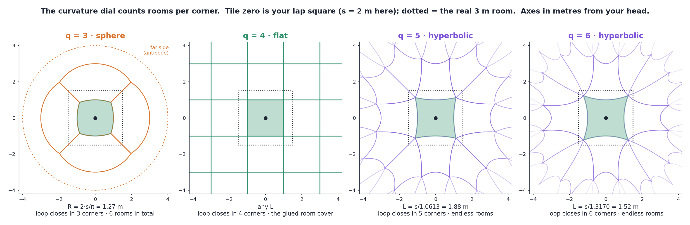

| Dial q | Space | Curvature radius from the lap square | A square lap closes after | World |
|---|---|---|---|---|
| 3 | Small Planet (S4) | R = 2s / π | 3 corners | Finite: six rooms |
| 4 | Flat (S0, and the cover of S1) | any | 4 corners | The ordinary plane |
| 5 | Hyperbolic (S2, S3), the default | L = s / 1.0613 | 5 corners | Endless |
| 6 | Hyperbolic, stronger | L = s / 1.3170 | 6 corners | Endless, grows faster |

Where the numbers come from (derived, checked numerically; formulas in Appendix A):

- In a regular tiling with four-sided tiles and q tiles per corner, the distance between neighbouring tile centres is 2·asinh(√cos(2π/q)) in units of L. For q = 5 that is 1.0613, and its hyperbolic cosine is exactly the golden ratio φ.
- A walker who goes from one tile centre to the next and turns left 90° each time circles one corner post and passes through the q tiles around it. So a square lap of side s closes after exactly q corners when s equals the centre spacing. Setting them equal gives the table.
- On the sphere the same argument gives the triangle with three right angles, whose sides are a quarter of the circumference.

Typical values (derived):

| Real room | Lap square s | L at q = 5 | R at q = 3 | L at q = 6 | Tile edge at q = 5 | Fog radius (ρ = 3) |
|---|---|---|---|---|---|---|
| 2.5 × 2.5 m | 1.5 m | 1.41 m | 0.95 m | 1.14 m | 1.77 m | 4.2 m |
| 3 × 3 m | 2.0 m | 1.88 m | 1.27 m | 1.52 m | 2.36 m | 5.7 m |
| 3 × 4 m | 2.0 m | 1.88 m | 1.27 m | 1.52 m | 2.36 m | 5.7 m |
| 4 × 5 m | 3.0 m | 2.83 m | 1.91 m | 2.28 m | 3.54 m | 8.5 m |
| 6 × 8 m | 3.2 m (cap) | 3.02 m | 2.04 m | 2.43 m | 3.78 m | 9.0 m |

A bigger room gives gentler curvature for the same effect. That is a direct benefit of dropping the fixed square: the old plan's 1 m cells forced a radius near 0.9 m, which its own authors called strong and disorienting (Brief §3.7).

### 3.3 The 3-4-5 walk

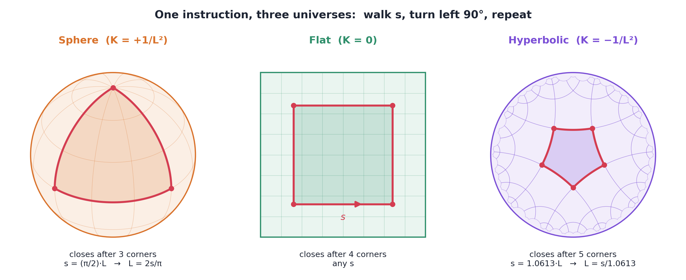

The instruction is the same in every space: *walk s, turn left 90°, repeat.* The guide is a beacon s metres straight ahead and, when you reach it, the next one to your left. A flag marks where you started. The beacons live in the world, not on the real floor.

- At q = 4 the flag is back under your feet after four corners.
- At q = 3 it is there after three.
- At q = 5 you return to where you physically started after four corners, but the flag is one more side away: you need a fifth.

What one physical lap does in hyperbolic space at the loop-fit curvature (derived, verified to 1e-12):

- You end exactly one tile away from where you began, and the world has turned a quarter-turn (90°) round you.
- Seen from the corner post you circled, the same motion is a rotation of the whole world by 72° about that post. Five laps bring everything back.

For smaller loops the turn per lap is smaller and approaches area ÷ L² (a 1 m square at L = 1.88 m turns the world by about 16°). This is curvature measured with your feet, and the read-out shows it live: corners walked, distance from the flag, and the turn accumulated.

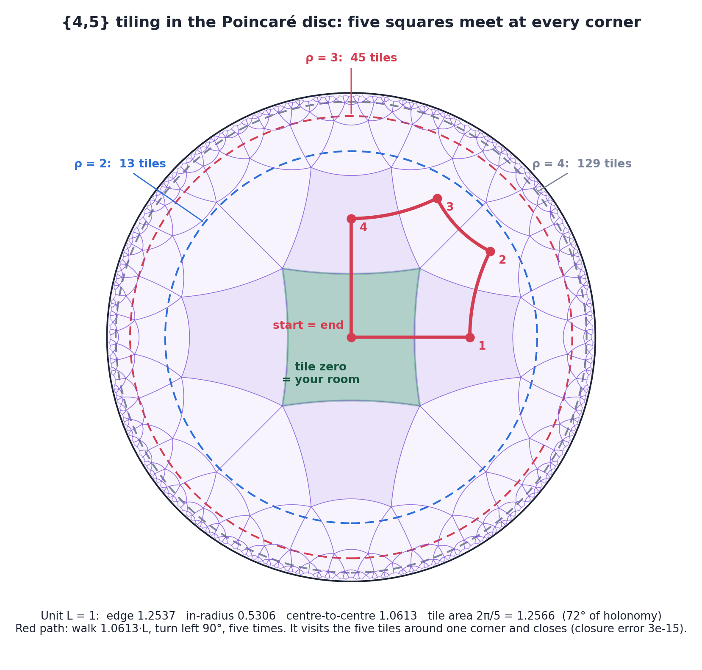

### 3.4 How the curved worlds are built

**Tiles are generated in code, not modelled.** The curvature radius depends on the scanned room, so tile meshes cannot be authored for one fixed L. The generator (task `P1-B05`) builds each tile like this:

1. Lay a regular grid on the tile's square in the Klein model, where the tile really is a straight-edged square (half-width 0.4859 for {4,5}).
2. Move every vertex to its position in the log chart: same direction from the tile centre, distance atanh of the Klein radius, times L.
3. Add kerbs along the edges, a 72° wedge of a corner post at each corner (five wedges from five tiles make one post), palette colours and vertex ambient occlusion.

Because the grid lines are geodesics in the Klein model, neighbouring tiles meet exactly along their shared edge. The warp shader then needs nothing special: it receives tile-local positions and applies the log map centred on the walker's head (§4.6).

Three levels of detail keep the triangle count flat as the tile count grows: a 0.1 m grid on the tile under the walker, 0.25 m on its neighbours, and a coarse grid beyond (far tiles are a few pixels wide).

**Content is a pure function of the tile id.** `archetype = table[hash(tileId, seed)]`, constrained by region. The same seed gives the same world on the phone and on the Station, which is what lets the Spectator redraw the walker's view from a few numbers.

| Archetype | What it is | Purpose |
|---|---|---|
| Home | Tile zero and any tile under the room's footprint: no generated props | The room itself is the content |
| Plaza | Open floor with the four corner wedges | Default; keeps sight lines open |
| Corridor | Low kerb walls (0.9 m) on two opposite edges | Shows "parallel" walls diverging |
| Doorway | One edge with a framed opening | Region gates |
| Tower | A tall emissive beacon at the tile centre | Navigation; at least one within ρ = 2.5 of every tile |
| Span A / Span B | Two neighbouring tiles that each carry half of one long object | A straight beam visibly bends across tiles |
| Garden | Low props only (under 0.5 m) | Variety without blocking the view |

Regions are whole branches of the tiling (everything first reached through one of tile zero's four edges). Each has its own hue and fog colour, so the world reads as four "lands" that never meet again.

**WorldLint** is an editor check that every generated world must pass before it reaches the phone: every tile reachable; a tower visible from every tile; every tile has its four wedges; at least one spanning object near the start; draw calls and triangles inside budget from every tile centre and eight headings; no coincident faces between neighbours; the same seed gives the same world twice.

### 3.5 What makes a curved world legible

These rules come from the only user-tested hyperbolic walking system (Holonomy, TU Delft) and from our own comfort constraints (R1, R6).

| Rule | Value |
|---|---|
| A post at every tile corner | Always. It is how "five rooms meet here" is read at a glance |
| Tile edges drawn on the floor | Always, in the shader |
| One object that spans two tiles, visible from the start | At least one |
| A tall landmark visible from every tile | Tower within ρ = 2.5; a pole beacon on the Small Planet |
| Open sight lines | Kerbs of 0.9 m, not walls; no tile closed on four sides |
| Fog in the region's hue | Starts at ρ = 2, opaque at the cull radius ρ = 3 |
| Flat twin shown after the first lap, not before | A map shown too early distracts from noticing the geometry (Spec §10.2) |
| A home beacon | Arrow and distance to tile zero; people steer home as if space were flat (R1) |
| Solid-looking things near the head | Fade within 0.3 m: virtual walls in Curved Walk are not real walls |

---

## 4. Scan your room into curved space

This section is the design that replaces the taped square. It covers the scan, the data it produces, how the room becomes Home and then tile zero, how the two hyperbolic modes work, and how the walker is kept from bumping into things.

### 4.1 The pipeline

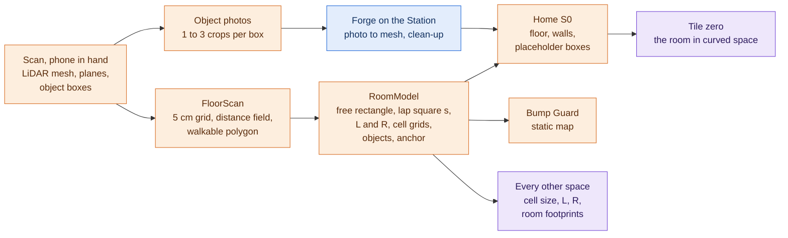

Everything downstream reads the **RoomModel**. No space, and no use case, contains a room size of its own.

### 4.2 Scanning

Two paths, both supported (D21):

- **Self-scan (the headline).** The walker holds the phone, sweeps the room, confirms the outline shown on the floor, and puts the phone in the headset.
- **Pre-scan (the fast path).** A team member scans beforehand. The app saves the `ARWorldMap` with the RoomModel and relocalises when the next walker starts.

Four scan routes, from most robust to most detailed. Each later route adds to the earlier ones; the app always has a result from the highest route that succeeded.

| Route | What it uses | What it gives | Status |
|---|---|---|---|
| 1 Manual outline | Taps on the floor corners, or the path walked along the walls | Floor polygon | Core; always available |
| 2 FloorScan | LiDAR mesh with per-triangle classes, plus plane detection | Free floor with holes for furniture, wall directions, obstacle blobs | Core |
| 3 Object boxes | RoomPlan through AR Foundation's bounding-box manager (iOS 17+) | One oriented box per piece of furniture, with a category | Core; needed for live furniture |
| 4 Wall bridge | A Swift plugin around `RoomCaptureSession(arSession:)` | Clean walls, doors, windows and openings | Extended |

Facts that constrain the design (R1, verified against Apple and Unity documentation): AR Foundation exposes RoomPlan only as furniture boxes, so walls come from planes and the mesh unless route 4 is built; the LiDAR reaches about 5 m; glass and mirrors produce missing or phantom floor, which is why unknown cells are never treated as free and the walker confirms the outline; meshing and plane detection are switched off as soon as the scan is confirmed because they are a major source of heat.

**FloorScan**, in outline (R1 §C.3):

```text
y0    = height of the largest plane classified Floor
grid  = 5 cm cells over the mesh's footprint
mark FLOOR  under every Floor triangle within 8 cm of y0, and under the walker's own path
mark OBST   under every triangle with a vertex between 0.10 m and 2.0 m above y0
FREE  = FLOOR minus OBST grown by one cell; small holes closed; unseen cells stay not-free
SDF   = signed distance to the edge of FREE, in metres
WALK  = the connected part of {SDF > 0.30 m} that contains the walker     # 0.30 m = body half-width + tracking error
axis  = dominant wall direction (length-weighted wall-plane normals)
rect  = largest rectangle inside WALK aligned to axis                      # the free rectangle, Wf × Df
boxes = oriented boxes of the OBST blobs, merged with the RoomPlan boxes
anchor = ARAnchor at the centre of rect; everything is stored relative to it
```

It runs once, off the main thread.

### 4.3 The RoomModel

| Field | Content | Used by |
|---|---|---|
| `anchor` | Pose of the ARAnchor at the centre of the free rectangle; axis direction | Everything |
| `sdf` | Distance field on the 5 cm grid (positive inside free floor) | Bump Guard |
| `walkable` | Polygon with holes | Home floor, room fitting, Station view |
| `freeRect` | Wf × Df, centred on the anchor | Glued cell, Impossible Rooms, breath lane |
| `lapSquare` | Side s | 3-4-5 walk, loop-fit |
| `curvature` | L for q = 5 and 6, R for q = 3 | S2, S3, S4 |
| `cells` | Glued cell size; Aligned Cells grid (n × m, side g) | S1, S3 |
| `walls` | Wall segments with height; door and window openings where known | Home |
| `objects` | Per object: id, category, oriented box, state of its mesh (placeholder, requested, ready), content hash | Home, Forge, asset client |
| `quality` | Share of unknown cells inside the outline; scan route reached | Onboarding, risk checks |

The schema and three sample rooms (3 × 3 m; a 3 × 4 m L-shape; 4 × 5 m with a table in the middle) are part of the contracts frozen at G0, so every lane can build against them before the first real scan exists.

### 4.4 The loop-fit rule

```text
s = clamp( min(W, D) − 1.0 m , 1.0 m , 3.2 m )      # lap square, 0.5 m inside the walls
L = s / 1.0613      (q = 5)        L = s / 1.3170   (q = 6)        R = 2 s / π   (q = 3)
```

W and D are the wall-to-wall sizes of the largest rectangle that fits the room. The lap square sits 0.5 m inside it, so a walker on the lap keeps half a metre from every wall. The table in §3.2 gives the resulting values.

- **Comfort floor.** The Curved-walk spike (gate G2) measures comfort at the loop-fit value. If the measured floor is higher than the loop-fit value for a small room, the dial uses the floor value and offers the exact loop-fit as an opt-in "strong" setting. Until G2 has run, the provisional floors are L ≥ 1.4 m and R ≥ 1.2 m.
- **Small rooms.** With less than 1.5 × 1.5 m of free floor the app selects standing mode: the walker looks and leans, and the dial, the Slicer and the Glued view still work.
- **Large rooms.** The lap square is capped at 3.2 m so that a lap stays a short walk. The rest of the floor is still free to walk.

### 4.5 Home, and furniture that arrives while you watch

Home (S0) is the room rebuilt from the RoomModel: floor, walls and door openings as clean meshes on a 0.25 m grid in the shared palette, placed at the anchor so they coincide with the real ones. It is flat and registered: touching a virtual wall is touching the real wall.

Each scanned object starts as a **placeholder box** of the scanned size, tinted by category. In parallel:

1. During the scan the phone keeps, for each object box, the one to three camera frames in which the box is best seen (largest on screen, centred, sharp, from different sides), and crops them.
2. The crops go to the Forge on the Station with the box's size and category.
3. The Forge makes a mesh from the photo, then cleans it: oriented and scaled to the box, 1,500 to 5,000 triangles, no edge longer than 0.25 m so it can bend, one palette colour taken from the photo, baked vertex shading.
4. The phone downloads the result, checks it against the budget, and swaps the box for the mesh.

The walker sees their room fill in. If the Station is not reachable the boxes simply stay. §7.4 specifies the round-trip.

### 4.6 Mode 1 · Curved Walk

**The idea.** The walker's real displacement each frame is replayed in the hyperbolic plane. Walk one metre north in the room, move one metre along a geodesic in the world. Nothing is scaled and nothing is rotated behind the walker's back, so there is no conflict between eyes and balance.

**The update** (BP §4, R1 §F.4), once per frame, after the pose has been read:

```text
d = head.xz − previousHead.xz
if |d| > 0.2 m or tracking is not Normal:  d = 0          # ignore relocalisation jumps
U = U · Boost(d / L)                                       # 3×3, double precision; U is the walker's frame in the current tile
U = orthonormalise(U) with respect to diag(1, 1, −1)
if the walker has left the current tile through edge i:
    U = inverse(G[i]) · U ;  tile = Neighbour(tile, i) ;  rebuild the visible set
for each visible tile t:
    anchor[t] = inverse(U) · F[t]                          # product in double, cast to float last
```

`G[i]` is the fixed step to the neighbour across edge i, `F[t]` is the chain of steps from the current tile to tile t, and `inverse(M)` is `η·Mᵀ·η`. Because U is always expressed in the tile the walker stands in, its entries stay near 1 however far they travel, and precision never degrades.

**The picture** is made by the vertex shader, which lays every vertex out at its true distance and bearing from the head:

```hlsl
float3 p = mul(_Anchor, ExpH2(posOS.xz / _HypL));          // tile-local position → walker's frame
float2 t = LogH2(p) * _HypL;                               // true distance and direction, in metres
posWS    = float3(_HeadPosWS.x + t.x, posOS.y, _HeadPosWS.z + t.y);
```

Height is untouched: the floor stays level and at the real floor's height. Ordinary stereo projection then gives correct depth for each eye.

**What the walker sees.** Nearby things behave normally. Farther away, straight edges bow, rooms shrink quickly (at L = 1.88 m an object 6 m away looks a quarter of the size it would in flat space), and there are many more of them than there should be: 45 tiles inside the fog radius where a flat grid of the same spacing has 21.

**What cannot be true at the same time.** A flat floor cannot be mapped onto a curved surface without distortion (Gauss). We keep every step exactly 1:1, so we must give up registration: *the virtual world slips against the real room as the walker moves.* A lap of the room leaves the world turned (§3.3). Consequences, all designed for:

- The rebuilt room is content of tile zero, not a boundary. It starts exactly on the real room and drifts off as the walker laps.
- Virtual walls cannot be solid in this mode. When curvature turns on, the walls of tile zero sink to kerbs and corner posts, and anything solid-looking fades within 0.3 m of the head.
- Virtual furniture is no longer where the real furniture is. Bump Guard, which works in real coordinates, is what warns the walker (§4.10).
- "Return to Home" (one button) fades out, resets U and curvature, and fades in with the room registered again.

**How the room enters curved space.** The Home meshes are already stored relative to the room centre, in metres. Those coordinates are used directly as tile-local coordinates of tile zero, so the same shader places them with the exp map about the room centre: distances from the centre are exact, and at zero curvature the result is identical to Home. Each furniture mesh gets its own anchor at its scanned position so that it stays rigid instead of stretching (the exp map widens things by 11 % at 1.5 m from the centre when L = 1.88 m). Tiles that lie under the room's footprint are flagged Home and receive no generated props.

**Turning curvature on.** The walker stands on the mark at the room centre. Curvature ramps from zero to the dial value while they stand still, and never changes while the head moves faster than 0.1 m/s.

**Getting around.** Laps in one direction only carry the walker round a circle of tiles. To travel, mix loops: a lap round the left half of the room, then one round the right half, or a figure of eight. The world offers help: a post at every corner, towers, region colours, a home beacon, and the flat map.

### 4.7 Mode 2 · Aligned Cells

**The idea** (after Holonomy, TU Delft 2024). Cut the free floor into square cells. Each cell shows one tile of the same {4,5} tiling, drawn flat. Stepping across a cell edge moves to the neighbouring tile. On the real floor four cells meet at a corner; in the world five tiles do. So walking once round a corner post brings you back to the same cell but a different tile, and a fifth quarter-turn is needed to close the loop.

**The grid.**

```text
n = max(3, ceil(Wf_short / 1.5))     g = Wf_short / n     m = floor(Wf_long / g)
if g < 0.8 m:  n = 2, g = Wf_short / 2       # corner demo only: five tiles round one post
```

A 3 × 3 m room gives 3 × 3 cells of 0.8 m; a 4 × 5 m room gives 3 × 3 cells of 1.13 m; a 6 × 8 m room gives 4 × 5 cells of 1.35 m. Two interior corners are enough to reach every tile of the infinite tiling.

**Drawing it.** The tile under the walker and its row and column are placed directly. A cell seen "round a corner" can show different tiles depending on which side of the corner post the line of sight passes, so each such view is a separate instance of the cell, clipped per pixel against the lines from the eye through the posts ("gates"). No stencil buffer is needed, each eye uses its own position, and the corner post hides the seam (R1 §F.7). On a 3 × 3 grid this is 13, 15 or 17 instances depending on the walker's cell. Holonomy's own solution, seven stencil views, is the documented alternative.

**What stays true.** Everything is flat inside a cell, so the world is registered: the real walls are the edge of the grid, and furniture stays where it really is, drawn in whichever tile currently occupies its cell. This is the mode with published comfort evidence (65 users, no session ended for sickness).

**What it costs.** Each cell looks Euclidean. The geometry shows itself only at the posts and on the map. And the equivalent curvature is strong and not adjustable: it behaves like L ≈ 0.89 g, about 0.7 to 1.2 m.

### 4.8 The two modes side by side

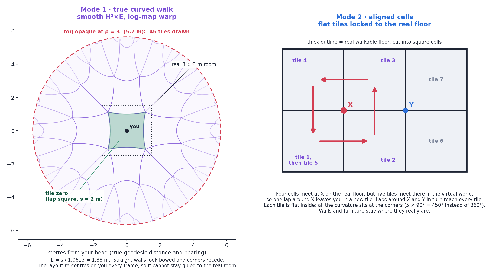

| | Mode 1 · Curved Walk | Mode 2 · Aligned Cells |
|---|---|---|
| Where the curvature is | Everywhere, evenly | Only at the corner posts |
| Curvature per tile | −2π/5 | −2π/5: the same total, concentrated in four corners |
| Each step 1:1 | Yes | Yes |
| World matches the real room | No, it slips as you walk | Yes, always |
| Furniture touchable where seen | No | Yes |
| Curvature radius | From the room: 1.4 to 3 m | Fixed by the cell: about 0.7 to 1.2 m |
| Renderer | Log-map vertex warp | Flat tiles, clip gates |
| Meshes | Chart-authored, 0.25 m grid | Plain flat squares |
| Comfort evidence | None published; our G2 spike | Holonomy: no sickness aborts |
| Role | The main world | The registered comparison, the comfort fallback, and the natural way to walk a tree (§10.2) |

One kernel serves both: the same tile ids, the same neighbour function, the same content hash, the same map. Switching mode keeps the walker in the same tile. The switch goes through a short fade because Mode 2 must re-register to the room.

For the documentation this pair is a result in itself. By the Gauss–Bonnet theorem a {4,5} tile carries total curvature −2π/5 however it is drawn. Mode 1 spreads it smoothly; Mode 2 is the polyhedral model that puts all of it into cone points of 450° at the corners. The walker can feel both.

### 4.9 Which spaces match the real room

| Space | Registered? | Walls and furniture you see are where they really are? |
|---|---|---|
| S0 Home | Yes | Yes |
| S1 Glued | Yes (the lattice is fixed to the floor) | Yes, in every copy |
| S2 Curved Walk | Only until the first step | No |
| S3 Aligned Cells | Yes | Yes |
| S4 Small Planet | Only until the first step | No |
| S5 Impossible Rooms | Yes, room by room | The real room's, yes; a virtual room's walls are virtual |
| S6 Slicer | Yes | Yes |

### 4.10 Bump Guard

The lead's decision (D19): the world is VR, nothing of the real room is drawn as a ghost, and the response to an imminent bump is **a warning cue and a haptic pulse**. Nothing freezes and nothing is replaced by a camera image. Bump Guard therefore has one job: predict contact early and say so clearly.

**Inputs** (all on the phone, all in real coordinates):

| Input | Source | Covers |
|---|---|---|
| Static clearance | The RoomModel distance field | Walls and furniture present at scan time, in every direction |
| Live depth | LiDAR depth image, seven sectors across ±35° of the view direction (Burst job) | Anything new in front of the walker: a person, a moved chair, an opened door |
| Head velocity | Raw ARKit pose, low-passed over 0.2 s | Where the walker will be |
| Tracking state | ARKit | Loss of tracking |

**Logic**, every frame, before anything else:

```text
stamp each live-depth hit that is more than 0.3 m nearer than the static map predicts
      into a dynamic layer that decays after 1 s
clear(p) = min( static SDF at p , distance to the dynamic layer at p )
now  = clear(head)
soon = clear(head + velocity × 0.8 s)
level = STRONG  if min(now, soon) < 0.20 m, or tracking has been lost for 0.5 s
        WARN    if min(now, soon) < 0.35 m
        CLEAR   otherwise          (relax only after 0.15 m and 0.3 s of margin)
direction = from the head towards the nearest hazard
```

Walking straight at a wall at 0.7 m/s, WARN starts 0.9 m out, about one second before the walker's shoulder would reach it. Walking along a wall at half a metre raises nothing.

**Outputs.**

| Level | Warning cue | Haptic |
|---|---|---|
| WARN | A chevron at the edge of the view on the side of the hazard; a soft tick from that side | Two pulses per second |
| STRONG | The chevron grows and pulses; a clear tone | Continuous pulses, six per second |
| Tracking lost | A distinct "stand still" icon | Continuous pulses |

Haptics use the phone's own engine (felt through the headset) and the gamepad's rumble when a gamepad is in hand.

**Rules.**

- The thresholds are constants in code. They are not in the parameter registry, so the Console cannot change them, and Bump Guard never reads the link.
- Bump Guard uses the raw pose. The curved-space frame ignores pose jumps; safety must not.
- The static map follows the ARAnchor, so it stays correct when ARKit refines its map.
- LiDAR depth stays on while walking. Its thermal cost is measured in the soak test (G4) and budgeted, not avoided.
- The operator can trigger the cue from the Console as an extra, never as the only, source.

**What it does not do, stated honestly.** It shows no picture of the obstacle. The LiDAR looks only where the head looks, so something approaching from the side or behind is covered only if it was in the scan. Glass and mirrors can be missed by the scan. For those reasons this plan recommends, wherever someone outside the team wears the headset: a floor cleared of loose objects, a scan the walker has confirmed, and a human spotter within reach. None of that changes what the software does; it is how we run sessions (§12, §13).

---

## 5. The fourth dimension

The challenge describes 4D like this: "Just as a 3D object casts a 2D shadow, a four-dimensional object can be projected into our 3D world… rotations happen in planes we cannot directly perceive." ATLAS uses 4D twice: once as a toybox that teaches three verbs, and once where those verbs are real clinical objects. This section explains what the medical 4D is, why it is useful, and how one piece of code serves both.

### 5.1 Three verbs

We never draw a 4D world in 4D perspective. Every view is one of three operations on a 4D object, and the walker holds the control for each.

| Verb | What it does | On a tesseract |
|---|---|---|
| **Slice** | Cut the object with a flat 3D space and show the cross-section. Move the cut along the fourth direction and the cross-section changes | Corner-first: a tetrahedron appears, grows, becomes a truncated tetrahedron, then an octahedron, and shrinks back |
| **Shadow** | Flatten the object along the fourth direction and show everything it ever occupies | The familiar cube-within-a-cube |
| **Rotate** | Turn the object, or the cut, in a plane that contains the fourth direction | The cross-section morphs in a way no ordinary rotation can produce |

The **4D toybox** (space S6) lets the walker do all three on a tesseract, a 5-cell and a 16-cell floating in their room. Each cell has its own colour, so the faces of a cross-section can be traced back to the cell they came from.

### 5.2 The medical 4D: a breathing lung

Radiotherapy and lung biopsy already use the word. A **4D-CT** is a set of ten 3D scans, one for each phase of the breathing cycle. Stack them along a fourth axis, the phase, and every structure in the chest becomes a 4D object. Because breathing repeats, the phase axis is a circle: phase 100 % is phase 0 % again. The space is ℝ³ × S¹.

In that space a tumour is a **worldtube**: the set of all points it occupies, at all phases.

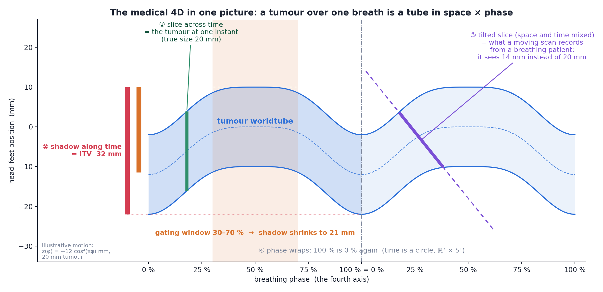

The three verbs now have clinical names:

| Operation on the worldtube | What it is | Clinical name |
|---|---|---|
| Slice across time | The tumour at one instant of the breath | One phase of the 4D-CT |
| Shadow along time | Everywhere the tumour ever is | The internal target volume (ITV; strictly, the union of the tumour over all phases is the IGTV) and the maximum-intensity projection |
| Shadow with density | How much of the breath the tumour spends at each point | Occupancy; its centre is the "mid-ventilation" position |
| Core | The points that are inside the tumour at every phase | No standard name. For a small, mobile nodule it can be empty |
| Shadow of part of the tube | Treat only during a chosen arc of the breath | Gating, and its duty cycle |
| Tilted slice | A cut that mixes position and time | What a scanner with a moving table records from a breathing patient |

The worldtube and the ℝ³ × S¹ language are ours. The objects in the right-hand column are standard practice (R2, with sources in Appendix F).

**Is this non-Euclidean?** Not by curvature. ℝ³ × S¹ is flat. What is unusual is its topology: one direction wraps, exactly as in the Glued space. It belongs in ATLAS because the challenge lists 4D projections as a geometry family in its own right, and because the three verbs are the same ones the toybox teaches. The curvature in the Lung Mission comes from the airway (§10.2).

### 5.3 Why it is useful

A static 3D model of a lung teaches several things that are wrong. The 4D view corrects each of them, and each correction is something the walker sees happen.

| What a static 3D model suggests | What is true (source) | What the walker sees in 4D |
|---|---|---|
| "The CT is a snapshot of the tumour." | A scan taken during free breathing can shorten or lengthen a moving object by centimetres: a sphere moving 1 cm with a 4 s period was imaged up to 2 cm short and 0.8 cm off-centre (Chen 2004) | Tilt the cut and the cross-section stretches or shrinks; it is striped by the phase at which each part was recorded |
| "A generous margin all round is safe." | A uniform 10 mm margin doubled the treated volume and still under-dosed the two most mobile tumours in one study (Underberg 2004) | The shadow is long in one direction and tight in the others. A sphere both overshoots and misses |
| "Tumours move a lot" (or "they don't move") | It depends where they are: 12 ± 2 mm head-to-feet for free lower-lobe tumours, 2 ± 1 mm sideways (Seppenwoolde 2002); only about one tumour in ten moves more than 10 mm (Liu 2007) | Two tubes side by side: a real one that is nearly straight, and an illustrative one that swings |
| "The average position is halfway." | The tumour dwells near the breathed-out position | The shadow is darker at one end |
| "It goes out and comes back the same way." | About half of tumours trace a loop 1 to 5 mm wide (Seppenwoolde 2002) | Look along the time axis: the centre line of the tube is a loop |
| "If the needle tip is inside the nodule on the scan, it is inside the nodule." | Between the planning scan and normal breathing during the procedure, nodules shift by 17.6 mm on average (Chen 2015). For a 10 mm nodule moving 15 mm, no point is inside at every phase (derived) | The core is small or empty. The best point to aim at is where the shadow is darkest |
| "Gating is free." | Treating only between 30 % and 70 % of the cycle removes 88 % of the motion in our illustrative breath, but the beam is on for only 40 % of the time (derived) | Drop two flags on the tube: the shadow shrinks and the duty cycle is printed |

These are teaching claims. ATLAS is for education and research visualisation, and says so on screen.

### 5.4 The four pieces

The lead chose all four. They appear in this order, and each reuses what the previous one taught.

| Piece | What the walker does | What they learn | Number on screen |
|---|---|---|---|
| **1 · 4D toybox** | Pushes a tesseract through the room; looks down to see its shadow; turns the marker cube (or the gamepad stick) to rotate the cut | Slice, shadow, rotate | Name of the cross-section; offset along w |
| **2 · Breathing worldtube** | Stands beside a tumour tube in the lesion chamber of the airway. Scrubs the phase; switches to the shadow and its dark end; places a needle point | The "map" they navigated by was one frozen slice of a 4D object | Shadow volume ÷ tumour volume; share of the breath the needle point spends inside |
| **3 · Breath lane walk** | Walks along a lane on the floor where position is time: one breath is 1.5 m, and the lane repeats. Plants two flags to bracket a gating window | Time is a circle. Choosing when to treat changes what must be treated | Gated shadow volume; duty cycle |
| **4 · Scanner-artifact demo** | Tilts the cut from "snapshot" towards "slow table" | Why an ordinary scan of a breathing patient shows a stretched, shortened or split tumour, and why 4D-CT exists | Apparent length against true length; the equivalent table speed |

Details that make them work:

- **The breath lane** is the free-walk form of the old Breath Room. It is laid along the longest clear run of the scanned floor. Because phase wraps, the lane has no end: at the real wall the walker turns round and time runs backwards. The tube is drawn once per period with the Glued engine's copy code along one axis.
- **The tube is built in front of the walker.** Shown cold, people read it as a sausage-shaped tumour (R2). So it starts as an ordinary breathing tumour; on a button press each phase slides out to its place along the lane and leaves a trail, like a multiple-exposure photograph; a "now" plane then travels along it in step with a breathing chest.
- **The tilt has a physical meaning.** A scanner whose table moves at speed v sees position z at a time that depends on z. In space-time that is a tilted cut whose angle θ satisfies tan θ = c / v, where c is the scale that turns seconds into metres on the lane. θ = 0 is an infinitely fast scanner (a true snapshot); a larger θ is a slower table. A sphere of diameter D moving at speed u along the table appears with length D·v / (v − u). That one formula reproduces the published phantom result and is a unit test.
- **Honest scale.** Real tumours in the public dataset move little (median 4.3 mm head-to-feet across its 20 patients), so the real tube is nearly straight. It is shown beside a clearly labelled illustrative nodule (10 mm, moving 15 mm) on which every effect is plain.

### 5.5 One slicer for both

`Mesh4D` holds tetrahedra with four-dimensional vertices. A Burst job cuts every tetrahedron with the hyperplane n·x = w₀ and writes triangles into a preallocated mesh (a tetrahedron cut by a hyperplane gives a triangle or a quadrilateral).

| Object | How it becomes tetrahedra | Size | Cost on the phone |
|---|---|---|---|
| Tesseract | 8 cubic cells, each split into 6 | 48 | about 0.02 ms |
| 5-cell, 16-cell, 24-cell | Directly | 5, 16, 96 | negligible |
| Tumour worldtube | A 600-triangle surface carried through 10 phases: each triangle between two phases is a prism, split into 3 tetrahedra | 18,000 per breath | under 1 ms; nothing when the cut is not moving |

The same tests therefore cover both: the tesseract's corner-first slice has area 0.8660 at offset 0.5 and 6.9282 at offset 2 (the octahedron); a 4D ball of radius 1 cut at offset c is a sphere of radius √(1 − c²); a moving sphere cut at a tilt obeys D·v / (v − u).

The shadow, its density and the core are not computed on the phone. The Station's pipeline produces them once per case as small meshes and a 64³ occupancy texture (§10.2).

### 5.6 Data

| Case | Source | Label on screen |
|---|---|---|
| Real | TCIA 4D-Lung, patient 101 (public, CC BY 3.0): tumour contoured on all ten phases, with lungs, heart, oesophagus, cord and trachea | "Public research data. Not for clinical use." |
| Illustrative twin | A 10 mm sphere in the lower lobe moving 15 mm with a published breathing-curve shape (Lujan) and a 3 mm loop | "Illustrative model." |
| Airway | Procedural tree (branching rules from the literature); optionally the first generations from a public segmented scan (AeroPath, CC BY 4.0) | "Model-generated" on every generated branch |

### 5.7 How the 4D joins the hyperbolic airway

One sentence carries the Lung Mission: **the lung defeats an ordinary 3D picture twice. It has too many branches to fit in flat space, and it will not hold still.**

- Negative curvature fixes the first. An airway tree doubles at every generation (about 16 generations of conducting airway, 23 counting the gas-exchange zone). A hyperbolic floor grows exponentially, so every branch gets a corridor of the same width.
- A fourth, circular dimension fixes the second. The walker reaches the lesion along that tree and then learns that the map was one slice of a 4D object.

The same shape of argument both times: a flat, static 3D model is the wrong container, and the right one is a geometry chosen to match the structure of the data.

---

## 6. System architecture

### 6.1 Devices and processes

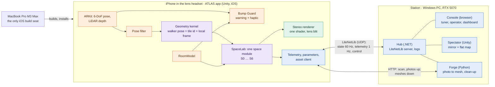

The colours are the four lanes (§9.2). The principle from the older design stands and is now stricter: **the phone renders everything and decides everything that matters within a frame. The Station watches, tunes, measures and manufactures assets. If the Station is unplugged the walker notices nothing except that furniture stays as boxes.**

### 6.2 Assemblies

One assembly definition per area. Dependencies point only downwards in this table.

| Assembly | Contains | May reference | Lane |
|---|---|---|---|
| `Atlas.Kernel` | `Iso2` (3 × 3 double isometries for negative, zero and positive curvature), exp and log maps, `TileId`, tile graph, `Mesh4D` and the slicing job | Mathematics, Burst, Collections. No scene types, so it runs in EditMode tests | B (4D part: A) |
| `Atlas.Link` | Message types, binary packing, clock sync, watchdog, client and host over LiteNetLib | Nothing from Unity. The same source compiles into the Hub | D |
| `Atlas.World` | `ISpaceModule`, SpaceLab, `RoomModel` types, world generator, archetypes, WorldLint | Kernel | A, B, C |
| `Atlas.Rendering` | Stereo rig, lens blit, shared shader and its includes, tile renderer, portal features, quality ladder | Kernel, World, URP | A (warp include and tile renderer: B) |
| `Atlas.Scan` | AR session set-up, scan routes, FloorScan, loop-fit, Home rebuild, photo capture, world map | Kernel, World | C |
| `Atlas.Safety` | Bump Guard | Scan types only. **Never Link or Telemetry** | C |
| `Atlas.Input` | Action map and twins | none | C |
| `Atlas.Telemetry` | Parameter registry, perf probe, HUD, event log, asset client | Link, World | D |
| `Atlas.Spaces.*` | One assembly per space S0–S6 | Kernel, World, Rendering, Input, Telemetry | S0: C · S1, S5, S6: A · S2, S3, S4: B |
| `Atlas.Blades.*` | The use cases (Phase 2 onwards) | All of the above | per use case |
| `Atlas.Spectator` | Windows only: consumes `State`, drives the mirror and the map | Rendering, World, Link, Spaces | D |

### 6.3 The phone's frame, in order

1. **Read**: ARKit pose (once, in Update), gamepad, the newest LiDAR depth image.
2. **Bump Guard**: uses the raw pose and the depth image. Sets the warning level. Runs before anything can be skipped.
3. **Pose filter**: rejects jumps over 0.2 m for the geometry.
4. **Kernel**: updates the walker's frame, handles a tile crossing, refreshes the visible set if the tile changed.
5. **Space module**: interaction, simulation, the slicer job.
6. **Upload**: per-tile anchors and parameters to materials.
7. **Render**: two eye cameras into one target, then the lens blit.
8. **After the frame**: sample performance counters, send `State`, drain incoming parameter changes. Nothing in steps 1–7 waits for the network.

### 6.4 Contracts frozen at G0

Lanes work in parallel because these are agreed first and changed only with notice to all four lanes.

| Contract | What it fixes | Owner | Main consumers |
|---|---|---|---|
| `ISpaceModule` | How a space is configured from the RoomModel, entered, ticked, left, and how it describes itself to the Spectator | A | all |
| Kernel types | `Iso2`, `TileId`, `WalkerPose`, `ITileGraph`; unit hyperboloid with metric diag(1, 1, −1); lengths divided by L at the boundary | B | A, C, D |
| RoomModel schema | The fields of §4.3, coordinate frame, units; three sample rooms | C | all |
| Shader include contract | Entry points and signatures of `AtlasCore.hlsl`, `AtlasWarp.hlsl`, `AtlasPortalClip.hlsl`, `AtlasGates.hlsl`; the single `UnityPerMaterial` block; every property id in `AtlasShaderIDs.cs` | A and B | all |
| Parameter registry | How a tunable is declared (id, group, range, default) and reaches the Console | D | all |
| Link schema | Message ids, the `State` layout, the event format (Appendix B) | D | all |
| Asset contract | What a generated GLB must satisfy: one mesh, no textures or materials (the phone assigns the shared one), metres, Y up, origin at the centre of the box's base, 1,500–5,000 triangles, longest edge ≤ 0.25 m | D | C |
| Layer and stencil table | One row per room layer and stencil reference (1–15) | A | B |
| Scene ownership | Who may edit which scene and prefab (§9.3) | A | all |

### 6.5 Core interfaces

Names are binding. Bodies are free.

```csharp
// Atlas.Kernel -----------------------------------------------------------------
public readonly struct Iso2 {                       // 3×3 double; κ < 0 hyperbolic, 0 flat, > 0 spherical
    public static Iso2 Boost(double2 step, double kappa);   // move by a tangent vector (already divided by L)
    public static Iso2 Rot(double angle);
    public Iso2 Inverse();                                   // η·Mᵀ·η in H², transpose on S²
    public Iso2 Orthonormalised();
    public static Iso2 operator *(Iso2 a, Iso2 b);
}
public readonly struct TileId : IEquatable<TileId> {         // six Int64: X, Y, T in ℤ[φ] for {4,5}
    public TileId Step(int edge);                            // neighbour across edge 0..3; additions only
    public ulong ContentSeed(uint worldSeed);
}
public struct WalkerPose { public TileId Tile; public Iso2 Local; }   // never a global coordinate
public interface ITileGraph {
    int Q { get; }                                           // tiles per corner
    void VisibleSet(TileId centre, double rho, List<VisibleTile> into);   // id, step chain F[t], graph distance
}

// Atlas.World ------------------------------------------------------------------
public interface ISpaceModule {
    SpaceId Id { get; }
    bool Registered { get; }                                 // does this space match the real room?
    void Configure(RoomModel room, ParamRegistry registry);  // every size comes from the RoomModel
    void Enter(in WalkerPose start);
    void Tick(in FrameContext frame);                        // after Bump Guard and the pose filter
    void Exit();
    void WriteState(ref StateMessage state);                 // what the Spectator needs to redraw this frame
}

// Atlas.Safety (no reference to Atlas.Link) --------------------------------------
public enum BumpLevel { Clear, Warn, Strong, TrackingLost }
public interface IBumpGuard {
    BumpLevel Level { get; }
    float2 Direction { get; }                                // towards the hazard, in head space
    void Tick(in SensorFrame sensors);                       // first call of the frame; never awaits
}

// Atlas.Telemetry ----------------------------------------------------------------
[AttributeUsage(AttributeTargets.Field)]
public sealed class AtlasParamAttribute : Attribute { /* id, group, min, max, default */ }
```

---

## 7. Phone ↔ Station link

Phase 1 ends with four link functions working together (D22): Spectator mirror, live tuning and operator Console, performance telemetry, and the scan and asset round-trip with furniture generated live per object (D20). The link is an accessory: the ATLAS app is complete without it (§7.5).

### 7.1 Topology and processes

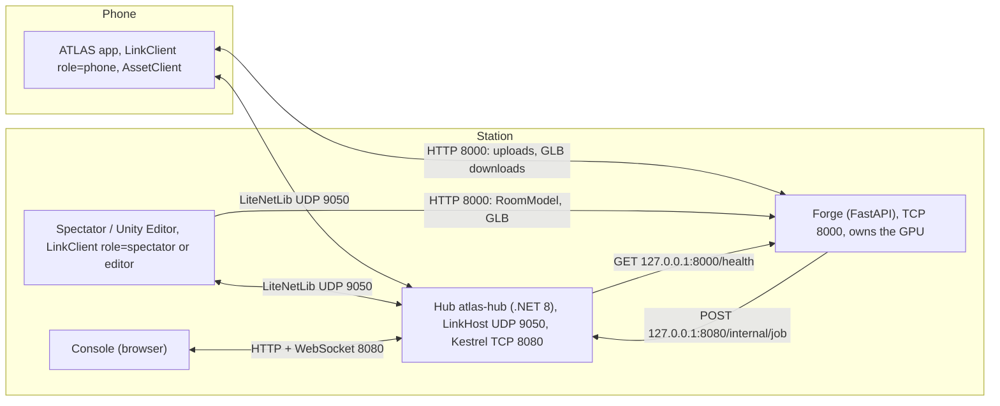

| Process | Listens on | Role |
|---|---|---|
| Hub | UDP 9050 (the only LiteNetLib listener); TCP 8080 on `0.0.0.0` | Relays `State` to spectators and commands to the phone; writes logs; serves the Console |
| Forge | TCP 8000 on `0.0.0.0` | Stores RoomModels, runs object jobs, serves GLBs by hash; never sees live pose |
| ATLAS app, Spectator, Editors | nothing (clients) | Same `LinkClient`; the phone rejects every connection request |

- `Atlas.Link` is one plain C# library (asmdef with no engine references; no `UnityEngine` types) compiled into the app, the Spectator and the Hub (linked sources). It holds `LinkClient`, `LinkHost`, `ClockSync`, the message readers and writers, and `ParamRegistry`'s engine-free half. (R4 §5.9)
- LiteNetLib 2.1.4, connection key `atlas-v1`; unicast to a known address only. Pairing: `http://<station>:8080/pair` shows a QR of `atlas://<ip>:9050`, read by the iOS Camera app; a typed-IP field and a DHCP-reserved default are the fallbacks. (R4 §3.7)
- The first `Connect` is made in hand during onboarding to raise the Local Network prompt, retried every 1 s. (BP §0.5, R4 §3.3)

### 7.2 Channels, encoding, clock and watchdog

| Ch | Delivery | Direction | Messages | Rate | Payload |
|---|---|---|---|---|---|
| 0 | ReliableOrdered | both | `Hello`, `Welcome`, `ParamManifest`, `ParamSet`, `SceneCmd`, `OperatorCmd`, `RoomOutline`, `Event`, `Log`, `JobStatus`, `AssetReady`, `AssetAck`, `Bye`, `Telemetry` | on demand; `Telemetry` 1 Hz | < 1 kB each |
| 1 | Sequenced | phone → Hub → spectators | `State` | 60 Hz (30 Hz on the thermal tier) | 202 B (derived) |
| – | Unreliable | both | `TPing`, `TPong` | 8 at connect, then 1 Hz | 13 B, 29 B |
| HTTP | TCP | phone ⇄ Forge | RoomModel, crops, GLB | on demand | §7.4 |

- **Encoding.** `State`, `Telemetry`, `ParamSet`, `RoomOutline`, `TPing`, `TPong`: hand-packed little-endian through one reused `NetDataWriter` (zero allocation). Everything else: one type byte plus a UTF-8 JSON string (`JsonUtility` on the phone, `System.Text.Json` on the Hub), forwarded to the Console unchanged. `NetSerializer` is not used. (R4 §4)
- **Bandwidth.** `State` on the wire ≈ 234 B × 60 Hz ≈ 14 kB/s; no datagram reaches the 1,024-byte initial MTU (derived from R4 §5.2).
- **Send point.** `SendState` runs once per frame in `LateUpdate` after the kernel step, then `TriggerUpdate()`. LiteNetLib settings: `ChannelsCount 2`, `PingInterval 500`, `DisconnectTimeout 3000`, `UpdateTime 5`, `IPv6Enabled false`; Hub adds `AllowPeerAddressChange true`. (R4 §5.5)
- **Clock sync.** Four-timestamp exchange on `Stopwatch` microseconds: offset = ((t2 − t1) + (t3 − t4)) / 2. Eight exchanges 50 ms apart at connect, then 1 Hz; keep the minimum-RTT sample of the last 16; low-pass α = 0.1. The Hub clock is the reference for phone and spectators. (R4 §5.4)

| Watchdog state | Condition | Behaviour on the phone |
|---|---|---|
| CONNECTED | a packet within 500 ms | normal |
| DEGRADED | silent 500 ms–3 s (enter after 2 missed pings, leave after 2 s healthy) | `ParamSet` ignored |
| OFFLINE | peer disconnected | app unchanged; reconnect at 0.5, 1, 2, 4, 4 … s; asset client falls back to polling (§7.4) |
| RESYNC | just reconnected | `Hello` → `Welcome` → 8 pings → `ParamManifest`; Hub replays the last parameter snapshot and any unacknowledged `AssetReady` |

On `OnApplicationPause(false)` with no peer, the app calls `Connect` again. (R4 §3.5)

**Link indicator.** In hand: state dot (green, amber, grey), Hub address, RTT, loss, Forge reachability, "Reconnect", "Change IP". In the headset: one dot at the lower edge of both eyes, refreshed at 2 Hz, hidden while CONNECTED under demo lock. (R4 §5.7)

### 7.3 The four functions

#### 7.3.1 Spectator mirror

- **Flow.** `State` (channel 1) carries scene id, space id, the tile id as six `i64` for {4,5}, the tile-local double 3×3, eight parameters, and the head pose in the RoomModel anchor frame. The Spectator is the app's own render scene built with `ATLAS_SPECTATOR` (no ARKit); it sets the same kernel state and draws one mono camera. No video is sent.
- **Determinism.** The Spectator never integrates motion; it applies the received transform and re-anchors exactly as the phone does. `Hello` and `Welcome` carry `worldHash` = SHA-256 of (space id, tiling, generator seed and version, RoomModel hash, L in millimetres), truncated to 16 hex characters. `State.worldVer` bumps on any regeneration. On mismatch the Spectator shows "world mismatch" and re-fetches `GET /rooms/{roomId}`; it never draws a guessed world. (R4 §5.3)
- **Beside the mirror.** Flat-twin mini-map (the space's flat model with the walker's path); the RoomModel outline from `RoomOutline` with the walker's physical position and object boxes; the Bump Guard level (`State.bumpLevel`: 0 clear, 1 warn, 2 strong, 3 tracking lost) as a coloured bar.
- **Furniture.** The Spectator gets the relayed `AssetReady` and downloads the same GLBs.
- **Acceptance.** Tile ids equal on 100% of samples; photon-to-photon ≤ 150 ms (tests L5, L7, L8).

#### 7.3.2 Live tuning and operator Console

- **Registry.** Each parameter is registered once at boot: `{id u16, name, group, min, max, def, val, onRelease}`. The phone sends `ParamManifest` after `Welcome`; the Console builds its sliders from it with no further code. First set: `_HypL`, fog distance, cull ρ, 4D slice w and rotation angles, render scale, MSAA, line width, IPD. (R4 §6.3)
- **Path.** Slider → WebSocket `{id, value}` → Hub → `ParamSet` → phone clamps to `[min, max]` and applies → the applied value returns in the next `State.p[]` or `Event param`. Parameters that regenerate geometry have `onRelease = true` and bump `worldVer`.
- **Presets.** Stored as JSON on the Station; loading replays one `ParamSet`; "Bake" copies a preset into project defaults so the phone is correct with no Station.
- **Operator commands.** Exactly six: switch space (`SceneCmd`), and `OperatorCmd` `home`, `recentre`, `quality`, `cue`, `lock`. `cue` fires the Bump Guard warning cue (indicator, sound, haptic) through the same local code path Bump Guard uses. There is no "panic → passthrough" and no freeze (D19).
- **Lock.** `demoLock` (build flag or `OperatorCmd lock`) makes the phone ignore `ParamSet`; operator commands still work.
- **Acceptance.** Slider visible on the phone ≤ 100 ms; clamped; ignored under lock (L9, L10).

#### 7.3.3 Telemetry dashboard and CSV

- **Flow.** `AtlasPerfProbe` keeps a 3,600-frame ring buffer and emits one `Telemetry` row per second (91 B, derived), reliable, so the CSV has no holes. (R5 D3)
- **Fields.** Listed in Appendix B.2: frame-time percentiles, CPU and GPU times, draw calls, triangles, memory, thermal state, battery, tracking, quality settings, link health, Bump Guard and asset counters.
- **Storage.** The Hub appends `logs/<session>/perf.csv` (header row, one line per second), plus `state.bin`, `events.jsonl`, `phone.log`. The phone writes the same rows to `Application.persistentDataPath/perf/perf_<session>.csv` from a writer thread (`UIFileSharingEnabled` on), so a lost link loses nothing.
- **Console.** A tile per field; line charts of frame-time p95 and fps; a thermal colour bar; Forge queue length.
- **Acceptance.** 15-minute soak: ≥ 895 rows, no gap > 2 s, PC and phone copies identical (L11).

#### 7.3.4 Scan and asset round-trip

See §7.4. Acceptance: every box ends as a generated or fallback mesh; ≤ 60 s from job start to `AssetAck` per object (L15–L20).

### 7.4 Scan and asset round-trip

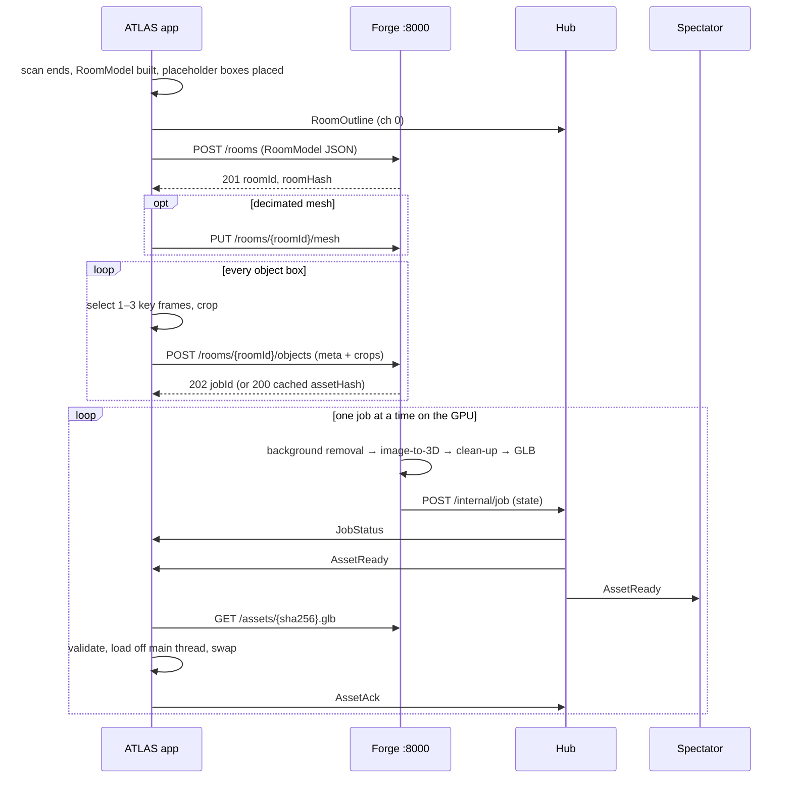

**Phone: capture and selection.**
- During the scan the app keeps a key-frame ring in memory: a new frame when the camera has moved ≥ 0.25 m or turned ≥ 15°, and gyro speed < 30°/s; at most 96 frames, each with camera pose and intrinsics (thresholds derived; tune at G6).
- When the RoomModel is final, each object box is projected into each key frame. A frame is a candidate when all eight corners are inside the image with a 5% margin, the projected bounding box covers 10–70% of the image, the camera is 0.6–3.0 m from the box, and LiDAR depth at the box centre is within 0.15 m of the expected distance (not occluded).
- Score = 0.4·min(area / 0.35, 1) + 0.3·centredness + 0.3·sharpness, where centredness = 1 − (offset of the box centre from the image centre ÷ half-diagonal) and sharpness = variance of the Laplacian on a 160-pixel thumbnail ÷ the scan's median (derived).
- Take the best frame, then up to two more whose azimuth about the box differs by ≥ 30° from every frame already taken. Zero candidates → no upload; the box takes the built-in fallback mesh.
- Crop to the projected box padded by 12%, squared, ≤ 768 × 768, JPEG quality 85, on a worker thread. View 0 feeds generation; views 1–2 are retry inputs and colour samples (TripoSG takes one image: verify).

**Forge: job per object.**

| State | Work | Timeout |
|---|---|---|
| `queued` | Cache lookup by `sha256(view 0) + pipelineVer`; a hit goes straight to `ready` | – |
| `matting` | Background removal (`rembg`) | 10 s |
| `generating` | TripoSG on the RTX 5070 (BP §0.5) | 90 s, then one retry with view 1, then the hosted API if a key is configured (120 s) |
| `cleaning` | Up axis and the yaw in {0°, 90°, 180°, 270°} whose bounds best match the scanned box; scale to the box (≤ ±15% per axis); decimate to 1.5–5k triangles; regrid so no edge exceeds 0.25 m; nearest palette entry to the photo's dominant colour; vertex ambient occlusion; export GLB | 20 s |
| `ready` / `failed` | `AssetReady`, or `JobStatus failed` → the phone uses the fallback set | – |

- GLB contract: one mesh, `POSITION`, `NORMAL`, `TEXCOORD_0` (palette cell), `COLOR_0` (ambient occlusion), no textures, no material; box-local frame, origin at the base centre, +Y up, metres. The phone assigns the shared look material.
- One GPU job at a time; the queue is ordered by box volume, largest first.

**Phone: placement.**
- Placeholder: a box of the scanned dimensions in the palette's neutral colour, gridded at 0.25 m, present from the moment Home is built.
- On `AssetReady`: download to `persistentDataPath/assets/<sha256>.glb`, verify the SHA-256, load with glTFast asynchronously, instantiate at most one asset per frame, validate triangles ≤ 5,000 and bounds within ±10% of the box, then cross-fade placeholder to mesh over 0.3 s. Send `AssetAck {ok, loadMs, worstFrameMs}`. A rejected asset keeps its placeholder and reports `ok: false`.
- Without the Hub, the phone polls `GET /jobs?room=` every 2 s. Without the Forge, placeholders stay and the built-in fallback set (one mesh ≤ 1.5k triangles per category, scaled to the box) replaces them after 3 failed uploads (backoff 1, 2, 4 s). Uploads resume when the Forge returns.
- The saved RoomModel stores `boxId → sha256`, so the pre-scan path (D21) loads furniture from the phone's cache with no Station.

**Privacy.** Only crops leave the phone; full camera frames are never uploaded or written to disk and the ring is cleared when cropping ends. The Forge holds crops in memory and deletes them when the job finishes unless `FORGE_DEBUG_KEEP=1`. Scan with no other person in view; a crop in which ARKit's human stencil covers > 5% of pixels is discarded (Extended).

| Budget | Value |
|---|---|
| RoomModel JSON | ≤ 300 kB (160 × 160 grid, base64; derived from R1 C.3) |
| Decimated room mesh | ≤ 2 MB; optional |
| Crop | ≤ 200 kB each; ≤ 3 per object |
| GLB | ≤ 1 MB; 1.5–5k triangles (§2) |
| Worst frame during a swap | < 20 ms |

### 7.5 Link rules

1. Safety never touches the network. Bump Guard, tracking, the kernel and rendering never read link state. `OperatorCmd cue` is an extra trigger, never the only one.
2. Nothing in `Update`, `LateUpdate` or a render callback awaits the link. Sockets run on LiteNetLib's threads; HTTP, hashing, JPEG encoding, GLB parsing and file writes run off the main thread; received commands are queued and applied on the next frame.
3. Every remote parameter is clamped on the phone. Bump Guard distances and thresholds are not in the registry.
4. With the Hub unplugged the app behaves identically apart from the link indicator; with the Forge unplugged, apart from placeholder or fallback furniture.
5. A receiver ignores unknown message ids and trailing bytes; a `proto` major mismatch is refused with a readable reason.
6. `Atlas.Link` allocates 0 B per frame in steady state.

### 7.6 Acceptance tests for gate G6

Own router, Station wired, phone in the headset. Loss and latency simulation is enabled on the Hub side (R4 §5.10).

| # | Test | Pass |
|---|---|---|
| L1 | Cold connect, permission already granted | CONNECTED ≤ 3 s p95 over 10 launches |
| L2 | First connect with the iOS prompt | CONNECTED ≤ 5 s after "Allow"; no restart |
| L3 | `State` rate at the Hub, 5-minute walk | ≥ 58 Hz mean; loss < 2% |
| L4 | Phone → Hub latency, clock-corrected | p50 ≤ 10 ms, p95 ≤ 25 ms, p99 ≤ 50 ms |
| L5 | Photon to Spectator (slow-motion video) | ≤ 150 ms |
| L6 | Clock offset over 10 min | jitter ≤ 2 ms p95 |
| L7 | Closed five-corner loop in S2 | tile ids equal on 100% of samples; `worldHash` equal |
| L8 | `worldHash` forced to differ | Spectator shows "world mismatch"; draws no world |
| L9 | Sliders for L, fog, ρ, w | visible ≤ 100 ms; ≤ 250 ms at 10% loss; clamped; ignored under lock |
| L10 | Six operator commands | each takes effect ≤ 250 ms; `cue` gives indicator, sound and haptic |
| L11 | Telemetry, 15-minute soak | ≥ 895 rows; no gap > 2 s; PC and phone CSV identical |
| L12 | Router off 10 s; Hub restarted; app backgrounded 10 s | OFFLINE ≤ 3.5 s; CONNECTED ≤ 5 s after return; parameters restored; no phone restart |
| L13 | Link on against Hub unplugged, 5 min each | main-thread p95 differs ≤ 0.2 ms; 0 B per frame from `Atlas.Link` |
| L14 | Station cable pulled while walking at an obstacle | Bump Guard cue identical; no frame > 33.3 ms |
| L15 | Room with ≥ 4 object boxes, Station up | 100% placeholders at Home entry; every box ends as mesh or fallback; ≤ 60 s job start → `AssetAck` each |
| L16 | Forge output check | every GLB ≤ 5,000 triangles, edges ≤ 0.25 m, longest side within 10% of the box |
| L17 | Mesh swap | worst frame < 20 ms over 10 swaps |
| L18 | Same room scanned twice | second run: 100% cache hits, no GPU job |
| L19 | Forge stopped before the scan | app enters Home; fallback set placed; uploads resume on restart |
| L20 | Privacy | after all jobs, Forge holds 0 crop files with the debug flag off |

---

## 8. Graphics and performance

The aim is a picture that reads clearly in both eyes at 60 frames per second for a whole session, on a phone with no fan. The Build Pipeline sets the method; the performance research (R5) checked its budgets against the hardware and corrected three numbers. Both are folded in here.

### 8.1 The look: a lit architectural diagram

Colour and line define form, not textures (BP §2). This is also the cheapest thing to draw in stereo.

| Rule | Detail |
|---|---|
| One palette | A single 128² texture of flat colour blocks and a few gradient strips. Compression off, mipmaps off |
| One material | One shader for every opaque surface, so the SRP Batcher works and draw submission stays cheap |
| Shading baked into vertices | Ambient occlusion in vertex colours. No lightmaps (they do not follow warped or copied geometry), no real-time shadows |
| Lines in the shader | Tile edges and a 0.5 m floor grid drawn with `fwidth`, anti-aliased and stable in both eyes. They show the geometry directly |
| Fog in the room's hue | Lightness steps down with distance or copy depth, so repetition reads and the edge of the drawn world disappears |
| Emissive accents | Portals, cross-sections, beacons. No bloom |
| Dark base palette | The display is OLED: dark pixels cost less power, which delays thermal throttling |
| Outlines | Inverted-hull outlines only on a few hero objects (portal frames, the slicer) |
| Transparency | Sparingly. Dithered, or a rim term, instead of sorted blending |
| Text | TextMeshPro for every label and sign |

### 8.2 Render set-up

| Setting | Value | Why |
|---|---|---|
| Pipeline | URP, forward, Render Graph | (BP §4) |
| Cameras | Two eye cameras, ±32 mm, one shared renderer, no camera stacking, no AR camera background | (BP §0, §1) |
| Target | Both eyes into one colour target at render scale 0.8 (1118 × 1032 per eye), 4× MSAA, depth not stored | Fill rate is not the limit on this GPU; line art needs the resolution (R5) |
| Final pass | One full-screen blit: per-eye barrel pre-distortion for the lenses, combined with the upscale | The only full-screen pass in the app |
| Off | HDR, depth texture, opaque texture, depth priming, post-processing, FXAA, STP, shadows, additional lights, GPU Resident Drawer, baked occlusion culling, static batching of warped meshes | (BP §4) |
| On | SRP Batcher, native render pass | |
| Frame rate | `targetFrameRate = 60`; ProMotion off; Unity's thermal frame-rate adjustment off (needs Unity ≥ 6000.3.21f1) | Unity otherwise forces 30 fps at thermal state Serious (R5) |
| ARKit | Lowest-resolution 60 Hz video format; LiDAR depth on; meshing, planes, light estimation and probes off after the scan | Heat |

A check that must be made once with an Xcode GPU capture: the opaque pass, the portal stencil passes and the tile passes are merged into one native pass per eye, and the multisampled depth is discarded, not stored. If a pass break forces the MSAA surface to be stored and reloaded, a 10 % cost becomes several milliseconds.

### 8.3 One shader, four includes

| File | Owner | Does |
|---|---|---|
| `AtlasCore.hlsl` | A | Palette lookup, vertex ambient occlusion, grid and edge lines, fog, the single per-material constant block |
| `AtlasWarp.hlsl` | B | One entry point: object position in, world position out. Modes: none, hyperbolic, spherical (log map centred on the head) |
| `AtlasPortalClip.hlsl` | A | Clip against a portal plane |
| `AtlasGates.hlsl` | B | Per-pixel clip against up to four sight-line gates (Aligned Cells) |

Rules that keep it fast:

- Per-tile or per-room data (the anchor matrix) lives in the per-material block, one pooled material instance per tile or room. Camera-wide data (head position, L, fog) are globals. **No MaterialPropertyBlocks.**
- No new shader keyword without telling lane A. Prefer a per-material number or a global mode.
- The warp evaluates the exponential once per vertex and derives sinh and cosh from it. Positions stay in full `float`.
- Portal rooms are flat and curved spaces have no portals, so the clip and the warp never meet in one material.
- Warped renderers get huge `localBounds`. Unity then culls nothing, so the kernel's cull by hyperbolic distance is the only culling in curved spaces and is mandatory.

A note on the reference code: HyperEngine's own shader passes its per-object matrix through a MaterialPropertyBlock (R3). The port must move that matrix into the per-material block; it is not a copy-and-paste.

### 8.4 Geometry and asset budgets

| Asset | Made by | How | Triangles |
|---|---|---|---|
| Tile shell, three levels of detail | Lane B | Generated in C# at run time (§3.4) | ≤ 1,500 at 0.1 m (home tile) · ≤ 600 at 0.25 m · ≤ 120 beyond |
| Home shell (floor, walls) | Lane C | Generated from the RoomModel on a 0.25 m grid | ≤ 3,000 |
| Furniture | Lane D | Forge: photo to mesh, then clean-up | 1,500–5,000 each; longest edge ≤ 0.25 m |
| Glued cell | Lane A | The Home shell and decimated furniture merged into one mesh per copy | ≤ 5,000 per copy |
| Impossible Rooms | Lane A | Parametric from the free rectangle (ProBuilder or C#) | ≤ 2,000 per room |
| Landmarks, spans, garden props, avatar, door frame | Lanes A and B | Blender, CC0 kits (Kenney, Quaternius, KayKit) recoloured to the palette | Hero 5,000–15,000 · small 300–1,500 |
| Polytopes and tubes | Lane A | Generated | Tesseract 48 tetrahedra; tube 18,000 |

Licence rules: Asset Store packs never enter the repository; CC-BY assets and any hosted AI output are credited; Hunyuan3D stays off the default path (territory limits); TripoSG is MIT.

### 8.5 Budgets

**Per frame, both eyes (must):** at most 300 draw calls, 500,000 triangles, 60 set-pass calls, 1.5 GB of memory, and no managed allocation in steady state.

**Per space (planning figures, to be replaced by measured ones at G4):**

| Space | Draw calls per frame | Triangles per frame | What drives it |
|---|---|---|---|
| S0 Home | ≤ 40 | ≤ 120k | Ten furniture meshes |
| S1 Glued, 5 × 5 | ≤ 60 | ≤ 250k | One merged mesh per copy |
| S2 Curved Walk, ρ = 3 | ≤ 150 | ≤ 250k | 45 tiles plus the room |
| S3 Aligned Cells | ≤ 120 | ≤ 200k | 13 to 57 cell instances |
| S4 Small Planet | ≤ 40 | ≤ 60k | Six tiles |
| S5 Impossible Rooms | ≤ 60 | ≤ 80k | Two rooms through one portal |
| S6 Slicer | ≤ 60 | ≤ 160k | Home plus the dynamic cross-section |

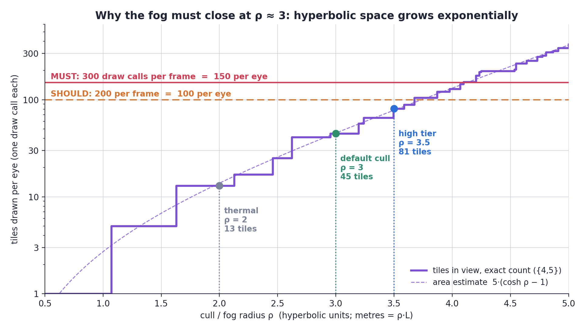

The figure shows why the cull radius is the main performance control in hyperbolic space: the number of tiles grows exponentially with distance. At ρ = 3 there are 45, at ρ = 4 there are 129, at ρ = 5 there are 373. The Build Pipeline's "fog at 5–8 units" is the numerical precision horizon, not a drawable distance; the working rule is **fog fully opaque at the cull radius, default ρ = 3**.

**Frame time at 60 fps (16.7 ms), cold targets (R5):**

| Stage | Thread | Target | Cap |
|---|---|---|---|
| ARKit update, pose, input | main | 1.0 ms | 1.5 |
| Bump Guard, kernel, visible set, slicer, space logic | main | 0.8 ms | 1.5 |
| Link, telemetry, HUD | main | 0.2 ms | 0.5 |
| URP set-up and culling for two cameras, engine overhead | main | 1.8 ms | 3.0 |
| **Main thread** | | **3.8 ms** | **6.5** |
| Draw submission (≤ 300 draws), encode, present | render | 3.0 ms | 5.0 |
| Opaque, warp, fog, portals, resolve, lens blit, both eyes | GPU | 4.6 ms | 7.6 |

The GPU can lose 30–50 % of its speed when hot, which is why the cold GPU target is under 5 ms.

### 8.6 Heat

The plan is never to reach thermal state Serious during a session. Levers, in order of benefit for effort (R5):

1. Dark palette and dark fog.
2. Screen brightness fixed near 40 %.
3. Lowest-resolution 60 Hz ARKit format; meshing and planes off after the scan.
4. No charging while running; case off; phone out of the headset and in front of a fan between sessions.
5. The quality ladder below.
6. Two phones: swap at Fair.

| Trigger | Render scale | MSAA | Cull ρ | Glued copies | Note |
|---|---|---|---|---|---|
| Nominal | 0.8 | 4× | 3 | 5 × 5 | |
| Fair, or GPU p95 over 9 ms | 0.7 | 4× | 3 | 5 × 5 | Console shows amber |
| Serious, or GPU p95 over 12 ms | 0.6 | 2× | 2 | 3 × 3 | Console says "swap phone"; still 60 fps |
| Still missing 60 fps after 10 s, or Critical | 0.6 | off | 2 | 3 × 3 | Lock to 30 fps and end the session |

The ladder moves one step at a time, at most every 20 seconds. A "high" tier (ρ = 3.5, 7 × 7 copies) exists for a cool phone and for video capture.

One cost is accepted rather than avoided: LiDAR depth stays on for Bump Guard. Its effect on time-to-Fair is measured in the G4 soak, and the ladder absorbs it.

### 8.7 Latency

ARKit reports the pose of the moment the camera frame was captured, not a prediction. The expected motion-to-photon time on this stack is 55–95 ms (R5, an estimate until measured). Three decisions follow:

- Keep `TrackedPoseDriver` on Update only. One pose sample per frame feeds the kernel and both cameras, so the virtual and real motion stay consistent. Sampling again before render would gain about 1 ms and add judder.
- Gyro rotation prediction is the one cheap improvement: rotate the rig by the gyro rate times 30–60 ms after the kernel has used the unpredicted pose. It ships behind a switch and stays only if the slow-motion measurement improves and three people see no jitter.
- Measure it once (240 fps video of the phone and its screen, §11.4) and publish the number.

### 8.8 Measuring

A single component, `AtlasPerfProbe`, samples frame timings and render counters every frame, keeps one minute of history and, once per second, computes percentiles and sends one telemetry row to the Station. The row is also appended to a CSV on the phone, so a lost link loses nothing. A HUD in the headset shows the same numbers. §11.2 lists every metric with its must, should and stretch value; §11.4 gives the measurement protocols. Published numbers come from a Release build, in the headset, after the soak.

### 8.9 Where to spend optimisation effort

In order of expected gain:

1. Frame-rate settings: `targetFrameRate`, thermal adjustment off, Release configuration, debugger detached.
2. The URP switches of §8.2.
3. The ARKit configuration and switching managers off after the scan.
4. One merged mesh per tile, room or copy; one shader; pooled materials.
5. Cull at ρ = 3 with fog opaque at the cull radius.
6. Levels of detail by graph distance: 0.1 m only on the home tile.
7. The MSAA pass-merge check.
8. Zero allocations per frame: pooled materials, preallocated slicer buffers, no string building in Update.
9. Dark palette and brightness.
10. The thermal ladder.
11. Decimating scanned and generated meshes to budget before they are copied 25 times.

Not worth effort: baked occlusion culling (broken by the warp), static batching, the GPU Resident Drawer, a compute-shader slicer, single-camera stereo. Stretch only: a hidden-area mask for the lens circle, instanced tile shells, 30 fps rendering with reprojection.

Profiling tools, in the order to reach for them: the HUD and the CSV; the Metal Performance HUD for an independent reading; the Unity Profiler over USB for a CPU problem; the Frame Debugger for batch breaks; the Render Graph Viewer for pass structure; an Xcode GPU capture for a GPU problem.

### 8.10 Sound

Cheap polish (BP §3c), done in Phase 4: one ambient loop per space, a chime at portals pitched by depth, a tick at tile edges, a rising tone as the 4D cut moves, and the Bump Guard tones. Plain Unity audio; sources are CC0 packs.

---

## 9. Build plan

### 9.1 How the plan is organised

- **By dependency, not by date.** Every task lists what it needs and what proves it is done. A task starts when its inputs exist. A phase ends when its exit gate passes.
- **Contracts first.** One short sequential spine ends in gate G0, where the interfaces between lanes are frozen and stubbed. After that the four lanes do not wait for each other's code until the integration gates.
- **Editor first, phone last.** Only one Mac can build to the phones, so everything that can be proved in the Unity Editor or in a unit test is proved there. The phone is for acceptance.
- **Small, verifiable tasks.** Each task fits one engineer or one coding agent, touches one lane's files, and has a binary acceptance test with numbers.
- **The plan's tables and diagrams come from one data set.** The Phase 1 graph has 58 tasks and 127 dependency edges, checked to be free of cycles; the diagrams below are generated from the same data as the tables.

### 9.2 The four lanes

| Lane | Phase 1 · Foundation | Phase 2 · Use cases I | Phase 3 · Use cases II | Phase 4 · Finish |
|---|---|---|---|---|
| **A · Platform, Look and Flat Spaces** | Project, build seat, stereo rig, lens blit, shared shader, SpaceLab, Glued (S1), Impossible Rooms (S5), Slicer and `Mesh4D` (S6), thermal ladder, soak | Slicer toybox, equation sources, look of the Playground; the whole medical 4D runtime (worldtube, breath lane, scanner tilt, tasks) | Shared House: sheets, door, second home, visitor | Look and audio, performance hardening, golden build |
| **B · Kernel and Curved Worlds** | Kernel, holonomy rig, warp shader, exact tile ids, tile meshes and renderer, world generator, Small Planet (S4), dial and 3-4-5 walk, Aligned Cells (S3), room as tile zero | Lung Mission: airway wing in hyperbolic space, valve chambers, Two Compasses, needle sky | FieldFit: lens mathematics, lookup, composed final blit, blind-spot finder | Maths notes, correctness report, equation cards, figures |
| **C · Scan, Room and Safety** | AR session, scan routes, RoomModel and loop-fit, Home (S0), object photos, Bump Guard, input, pose pipeline, onboarding, pre-scan path | Geometry Playground: the shell (director, guided walk, captions, twins, menu) and the Glued and Impossible Rooms stations | Shared House: second scan, door fit, Bump Guard on the second sheet, peer link | Onboarding with outside walkers, comfort protocol, failure drills, rehearsals |
| **D · Link, Station and Forge** | `Atlas.Link`, Hub, tuner and Console, perf probe and telemetry, Spectator, flat-twin map, Forge and mesh clean-up, asset client, pairing | Lung Mission: the Station pipeline (`atlas case`), case packages, plan card, Lung panels on Console and Spectator | FieldFit: field presets, Console lens panel, Spectator heatmap, search task and logging | Judges' dashboard, session logs, metrics report, video capture, deck |
| Work packages | A 14 · B 11 · C 13 · D 11 (+ 2 shared, 7 gates) | A 16 · B 12 · C 16 · D 13 | A 7 · B 8 · C 5 · D 6 | A 5 · B 5 · C 6 · D 6 |

The lane owner decides inside the lane. Anything that touches a contract (§6.4) is announced to all four before it is committed.

### 9.3 Shared resources and the rules that protect them

**The build seat (one Mac).**

1. Lane A's first job is the build chain and the stereo rig. Nothing else in lane A starts before gate G1.
2. Everyone runs the Unity Editor on their own machine. Native code is wrapped so the Editor and the Station build compile without it.
3. Device builds go out as a build train: one integration build at every gate, plus short on-request slots from a visible queue (who, branch, what is tested).
4. Prefer iteration that needs no rebuild: live tuning from the Console, replay of recorded RoomModels and pose logs in the Editor, kernel and graph logic as EditMode tests.
5. One bundle id and one signing account. A build signed by a different account cannot install over the existing one.

**The two phones.**

1. Phone A is the reference device for every published number. Phone B is lane C's working device (lane C has the most tasks that need a phone: 13 of its 13), the hot-swap spare, and the second walker in Phase 3.
2. Hand-held before head-mounted: scan, link and input are debugged with the phone in the hand; the headset is for acceptance.
3. Record once, replay many times: the first good scan and a few walks are saved and replayed in the Editor by every lane.
4. A soak leaves a phone hot. Soaks are scheduled, not squeezed between someone else's measurements, and the thermal state is noted at the start of every measurement.

**The Station's GPU.** The RTX 5070 has 12 GB. The Forge's generator needs about 8 GB and owns the card while jobs are queued. The Spectator runs at modest settings beside it. The medical pipeline (`atlas case`, Phase 2) runs when the Forge is idle.

**Scenes and prefabs.** Unity scenes are single files, so each has exactly one owner.

| Asset | Owner | Rule |
|---|---|---|
| `Atlas_Boot` (XR origin, stereo rig, SpaceLab, bootstraps) | A | Nobody else edits it. Systems register themselves from their own scenes |
| `Space_Home` | C | One additive scene per space, one owner each |
| `Space_Glued`, `Space_Rooms`, `Space_Slicer` | A | |
| `Space_Curved`, `Space_Cells`, `Space_Planet` | B | |
| `Sys_Scan`, `Sys_BumpGuard`, `Sys_Onboarding` | C | Loaded additively by the boot scene |
| `Sys_Link`, `Sys_Hud`, `PC_Spectator` | D | The Spectator scene is never in the iOS build list |
| Use-case scenes (Phase 2 onwards) | The lane that owns the use case's runtime | Reference spaces through `ISpaceModule`; never copy their objects |
| `Sandbox_<name>` | Each engineer | Never in the build list |
| URP assets, Project Settings, layers, stencil table, package manifest | A | Changed only by A, announced first |
| The shared material and palette | A | Per-tile and per-room material instances are created at run time from a pool, never saved as assets |

**The shared shader.** Ownership of the four include files is in §8.3. A contract check runs at every gate: the shader is still reported SRP-Batcher compatible, and the draw-call count of the stress scene has not grown.

**Source control.** Text serialisation, visible meta files, UnityYAMLMerge as the merge tool, Git LFS for binaries. Small merges to one main branch. Tunables live in the parameter registry and in ScriptableObjects, one file per space, so tuning never touches a scene. Asset Store packs stay out of the repository.

### 9.4 Phases and gates

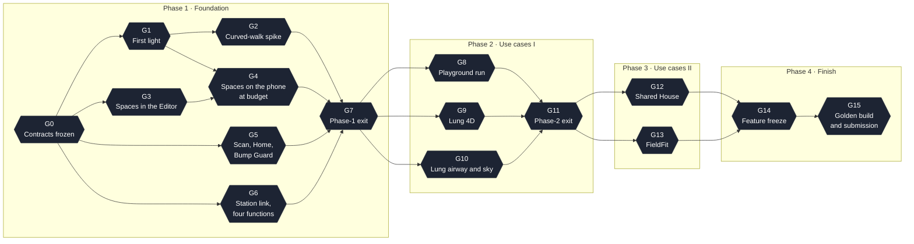

| Gate | Passes when (summary; full checklists in §11.3) |
|---|---|
| **G0** Contracts frozen | Every contract of §6.4 is written and stubbed; each lane's sandbox runs against the stubs |
| **G1** First light | Empty stereo scene at 60 fps on the phone; telemetry visible on the Station; anyone can install a build |
| **G2** Curved-walk spike | Five-corner loop closes within 0.25 m and three walkers are comfortable at the loop-fit curvature. Decides the default mode and the comfort floor |
| **G3** Spaces in the Editor | S1–S6 run in SpaceLab on the three sample rooms; all mathematics tests green |
| **G4** Spaces on the phone at budget | Every space meets the Must column cold; the 15-minute soak passes |
| **G5** Scan, Home and Bump Guard | Both scan paths end in a registered Home; Bump Guard passes its scripted test in the headset |
| **G6** Station link, four functions | Mirror, tuning and Console, telemetry, and the scan and asset round-trip all pass §7.6 |
| **G7** Phase-1 exit | A first-time walker goes from self-scan to every space, watched and tuned from the Station |
| **G8** Playground run | A first-time walker completes the guided run in two different rooms |
| **G9** Lung 4D | The four 4D pieces run on both case packages at budget |
| **G10** Lung airway and sky | Four forks walked without rescue; sky and plan card correct |
| **G11** Phase-2 exit | Playground and Lung Mission in one session by an outsider, hot, at budget |
| **G12** Shared House | Post Circling walked by three people with no contact |
| **G13** FieldFit | Blind spot found; search is faster with the lens than without |
| **G14** Feature freeze | Full path twice in a row on one phone without cooling; only fixes after this |
| **G15** Golden build and submission | Golden build runs with the Station unplugged; documents, video and metrics delivered |

Phase 3's packages depend technically only on Phase 1. They are placed after G11 because every lane is occupied until then.

### 9.5 Phase 1 · Foundation

#### 9.5.1 What is sequential and what is parallel

```text
SEQUENTIAL SPINE  (everyone waits for this)
   X01  Machines, accounts, devices ready
    ↓
   A01  Unity project and repository skeleton
    ↓
   X02  = G0  Contracts frozen, stubs compile

THEN FOUR LANES IN PARALLEL     → must finish before     ‖ can run at the same time

 LANE A  Platform, Look and Flat Spaces
   1 Device bring-up        (A02 ‖ A03) → A04          A13 after A02
   2 Look and host          A06 ‖ A08 ‖ A05            A06 may start as soon as A03 is done
   3 Flat spaces and 4D     A09 ‖ (A10 → A11) ‖ A12
   4 Heat and proof         A07 → A14                  both wait for D04 from lane D

 LANE B  Kernel and Curved Worlds
   1 Maths core             B01 → B02                  Editor only: starts straight after A01
   2 Curved building blocks B03 ‖ B04 ‖ B05            B05 waits for A06 from lane A
   3 Curved worlds          B06 ‖ B07 ‖ B08 ‖ B10
   4 Your room, curved      B09 ‖ B11                  wait for C06 and C07 from lane C

 LANE C  Scan, Room and Safety
   1 Sensing base           C01 ‖ C10 ‖ C11            wait for A02 / A04 from lane A
   2 Scan                   C02 ‖ C03 ‖ C04 ‖ (C05, Extended)
   3 RoomModel              C06
   4 Room and safety        C07 ‖ C08 ‖ C09            C07 waits for A06
   5 Arrival                C12 ‖ C13                  after C06; C12 waits for D11

 LANE D  Link, Station and Forge
   1 Link base              D01 → D02 → D11
   2 Control and measure    (D03 → D06) ‖ D04          D04 waits for A04
   3 Watch                  D05 → D07                  D05 waits for A06, A08; D07 for B04
   4 Make                   D08 → D09 → D10            D08 starts at G0; D10 waits for C07

GATES  (where lanes meet)
   G1 First light ................ A04, A13, D04, D11
   G2 Curved-walk spike .......... G1, B02, C11
   G3 Spaces in the Editor ....... A09, A11, A12, B06, B07, B08, B10
   G4 Spaces on the phone ........ G1, G3, A14
   G5 Scan, Home, Bump Guard ..... C07, C08, C09, C10, C12, C13
   G6 Station link ............... D03, D04, D05, D06, D07, D10, C08, B07
   G7 Phase-1 exit ............... G2, G4, G5, G6, B09, B11
```

Three facts from the graph:

- **Twelve tasks beyond the spine need no phone at all**: the kernel, holonomy rig, warp shader, tile ids, tile meshes, world generator, URP settings, link library, Hub, Spectator, Forge and mesh clean-up. None of them ever waits for the build seat.
- **The longest chain of dependencies** runs X01 → A01 → G0 → D01 → D02 → D04 → A07 → A14 → G4 → G7: the telemetry path is on it, because the performance gates cannot be measured without it. Build the perf probe early.
- **Lane B's integration tasks (B09, B11) wait for lane C's RoomModel and Home.** Until those exist, lane B works against the three sample rooms from G0.

#### 9.5.2 Overview

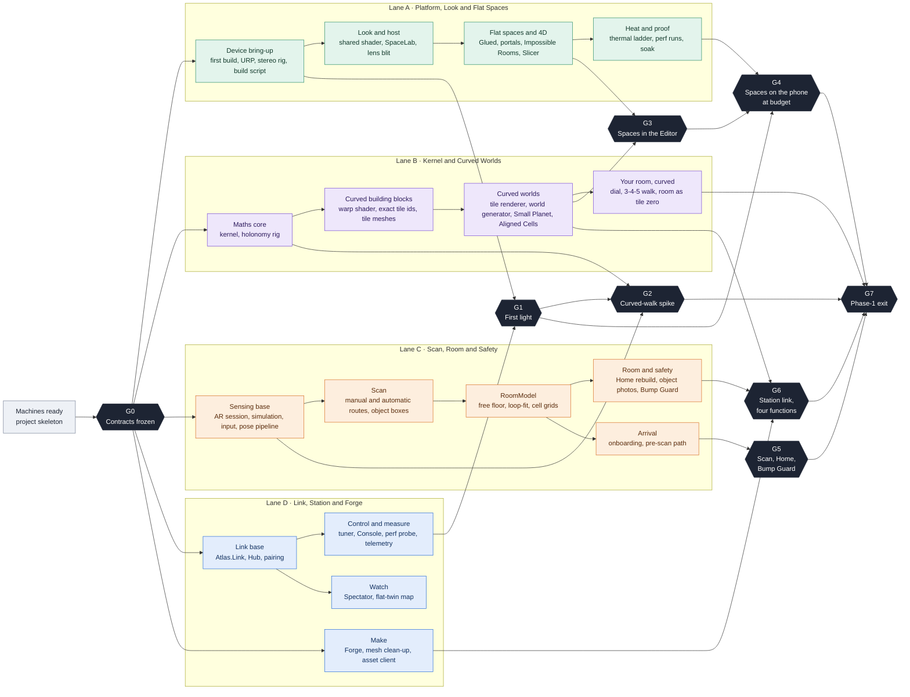

#### 9.5.3 Cross-lane handovers

Every point where one lane's output unblocks another lane's task. These are the moments to talk.

| From | To | What is handed over (task → task) |
|---|---|---|
| A · Device bring-up | C · Sensing base | `P1-A02` First build on phones → `P1-C01` AR session, simulation; `P1-A04` Stereo rig → `P1-C10` Input and twins; `P1-A04` Stereo rig → `P1-C11` Pose pipeline |
| A · Device bring-up | D · Link base | `P1-A02` First build on phones → `P1-D11` Pairing and network |
| A · Device bring-up | D · Control and measure | `P1-A04` Stereo rig → `P1-D04` Perf probe, telemetry |
| A · Look and host | B · Curved building blocks | `P1-A06` Shared look shader → `P1-B05` Tile meshes |
| A · Look and host | C · Room and safety | `P1-A06` Shared look shader → `P1-C07` Home rebuild S0 |
| A · Look and host | D · Watch | `P1-A06` Shared look shader → `P1-D05` Spectator; `P1-A08` SpaceLab host → `P1-D05` Spectator |
| B · Curved building blocks | D · Watch | `P1-B04` Exact tile ids and graph → `P1-D07` Flat-twin mini-map |
| C · RoomModel | B · Your room, curved | `P1-C06` RoomModel and loop-fit → `P1-B09` Dial and 3-4-5 walk |
| C · Room and safety | B · Your room, curved | `P1-C07` Home rebuild S0 → `P1-B11` Room becomes tile zero |
| C · Room and safety | D · Make | `P1-C07` Home rebuild S0 → `P1-D10` Asset client |
| D · Link base | C · Arrival | `P1-D11` Pairing and network → `P1-C12` Onboarding in hand |
| D · Control and measure | A · Heat and proof | `P1-D04` Perf probe, telemetry → `P1-A07` Thermal ladder; `P1-D04` Perf probe, telemetry → `P1-A14` Perf runs and soak |

#### 9.5.4 All hands

| ID | Task | Depends on | Output | Acceptance test | Runs on |
|---|---|---|---|---|---|
| `P1-X01` | **Machines, accounts and devices ready** | none | Appendix C sections 1–2 ticked: Mac with Xcode 26 and Unity ≥ 6000.3.21f1; one signing owner; both phones in Developer Mode; Station with .NET 8, Python 3.11 and a working CUDA build of PyTorch; own Wi-Fi router with a fixed Station address | Both phones report LiDAR (iPhone 15 Pro Max and 14 Pro Max, not Plus models); `nvidia-smi` and a PyTorch CUDA test pass on the Station; all four machines open Unity | Mac, Station |
| `P1-X02` | **Contracts frozen (this is gate G0)** | `P1-A01` | `docs/contracts/` with one page each for: `ISpaceModule`; kernel types (`Iso2`, `TileId`); RoomModel JSON schema plus three sample rooms (3×3 m, 3×4 m L-shape, 4×5 m with a table); shader include contract and `AtlasShaderIDs.cs`; parameter registry; link message ids and the `State` layout; GLB asset contract; layer and stencil table; scene ownership. Stubs for every interface: identity warp, fake tile provider, loopback link, recorded pose log | Stub implementations compile in every assembly; each lane's sandbox scene runs against the stubs in the Editor with no other lane's code; a change to any contract after this point is announced to all four lanes before it is committed | Editor |

#### 9.5.5 Lane A · Platform, Look and Flat Spaces

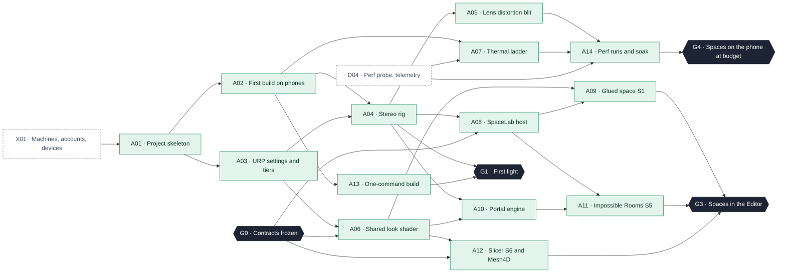

Dashed boxes are inputs from other lanes; dark hexagons are gates.

| ID | Task | Depends on | Output | Acceptance test | Runs on |
|---|---|---|---|---|---|
| `P1-A01` | **Unity project and repository skeleton** | `P1-X01` | Project from the AR Mobile template; packages pinned (Appendix C); one assembly definition per area; text serialisation, Git LFS, UnityYAMLMerge; `station/` folders; scene-ownership file | A clean clone opens with zero console errors on all four machines; the EditMode test runner runs (0 failing) | Editor, Mac |
| `P1-A02` | **First build on both phones** | `P1-A01` | ARKit as the only XR loader; signing with the Personal Team; post-build script for Info.plist keys; `targetFrameRate = 60`; thermal frame-rate adjustment off; Frame Timing Stats on | An empty AR scene runs on phone A and phone B with tracking state Normal; the build recipe is one paragraph in the README | Mac, phone in hand |
| `P1-A03` | **URP asset and quality tiers** | `P1-A01` | Forward, Render Graph, HDR off, depth and opaque textures off, depth priming off, no post-processing, shadows off, SRP Batcher on; tier assets Nominal / Fair / Serious | Render Graph Viewer shows one native pass per eye camera on the test scene; settings equal the Appendix C table | Editor |
| `P1-A04` | **Two-camera stereo rig** | `P1-A02`, `P1-A03` | Eye cameras at ±IPD/2 under the tracked head, half-screen viewports, one shared renderer, no camera background; IPD in the parameter registry; the AR camera only carries the pose | Phone A in the headset, empty scene: 60 fps on the Metal HUD, CPU main ≤ 3 ms, GPU ≤ 2 ms; a cube at 1 m fuses comfortably for three testers | phone in headset |
| `P1-A05` | **Lens pre-distortion as the single final blit** | `P1-A04` | Both eyes render into one target at render scale 0.8 with 4× MSAA; one full-screen pass applies per-eye barrel distortion (headset coefficients) and upscales; switchable | A straight-line grid looks straight through the lenses to three testers; the pass adds ≤ 1.0 ms GPU; the MSAA depth buffer is not stored (Xcode GPU capture) | phone in headset |
| `P1-A06` | **Shared look shader** | `P1-X02`, `P1-A03` | `AtlasSurface` with `AtlasCore.hlsl`: palette lookup, vertex-colour ambient occlusion, `fwidth` grid and edge lines, distance fog in the room hue, emissive accents; calls the `AtlasWarp` entry point; one `UnityPerMaterial` block; 128² palette texture (dark base) | Frame Debugger reports the shader SRP-Batcher compatible; ≤ 8 variants; a test room holds 60 fps in stereo on phone A | Editor, phone in headset |
| `P1-A07` | **Thermal plugin and quality ladder** | `P1-A02`, `P1-D04` | Native `.mm` returning `NSProcessInfo.thermalState`, polled every 2 s; ladder controller that steps render scale, MSAA, cull radius ρ and glued copies from thermal state and GPU p95 | Each tier can be forced from the Console and takes effect within 1 s; at most one step per 20 s with hysteresis; thermal state is visible on the HUD and in the CSV | phone in headset |
| `P1-A08` | **SpaceLab host** | `P1-X02`, `P1-A04` | Boot scene that loads one `ISpaceModule` scene additively at a time, with a fade, and registers that space's parameters | Switching among all loaded spaces 20 times leaves memory within ±5 %; works in the Editor (XR Simulation) and on the phone | Editor, phone in headset |
| `P1-A09` | **Glued space S1** | `P1-A06`, `P1-A08` | Universal cover fixed to the floor: cell size from the RoomModel, 5×5 copies around the walker's current cell, mirrored rows for the Klein bottle (negative scale), vertical copies for T³, self-avatar in every copy but the walker's own, one chiral landmark | Walking across a cell edge shows no seam in either eye; Klein rows pass the determinant-sign test; 5×5 stays ≤ 60 draw calls and ≤ 250k triangles per frame | Editor, phone in headset |
| `P1-A10` | **Stencil portal engine** | `P1-A06`, `P1-A04` | Render Objects features per room layer, stencil references 1–15 from one allocation table, plane clip in `AtlasPortalClip.hlsl`, room swap only when both eye frusta have left the old room (with hysteresis), portal box for the straddling eye; no recursion | Two-room test: no seam or pop when the head crosses the doorway in stereo; ≤ 1.0 ms GPU per visible portal; passes stay merged so MSAA is resolved on-tile | Editor, phone in headset |
| `P1-A11` | **Impossible Rooms S5** | `P1-A10`, `P1-A08` | Booth-to-hall (bigger inside) and a four-turn loop corridor, generated from the RoomModel free rectangle and authored in play-space coordinates so every portal transform is the identity; room graph with a reachability check | Layouts fit inside the eroded free floor for all three sample rooms; four right turns arrive in a different room; every room is reachable (graph test) | Editor, phone in headset |
| `P1-A12` | **Slicer S6 and Mesh4D** | `P1-X02`, `P1-A06` | `Mesh4D` (tetrahedra in ℝ⁴), Burst job that cuts it with a hyperplane, generators for the 5-cell, tesseract (48 tetrahedra), 16-cell and 24-cell, shadow (projection) view, rotations in planes that contain w, a colour per cell, and a periodic tube generator in ℝ³×S¹ (moving sphere) | EditMode: tesseract corner-first slice areas 0.8660 at 0.5 and 6.9282 at 2.0; 4D ball slice radius √(1 − c²); moving-sphere length D·v/(v − u). Phone A: tesseract ≤ 0.2 ms, 18k-tetrahedron tube ≤ 1.0 ms at p95, zero allocations per frame | Editor, phone in headset |
| `P1-A13` | **One-command build and the build-seat rules** | `P1-A02` | Script: clean checkout → Unity batch build → Xcode build → install on a connected phone; written rules for the build queue and phone booking | One command installs the current main branch on a phone; a second engineer has done it from the README alone | Mac |
| `P1-A14` | **Per-space performance runs and the soak** | `P1-D04`, `P1-A07`, `P1-A05` | Scripted tour that visits every space; one CSV per run; the 15-minute in-headset soak on the heaviest space | Metrics table of §11.2 filled for every space at the Must level, cold; soak: no Critical thermal state, mean ≥ 45 fps, never below 30 | phone in headset |

#### 9.5.6 Lane B · Kernel and Curved Worlds

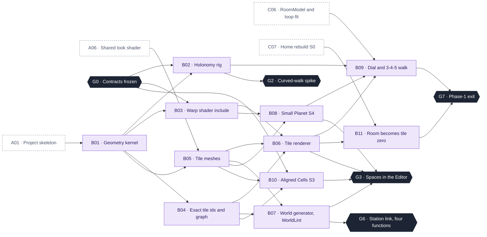

| ID | Task | Depends on | Output | Acceptance test | Runs on |
|---|---|---|---|---|---|
| `P1-B01` | **Geometry kernel** | `P1-A01` | `Atlas.Kernel` in double precision: boosts and rotations for κ < 0, = 0, > 0, exp and log maps, distance, η-Gram–Schmidt, inverse as ηMᵀη; no scene types | EditMode: exp∘log = identity to 1e-12; holonomy of a geodesic triangle equals its angle defect to 1e-9; five steps of 1.0613 with 90° turns return to the identity, three steps of π/2 on the sphere, four flat; ‖UᵀηU − η‖ < 1e-12 after 100,000 random boosts | Editor |
| `P1-B02` | **Holonomy rig** | `P1-B01`, `P1-X02` | Per-frame update U ← U·Boost(Δ/L) from the filtered head displacement, tile-crossing hook, curvature ramp that only runs while the walker stands still | Replay of a recorded square lap at loop-fit L closes after five sides to 1 mm; a recorded stand-still of 60 s moves the frame by < 5 mm | Editor |
| `P1-B03` | **Warp shader include** | `P1-X02`, `P1-B01` | `AtlasWarp.hlsl`: one entry point (object position in, world position out) for none / hyperbolic / spherical, log map centred on the head, one per-material anchor matrix computed in double on the CPU and cast last; component that sets huge `localBounds` | GPU positions match the kernel's CPU reference to 1 mm for ρ ≤ 3; the shared shader is still SRP-Batcher compatible; exp is evaluated once per vertex | Editor |
| `P1-B04` | **Exact tile ids and the tile graph** | `P1-B01` | `TileId` as six integers in ℤ[φ], neighbour step S_k = R^k·T·H by additions only, breadth-first visible set, re-root when the walker crosses an edge, content seed = hash of the id; tolerance-hash variant for {4,6} | Per-depth counts equal OEIS A377322 to depth 10; a walk round a vertex closes after exactly 5 steps; φ(X²+Y²) − T² = −1 for every tile; visible set sizes 13 / 45 / 81 / 129 at ρ = 2 / 3 / 3.5 / 4; a crossing costs ≤ 0.5 ms in the Editor | Editor |
| `P1-B05` | **Procedural tile meshes** | `P1-B01`, `P1-A06` | Generator in C#: Klein-square grid mapped to the log chart, three levels of detail (0.1 m home tile, 0.25 m, coarse), kerbs, 72° corner wedges, palette UVs, vertex ambient occlusion; flat variant for Aligned Cells and Glued | Edges of neighbouring tiles coincide to 1 mm; longest edge ≤ 0.25 m after scaling by L; ≤ 1.5k triangles at the finest level, ≤ 600 at the next | Editor |
| `P1-B06` | **Tile renderer** | `P1-B03`, `P1-B04`, `P1-B05` | Pool of tile objects and material instances, per-tile anchor each frame, level of detail by graph distance, CPU cull at ρ, fog opaque at the cull radius | Phone A at ρ = 3 (45 tiles): tile shells cost ≤ 100 draw calls per frame and the whole scene ≤ 150; 60 fps; no allocation on a tile crossing; no tile appears inside the fog radius | Editor, phone in headset |
| `P1-B07` | **World generator and WorldLint** | `P1-B04`, `P1-B05` | Archetype from hash(tile id, seed): Plaza, Corridor, Doorway, Tower, Span A/B, Garden, Home; four regions with their own hue; corner posts; one spanning object near the start; WorldLint editor check | WorldLint passes for three seeds (reachable, a tower within ρ ≤ 2.5 of every tile, budgets, no coincident faces); the same seed gives the same world hash on the phone and on the Station | Editor |
| `P1-B08` | **Small Planet S4** | `P1-B03`, `P1-B05` | {4,3} tiling: six tiles always loaded, spherical branch of the warp, fragments beyond 2.6 rad discarded, fog opaque at 0.8π, pole beacon | Three steps of (π/2)·R with 90° turns close to 1 mm in the Editor; no smeared triangle in a 360° look-around on the phone | Editor, phone in headset |
| `P1-B09` | **Curvature dial and the 3-4-5 walk** | `P1-B02`, `P1-B06`, `P1-B08`, `P1-C06` | Dial with snaps q = 3, 4, 5, 6 that ramps curvature only while the walker stands still; guided loop markers from the RoomModel lap square; corner counter, closure-error and world-turn read-outs | On phone A the loop closes after 3, 4 and 5 corners with closure error < 0.25 m each; curvature never changes while head speed exceeds 0.1 m/s | phone in headset |
| `P1-B10` | **Aligned Cells S3 (Mode 2)** | `P1-B04`, `P1-B05`, `P1-X02` | Cell grid from the RoomModel (sample rooms until the live scan exists), tile per cell chosen by the walked path, sight-line instances clipped by per-fragment gates (no stencil), a post at every interior corner, switch from Mode 1 at the same tile id | EditMode: 13 / 15 / 17 instances for centre / edge / corner cell of a 3×3 grid; in the Editor and on the phone four quarter-turns round an interior corner end in a fifth tile and a fifth returns to the first | Editor, phone in headset |
| `P1-B11` | **The room becomes tile zero** | `P1-B06`, `P1-C07` | Home rebuild placed in curved space by the exp map about the room centre; walls sink to kerbs and corner posts when curvature is on; tiles under the room's footprint are flagged home and kept clear; return-to-Home re-registers | At κ = 0 the curved-space room matches Home to 1 cm; a ramp to loop-fit L and back restores registration to 2 cm; WorldLint finds no generated prop inside the room footprint | phone in headset |

#### 9.5.7 Lane C · Scan, Room and Safety

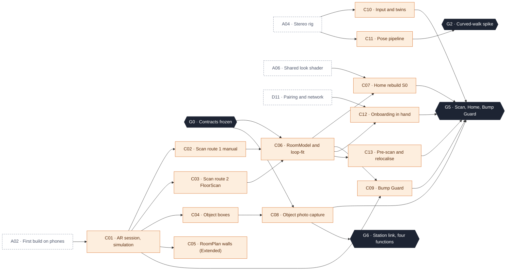

| ID | Task | Depends on | Output | Acceptance test | Runs on |
|---|---|---|---|---|---|
| `P1-C01` | **AR session and Editor simulation** | `P1-A02` | Lowest-resolution 60 Hz camera configuration; LiDAR depth on; meshing and plane detection on only during the scan; XR Simulation environments; pose-log and RoomModel replay in the Editor | The session holds 60 Hz on the phone; a recorded walk drives the rig in the Editor; the log confirms meshing and planes are off after the scan | Editor, phone in hand |
| `P1-C02` | **Scan route 1: manual outline** | `P1-C01` | Tap or walk the floor corners to make the floor polygon | Polygon within 5 cm of a tape measure in three rooms | phone in hand |
| `P1-C03` | **Scan route 2: automatic FloorScan** | `P1-C01` | Classified LiDAR mesh and planes → 5 cm occupancy grid → signed distance field → walkable polygon with holes, dominant wall direction, obstacle boxes | EditMode on synthetic rooms (rectangle, L-shape, table in the middle); on the phone the free rectangle is within 10 cm of a tape measure and scan-to-walkable takes ≤ 90 s | Editor, phone in hand |
| `P1-C04` | **Object boxes** | `P1-C01` | RoomPlan furniture boxes through `ARBoundingBoxManager` (category, size, pose), merged with the FloorScan obstacles in one coordinate frame | Boxes overlay the mesh to ≤ 10 cm; in three test rooms every piece of furniture wider than 0.4 m has a box (proposed) | phone in hand |
| `P1-C05` | **Swift RoomPlan bridge for walls, doors and windows (Extended)** | `P1-C01` | Native plugin using `RoomCaptureSession(arSession:)`; walls, doors, windows and openings as JSON in session coordinates; AR configuration re-applied afterwards | Wall positions within 3 cm of the mesh-derived ones; scene depth is available again after capture | phone in hand |
| `P1-C06` | **RoomModel and the loop-fit** | `P1-C02`, `P1-C03`, `P1-X02` | RoomModel JSON: polygon, distance field, free rectangle, lap square s, L and R from the loop-fit rule, cell grids for S1 and S3, object list, anchor; outline confirmation in hand; save and load | Validates against the schema; s, L, R equal the reference table for the three sample rooms; a room with less than 1.5 × 1.5 m free floor selects standing mode | Editor, phone in hand |
| `P1-C07` | **Home rebuild S0** | `P1-C06`, `P1-A06` | Floor, walls and door openings as 0.25 m-grid meshes in the palette, registered at the anchor; a placeholder box per object, coloured by category | In the headset a virtual wall is within 3 cm of the real wall at three touch points; Home with ten objects costs ≤ 40 draw calls and ≤ 120k triangles per frame | phone in headset |
| `P1-C08` | **Object photo capture** | `P1-C04`, `P1-X02` | For each object box, one to three key frames chosen by projected area, centredness, sharpness and spread of view angle; cropped and JPEG-encoded off the main thread; handed to the asset client | Every box gets at least one crop in which it fills 35–90 % of the frame; capture adds < 2 ms per frame; nothing is written to disk | phone in hand |
| `P1-C09` | **Bump Guard** | `P1-C06`, `P1-C01` | Static clearance from the distance field with velocity look-ahead, live LiDAR depth sectors (Burst), tracking-state check; outputs a level and a direction to the warning cue (indicator and tone) and to haptics; thresholds live in code, not in the parameter registry | Scripted approaches at 0.5 and 1.0 m/s to a wall and to a chair placed after the scan: warning ≥ 0.6 s before predicted contact in 20 of 20 trials; no warning during a 5-minute lap 0.5 m from the walls; ≤ 0.3 ms per frame; identical with the Station unplugged | Editor, phone in headset |
| `P1-C10` | **Input and twins** | `P1-A04` | Gamepad through the Input System, gaze reticle with 600–800 ms dwell, headset lever tap; one action map | Every SpaceLab action can be done with the gamepad alone and with gaze dwell alone | Editor, phone in headset |
| `P1-C11` | **Pose pipeline** | `P1-A04` | `TrackedPoseDriver` on Update only; jumps over 0.2 m per frame rejected for geometry while safety keeps the raw pose; tracking-state events; gyro rotation prediction behind a switch | A 0.5 m jump injected in replay does not move the curved-space frame; loss of tracking raises the warning cue within 0.5 s | Editor, phone in headset |
| `P1-C12` | **Onboarding in hand** | `P1-C06`, `P1-D11` | Permissions (camera, Local Network), pairing, scan route, outline confirmation, headset prompt | Three first-time users reach Home in the headset with at most three prompts each | phone in hand, phone in headset |
| `P1-C13` | **Pre-scan path: world map save and relocalise** | `P1-C06` | Save `ARWorldMap` with the RoomModel; relocalise at launch | Relocalised RoomModel aligns to ≤ 5 cm within 10 s (proposed) in the room it was scanned in | phone in hand |

#### 9.5.8 Lane D · Link, Station and Forge

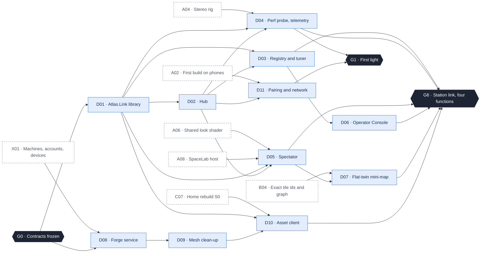

| ID | Task | Depends on | Output | Acceptance test | Runs on |
|---|---|---|---|---|---|
| `P1-D01` | **Atlas.Link library** | `P1-X02` | Plain C# (no Unity references): message types, hand-packed `State` and `Telemetry`, JSON control, clock sync, watchdog, `LinkClient` and `LinkHost` over LiteNetLib; loopback tests | Round trip for every message; 60 Hz `State` survives 2 % simulated loss; clock offset error ≤ 2 ms p95 on a simulated link | Editor |
| `P1-D02` | **Hub** | `P1-D01` | `atlas-hub` (.NET 8 console): LiteNetLib server, relay between phone, Spectators and Console, web server, JSONL and binary logs | Relay adds < 2 ms; the Hub can be restarted and every client reconnects within 5 s | Station |
| `P1-D03` | **Parameter registry and Console tuner** | `P1-D01`, `P1-D02` | Registry on the phone with min, max and default per parameter; `ParamManifest` and `ParamSet`; clamps on the phone; demo lock; web page with sliders grouped by space | A slider change is visible in the headset within 100 ms at p95 (proposed); with the lock on, `ParamSet` is ignored | Editor, Station, phone in headset |
| `P1-D04` | **Perf probe, HUD and telemetry** | `P1-D01`, `P1-D02`, `P1-A04` | `AtlasPerfProbe` (FrameTimingManager and ProfilerRecorders), in-headset HUD at 2 Hz, `Telemetry` at 1 Hz, dashboard charts, CSV on the Station and a local copy on the phone | Rows 1–14 of the §11.2 register appear in the CSV; the HUD costs < 0.2 ms and allocates nothing; a 15-minute run yields a complete CSV | phone in headset, Station |
| `P1-D05` | **Spectator** | `P1-D01`, `P1-D02`, `P1-A06`, `P1-A08` | The same Unity project built for Windows with `ATLAS_SPECTATOR`; re-renders the walker's view from `State` (space, tile id, tile-local transform, parameters, head pose); world-hash check | The mirror lags the phone by ≤ 150 ms at p95; a world mismatch shows a banner instead of a wrong picture | Station |
| `P1-D06` | **Operator Console** | `P1-D03` | Buttons: switch space, return to Home, recentre, quality tier, trigger the warning cue, lock; comfort-score entry and notes | Every command acts on the phone within 200 ms and is written to the log | Station, phone in headset |
| `P1-D07` | **Flat-twin mini-map** | `P1-B04`, `P1-D05` | One renderer for the headset and the Station: Poincaré disc of the tile graph centred on the walker with the walked trail and the room outline; cube net for S4; lattice for S1; room graph for S5 | In replay the map shows the same tile-id sequence as the log; ≤ 0.3 ms on the phone | Editor, Station, phone in headset |
| `P1-D08` | **Forge service** | `P1-X01`, `P1-X02` | FastAPI on the Station: scan upload, object upload, job queue with one GPU worker, background removal, image-to-3D with TripoSG, job status, asset download by content hash | One object photo becomes a raw mesh on the RTX 5070 in ≤ 60 s (proposed; record the measured value); a corrupt image fails its job cleanly | Station |
| `P1-D09` | **Mesh clean-up** | `P1-D08` | Orient and scale to the scanned box, decimate to 1.5–5k triangles, regrid so no edge exceeds 0.25 m, palette colour from the photo, vertex ambient occlusion, GLB, content hash | Every output passes the asset validator (triangle count, longest edge, bounds within the box ± 5 %, one material slot); the same input gives the same hash | Station |
| `P1-D10` | **Asset client on the phone** | `P1-D01`, `P1-D09`, `P1-C07` | Uploads (RoomModel, crops), `JobStatus` and `AssetReady` handling, download with a cache, glTFast load off the main thread, material remap to the shared shader, placeholder-to-mesh swap | Worst frame during a swap < 20 ms; with the Station unplugged the placeholders stay and the app behaves normally; a repeated photo is served from the cache | phone in hand, phone in headset |
| `P1-D11` | **Pairing and network bring-up** | `P1-D02`, `P1-A02` | Router set-up, QR page from the Hub, Local Network prompt triggered in hand with retry, link indicator | A fresh install pairs by QR in ≤ 30 s (proposed); after a Wi-Fi drop the link returns within 5 s | phone in hand, Station |

#### 9.5.9 Phase 1 gates

| ID | Task | Depends on | Output | Acceptance test | Runs on |
|---|---|---|---|---|---|
| `P1-G1` | **G1 First light** | `P1-A04`, `P1-A13`, `P1-D11`, `P1-D04` | Stereo at 60 fps on the phone, live telemetry on the Station, the build recipe and the phone-booking rule in force | Empty stereo scene at 60 fps with the HUD on; telemetry row per second on the dashboard; every engineer has installed a build | phone in headset, Station |
| `P1-G2` | **G2 Curved-walk spike** | `P1-B02`, `P1-C11`, `P1-G1` | Rolling update on the phone with line-drawn tiles (no shader needed), a tape-measured lap square, three walkers | Five-corner closure error < 0.25 m at loop-fit L; comfort score ≤ 3 of 20 after three minutes at loop-fit L for all three walkers. If it fails: raise L one step, or make Aligned Cells the default mode | phone in headset |
| `P1-G3` | **G3 Spaces in the Editor** | `P1-A09`, `P1-A11`, `P1-A12`, `P1-B06`, `P1-B07`, `P1-B08`, `P1-B10` | Every space module S1–S6 runs in SpaceLab in the Editor on the three sample rooms | All EditMode tests green; each space selectable from the gamepad menu; shader contract unchanged since G0 or re-agreed | Editor |
| `P1-G4` | **G4 Spaces on the phone at budget** | `P1-G1`, `P1-G3`, `P1-A14` | Per-space metric table and the soak CSV | Every space meets the Must column of §11.2 cold; the 15-minute soak passes | phone in headset |
| `P1-G5` | **G5 Scan, Home and Bump Guard** | `P1-C07`, `P1-C08`, `P1-C09`, `P1-C10`, `P1-C12`, `P1-C13` | Self-scan and pre-scan paths end in a registered Home; Bump Guard verified by someone who did not write it | Both scan paths reach Home; the Bump Guard scripted test passes in the headset; a 1.4 × 1.4 m free floor selects standing mode | phone in headset |
| `P1-G6` | **G6 Station link, all four functions** | `P1-D03`, `P1-D04`, `P1-D05`, `P1-D06`, `P1-D07`, `P1-D10`, `P1-C08`, `P1-B07` | Spectator mirror, live tuning and Console, telemetry dashboard and CSV, scan and asset round-trip | §7.6 table passes: state ≥ 50 Hz with < 2 % loss; mirror latency ≤ 150 ms p95; a parameter change visible ≤ 100 ms; one CSV row per second; photo to placed mesh for every object box in a test room with no frame over 20 ms; the app is unaffected when the Hub is unplugged | phone in headset, Station |
| `P1-G7` | **G7 Phase-1 exit** | `P1-G2`, `P1-G4`, `P1-G5`, `P1-G6`, `P1-B09`, `P1-B11` | End-to-end run by a first-time user, watched on the Spectator | Self-scan → Home with furniture arriving live → dial → 3-4-5 walk → Curved Walk → Aligned Cells (a virtual table edge stays within 5 cm of the real one) → Glued → Small Planet → Impossible Rooms → Slicer, with tuning and telemetry live; the §11.2 table is filled; every Phase-1 gate checklist in §11.3 is ticked | phone in headset, Station |

### 9.6 Phase 2 · Geometry Playground and Lung Mission

Two tracks run in parallel from G7. The specifications and the work-package tables are in §10.1 (Playground) and §10.2 (Lung Mission); the diagrams here show the order.

| Track | Lanes | Packages | Exit gate |
|---|---|---|---|
| Geometry Playground | C (shell; Glued and Impossible Rooms stations) and A (Slicer toybox, equation sources, look) | `P2-C01`–`P2-C16`, `P2-A01`–`P2-A04` | G8 |
| Lung Mission | D (Station pipeline, case packages, plan card), A (medical 4D runtime), B (airway wing, needle sky) | `P2-D01`–`P2-D13`, `P2-A20`–`P2-A31`, `P2-B01`–`P2-B12` | G9 (4D), G10 (airway and sky) |

What is sequential:

- In the Playground everything hangs off the director (`P2-C01`); the stations are independent of one another; the run (`P2-C11`) is last.
- In the Lung Mission the case contract (`P2-D01`) comes first. Lane D then produces the **illustrative** package (`P2-D02`) before the real one, so lanes A and B have data to build against without waiting for the full pipeline. The 4D runtime (lane A) and the airway wing (lane B) are independent of each other until the lesion chamber hand-over (`P2-B09`).
- G11 needs G8, G9 and G10, and then one combined session by someone from outside the team.

**Track: Geometry Playground**

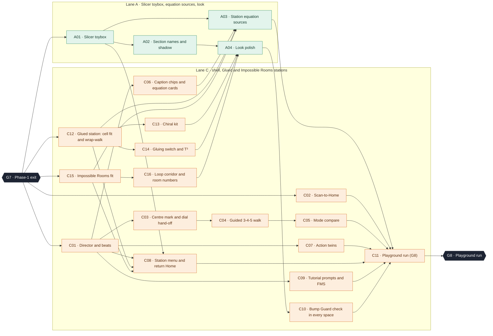

**Track: Lung Mission**

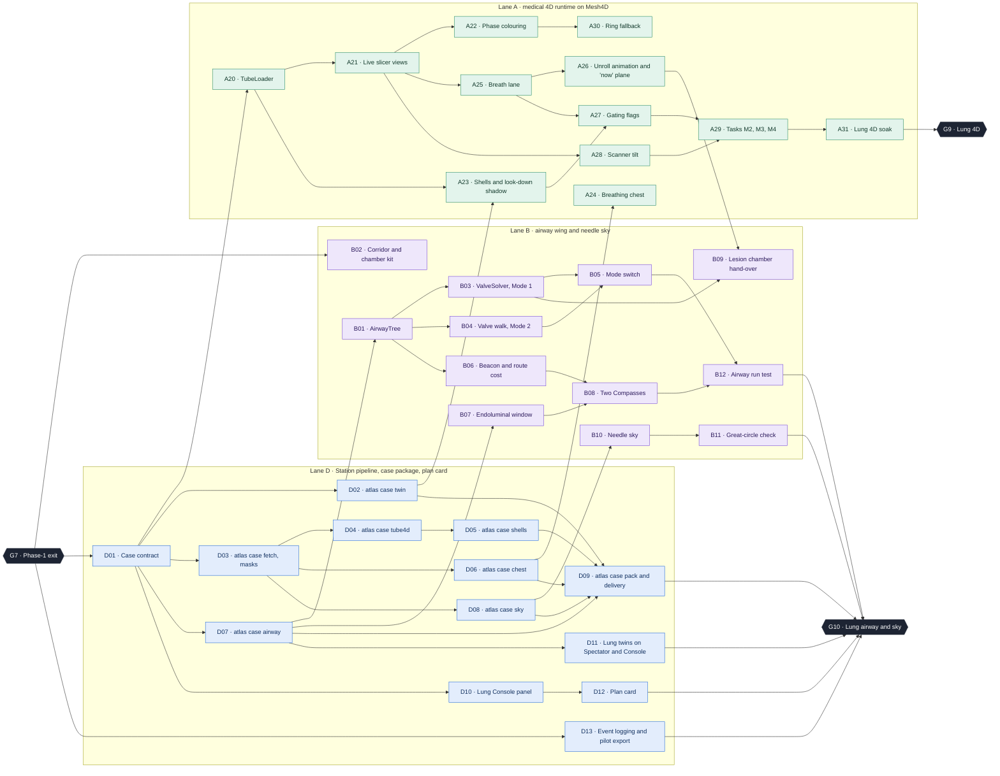

### 9.7 Phase 3 · Shared House and FieldFit

Two independent use cases, two lanes each. Specifications and work-package tables: §10.3 and §10.4.

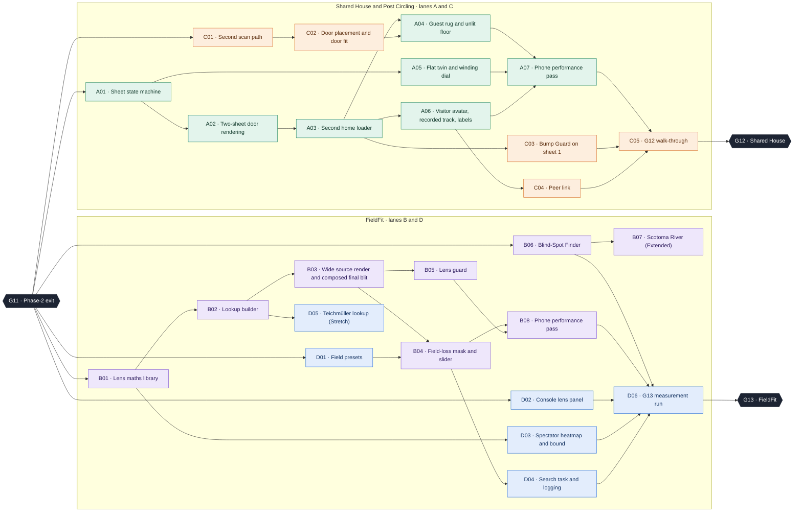

### 9.8 Phase 4 · Finish

Polish, evaluation, demo operations and documentation. Work-package table: §13.6. Feature freeze (G14) follows the look pass; after it, only fixes, audio, documents and rehearsals.

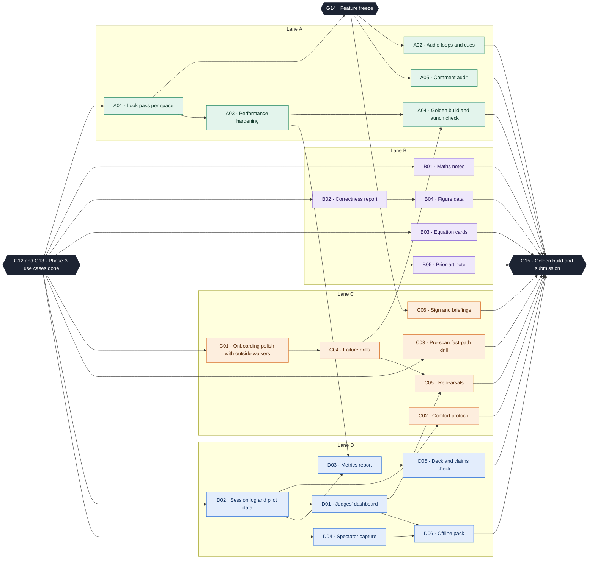

### 9.9 Working with AI coding agents

The tasks are sized and worded to be handed over. The rules that make that safe:

1. **One task, one branch, one merge request.** The branch name is the task id.
2. **An agent stays in its lane's folders.** It may read contracts and other lanes' public interfaces; it may not edit them. A contract change is made by a human and announced.
3. **The acceptance test comes first.** For anything provable in the Editor the agent writes the test from the acceptance cell, sees it fail, then implements.
4. **Parallel agents take tasks marked ‖** in §9.5.1: they touch different files by construction.
5. **A human runs every phone test** and records the numbers. An agent prepares the build, the test scene and the checklist.
6. **No agent merges on a red test or a broken shader contract.**
7. **Numbers in a task are part of the task.** If a budget cannot be met, the agent reports the measured value and stops; it does not relax the number.

A task brief, ready to paste:

```text
Task        P1-B04  Exact tile ids and the tile graph            Lane B
Read first  docs/contracts/kernel.md; this plan §3.4, §6.5, Appendix A.2
Depends on  P1-B01 (merged)
You own     Assets/Atlas/Kernel/Tiling/**  and its tests. Touch nothing else.
Deliver     TileId.cs, TileGraph.cs, Tests/TileIdTests.cs
Accept      - per-depth tile counts equal OEIS A377322 to depth 10
            - a walk round a vertex closes after exactly 5 steps
            - φ(X²+Y²) − T² = −1 for every generated tile
            - visible set sizes 13 / 45 / 81 / 129 at ρ = 2 / 3 / 3.5 / 4
            - a tile crossing costs ≤ 0.5 ms in the Editor
Out of scope  rendering, materials, scenes, shader code
Report      test log; measured crossing cost; anything in the contract you could not satisfy
```

---

## 10. Use cases

Four use cases are built on the Phase-1 platform. Each is specified here with its work packages; §9.6–9.8 show the order in which the packages are built.

| Use case | Phase | Lanes | Geometry it needs, and why | Exit gate |
|---|---|---|---|---|
| **10.1 Geometry Playground** | 2 | C, A | All of S0–S6: the room bent by the dial, walked, and compared | G8 |
| **10.2 Lung Mission** | 2 | B, D, A | Hyperbolic space for a tree that doubles at every generation; ℝ³ × S¹ for a tumour that moves with breathing; a sphere for the directions a needle can take | G9, G10 |
| **10.3 Shared House / Post Circling** | 3 | A, C | A two-sheet branched cover: two homes joined at one door, flat everywhere except two posts | G12 |
| **10.4 FieldFit** | 3 | B, D | The sphere of view directions: a lens that trades sharpness for field | G13 |

### 10.1 Geometry Playground

#### 10.1.1 Purpose

Promise: **"your own room, bent"**. The walker scans a room, sees it rebuilt 1:1, turns one dial, and walks the same floor in spherical, flat-wrapped, hyperbolic, portal-stitched and 4D space. The Playground adds no new geometry: it packages the Phase-1 spaces S0–S6 into one guided run in which every claim is backed by a live number. Built in Phase 2 by lanes C and A: lane C owns the shell and the Glued and Impossible Rooms stations, lane A the Slicer toybox, the equation sources and the look; lane B hands over S2, S3, S4, the dial and the 3-4-5 walk; lane D supplies `Event` transport, the flat-twin mini-map and the Station views. Exit gate: G8 Playground run.

#### 10.1.2 The flow

`PlaygroundDirector` (lane C) is a state machine over the beats below, stored in `Beats.asset`. A beat advances on its exit condition or on an operator `SceneCmd` from the Console, and each change emits `Event{ev:"pg.beat"}`.

| # | Beat | What happens | Exit condition |
|---|---|---|---|
| 1 | Scan | Phone in hand; walker sweeps the room and confirms the floor outline (D21). Pre-scan + ARWorldMap is the fast path. | RoomModel valid |
| 2 | Home appears | S0 drawn 1:1. Each object box shows a placeholder; Forge meshes arrive and replace them one by one. | Walker confirms; Local Network prompt already answered (BP §0.5) |
| 3 | Headset on | Phone into the headset; stereo starts. | Head pose stable |
| 4 | Centre | A floor disc marks the free-rectangle centre c0. | Head within 0.3 m of c0 (derived) |
| 5 | Dial | Rooms per corner q = 3, 4, 5, 6: Small Planet (R = 2s/π), flat, {4,5} (L = s/1.0613), {4,6} (L = s/1.3170). Walls sink to kerbs when q ≠ 4. | q = 5 selected |
| 6 | 3-4-5 walk | Beacons lead the loop of side s (§3.3): corner counter, distance from the start flag, and "world turned by N°". The walker repeats it at q = 3 and q = 4. | Loop closed at q = 5 |
| 7 | Free Curved Walk | S2, Mode 1. Mini-map revealed after the first lap; home beacon on. | Walker opens the mode chip |
| 8 | Compare | Switch to S3, Mode 2. Caption: "smooth curvature" against "curvature at the corners". | Walker opens the menu |
| 9 | Station menu | Signs in Home for Glued, Impossible Rooms, Slicer. | Station chosen, or done |
| 10 | Return Home | Kernel reset to tile zero, κ ramps to 0, S0 registered again. | End of run |

#### 10.1.3 Station cards

**What the walker meets**

| Station | Caption chip (the rule) | The "aha" | Tasks | Registered to the real room? |
|---|---|---|---|---|
| S1 Glued | "Every wall is a door to its opposite wall. Flat, but it wraps." | You see your own back; in the Klein rows your copy is mirrored. | Wrap-walk through one cell edge; wave at your copies; switch to Klein and compare the chiral landmark; switch to T³ and look up. | Yes. Universal cover fixed to the floor; cell = W/n with n = max(1, round(W/1.5 m)), same for D (R6 §3.2); T³ vertical period 2.6 m (Spec §11.2). Scanned furniture is solid. |
| S2 Curved Walk | "Five rooms meet at every corner. Constant negative curvature." | Four right turns do not bring you home; a fifth does. | Walk the loop; follow a spanning object across a tile edge; reach a region tower; use the home beacon to return. | Only at entry. Tile zero is the room, then it drifts, so walls are 0.9 m kerbs and corner posts (five 72° wedges per post). Bump Guard is the only protection. |
| S3 Aligned Cells | "Each cell is flat. All the curvature sits at the corners." | Left of a pillar is a different room from right of it. | Circle one pillar: four cells pass, a fifth room appears. | Yes, permanently. Cell grid from the RoomModel; furniture stays put; a pillar at each interior corner. Needs ≥ 3×2 cells for unbounded exploration; below that, the five-tile corner demo (R1 §D.4). |
| S4 Small Planet | "Three rooms meet at every corner. Six tiles, then it repeats." | Three right turns close the loop; walking straight brings you back. | Three-corner loop; walk 4s in a straight line and arrive home (2πR = 4s, derived); find the pole beacon. | No. Six tiles always loaded; fog starts 0.5π, opaque 0.8π; fragments beyond 2.6 rad discarded; props ≤ 1.2 m (R6 §2.5). |
| S5 Impossible Rooms | "Flat rooms joined so that they overlap." | A 1 m booth contains a hall; four right turns arrive somewhere new. | Enter the booth; walk the loop corridor and read the room number. | Yes. Authored in play-space coordinates; hall = free rectangle; corridor width clamp(W/3, 0.7, 1.0 m). Loop only when min(W, D) ≥ 2.4 m, else booth → hall (R6 §3.5). |
| S6 Slicer toybox | "A 3D slice of a flat 4D shape." | A solid changes shape when moved along a direction you cannot point to. | Slice the tesseract corner-first: tetrahedron → truncated tetrahedron → octahedron; look down for the shadow; rotate in a plane containing w; repeat on the 5-cell and 16-cell. | Pedestal at c0, registered. This station is the onboarding for the Lung Mission's three verbs (R2). |

**What is measured**

| Station | Equation card (live numbers) | Events (`ev`) | Acceptance test |
|---|---|---|---|
| S1 | `x mod a`, `z mod b`; cell a × b; wraps; copy parity (−1)^row | `glued.wrap`, `glued.mode` | No seam in either eye on 10 of 10 crossings; avatar in all 24 other copies of 5×5; Klein copy determinant = (−1)^row in 100% of copies. |
| S2 | `cosh(s/2L) = √2·cos(π/q)` with live s, L, q; laps; world turned N° | `walk.corner`, `walk.lap`, `walk.closed`, `tile.cross` | Five-corner loop closes within 0.25 m; read-out 90° ± 5° after one lap at loop-fit L (R1 §D.1). |
| S3 | corner curvature `2π − q·π/2 = −90°`; `L_eff = 0.89·g` | `cells.cross`, `cells.pillarLoop` | After four cell crossings round one pillar the tile id differs from the start; after five it matches. |
| S4 | `R = 2s/π`; triangle angle sum 270° | `walk.*`, `planet.return` | Three-corner loop closes within 0.25 m; no geometry smear at the antipode in 8 headings. |
| S5 | virtual floor walked ÷ free-rectangle area | `portal.cross`, `rooms.loop` | Hall visible through the booth door before entry; no pop when either eye crosses the portal, 10 of 10. |
| S6 | `w₀`, rotation angle, section name, face count | `slicer.w`, `slicer.rot`, `slicer.shadow`, `slicer.poly` | Section named "octahedron" with area 6.9282 ± 0.001 at x+y+z+w = 2.0 (R2); slice < 1 ms. |

**Twins.** Hands are optional, so every action has three inputs, mapped in `ActionMap.cs`. Gaze dwell is 700 ms (Spec §4.5).

| Action | Gamepad | Gaze dwell | Headset lever |
|---|---|---|---|
| Confirm / next beat | A | prompt chip | click |
| Dial q | D-pad left/right | floor dial, four detents | click cycles 3→4→5→6 |
| Mode 1 ↔ Mode 2 | Y | mode chip | double click |
| Station menu, pick | Start, stick + A | station sign | long press opens, click steps, long press picks |
| Gluing T² / Klein / T³ | bumpers | gluing sign | click |
| Slice w | bumpers | ends of the w-ruler | hold to sweep |
| Rotate in a w-plane | triggers (or marker cube pitch) | floor dial, five detents | double click steps 15° |
| Shadow | X | look down past −35° (R2) | — (gaze twin only) |
| Return Home | B held | home beacon | triple click |

#### 10.1.4 Comfort and legibility rules

| Rule | Value | Source |
|---|---|---|
| Real walking only; gains at identity; no vignette | Always | BP §0.5 |
| Curvature changes only while standing | Dial locked when head speed > 0.15 m/s (derived, tune); κ ramps over 4 s | R1 §E.3 |
| Fog fully opaque at the cull radius | ρ = 3 (S2); 3 cells (S1); 0.8π (S4) | §8.5; R6 §5.1 |
| Tiles spawn only beyond the fog | Always | R6 §5.2 |
| Corner landmark at every tile vertex; ≥ 1 spanning object within ρ ≤ 2 of entry; tower within ρ ≤ 2.5; ≥ 4 region colours | WorldLint pass | R6 §5.1, §5.3 |
| Walls ≤ 0.9 m in curved spaces | Always | R6 §5.1 |
| Caption chip at every entrance; a flat space is never called curved | Always | Brief §4.0 |
| Mini-map and UI anchored to the floor or body, never warped | Always | R1 §E.3 |
| FMS | Asked aloud once per minute; operator types it into the Console; logged as `fms`; stop value `pg.fmsStop` set from the G2 spike (must be measured) | BP §0.5 |
| Bump Guard | Warning cue + haptic only, in every space | D19 |

#### 10.1.5 Work packages

Files live under `Assets/Atlas/Playground/Stations/` and `Assets/Atlas/Playground/Shell/`. Lane A's later ids (`P2-A20` onwards) belong to the Lung Mission (§10.2.8).

| ID | Work package | Lane | Depends on | Output (files, components, interfaces) | Acceptance test (binary, with numbers) | Needs (Editor / phone in hand / phone in headset / Station) |
|---|---|---|---|---|---|---|
| P2-A01 | Slicer toybox | A | Mesh4D slicer | `ToyboxStation.cs`, w-ruler, cell colours (8 / 5 / 16) | Area test 6.9282 ± 0.001; slice < 1 ms on phone A | Editor, phone in headset |
| P2-A02 | Section names and shadow | A | P2-A01 | `SectionNamer.cs` (face-count table), look-down shadow | Correct name at five test offsets per polytope; shadow toggles at −35° ± 2° | Editor |
| P2-A03 | Station equation sources | A | P2-C12, P2-C15, P2-A01, P2-C06 | `IEquationSource` for S1, S5, S6 | Card values equal logged values to 3 significant figures | Editor |
| P2-A04 | Look polish | A | P2-C12, P2-C13, P2-C14, P2-C15, P2-C16, P2-A01, P2-A02 | Kerb and post meshes, fog tints, emissive signs, audio cues | 60 fps p95 ≤ 16.7 ms, ≤ 300 draw calls, ≤ 500k triangles in every beat | Phone in headset, Station |
| P2-C01 | Director and beats | C | G7, Atlas.Link | `PlaygroundDirector.cs`, `Beats.asset`, `pg.beat` | All 10 beats advance by condition and by `SceneCmd`; 10 events in `events.jsonl` | Editor, Station |
| P2-C02 | Scan-to-Home | C | RoomModel, Forge | Beats 1–3; placeholder → mesh swap | Every object box shows a placeholder or a mesh (100%); a swap moves the box centre < 0.05 m | Phone in hand, Station |
| P2-C03 | Centre mark and dial hand-off | C | P2-C01, curvature dial (lane B) | Floor disc, standing lock, kerb transition | Dial ignored above 0.15 m/s in 10 of 10 tries; q = 3…6 each load | Phone in headset |
| P2-C04 | Guided 3-4-5 walk | C | P2-C03, tile graph | `LapCounter.cs`, floor arrows, N° read-out | Closure < 0.25 m at q = 3, 4, 5; 90° ± 5° per lap at q = 5 | Phone in headset |
| P2-C05 | Mode compare | C | P2-C04, S2 and S3 (lane B) | Mode chip, mini-map reveal after lap 1, home beacon | Switch keeps the tile id; beacon distance matches the kernel within 0.1 m | Phone in headset |
| P2-C06 | Caption chips and equation cards | C | P2-C01 | `CaptionChip.cs`, `EquationCard.cs`, `IEquationSource`, sources for S0, S2, S3, S4 | Chip shown at 6 of 6 entrances; card refresh ≥ 10 Hz | Editor |
| P2-C07 | Action twins | C | P2-C01 | `ActionMap.cs`, dwell reticle | Full run completed three times, once per input alone | Phone in headset |
| P2-C08 | Station menu and return Home | C | P2-C01, P2-C12, P2-C15, P2-A01 | `StationMenu.cs`, kernel reset | After return, Home walls within 0.05 m of the RoomModel | Phone in headset |
| P2-C09 | Tutorial prompts and FMS | C | P2-C01, Console (lane D) | `PromptQueue.cs`, `fms` event, `pg.fmsStop` | One prompt per beat; FMS asked every 60 s ± 5 s; the entry appears in the log | Phone in headset, Station |
| P2-C10 | Bump Guard check in every space | C | Bump Guard, P2-A04 | `docs/evidence/bumpguard_spaces.md`: the scripted approach test of §11.4 repeated in S0–S6 with the same fixed thresholds | In each space the warning starts ≥ 0.6 s before predicted contact in 10 of 10 wall approaches; 0 false warnings in one clear-floor 3-4-5 walk | Phone in headset |
| P2-C11 | Playground run (G8) | C | all above, Spectator and mini-map (lane D) | Run script, operator checklist | Three complete runs in two rooms with no restart; Spectator shows every beat | Phone in headset, Station |
| P2-C12 | Glued station: cell fit and wrap-walk | C | G7 Phase-1 exit, RoomModel | `GluedStation.cs`: cell from free rectangle, wrap counter, `glued.*` events | Cell sides in [1.2, 1.9] m for rectangles 1.4–7.4 m; 10 of 10 seamless crossings | Editor, phone in headset |
| P2-C13 | Chiral kit | C | P2-C12 | `ATL_GLU_Chiral_A.fbx`, avatar with coloured shoulders, lattice floor | Determinant test 100%; avatar in 24 copies | Editor |
| P2-C14 | Gluing switch and T³ | C | P2-C12 | `GluingMode {T2, Klein, T3}`, period 2.6 m | Looking up > 60° shows the avatar; ≤ 300 draw calls | Phone in headset |
| P2-C15 | Impossible Rooms fit | C | G7, RoomModel | `RoomsStation.cs`: booth, hall, loop from W, D | Every footprint inside the eroded floor (WorldLint physical fit 100%) for three RoomModels | Editor |
| P2-C16 | Loop corridor and room numbers | C | P2-C15 | Four-turn loop, signs, `rooms.loop` | Room number after four turns ≠ start in 10 of 10 runs; fallback chosen when min(W, D) < 2.4 m | Phone in headset |

### 10.2 Lung Mission

Phase 2, lanes B and D; the 4D medical runtime (`P2-A20` onwards) is built by lane A on its Phase-1 `Mesh4D`. Gates: G9 Lung 4D, G10 Lung airway and sky. The concept of the worldtube, slice, shadow and tilt is in (§5); this section is the build spec.

#### 10.2.1 Story and claim limits

One story: a trainee plans a biopsy of one lung lesion. The lung defeats a flat static 3D picture twice: it has too many branches to fit, and it does not hold still (R2 §E). Negative curvature answers the first, a circular fourth axis the second.

Every screen of the blade carries the footer "Education and research visualisation. Not for clinical use." Each asset carries exactly one label:

| Content | Status | On-screen label |
|---|---|---|
| Tumour, lungs, heart, oesophagus, cord, trachea contours on 10 phases, patient 101_HM10395 | Real | "Public research data: TCIA 4D-Lung, CC BY 3.0" |
| "Rigid shape" tube (phase-0 shape moved along the centroid path) | Real path, simplified shape | "Simplified: rigid shape" |
| 10 mm nodule, 15 mm motion (Lujan model) | Illustrative | "Illustrative model" |
| Airway tree (Weibel/Kitaoka-type generator) | Model-generated | "Model-generated airway" |
| Optional AeroPath proximal tree | Real, different patient | "AeroPath, CC BY 4.0, not this patient" |
| 5 mm clearance threshold, literature figures (17.6 mm, 12 ± 2 mm) | Teaching values | "Teaching threshold" / "Literature value" |

Not claimed: clinical benefit, low-distortion embedding (Spec §11.3.1), that the airway belongs to patient 101, that ℝ³×S¹ is curved, that space–time tilts are symmetries (R2 A.5). Wording: "target lesion" for the real case (locally advanced tumour), "nodule" only for the illustrative twin.

#### 10.2.2 Beats

Twins for every action: **walk/gaze** (dwell 700 ms), **gamepad**, **Console** (operator, via `ParamSet`). The marker cube is an Extended fourth twin (R2 D.8).

| Beat | Space and why this geometry | Walker does | Number on screen | Twins (walk/gaze · pad · Console) | Acceptance test |
|---|---|---|---|---|---|
| a. Toybox recap | S6, tesseract. Same slicer as the tumour, so the three verbs are learnt on an object with known answers | Slices, looks down for the shadow, tilts once | Cross-section name; 48 tets | step along lane · bumpers/triggers · sliders | Corner-first slice area 0.8660 at offset 0.5 and 6.9282 at 2.0, to 4 decimals (R2 D.10) |
| b. Airway wing | S2 (fallback S3). 2^g branches at constant corridor width fit only in H² | Walks 4 forks to the lesion chamber | Generation g; 2^16 ≈ 66,000 terminal bronchioles (R2 C.4); insertion depth in mm | walk to door · stick + A · "choose branch" | 4 forks walked by a naive walker with no rescue beacon in ≥ 9 of 10 runs (Spec §11.3.5) |
| c. Lesion chamber | Curvature ramps to flat while standing; S6 loads. "The map was one frozen slice" | Presses "unroll time": the phase-0 lesion becomes a tube | 17.6 mm, literature value (Chen 2015, R2 A.3) | dwell on plinth · A · button | Unroll completes with the 10 phase copies at k·Λ/10 ± 1 cm |
| d. Breathing worldtube | ℝ³×S¹: phase wraps, so the tube closes | Scrubs phase (slice); looks down (shadow, ρ = 0.5 shell, core) | GTV, ITV, ITV/GTV, core in cm³; "core empty" on the twin | walk/look down past −35° · bumpers, Y · sliders | On-screen volumes equal `table.json` within 1 % (R2 D.10) |
| e. Breath lane | One breath = Λ = 1.5 m along the longest clear floor segment; copies wrap because time wraps | Walks through the breath; drops two flags | Gated ITV in cm³; duty cycle in % | walk + dwell · A twice · two sliders | Tube visible in ≥ 3 copies at 60 fps; gated volume equals table entry within 1 % |
| f. Scanner artefact | Rotation of the slicing hyperplane in z–τ: tan θ = c/v | Turns the floor dial (5 detents) | Table speed v in mm/s; apparent length in mm | dial dwell · triggers · slider | Illustrative 20 mm sphere, 15 mm motion, v = 20 mm/s: apparent length spans 11.9–34.8 mm ± 0.5 mm (R2 A.3) |
| g. Needle sky | S²: straight approaches to one point are the sphere of directions; head direction is a point on it | Looks at a green window; marks three directions | Minimum clearance in mm over 10 phases; robust-window share of sky in %; triangle angle sum in degrees | look + dwell · stick + A · click on sky panel | Angle sum > 180° and equal to 180° + 180°·area/π within 0.5° |
| h. Plan card | — | Reviews the card | All of the above | — | Card validates against `atlas.plancard/2`; every number traces to a logged event |

#### 10.2.3 Airway wing under free walking

**Layout (R3 D3).** The tree is snapped to the {4,5} tile graph by Rule S: each generation is one turn tile (left or right) plus one straight tile; the next fork is the tile at the end. Branch address = string over {L, R}; fork tile id = `FrameOf(address, trachea)`, exact in ℤ[φ]. Fork spacing 2.1226 units > 1.7627, so the embedding is collision-free at every depth and greedy routing is exact (Sarkar; R3 D1). Tiles not in the tree are solid tissue.

| Parameter | Value | Tag |
|---|---|---|
| L | loop-fit L from the RoomModel (never changed while walking) | §4.4 |
| Tile step (corridor, centre to centre) | 1.0613·L = s (2.0 m in a 3×3 m room) | derived |
| One generation | 2 tile steps = 2s (4.0 m at s = 2.0 m) | derived |
| Chamber | disc, radius 0.5 m, at every tree tile centre (fork chamber or bend chamber) | Spec §11.3.1 |
| Corridor walkable width | 0.8 m; walls are 0.4 m kerbs plus a dithered membrane, so sibling branches are seen fanning out | derived; R1 D.3 |
| Walkable depth | 16 conducting generations = 32 tile steps (inside the `long` id range of ≈ 40); generations 17–23 appear on the map and counter only | R2 F9, R3 D3 |
| Lazy window | current node, 2 ancestors, descendants to depth 3: ≤ 60 nodes, ≤ 120 tiles; drawn set is further cut by cull ρ = 3 | R3 D3 |
| Demo route | 4 forks, 8 tile steps, 8s walked (16 m at s = 2.0 m) | derived |
| Straight tiles per generation | 1 (Core); 1–3 by segment-length tercile (Extended; the guarantee holds) | R3 D3 |

**Why valve chambers.** A tree has no loops, so the walker cannot follow it in a small room without being re-aimed. Teleport or stick locomotion would break "walked distance tracks insertion depth" (Spec §11.3.1). Instead every tile step is really walked, and the re-aiming happens where it cannot be seen.

**Mode 1, Curved Walk (default).** Chambers land on the four corners of the lap square of the loop-fit rule, corridors on its sides; the lap square is 0.5 m inside the walls, so a run of s always exists (derived).

1. The walker enters a chamber (head within 0.5 m of the tile centre). The valve behind closes and the chamber shell turns opaque.
2. At a fork chamber the two branches are offered in the endoluminal window and as two floor glyphs; the walker chooses. At a bend chamber there is one exit.
3. `ValveSolver` picks the physical direction d*: the lap-square side from the current corner whose far corner has the larger RoomModel SDF clearance; ties alternate.
4. With the shell opaque, U ← U·Rot(α) about the walker so that the chosen tree edge points along d*. A floor arrow (turn prompt) points along d*.
5. One iris opens at d*; the shell returns to dithered.

The tree path is never altered; only the embedding on the floor is. Bump Guard stays the only safety system.

**Mode 2, Aligned Cells (fallback).** Each tree tile is shown in one registered cell of side g (L_eff ≈ 0.89·g). Each tree step is a cell step. In the valve state the cell's tile frame is rotated by a multiple of 90° so the chosen tree edge faces the free neighbouring cell with the longest clear run. Needs ≥ 1×2 free cells (derived).

| Criterion | Mode 1 | Mode 2 |
|---|---|---|
| Shows the claim (branches fan out at constant width) | Yes | No: each cell looks flat |
| Registered to real walls | No | Yes |
| Comfort evidence | G2 spike only (FMS ≤ 3/20) | 65 users, no sickness aborts (R1 A.6) |
| Walked distance per tile step | s | g |

Mode 1 is the default because it has passed G2 by the time Phase 2 starts and is the only mode in which the geometry is visible. Mode 2 is selected from the Console, or automatically when the walker reports FMS > 3/20 or the free rectangle gives s < 1.5 m.

**Aids and tasks.**

| Item | Specification |
|---|---|
| Beacon | Arrow to the target. Next step = prefix comparison of addresses (exact). Shown after 8 s of hesitation, except at the Two Compasses fork |
| Two Compasses | One fork chosen offline where the Euclidean compass (3D direction to the target from `pos_mm`) points down the wrong child and the beacon down the right one. Choice logged as `compass_choice` |
| Endoluminal window | True 3D view of the bifurcation from inside the model airway, rendered once per fork to a 512×512 texture, with clock positions ("take the 3 o'clock branch") |
| Route cost read-out | Insertion depth (Σ `len_mm`); sharp turns (branch angle > 45°, our definition); narrowest lumen against scope outer diameter 3.5 / 4.2 / 4.0 mm (Spec §11.3.1). In the symmetric model the lumen falls below 4.2 mm at generation 7 (derived) |
| Flat twins | Poincaré mini-map and a planar dendrogram, on the phone and on the Console |

**Honest limits.** The H² layout distorts 3D branch direction, so it is always paired with the endoluminal window and the dendrogram. The share of forks where the Euclidean compass is wrong is measured offline (`greedy.json`, 1,000 random targets) and that measured number is the only one quoted.

#### 10.2.4 Data and offline pipeline (Station)

Python CLI `atlas case <step>`, run on the Station before the demo; every step is idempotent and cached by input hash (Spec §12.1). It is not part of the Forge service and never on the pose path.

| Step | Command | Does | Output |
|---|---|---|---|
| 1 | `fetch` | TCIA REST `getSeries` / `getImage` for 101_HM10395, study UID in R2 C.2: 10 CT + 10 RTSTRUCT series, about 0.8 GB | DICOM cache |
| 2 | `masks` | Rasterise `Tumor_c00…c90`, lungs, heart, oesophagus, cord, trachea on the CT grid (0.977 × 0.977 × 3 mm) | masks per phase |
| 3 | `tube4d` | Masks → SDFs (1 mm isotropic, σ = 1 mm) → mean-shape template of 600 triangles → Newton projection onto each phase (5 iterations) → prisms → 3 tets each with index-sorted diagonals (R2 D.2, D.3) | `tube4d.bin`, `tube4d_rigid.bin`, `phases.glb` |
| 4 | `shells` | Union, intersection and occupancy with 4 sub-steps between phases, wrapping 9 → 0 | `itv.glb`, `core.glb`, `rho50.glb` (≤ 1.5k triangles each), `occ.r8` (64³), `table.json` |
| 5 | `chest` | Lungs, heart, trachea template with 10 blend shapes | `chest.glb` (≤ 40k triangles) |
| 6 | `twin` | Lujan z(t) = z₀ − b·cos^(2n)(πt/τ − φ₀): 10 mm sphere, b = 15 mm, n = 2, 3 mm hysteresis (b_AP = 4 mm, δ = 24°); then steps 3–4 | second case package |
| 7 | `airway` | Dichotomous generator: diameter ratio 0.794, length/diameter 3 ± 1, angle 37°, plane rotation 90° (R2 C.4); picks target and Two Compasses fork; runs the greedy study | `tree.json` (`atlas.tree/2`), `greedy.json` |
| 8 | `sky` | Per-phase distance fields of heart, oesophagus, cord, trachea; rays from the target (the argmax-ρ point) on HEALPix nside 64 (49,152 directions, astropy-healpix); risk = minimum clearance along the ray; robust = AND over 10 phases of clearance ≥ 5 mm; baked to equirectangular 512×256 | `sky/risk_p0…9.r8`, `sky/robust.r8`, `sky.json` |
| 9 | `pack` | Hashes, labels, licences | `manifest.json`, `CREDITS.txt` |

Package layout: `cases/<id>/{manifest.json, tube4d.bin, tube4d_rigid.bin, phases.glb, itv.glb, core.glb, rho50.glb, occ.r8, table.json, chest.glb, sky/, airway/, CREDITS.txt}`. Both packages ship inside the app build; the Hub also serves them over HTTP for updates.

| File | Format |
|---|---|
| `tube4d.bin` | Header: magic `ATL4`, version u16, nVerts u32, nTets u32, layers u16, M f32, Λ f32. Then P float32 n×4 (x, y, z, τ in metres), T int32 m×4, slab id u8 per tet. Phase 10 repeats phase 0 |
| `table.json` | GTV per phase, ITV, core (cm³); 10×10 gating table indexed [start bin][length]; centroid path (mm); argmax-ρ point; max ρ |
| `manifest.json` | `atlas.case/1`: id, kind (`real` / `illustrative`), label strings, licence, credit, M = 15, Λ = 1.5 m, file hashes |
| `tree.json` | `atlas.tree/2`: per node `address`, `gen`, `len_mm`, `radius_mm`, `pos_mm`, `dir`, `source: "model"`; `target.address`; `compass_fork.address`. No `parent_iso`, no `R_m` |

Credits (required): Hugo et al. 2016, *Data from 4D Lung Imaging of NSCLC Patients*, TCIA, doi 10.7937/K9/TCIA.2016.ELN8YGLE, CC BY 3.0, plus the TCIA citation; AeroPath under CC BY 4.0 if used (R2 F8). Shown in the app credits and the submission page.

#### 10.2.5 Runtime components and budgets

| Component (lane) | Budget | Tag |
|---|---|---|
| `TubeLoader`, `TubeSlicer` on `Mesh4D` (A) | 18k tets per period; ≤ 1.0 ms at the 95th percentile, 0 ms when the hyperplane is unchanged; one slab in ten touched for a pure phase slice. Above 1.5 ms: cut the template to 300 triangles | R2 D.4, D.10 |
| Slice mesh | ≤ 36k triangles, mostly degenerate; fixed slots, `SetVertexBufferData` | R2 D.10 |
| Shells | 3 × 1.5k triangles | R2 D.10 |
| Ghost phase meshes | 10 × 600 triangles; gated shadow = selected phases drawn opaque in one colour | R2 D.6 |
| Chest | ≤ 40k triangles, one material | R2 D.10 |
| Lane copies | 5–7 × 3k triangles | R2 D.10 |
| 4D scene total | ≤ 120k triangles per eye, < 40 draw calls | R2 D.10 |
| Memory | tube 0.4 MB, slice buffer 1.2 MB, occupancy 0.26 MB | R2 D.10 |
| Airway wing (B) | Inside the frame budget (≤ 300 draw calls, ≤ 500k triangles, both eyes); target ≤ 150 draw calls; must be measured | §8.5 |
| Needle sky (B) | One inverted sphere, 11 R8 textures (1.4 MB), 0 ms compute per frame | derived |

Phase colour: one cyclic row in the shared palette, u = frac(τ/Λ), inhale cool, exhale warm, lightness varied (R2 D.7). No self-avatar copies on the lane.

#### 10.2.6 Measures and tasks

| Task | Tier | Walker does | Score | Logged (`Event`, scene `lung`) |
|---|---|---|---|---|
| M2 Needle dwell point | Core | Places a point | Hit fraction H = ρ(p) from `occ.r8`; best = max ρ | `m2_place {p_mm, hit, best}` |
| M4 Gating window | Core | Chooses a phase arc | ITV reduction against the best arc of equal duty | `m4_gate {start, len, itv_cm3, duty, best_cm3}` |
| M3 Spot the artefact | Core | Picks the true shape among three | Correct or not, before and after beat f | `m3_pick {choice, correct, when}` |
| M1 Margin fit | Extended | Sizes an ellipsoid | Coverage C = min over phases; excess O = volume/ITV; pass if C ≥ 0.95 | `m1_fit {radii_mm, C, O}` |

Also logged: `fork {address, choice, correct, beacon_shown, t_s}`, `compass_choice`, `sky_pick {az_deg, el_deg, clear_mm, robust}`, `gc_check {angle_sum_deg}`, walked distance, FMS each minute. The Hub writes `events.jsonl`. A pilot compares a static 3D model with the 4D view within subjects; the only claim permitted is "in a pilot with n people, hit fraction changed from X to Y" (R2 B.3).

#### 10.2.7 Corrections applied to the older documents

| Older text | Applied here | Tag |
|---|---|---|
| Slice Tilt in the time–left-right plane | Scanner tilt in z–τ, tan θ = c/v | R2 F1 |
| Seven precomputed tilted slices, blended | Live CPU slice; no blending | R2 F2, F3 |
| GTV and organs on all phases for all patients | True for patient 101 only among those needed; patient 112 excluded | R2 F4 |
| ITV(arc) = OR of 10 masks | 4 sub-steps between phases | R2 F5 |
| "≈ 17 mm CT-to-body divergence" | 17.6 mm is nodule displacement (Chen 2015), one contributor; labelled literature value | R2 F6 |
| 1.5 m glued cell, 0.75 m ring in the 3×3 m square | Breath lane on the longest clear segment; ring as fallback | R2 F7 |
| "≈ 23 generations" | About 16 conducting, 23 in all | R2 F9 |
| 12 mm illustrative motion expected from the real data | Real tube is subtle (6.8 mm SI); the twin is the dramatic one | R2 F10 |
| Wedge layout at R = 2.2 m, ℓ = 1.5 m (372 crossings by depth 8); parent-relative isometries | Rule S on the tile graph; addresses | R3 point 8, 9 |
| Sphere tracing on the phone; TotalSegmentator vessels | Precomputed sky from contoured organs; vessels Extended | derived |
| Roll a Lung live build, tile solver, H200 batch, kimimaro/skan skeleton | Dropped; offline generator on the Station | BP §0.5 |

#### 10.2.8 Work packages

Lane length is written Λ to keep L for the curvature radius.

| ID | Work package | Lane | Depends on | Output (files, components, interfaces) | Acceptance test (binary, with numbers) | Needs (Editor / phone in hand / phone in headset / Station) |
|---|---|---|---|---|---|---|
| P2-D01 | Case contract | D | G7 Phase-1 exit | `docs/case_contract.md`; C# and Python readers for `tube4d.bin`, `table.json`, `manifest.json` | A 2-tet fixture round-trips Python → C# byte-identical | Editor, Station |
| P2-D02 | `atlas case twin` | D | P2-D01 | Illustrative package (steps 6, 3, 4) | GTV 0.52 cm³ and ITV 1.70 cm³ within 3 %; core volume 0 | Station |
| P2-D03 | `atlas case fetch`, `masks` | D | P2-D01 | DICOM cache; masks | 20 series fetched; tumour centroid range 3.1 / 3.1 / 6.8 mm within 1 mm | Station |
| P2-D04 | `atlas case tube4d` | D | P2-D03 | `tube4d.bin`, `tube4d_rigid.bin`, `phases.glb` | 18,000 tets; no cracks (every interior face shared by exactly 2 tets); slice at each phase within 1 mm Hausdorff of that phase's contour mesh | Station |
| P2-D05 | `atlas case shells` | D | P2-D04 | shells, `occ.r8`, `table.json` | ITV 47.4 cm³ and core 17.2 cm³ within 5 % (R2 C.2) | Station |
| P2-D06 | `atlas case chest` | D | P2-D03 | `chest.glb` | ≤ 40k triangles; lung volume 4.42 L at 0 % and 3.87 L at 50 % within 3 % | Station |
| P2-D07 | `atlas case airway` | D | P2-D01 | `tree.json`, `greedy.json` | 16 generations addressable; diameter ratio 0.794 ± 0.08; exactly 1 Two Compasses fork on the 4-fork route | Station |
| P2-D08 | `atlas case sky` | D | P2-D03 | `sky/*`, `sky.json` | `robust.r8` equals the pixel-wise AND of the 10 phase maps (0 differing pixels); HEALPix indices match astropy-healpix on 1,000 random directions | Station |
| P2-D09 | `atlas case pack` and delivery | D | P2-D02, P2-D05, P2-D06, P2-D07, P2-D08 | Two packages in the build; Hub route `/cases/<id>/…` | Hash check passes for every file; package loads from the build in ≤ 2 s with the network off | Phone in hand, Station |
| P2-D10 | Lung Console panel | D | Atlas.Link, P2-D01 | Sliders for phase, tilt, gating arc; branch and sky buttons; label preview | Each control changes the phone state in ≤ 250 ms | Phone in hand, Station |
| P2-D11 | Lung twins on Spectator and Console | D | P2-D07, Spectator | Dendrogram and Poincaré map with the walker's address; lane strip with flags | Address shown equals the phone's within 1 frame of the `fork` event | Station, phone in hand |
| P2-D12 | Plan card | D | P2-D10 | `atlas.plancard/2` writer on the phone; card page on the Hub with print stylesheet | Card validates against the schema; contains both `not_for_clinical_use: true` and the case label; prints on one page | Station, phone in hand |
| P2-D13 | Event logging and pilot export | D | Atlas.Link | `events.jsonl` → `lung_summary.csv` per session | All 7 Core event types of §10.2.6 (`m2_place`, `m4_gate`, `m3_pick`, `fork`, `compass_choice`, `sky_pick`, `gc_check`) present after one full run | Station |
| P2-A20 | `TubeLoader` | A | Mesh4D slicer, P2-D01 | Loads `tube4d.bin` into `Mesh4D` | Illustrative tube: slice at θ = 0 has area within 2 % of 4πR² | Editor |
| P2-A21 | Live slicer views | A | P2-A20 | `TubeSlicer` with dirty flag and slab skipping | ≤ 1.0 ms at the 95th percentile over 1,000 moving-slice frames; 0 allocations | Phone in hand |
| P2-A22 | Phase colouring | A | P2-A21 | Palette row, `tau` vertex channel | Colour at τ = 0 and τ = Λ identical (ΔRGB = 0) | Editor |
| P2-A23 | Shells and look-down shadow | A | P2-A20, P2-D02 | ITV, ρ = 0.5, core; fade at pitch < −35° | Displayed volumes equal `table.json` within 1 % | Phone in headset |
| P2-A24 | Breathing chest | A | P2-D06 | Blend-shape player, wrap 9 → 0 | No visible jump at the wrap (vertex step ≤ 1 mm at display scale) | Editor |
| P2-A25 | Breath lane | A | P2-A21, RoomModel | Lane on the longest clear segment; 5–7 copies; phase stripes | ≥ 3 copies visible at 60 fps; lane lies inside free floor with ≥ 0.5 m clearance | Phone in headset |
| P2-A26 | Unroll animation and "now" plane | A | P2-A25 | Beat c sequence | 2 of 3 naive viewers answer "the tumour over time" unprompted (R2 D.9); else enable the ring | Phone in headset |
| P2-A27 | Gating flags | A | P2-A25, P2-A23 | Two flags; gated shadow; duty | Volume equals table entry within 1 %; duty = arc length/10 | Phone in headset |
| P2-A28 | Scanner tilt | A | P2-A21 | z–τ dial, 5 detents, v read-out | Apparent length 11.9–34.8 mm ± 0.5 mm at v = 20 mm/s | Editor |
| P2-A29 | Tasks M2, M3, M4 | A | P2-A23, P2-A27, P2-A28 | Task UI, scoring, events | M2 hit equals `occ.r8` sample within 0.01; three event types emitted | Phone in headset |
| P2-A30 | Ring fallback | A | P2-A22 | 10 phase meshes on a 0.75–1.0 m circle | Fits the largest free disc of the RoomModel; 60 fps | Phone in headset |
| P2-A31 | Lung 4D soak | A | P2-A29 | Soak report | 95th-percentile frame time ≤ 16.6 ms with the slice moving; thermal state never "Serious" | Phone in headset |
| P2-B01 | `AirwayTree` | B | Tile graph, P2-D07 | Address → tile id (`FrameOf`), lazy window | 32,767 nodes to depth 14 map to distinct ids; window ≤ 60 nodes | Editor |
| P2-B02 | Corridor and chamber kit | B | Tile mesh generator | Fork, bend and straight tile meshes with kerbs, membranes, iris | Meshes on a 0.25 m grid; wing ≤ 150 draw calls at ρ = 3 | Editor |
| P2-B03 | `ValveSolver`, Mode 1 | B | P2-B01, RoomModel | Steps 1–5 of §10.2.3 | 100 simulated 8-step routes in 3 RoomModels: head always ≥ 0.4 m from walls; rotation applied only while the shell is opaque | Editor |
| P2-B04 | Valve walk, Mode 2 | B | P2-B01, Aligned Cells | 90° frame rotation per cell | Same 100 routes complete with ≥ 1×2 cells | Editor |
| P2-B05 | Mode switch | B | P2-B03, P2-B04 | Console switch; automatic rule | Switch at a chamber keeps the address unchanged | Phone in headset |
| P2-B06 | Beacon and route cost | B | P2-B01 | Arrow, 8 s rule, read-out | Beacon step equals the address-prefix step on 1,000 random targets | Editor |
| P2-B07 | Endoluminal window | B | P2-D07 | 512×512 render per fork, clock labels | Render cost in 1 frame only; 0 ms afterwards | Phone in hand |
| P2-B08 | Two Compasses | B | P2-B06, P2-B07 | Fork UI, `compass_choice` event | Compass and beacon point to different children at the designed fork | Phone in headset |
| P2-B09 | Lesion chamber hand-over | B | P2-B03, P2-A26 | Curvature ramp to flat over 3–5 s while standing; S6 load | No frame > 33 ms during the hand-over | Phone in headset |
| P2-B10 | Needle sky | B | P2-D08 | Sky sphere, phase and robust layers, dwell pick, read-outs | Clearance shown equals `sky.json` within 0.1 mm at 20 test directions | Phone in headset |
| P2-B11 | Great-circle check | B | P2-B10 | Three arcs, angle sum | Octant triangle gives 270° ± 0.5° | Editor |
| P2-B12 | Airway run test | B | P2-B05, P2-B08 | Run report | 4 forks without rescue in ≥ 9 of 10 naive runs; FMS ≤ 3/20 | Phone in headset |

G9 = P2-A31 passed with both packages. G10 = P2-B12 and P2-B10 passed and P2-D12 printed from a real run.

### 10.3 Shared House and Post Circling

#### 10.3.1 Purpose and claim limits

Two scanned homes become the two sheets of one walkable surface, joined at a free-standing door frame. Core: **Post Circling**, solo, no network, second home pre-scanned, a recorded visitor labelled "recorded". Extended: **House Call**, a live second walker on phone B. Stretch: voice, hand-over, more than two homes.

Claims we make: the surface is an exact two-sheet branched cover; walking is 1:1 and flat. Claims we do not make: novelty over MRUnion (TVCG 2025) until it has been read (Spec §11.4); any clinical value of House Call; social-presence results.

#### 10.3.2 Why the geometry is necessary

Flat telepresence must use the intersection of the rooms or one merged room (Spec §11.4). The cover gives each walker the whole of the other home through a door that occupies 0 m² of wall. The three door behaviours are not scripted: they follow from one rule, "crossing the cut swaps the sheet".

#### 10.3.3 Maths

| Item | Formula | Tag |
|---|---|---|
| Sheets, door | N = 2 homes, K = 1 door, σ = transposition (σ = σ⁻¹, so crossing direction does not matter) | Spec §11.4 |
| Topology | χ = N − 2K = 0; genus g = K − N + 1 = 0; two boundary circles: an annulus | Spec §11.4 |
| Curvature | Flat except at the posts; cone angle 2πk = 4π, curvature 2π − 2πk = −2π per post; check 2πN − 4πK = 2πχ = 0 | Spec §11.4 |
| Cut | Open segment P₁P₂ between the post centres on the floor | derived |
| Crossing test | With orient(a,b,c) = (b−a)×(c−a), a step p→q crosses when orient(P₁,P₂,p)·orient(P₁,P₂,q) < 0 and orient(p,q,P₁)·orient(p,q,P₂) < 0; then sheet ← 1 − sheet | derived |
| Winding | θ₁ += atan2((p−P₁)×(q−P₁), (p−P₁)·(q−P₁)); a closed loop round P₁ alone returns to its sheet only when θ₁ is a multiple of 4π | derived |
| Embedding | M = T_A · Flip^f · T_B⁻¹, where T_X is the door pose in RoomModel X and f ∈ {0,1} turns the door 180° about its centre | derived |

Three consequences (derived): through the door crosses the cut once (switch); round the whole frame crosses it zero times (stay); round one post crosses it once (switch), and a second lap returns.

A straight sight line meets the cut at most once, so a depth-1 stencil portal renders the cover exactly; no recursion is needed (derived; matches §2).

#### 10.3.4 What is registered and what is not

| Thing | Registered to reality? |
|---|---|
| Sheet 0: the walker's own Home (walls, live AI furniture) | Yes |
| Door frame | Position yes; the frame itself is virtual (no real prop) |
| Sheet 1: the other home's walls and furniture | No. Virtual only |
| Walker position | 1:1 on both sheets; no drift, no holonomy |

Keeping the walker inside their own free floor F_A while on sheet 1:

1. **Door fit.** M is fixed by the door poses, so the search runs over the door pose in home B (x, z on a 0.1 m grid, yaw in 5° steps, f) and maximises area(F_A ∩ M·F_B) on the RoomModel free-floor grids. Virtual furniture standing in real free floor is harmless; virtual free floor over real obstacles is the hazard to minimise.
2. **Guest rug.** The region erode(F_A, 0.3 m) ∩ M·F_B is drawn on sheet 1 as a rug in the other home's palette; floor outside it is drawn unlit. This is content of the virtual home, not an outline of the real room, but the lead must confirm it against D19.
3. **Bump Guard** runs unchanged in tracking space on both sheets (warning cue + haptic only, D19).

Door placement in the walker's room: centre at the free-floor point of maximum signed distance; door width 0.8 m (design choice); the circling post needs ≥ 0.9 m clear radius (Spec §11.4), the other post ≥ 0.5 m (design choice). If no pose qualifies, the blade reports "room too small" and does not start.

#### 10.3.5 Flow

| Beat | Walker does | Sees | Flat twin (mini-map and Spectator) |
|---|---|---|---|
| 1 Door appears | Stands in Home | Frame rises from the floor; other home visible through it | Two floor plans side by side, cut drawn on both |
| 2 Peek | Leans head into the opening | Other home, correct per eye | Dot at the cut |
| 3 Through | Walks through | Whole surround is the other home; own room visible back through the frame | Dot jumps to plan B |
| 4 Round the frame | Walks round both posts | Stays on the same sheet | Loop encloses both posts; counter 0 |
| 5 Round one post | Circles the marked post once | Sheet switches without using the opening | Winding dial about P₁ reads 2π |
| 6 Second lap | Circles again | Back home | Dial reads 4π, "cone angle 4π" caption |
| 7 Visitor | Meets recorded or live visitor | Capsule-and-head avatar; label "recorded" or "live" | Second dot with sheet colour |

#### 10.3.6 Data, Station and link

| Need | Detail |
|---|---|
| Second RoomModel | `roommodel_B.json` plus Forge GLBs, pre-scanned and bundled, or scanned by phone B and fetched over HTTP from the Hub |
| Recorded visitor | `housecall_recorded.bytes`: pose and sheet at 30 Hz in sheet-B coordinates |
| Shared state | {sheet id, pose in sheet coordinates}; sheet k coordinates = RoomModel k frame; each client applies its own M (Spec §11.4) |
| Link additions (proposed for Appendix B) | `sheet` byte in the walker's `State`; Hub relays peer `State` as `PeerState`; JSON `house.door` carries the door pose. Peer playback buffer 80 ms (Spec: 60–100 ms) |
| Spectator | Renders the active sheet and both plans |
| Privacy | Only RoomModel geometry and Forge meshes are shared; no camera images (Spec §11.4) |

Post Circling must run with the Station unreachable.

#### 10.3.7 Measures logged

Sheet switches with cause (opening or post); θ₁ and θ₂; time on each sheet; Bump Guard warnings per sheet; overlap area of the door fit (m²); guest-rug exits; peer latency (ms); FMS on exit.

#### 10.3.8 Work packages

| ID | Work package | Lane | Depends on | Output (files, components, interfaces) | Acceptance test (binary, with numbers) | Needs (Editor / phone in hand / phone in headset / Station) |
|---|---|---|---|---|---|---|
| P3-A01 | Sheet state machine | A | G7 Phase-1 exit | `SheetState.cs` (crossing test, winding, per-eye sheet index) | Unit tests: 1,000 random segments match brute force; scripted paths give through = 1 switch, frame loop = 0, one-post loop = 1, two laps = 0 net | Editor |
| P3-A02 | Two-sheet door rendering | A | P3-A01, Impossible Rooms (S5) portals | `SheetDoor.cs`, door volume 0.1 m deep, stencil mask + depth reset + plane clip | Head moved through the opening at 1.5 m/s in simulation: 0 frames show the wrong sheet in either eye; ≤ 300 draw calls | Editor |
| P3-A03 | Second home loader | A | P3-A02, RoomModel, Forge | `SheetHome.cs` builds sheet 1 from `roommodel_B.json` under M, own pooled material | Home B wall corners land within 0.01 m of M·(RoomModel B corners) | Editor |
| P3-A04 | Guest rug and unlit floor | A | P3-A03, P3-C02 | `GuestRug.cs` mesh from the fit mask | Rug area equals the mask area within 2 %; no rug vertex nearer than 0.3 m to a real obstacle | Editor |
| P3-A05 | Flat twin and winding dial | A | P3-A01 | Mini-map module, Spectator view | Dial reads 4π ± 0.1 rad after two laps of one post | Editor, Station |
| P3-A06 | Visitor avatar, recorded track, labels | A | P3-A03 | `Visitor.cs`, recorder, "recorded"/"live" label | Avatar drawn only on its own sheet in 100 % of 200 sampled frames; label always visible | Editor |
| P3-A07 | Phone performance pass | A | P3-A02…A06 | Soak log | 60 fps median, never below 30, ≤ 300 draw calls, ≤ 500k triangles over a 10-crossing run | Phone in headset |
| P3-C01 | Second scan path | C | RoomModel, Atlas.Link | Export and import of `roommodel_B.json`, bundled and phone-B routes | Phone B scan appears on phone A with identical free-floor grid (0 differing cells) | Phone in hand, Station |
| P3-C02 | Door placement and door fit | C | P3-C01 | `DoorFit.cs` returning door poses, f, overlap mask | Post clearances met (0.9 m, 0.5 m) on 3 test rooms; result equals exhaustive search optimum | Editor |
| P3-C03 | Bump Guard on sheet 1 | C | P3-A03, Bump Guard | Test protocol and log | 10 of 10 approaches to a real obstacle on sheet 1 give cue and haptic at the Phase-1 distance | Phone in headset |
| P3-C04 | Peer link | C | P3-A06, Atlas.Link | `sheet` byte, `PeerState`, `house.door` | Two phones: peer avatar error ≤ 0.1 m at rest; latency logged; blade unaffected by Hub shutdown | Phone in hand, Station |
| P3-C05 | G12 walk-through | C | all above | Run log and capture | All seven beats completed by 3 walkers with 0 contacts | Phone in headset, Station |

#### 10.3.9 Open risks

| Risk | Handling |
|---|---|
| Rooms too small for 0.9 m post clearance | Report and do not start; measure on real rooms |
| Guest rug read as a ghost of the real room | Lead decision; without it, only Bump Guard protects on sheet 1 |
| Phone B has no headset | Phone B runs a mono handheld view; needs lead confirmation |
| Two walkers in one physical room | Not supported; walkers use separate rooms |

### 10.4 FieldFit

#### 10.4.1 Purpose and claim limits

FieldFit shows what a restricted visual field is like and how a field-expanding lens trades sharpness for coverage. It is a research prototype and a teaching tool, not a low-vision aid (Spec §11.5). Display acuity is about 14–17 px/deg (Spec §11.5), so we claim nothing about acuity.

What changes under VR only: there is no camera image. The lens remaps the **rendered Home** (the walker's scanned room with its live AI furniture). The source field half-width E is therefore our own render parameter, not a camera limit, and camera-to-photon latency no longer applies. The old Lens-standing and Lens-6DoF camera modes are dropped.

#### 10.4.2 Why the geometry is necessary

On the sphere of view directions, with s = 2·tan(e/2), any conformal lens that fits half-width E into a residual radius ρ₀ has central magnification ≤ tan(ρ₀/2)/tan(E/2) (Spec §11.5, Schwarz lemma). For E = 54°, ρ₀ = 10° that is 0.172: the centre shrinks 5.8×. A sharp centre plus the whole field forces a quasiconformal lens, and the distortion K is the price shown to the walker.

#### 10.4.3 Maths

| Item | Formula | Tag |
|---|---|---|
| Constants | S = 2·tan(E/2), σ₀ = 2·tan(ρ₀/2), s₁ = 2·tan(e₁/2) | Spec §11.5 |
| Uniform lens | σ = s·σ₀/S; conformal; attains the bound | derived |
| Power-law lens | σ = s for s ≤ s₁; σ = s₁·(s/s₁)^(1/K*) beyond; K* = ln(S/s₁)/ln(σ₀/s₁) | Spec §11.5 |
| Inverse, per output pixel | s = σ for σ ≤ s₁, else s₁·(σ/s₁)^K*; e = 2·atan(s/2) | Spec §11.5 |
| Default | E = 54°, ρ₀ = 10°, e₁ = 4° gives K* = 2.92; rings at 10°, 20°, 30° land at 5.5°, 7.0°, 8.0° | Brief §3.7, re-derived |
| Slider | σ_t = (1 − t)·σ_uniform + t·σ_power, monotone, inverted through a 1,024-sample radial table | derived |
| Cautionary lens | R = ρ₀·tanh(e/ρ₀); K ≈ 34 at 30° | Spec §11.5 |
| Source lookup | uv = 0.5 + 0.5·(tan e / tan E)·(cos α, sin α), α = azimuth | derived |
| Centre density | Source target of N pixels gives N/157.7 px/deg at the centre for E = 54°: 13.0 at N = 2,048 | derived |
| Scotoma River | Lines follow Im(w) = const, w = z + a²/z; letter scale 1/\|1 − a²/z²\| (0.5 directly above), clamped to ≤ 2 | Spec §11.5, scale derived |

**Render path.** Each eye renders Home to a square target of half-width E (2,048², fallback 1,536²; cost must be measured). A lookup texture per eye (RG16F, 512²) stores, for each screen pixel, the source uv after: inverse headset pre-distortion → view direction (e_out, α) → inverse lens → source uv. Pixels with e_out > ρ₀ store uv = −1 and are drawn black: this is the head-locked field loss. The lookup replaces the mesh of the ordinary pre-distortion blit, so the frame still ends in one blit. The texture is rebuilt only when a parameter changes, not every frame.

#### 10.4.4 Flow

| Beat | Walker does | Sees | Twin on the Spectator |
|---|---|---|---|
| 1 Blind-Spot Finder | One eye lit, fixates a cross, taps when a dot is seen | Dots on a grid 8°–22° temporal, ±8° vertical (design choice); found spot re-probed as catch trials | Field map filling in |
| 2 Struggle | Finds 5 marked objects in Home through a 10° tunnel | Black beyond 10° | Undistorted view with the tunnel outlined |
| 3 Fit and see | Moves the slider, repeats the search | Uniform → power-law; tanh shown once as the warning | Same view with rings at 10°, 20°, 30° |
| 4 Inspect | Looks around | "LENS ON" badge | K heatmap and the Schwarz bound |
| 5 Scotoma River (Extended) | Reads text with one eye | Text parting round their own blind spot | Streamline plot |

#### 10.4.5 Registration and safety

Home stays registered; the lens bends only directions. Lens beats are standing or seated (Spec §11.5). The lens switches off when the head moves more than 0.5 m from its start point (design choice), on one tap, or from the Console. Bump Guard stays on. The badge "LENS ON" is always visible while a lens is active.

#### 10.4.6 Data and Station

| Need | Detail |
|---|---|
| Field presets | `fieldloss/*.png` masks, 512²: 10° tunnel, hemianopia, one UWHVF field (BSD-3); Core uses the tunnel only |
| Console | Parameters `lens.E`, `lens.rho0`, `lens.e1`, `lens.t`, `lens.profile`, `lens.on` in the registry |
| Teichmüller lookup (Stretch) | Offline solve on the Station for one UWHVF field, exported as RG16F 512² |
| Search targets | 5 tokens placed on RoomModel object boxes, positions seeded per trial |

#### 10.4.7 Measures logged

Blind-spot centre and time to find (s); catch-trial false positives; search time per target (s); head-turn amplitude (degrees, sum of absolute yaw); lens profile, K*, t; blit cost (ms); lens auto-off events.

#### 10.4.8 Work packages

| ID | Work package | Lane | Depends on | Output (files, components, interfaces) | Acceptance test (binary, with numbers) | Needs (Editor / phone in hand / phone in headset / Station) |
|---|---|---|---|---|---|---|
| P3-B01 | Lens maths library | B | G7 Phase-1 exit | `LensMath.cs`: profiles, inverses, K(e) | K* = 2.918 ± 0.001; rings at 5.5°, 7.0°, 8.0° ± 0.05°; 54° maps to 10.00°; tanh K at 30° between 30 and 40 | Editor |
| P3-B02 | Lookup builder | B | P3-B01, lens pre-distortion blit | `LensLut.cs` (Burst), two RG16F 512² textures | Rebuild < 16 ms; round trip through forward lens within 0.1° at 1,000 samples | Editor |
| P3-B03 | Wide source render and composed final blit | B | P3-B02, Home (S0) | `FieldFitFeature.cs`, shader `FieldFitBlit` | With lens off, output differs from the ordinary blit by < 1 pixel; exactly one final blit per frame | Editor |
| P3-B04 | Field-loss mask and slider | B | P3-B03, P3-D01 | Mask sampling, `lens.t` morph | Tunnel edge at 10° ± 0.2° measured on a ring test scene | Editor |
| P3-B05 | Lens guard | B | P3-B03 | Badge, tap-off, 0.5 m auto-off | Auto-off within 1 frame of 0.5 m displacement in 10 of 10 trials | Phone in headset |
| P3-B06 | Blind-Spot Finder | B | stereo rig | `BlindSpot.cs`, one-eye stimulus, catch trials | Blind spot found in ≤ 30 s by ≥ 4 of 5 testers (Spec §11.5) | Phone in headset |
| P3-B07 | Scotoma River (Extended) | B | P3-B06 | `RiverText.cs` | No glyph centre inside radius a; scale directly above = 0.5 ± 0.02 | Phone in headset |
| P3-B08 | Phone performance pass | B | P3-B03…B05 | Soak log | Blit < 1 ms (Spec §11.5); 60 fps median, never below 30, over a full search trial | Phone in headset, Station |
| P3-D01 | Field presets | D | Forge host | `fieldloss/` masks and generator script | Tunnel mask area equals a 10° disc within 1 % | Station |
| P3-D02 | Console lens panel | D | parameter registry | Six `lens.*` parameters, stop-lens button | Each change reaches the phone in < 100 ms on the LAN | Station, phone in hand |
| P3-D03 | Spectator heatmap and bound | D | P3-B01, Spectator | K heatmap, bound readout | Heatmap reads K = 1 inside e₁ and 2.92 ± 0.05 outside; bound reads 0.172 | Station |
| P3-D04 | Search task and logging | D | P3-B04, telemetry CSV | `SearchTask.cs`, CSV columns above | 5 targets logged per trial with 0 missing rows over 10 trials | Phone in headset, Station |
| P3-D05 | Teichmüller lookup (Stretch) | D | P3-B02 | Offline solver output for one UWHVF field | Loads and renders; maximum K reported | Station |
| P3-D06 | G13 measurement run | D | all Core packages | Result table | Median search time with the power-law lens is lower than with the tunnel alone for ≥ 4 of 5 testers | Phone in headset, Station |

#### 10.4.9 Open risks

| Risk | Handling |
|---|---|
| Per-eye radial remap changes binocular disparity; fusion may fail | Test in P3-B03; fallback renders both eyes from the centre eye while the lens is on |
| 2,048² source targets exceed the frame budget | Fall back to 1,536² (9.7 px/deg, derived) or 2× MSAA; measure |
| Fewer than 5 scanned objects in Home | Tokens also placed on wall positions |
| No collision-judgement evidence for walking under a lens | Walking stays excluded (Spec §11.5) |

---

## 11. Verification: tests, metrics and gates

ATLAS is proved by automated tests (11.1), a metrics register filled with measured values (11.2) and gate checklists (11.3); 11.4 gives the measurement protocols. Rules throughout:

- Published numbers come from a Release build with Frame Timing Stats on, phone A in the closed headset (R5 §E2). "Cold" = thermal Nominal at the start; "hot" = after the 15-minute soak.
- A gate passes only when every box is ticked on one commit. A missed "must" blocks the gate; a missed "should" is recorded with its cause.
- "(proposed)" marks a value with no source in the corpus; the lead must confirm it.

### 11.1 Automated tests

EditMode, double precision, unless stated. All run before every merge to `main`.

| Test | What it proves | Pass condition | Owner lane |
|---|---|---|---|
| `Kernel_ExpLog` | exp∘log = identity for κ < 0, = 0, > 0 | Error < 1e-9 on 1,000 random points with ρ ≤ 4; < 1 mm after the float cast | B |
| `Kernel_EtaOrthonormal` | Kernel matrices stay on the group | ‖MᵀηM − η‖ < 1e-12 for generators, < 1e-9 after renormalisation (R3) | B |
| `Kernel_Inverse` | Inverse = ηMᵀη | ‖M·ηMᵀη − I‖ < 1e-12 on 1,000 random M (derived) | B |
| `Holonomy_Triangle` | Rotation round a geodesic triangle = angle defect | Error < 0.1° on 100 random triangles; sign flips with κ (R5) | B |
| `Closure_345` | The 3-4-5 walk closes | (Step·Rot 90°)ⁿ = I to 1e-12 for n = 5 at s/L = 1.0613, n = 3 at s/R = π/2, n = 4 flat; no smaller n closes (derived) | B |
| `Lorentz_Drift` | Renormalisation holds over long walks | ‖CᵀηC − η‖ (Frobenius) < 1e-9 after 100,000 random boosts; the unrenormalised value is logged only (R5) | B |
| `Float32_Upload` | The float cast is safe at the cull radius | \|⟨p,p⟩η + 1\| < 1e-3 for tile-relative anchors at ρ = 4 (R5) | B |
| `TileId_RingInvariant` | Ids are exact | φ(X²+Y²) − T² = −1 for every tile to depth 12, checked in `BigInteger` (R3) | B |
| `TileId_Growth` | The graph is {4,5} | Tiles at graph distance 0…8 = 1, 4, 12, 28, 64, 148, 340, 780, 1792 (OEIS A377322; R3 T7) | B |
| `TileId_VertexClosure` | Five squares meet at a vertex | A walk round a vertex returns the same tile after exactly 5 steps, not 4; still exact 35 tiles from home (R3) | B |
| `TileId_Unique` | No duplicates, no order dependence | Depth-6 ball by BFS, DFS and 10 random walks gives one id set; `Neighbour(Neighbour(t,k), back) == t` (R3) | B |
| `TileId_Seed` | Content is deterministic | Golden file of 64 (id, seed) pairs identical under Mono and IL2CPP (device PlayMode) (R3) | B |
| `VisibleSet_Counts` | Culling is correct | Tile centres within ρ = 2 / 3 / 3.5 / 4 of a viewer at a tile centre = 13 / 45 / 81 / 129; no false cull on 500 random poses (derived) | B |
| `TileMesh_SeamsEdges` | Tile meshes join and warp cleanly | Shared-edge vertices of neighbours coincide to ≤ 1 mm after the warp at L = 1.885 m and 2.83 m; longest edge × L ≤ 0.25 m (0.10 m on tile zero) (§2) | B |
| `Mode2_SightLines` | Aligned Cells instance list is complete | 3×3 cell grid: 13 / 15 / 17 instances with the user in the centre / an edge / a corner cell; ≤ 4 tiles per physical cell (R1 §A.3) | B |
| `WorldLint_All` | A generated world is usable | 100% of tiles reachable; no tile with 4 closed edges; landmark within ρ ≤ 2.5 of every tile centre; simulated draw calls < 300 and triangles ≤ 500k from every tile centre × 8 headings; enlarged `localBounds` on every warped renderer; every scan box has a mesh or placeholder; same seed → identical world (R6 §5.3) | B |
| `Glued_Handedness` | Klein copies mirror correctly | Determinant sign of copy (row, col) = (−1)^row; torus generators commute (R6 §5.3, R3 §C3) | A |
| `Portal_Graph` | Room graphs are valid | BFS from the start reaches 100% of rooms; every portal has a twin; allocated stencil references ≤ 15 per frame; every room cell inside the eroded free floor; 1,000 seeds × 5 floor shapes pass or return the fallback layout (R3) | A |
| `Slicer_Tesseract` | Mesh4D slices are correct | Corner-first slice area 0.8660 at x+y+z+w = 0.5 and 6.9282 at 2.0, to four decimals (R2 §D.10) | A |
| `Slicer_Ball` | Curved 4D bodies slice correctly | Unit 4D ball at offset c gives radius √(1 − c²) within 1% at c = 0, 0.5, 0.9 (R2 §D.10; tolerance proposed) | A |
| `Slicer_MovingSphere` | A tilted slice reproduces the scanner artefact | Apparent length = D·v/(v − u) within 2%; at θ = 0 area within 2% of 4πR² (R2 §D.5, §D.10) | A |
| `Shader_Contract` | The look shader keeps the draw path cheap | SRP Batcher compatible; no MaterialPropertyBlock in `Atlas.*`; ≤ 8 compiled variants (proposed) | A |
| `FloorScan_Synthetic` | Floor analysis and loop-fit | Rectangle 3×3 m → s = 2.0 m, L = 1.885 m; 4×5 m → s = 3.0 m, L = 2.83 m; L-shape and room-with-table: free rectangle within 0.05 m of the analytic answer, table cells not free (derived) | C |
| `BumpGuard_Replay` | Warning logic on replayed poses | 20 approaches: cue fires ≥ 0.6 s before predicted contact, exactly one rising edge each (0.15 m hysteresis); no cue on 5 replays of the lap square; cue when tracking is not Normal for > 0.5 s (R1 §C.4; counts proposed) | C |
| `Safety_Independence` | Bump Guard never touches the network | `Atlas.Safety` has no reference to `Atlas.Link`; an injected 0.25 m pose jump leaves the geometry frame unchanged but reaches Bump Guard (§0.5, rule 1) | C |
| `Link_RoundTrip` | Every message survives encode → decode | Byte-exact golden round trip for every Appendix B message; `State` payload = 157 B; unknown types and trailing bytes ignored (R4 §5.3) | D |
| `Link_ClockSync` | Offset estimate survives a lossy link | Simulated 10% loss, 15 ms one-way delay, 0–5 ms jitter (proposed): error against the injected offset ≤ 2 ms p95 (R4 §5.4) | D |
| `Link_Watchdog` | State machine is correct | DEGRADED after 500 ms silence, OFFLINE at 3 s, back-off 0.5 / 1 / 2 / 4 s, RESYNC replays the parameter snapshot (R4 §5.5) | D |

### 11.2 Metrics register

Captured by `AtlasPerfProbe` (3,600-frame ring buffer, one CSV row per second, stored on the phone and sent to the Hub) unless stated. "Per space" = each of S0–S6 alone.

| Metric | Must | Should | Stretch | How captured | Gate where first checked |
|---|---|---|---|---|---|
| **Performance** (R5 §D1) | | | | | |
| Frame time p50 / p95 / p99 | ≤ 16.7 / 20 / 33.3 ms | ≤ 16.7 / 17.5 / 25 ms | ≤ 16.7 / 16.9 / 18 ms | `FrameTimingManager` | G1; per space G4 |
| Frames over 16.7 / 33.3 ms | ≤ 5% / 0.5% | ≤ 1% / 0.1% | ≤ 0.2% / 0 | same | G4 |
| Frame rate, hot | ≥ 45 mean, never < 30 | 60 locked | 60 at render scale 1.0 | same + Metal HUD | G7 |
| Draw calls, both eyes | ≤ 300 | ≤ 200 | ≤ 120 | `ProfilerRecorder` "Draw Calls Count" | G4 |
| Set-pass calls | ≤ 60 | ≤ 30 | ≤ 15 | "SetPass Calls Count" | G4 |
| Triangles, both eyes | ≤ 500k | ≤ 300k | ≤ 200k | "Triangles Count" | G4 |
| CPU main / render p95 | ≤ 8 / 6 ms | ≤ 6 / 5 ms | ≤ 4 / 3 ms | `cpuMainThreadFrameTime`, `cpuRenderThreadFrameTime` | G1, G4 |
| GPU p95, cold / hot | ≤ 9 / 14 ms | ≤ 7 / 11 ms | ≤ 5 / 8 ms | `gpuFrameTime`, checked against the Metal HUD | G4, G7 |
| Resident memory | ≤ 1.5 GB | ≤ 1.0 GB | ≤ 700 MB | "System Used Memory" | G4 |
| Managed allocation per frame | ≤ 1 kB | 0 | 0 | "GC Allocated In Frame" | G4 |
| Thermal timeline, 15-minute soak | No Critical; Serious not before 10 min | No Serious | Nominal or Fair only | Native `thermalState` plugin, 2 s poll | G4, G7 |
| Slicer p95: tesseract / tumour tube | ≤ 0.5 / 1.0 ms | ≤ 0.2 ms / — | ≤ 0.05 ms / — | `ProfilerMarker("Atlas.Slicer4D")` (R5, R2 §D.10) | G4, G9 |
| Motion-to-photon, rotation | Measured; ≤ 100 ms | ≤ 50 ms | ≤ 30 ms | 11.4.2 | G7 |
| **Geometric correctness** | | | | | |
| 3-4-5 walk closure error | < 0.25 m at loop-fit L | < 0.15 m (proposed) | < 0.10 m (proposed) | Virtual pose logged at start and end (R1 §D.8) | G2, G7 |
| Measured holonomy against prediction | Within 5° | Within 2° (proposed) | — | Console equation card | G7 |
| In-app Lorentz drift | < 1e-9 always | < 1e-12 | — | Computed every 60 frames (R5) | G3 |
| Holonomy update / tile-crossing frame | ≤ 0.1 / 2 ms | ≤ 0.02 / 0.5 ms | — / ≤ 0.1 ms | `ProfilerMarker` (R5) | G3 |
| Phone and Spectator tile-id agreement | 100% of samples on a closed loop | — | — | Hub log (R4) | G6 |
| **Scan** | | | | | |
| Scan end → walkable Home | ≤ 90 s | ≤ 60 s | ≤ 30 s (proposed) | Event log (R5 §E3) | G5 |
| Free rectangle W, D against a tape measure | ≤ 0.10 m error | ≤ 0.05 m (proposed) | — | Tape, two rooms | G5 |
| Loop-closure drift of raw ARKit pose, 20 m | < 2% (0.40 m) | < 1% | < 0.5% | 11.4.3 (R5) | G5 |
| **Bump Guard** (thresholds of §4.10; pass marks proposed) | | | | | |
| Warning lead distance at 1.0 m/s | ≥ 0.60 m | ≥ 0.90 m | — | 11.4.5 | G5 |
| Warning lead time to predicted contact | ≥ 0.6 s | ≥ 0.8 s | — | 11.4.5 | G5 |
| Missed warnings in 20 scripted approaches | 0 | 0 | 0 | 11.4.5 | G5 |
| False warnings on a 5-minute lap of the lap square (0.5 m from the walls) | ≤ 2 | 0 | 0 | 11.4.5 | G5 |
| Frame-time cost of live LiDAR depth, p95 | ≤ 1.0 ms | ≤ 0.5 ms | — | Probe, depth on against off | G5 |
| **Link** (R4 §5.10) | | | | | |
| Connect time, launch → CONNECTED | ≤ 3 s p95 of 10 launches | — | — | Hub log | G6 |
| `State` rate and loss | ≥ 50 Hz, < 2% | ≥ 58 Hz, < 0.5% | — | Sequence numbers at the Hub | G6 |
| Phone → Hub latency, clock-corrected | p95 ≤ 25 ms, p99 ≤ 50 ms | p50 ≤ 10 ms | — | `t_us` against receive time | G6 |
| Phone → Spectator, screen to screen | ≤ 150 ms | ≤ 100 ms | ≤ 60 ms | 11.4.6 (R5, R4) | G6 |
| Parameter round trip, slider → phone | ≤ 250 ms at 10% simulated loss | ≤ 100 ms | — | `ParamSet` echo | G6 |
| Clock offset jitter | ≤ 2 ms p95 | — | — | Hub log | G6 |
| Main-thread p95, link on against off | Differs ≤ 0.2 ms; 0 B allocated by `Atlas.Link` | — | — | Two probe runs (R4) | G6 |
| **Asset round trip** | | | | | |
| Photo → placed mesh, per object | ≤ 60 s | ≤ 30 s (proposed) | ≤ 20 s | `Event` timestamps | G6 |
| Triangles after clean-up | ≤ 5k; edges ≤ 0.25 m | ≤ 3k (proposed) | — | Forge report (BP §5) | G6 |
| Scale error against the scanned box | ≤ 10% of the longest side (proposed) | ≤ 5% | — | Forge report against RoomModel | G6 |
| Worst frame while a GLB loads | < 20 ms | < 16.7 ms | — | Frame log | G6 |
| **Comfort and usability** (R5 §D2) | | | | | |
| FMS (0–20, spoken each minute), median peak | ≤ 5 | ≤ 3 | ≤ 2 | Operator types into the Console | G2, G7 |
| Pointing-to-origin error after a 3-leg walk | Measured in S0 and S2, n ≥ 5 | S2 within 1.5× of S0 | Within 1.2× | Head ray at a button press | G8 |
| Single Ease Question (1–7), median | ≥ 5 | ≥ 5.5 | ≥ 6 | One Console question per use case | G8 |
| Onboarding: launch → first completed walk | ≤ 90 s | ≤ 60 s | ≤ 30 s | Event log | G7 |

### 11.3 Gate checklists

**G0 Contracts frozen** (present: all four lanes)
- [ ] RoomModel fields, the `Atlas.Link` schema (Appendix B), parameter registry ids and the look-shader property list are merged and tagged.
- [ ] Assembly definitions exist; `Safety_Independence` is green.
- [ ] Both phones report LiDAR; rear camera and LiDAR are unobstructed in the headset.

**G1 First light** (present: A, C, D)
- [ ] Stereo rig, empty scene, phone A: 60 fps on the Metal HUD; CPU main ≤ 3 ms, GPU ≤ 2 ms (R5 §E3).
- [ ] Unity ≥ 6000.3.21f1, thermal frame-rate setting off; the thermal plugin returns a value.
- [ ] Lowest-resolution 60 Hz ARKit configuration shown in the start-up log.
- [ ] `State` packets from the phone appear in the Hub log.

**G2 Curved-walk spike** (present: B, C, three walkers)
- [ ] Protocol 11.4.4 run; pass or fail recorded per walker.
- [ ] Decision recorded: Mode 1 default, Mode 1 at a larger L, or Mode 2 default.

**G3 Spaces in the Editor** (present: A, B)
- [ ] Every 11.1 test owned by lanes A and B is green.
- [ ] S0–S6 each load in SpaceLab under AR simulation and expose their parameters.
- [ ] Mode 1 and Mode 2 switch on one tile graph with no tile-id change.

**G4 Spaces on the phone at budget** (present: A, B, D)
- [ ] S0–S6 each meet every "must" performance row, cold; values written into the register.
- [ ] Fog is opaque at the cull radius in both eyes; no popping when turning.
- [ ] One soak (11.4.1) in the heaviest space passes the thermal row.
- [ ] Each thermal-ladder tier forced from the Console changes render scale as specified.

**G5 Scan, Home and Bump Guard** (present: C, B, D)
- [ ] Self-scan produces a RoomModel, the walker confirms the outline, and all scan rows are at "must" in two different rooms.
- [ ] Home (S0): a touched real wall lies within 0.05 m of the virtual wall at three points.
- [ ] Pre-scan path: a saved ARWorldMap relocalises within 10 s to ≤ 5 cm (should: 5 s, 3 cm).
- [ ] Meshing and plane detection are off after the scan; LiDAR depth stays on.
- [ ] Protocol 11.4.5 passes every Bump Guard row; the cue is indicator, sound and haptic only, and the world does not change.
- [ ] Bump Guard behaves identically with the Station switched off.

**G6 Station link, four functions** (present: D plus one engineer from each other lane)
- [ ] Spectator mirror: tile-id agreement and screen-to-screen latency at "must".
- [ ] Live tuning: curvature, fog, space id and 4D slice change from the Console; values clamp; all six operator commands (switch space, return to Home, recentre, quality tier, warning cue, lock) act on the phone.
- [ ] Telemetry: a 15-minute run plotted with no gap > 2 s; the CSV exists on the Station and the phone.
- [ ] Scan and asset round trip: every object box photographed, generated by the Forge, returned and placed; asset rows at "must"; placeholders shown until each mesh arrives.
- [ ] Router unplugged for 10 s: OFFLINE within 3.5 s, CONNECTED within 5 s of return, parameters restored, frame time unchanged (R4).

**G7 Phase-1 exit** (present: all four lanes)
- [ ] G0–G6 and every 11.1 test green on one commit.
- [ ] All four Station functions shown in one session without a restart.
- [ ] S0, S1, S2, S3, S4, S5 and S6 each run on phone A at "must" budget.
- [ ] Self-scan → Home with live AI furniture: at least three objects generated and placed in the session.
- [ ] The 3-4-5 walk closes within 0.25 m after 3, 4 and 5 corners.
- [ ] Mode 1 and Mode 2 are both walked from the same tile zero.
- [ ] Bump Guard warns at a wall and at a chair moved after the scan.
- [ ] The 15-minute in-headset soak passes; motion-to-photon and loop drift are measured.
- [ ] Every register row first checked at G1–G7 holds a measured value.

**G8 Playground run** (present: A, C, two first-time users)
- [ ] A first-time user completes the Geometry Playground with walk, look and one button.
- [ ] Every space shows one predicted-against-measured number.
- [ ] Comfort and usability rows at "must".

**G9 Lung 4D** (present: A, B, D)
- [ ] Toybox, breathing worldtube, breath lane and scanner-artefact demo all run on the phone.
- [ ] ITV, core and gated volumes on screen equal `table.json` within 1% (R2 §D.10).
- [ ] Slicer p95 ≤ 1.0 ms and frame p95 ≤ 16.7 ms through a soak with the slice moving.
- [ ] "Not for clinical use", "illustrative model" and the CC BY 3.0 credit are on screen.

**G10 Lung airway and sky** (present: B, D)
- [ ] Procedural airway snapped to the {4,5} tile graph, 16 generations addressable, no overlap, labelled "model-generated".
- [ ] `P2-B12`: a first-time user walks four forks without the rescue beacon in ≥ 9 of 10 runs, comfort score ≤ 3.
- [ ] `P2-B10`: the needle sky reads precomputed maps (no per-frame compute); clearance shown equals `sky.json` within 0.1 mm at 20 directions.
- [ ] `P2-D12`: the plan card validates and prints from a real run.

**G11 Phase-2 exit** (present: all four lanes)
- [ ] G8–G10 green; performance rows at "must", hot, in both use cases.
- [ ] FMS median peak ≤ 5 with three people who did not build the use case.
- [ ] Set-pass calls ≤ 60; a kill switch exists for everything Phase 2 added.

**G12 Shared House** (present: A, C, both phones)
- [ ] `P3-C05`: all seven beats of Post Circling completed by three walkers with no contact: through the door switches sheet, round the frame does not, round one post does, a second lap returns.
- [ ] (Extended) House Call: a live second walker on phone B appears on the right sheet within 0.1 m.
- [ ] The recorded visitor carries a visible "recorded" label.
- [ ] Bump Guard gives cue and haptic on sheet 1 at the Phase-1 distances.

**G13 FieldFit** (present: B, D)
- [ ] Blind spot found within 30 s by ≥ 4 of 5 testers; the composed final blit costs < 1 ms.
- [ ] `P3-D06`: median search time with the power-law lens is lower than with the tunnel alone for ≥ 4 of 5 testers.
- [ ] No clinical claim in any string.

**G14 Feature freeze** (present: all four lanes)
- [ ] Full demo path twice in a row on one phone without cooling: no Serious, p99 ≤ 33.3 ms (R5 §E3).
- [ ] "Should" reached on the frame-time, CPU and GPU rows, or each miss documented.
- [ ] Recovery from a forced tracking loss within 15 s.

**G15 Golden build and submission** (present: all four lanes)
- [ ] The golden build launches with Wi-Fi off and runs the full demo with the Station unplugged.
- [ ] The filled register, one soak chart and its CSV are in the repository.
- [ ] A fresh clone builds from the README; architecture diagram, maths note, licences and AI-asset credits are present.
- [ ] No camera frame from any visitor is stored.

### 11.4 Measurement protocols

#### 11.4.1 15-minute soak
1. Release build, phone A in the closed headset, brightness 40%, start at thermal Nominal.
2. A walker, or a recorded pose track, cycles the heaviest spaces for 15 minutes with LiDAR depth on.
3. `AtlasPerfProbe` writes one CSV row per second; the Console plots frame time and thermal state.
4. Pass: every "must" performance row holds; no Critical; Serious not before 10 min. Record time-to-Fair and time-to-Serious.
5. Commit the file as `perf_<session>.csv`.

#### 11.4.2 Motion-to-photon by slow-motion video
1. The app shows a world-locked vertical line. Phone B films at 240 fps (4.17 ms per frame) with the test phone's body and screen in shot.
2. Twist the test phone sharply against a stop.
3. Count frames from first physical movement to first on-screen movement.
4. Ten trials, gyro prediction off and on; report mean and range (resolution ±4 ms) (R5 §B4).

#### 11.4.3 20 m loop drift
1. Mark a start point on the floor; in the headset, press the button on the mark.
2. Walk a 20 m closed path (for example ten laps of a 2 m square), return to the mark, press again.
3. Drift = distance between the two logged raw ARKit positions.
4. Three runs; report the worst. Pass: < 0.40 m.

#### 11.4.4 Curved-walk spike
1. Apply the loop-fit rule to the test room; record s and L.
2. Three walkers each walk the pentagon: five sides of s, a 90° left turn at each corner. Closure error = distance between virtual start and end.
3. Each walker then walks freely for three minutes at each of 0.5·L, L and 1.5·L (1.0, 1.9 and 2.8 m in a 3×3 m room; R1 §D.8), speaking an FMS score each minute. Warnings and wall contacts are counted.
4. Pass rule: closure < 0.25 m, every FMS ≤ 3 at loop-fit L and zero wall contacts, for all three walkers → Mode 1 stays the default.
5. Otherwise raise L and repeat once; if that fails, Mode 2 becomes the default and Mode 1 a switchable demonstration.

#### 11.4.5 Bump Guard scripted approach
1. Scanned room with one wall, one scanned table, and one chair placed after the scan (visible only to live LiDAR).
2. A walker in the headset, with a spotter, makes 20 approaches: each obstacle at about 0.5 and 1.0 m/s, head-on and at 45°.
3. The walker stops at the cue; a tape measure gives the lead distance, the log gives the lead time to predicted contact.
4. One run of five minutes lapping the lap square (0.5 m from the walls) counts false warnings.
5. Pass: all Bump Guard rows at "must".

#### 11.4.6 Link latency
1. Own router; phone in the headset; Hub and Spectator running.
2. Hub latency: the Hub logs clock-corrected `t_us` → receive time over five minutes of walking; report p50, p95, p99.
3. Screen to screen: a 240 fps camera films the phone screen and the Spectator monitor together during a sharp head turn; count frames between the two; ten trials.
4. Parameter round trip: the Console stamps each `ParamSet`, the phone echoes the applied value in an `Event`; report p95 with and without 10% simulated loss.

#### 11.4.7 Asset round trip
1. Scan a room holding a tape-measured box and two ordinary objects.
2. For each object the log records: photo sent, Forge start, GLB ready, mesh placed.
3. Report per object: photo → placed time, triangle count, longest edge, and longest-side scale against the scanned box.
4. Read the frame log during each GLB load.
5. Pass: all asset rows at "must" for three objects out of three.

---

## 12. Risks and fallbacks

Every fallback is a parameter change, not a code change. Parameters live in the registry (§7), are set from the Console, and are mirrored in an on-device debug menu so they work with the Station unreachable. Likelihood / impact: H high, M medium, L low.

### 12.1 Risk register

| # | Risk | Why it matters (rubric line or safety) | Likelihood / impact | Early signal (gate or metric) | Mitigation built into the plan | Fallback if it happens |
|---|---|---|---|---|---|---|
| **Safety and comfort** | | | | | | |
| 1 | Bump Guard is a warning cue and haptic only; the walker never sees the room (D19) | Safety | M / H | G5 protocol 11.4.5: any missed warning in 20 approaches | Two sources (static scan map, live LiDAR depth kept on); conservative thresholds; walker confirms the scan outline before the headset goes on | Human spotter, recommended at every public demo; raise `bump.warnDist`; stay in registered spaces (S0, S1, S3, S5) |
| 2 | Depth covers a forward cone only (about ±35°, 0.3–5 m, ≈ 15 Hz) (Spec §7) | Safety: side and back steps, people behind | H / H | G5 side-step and back-step approaches | Static map covers every direction; depth covers moving obstacles ahead | Spotter covers the rear; onboarding says "walk forwards" |
| 3 | Furniture moved after the scan | Safety: stale static map | M / H | Depth returns inside cells the map marks free | Depth overrides the map; rescan is one user action | Rescan; spotter |
| 4 | Virtual walls and furniture drift off the real ones in Curved Walk (decision 6) | Safety; UX 30% | H / M | G2: tile zero turns 72° per tile circled (derived) | Bump Guard works in tracking space only; onboarding states nothing in S2 is solid | `space.id` → S3 or S0, which stay registered |
| 5 | Smooth H²×E walking has no published comfort study (R1) | UX 30% | M / H | G2: FMS > 3/20 or pentagon closure error ≥ 0.25 m | G2 runs before S2 content is built; no gains, no vignette (BP §0.5) | `curved.mode` → Aligned Cells as the walked default; S2 stays a short opt-in |
| **Geometry correctness** | | | | | | |
| 6 | `long` tile ids overflow beyond ≈ 40 tile steps; the lung route needs 46 (R3) | Creativity 30%: wrong tiles | L / H | `checked` overflow exception; invariant φ(X²+Y²) − T² = −1 fails | `checked` arithmetic; ids behind one struct | 128-bit add-only struct (≈ 83 steps, R3); root lung ids at the lobar bronchus |
| 7 | Plain square tiles leave gaps under the log map (R6) | Graphics 25% | M / M | G3: seams at tile edges | Tile generator maps the Klein square to the chart (decision 8) | Regenerate; none needed at runtime |
| 8 | Float matrices lose precision far from the anchor (R3) | Graphics: jitter | M / M | G3: shimmer on far tiles | Double on CPU; re-anchor by tile id; cull ρ = 3 | Lower `curved.cullRho` |
| 9 | Sphere antipode breaks the log map (R6) | Graphics: S4 artefacts | M / L | G3: stretched triangles behind the planet | Fragment discard near the antipode; tight fog | Lower `planet.fogRho` |
| 10 | ARKit relocalisation jump integrated as motion | Creativity: world slides | M / M | Pose-jump counter in telemetry | Jumps > 0.2 m per frame rejected for geometry; Bump Guard always uses the raw pose | "Return to Home" re-anchors on tile zero |
| **Performance and heat** | | | | | | |
| 11 | Thermal "Serious": Unity caps at 30 fps unless the Player Setting is off (R5) | Graphics 25% | M / H | Thermal state in telemetry; G4 soak | Unity ≥ 6000.3.21f1; thermal ladder acts at "Fair"; dark palette; meshing off after the scan | Lower rungs (§12.2); swap to phone B |
| 12 | LiDAR depth stays on while walking; heat cost not published (R1) | Heat against safety | M / M | G5 soak: frame-time p95 rise > 1.0 ms with depth on | Budgets measured with depth on from G5 | Lower `bump.depthHz` to its floor; depth is never switched off |
| 13 | Two-camera rig is CPU-bound; tiles grow as 5(cosh ρ − 1) | Graphics: > 300 draw calls | M / H | G4: draw calls, render-thread ms | ρ = 3 (45 tiles), fog opaque at the cull radius, LOD | ρ 2.5 (25 tiles) → 2 (13); `RenderMeshInstanced` for shells |
| 14 | HyperEngine's warp shader uses MaterialPropertyBlocks and instanced properties: not SRP-Batcher compatible as written (R3) | Graphics: batching lost | H / M | Frame Debugger at G3 reports "not compatible" | Port moves the tile anchor into `UnityPerMaterial`; one pooled material per tile | Instanced variant of the same shader |
| **Scan and tracking** | | | | | | |
| 15 | RoomPlan through AR Foundation gives furniture boxes only (R1) | UX: scan flow | H / M | G5: no wall data from the route in use | Ranked scan routes; walls from planes and classified mesh | `scan.route` → manual corner taps |
| 16 | Tracking drift or loss inside a lens headset; iOS 26.4 LiDAR drift report, said fixed in 26.6.1 (R1, to re-check) | Safety; closure error | M / H | G2 closure error; G5 static-map error | iOS version recorded at set-up; headset exposes cameras and LiDAR | Team pre-scan with saved ARWorldMap (D21); update iOS |
| 17 | Phone B has no LiDAR or is slower (§0) | No swap phone | L / M | Set-up checklist; G4 on phone B | Verified at Phase-1 start; budgets measured on both phones | Phone B never walks; it takes object photos only |
| **Link and Station** | | | | | | |
| 18 | LiteNetLib 2.1.4 unverified on Unity 6.3 + IL2CPP + iOS 26 (R4) | Blocks G6 | M / H | G1 link smoke test | `Atlas.Link` hides the transport behind one interface | Raw UDP with the same `State` packing |
| 19 | LiteNetLib needs Wi-Fi even in development (`iproxy` forwards TCP only) (R4) | Process | H / L | First paired session | Own router; QR pairing to a known IP | Editor client on the PC for link work |
| 20 | Local Network prompt denied; Windows Firewall drops UDP (R4) | Link silent | M / M | Hub prints "no packets received" after 10 s | Prompt raised in onboarding with retry; firewall rule in the set-up script | Phone runs standalone |
| 21 | Venue radio congestion | Mirror stutters | M / M | Packet loss and RTT in telemetry | ATLAS app never depends on the link | Lower `link.stateHz`; recorded-state replay |
| **Live AI mesh pipeline** | | | | | | |
| 22 | Forge slow, down or unreachable (D20) | UX: bare room | M / M | G6: round-trip time per object (to be measured) | Placeholder box at once; retry; results cached by photo hash | `forge.backend` → hosted API → cache → built-in fallback set |
| 23 | TripoSG output is geometry-only, over budget or the wrong shape; the RTX 5070 needs PyTorch cu128 (BP §0.5) | Graphics; warp needs a ≤ 0.25 m grid | M / M | Forge post-check: triangle count, bounds against the box | Decimate, regrid, palette colour, scale to the scanned box | Reject the mesh; keep the placeholder |
| **Medical data and claims** | | | | | | |
| 24 | Real tumours barely move (median 4.3 mm SI, R2) | UX: worldtube looks static | H / M | G9: first render of patient 101 | Illustrative twin (10 mm nodule, 15 mm motion) beside it, labelled (D25) | Exaggeration slider with the factor on screen |
| 25 | Over-claiming; "4D shadow" and "tilted slice" framings are ours (R2) | Presentation 15%; ethics | M / H | Documentation review at G14 | "Not for clinical use" on screen; labels "illustrative model", "model-generated" | Remove the claim |
| 26 | Licences: TCIA CC BY 3.0, AeroPath CC BY 4.0, HyperEngine MIT notice; no GPL code (HyperRogue); ATM'22 labels not redistributable; Hunyuan3D off; Asset Store packs out of the repo | Submission validity | M / M | Ledger incomplete at G14 | Ledger row added with every dependency | Drop the asset; procedural substitute |
| **Team process** | | | | | | |
| 27 | One Mac is the only iOS build seat; free-profile signing expires (Spec §15.8) | Every device gate queues behind it | H / H | Build queue length; install failure | Editor simulation in all lanes; one-command build script; lane A owns the seat | Device tests batched per gate; reinstall before each demo |
| 28 | Shared scenes: four lanes touch SpaceLab | Merge conflicts | H / M | Conflicts in `.unity` files | One additive scene per space module; only lane A edits SpaceLab | Revert to last green; re-apply as a prefab |
| 29 | Shared shader: look (lane A) and warp include (lane B) in one file set | One edit breaks every space | M / H | Golden-image tests fail | Interface frozen at G0; warp is an include with one entry point | Per-space keyword disables the new path |

### 12.2 Fallback ladders

| Item | Full | Step 1 | Step 2 | Last resort | Switch |
|---|---|---|---|---|---|
| S0 Home | Swift RoomPlan plugin, Forge meshes | ARKit mesh, planes, RoomPlan boxes | Mesh and planes; placeholder boxes | Manual corner taps; built-in fallback set | `scan.route`, `forge.backend` |
| S1 Glued | T³, 5×5 copies | T² or Klein, 5×5 | 3×3 copies | T² only, 3×3 | `glued.mode`, `glued.copies` |
| S2 Curved Walk | ρ = 3, scale 0.8, MSAA 4× | ρ = 2.5, scale 0.7 | ρ = 2, scale 0.6, MSAA 2× | Switch to S3 | `curved.cullRho`, `render.scale`, `render.msaa`, `curved.mode` |
| S3 Aligned Cells | Stencil views | Per-instance clip gates | Fewer neighbour cells visible | Home with the curvature dial, standing | `cells.renderer`, `cells.viewDepth` |
| S4 Small Planet | Six tiles, loop-fit R | Tighter fog | Larger R | Standing view, no walking | `planet.fogRho`, `planet.R` |
| S5 Impossible Rooms | Portal depth 1 | Depth 0 | Fewer rooms | One room pair | `portal.depth`, `rooms.count` |
| S6 Slicer | Live worldtube (≈ 18k tets) and polytopes | Stepped precomputed slices, no blending (R2) | Tesseract only (48 tets) | Static slice meshes | `slicer.source` |
| Station: mirror | `State` at 60 Hz | 30 Hz | 10 Hz | Recorded-state replay | `link.stateHz` |
| Station: tuner | Console | Console read-only | On-device debug menu | Compiled defaults | `demoLock` |
| Station: telemetry | Live dashboard and CSV | CSV on the phone, uploaded over HTTP later | In-headset HUD | — | `telemetry.mode` |
| Station: round-trip | TripoSG on the 5070 | Hosted API | Cache by photo hash | Placeholder boxes; built-in set | `forge.backend` |

The thermal ladder (R5) drives `render.scale`, `render.msaa`, `curved.cullRho` and `glued.copies` by itself; the Console can pin any rung.

### 12.3 If a gate fails

| Gate | Blocked | Can proceed | Lead decides |
|---|---|---|---|
| G1 First light | G2, G4, G5 (all device work) | Kernel, tile graph, Hub process, Forge, all Editor work | Fix the rig first; no lane starts device tests |
| G2 Curved-walk spike | S2 as the walked default | Everything else; S3 shares the kernel and tile graph | Make S3 the default; walk the five-corner leg of the 3-4-5 walk in S3 |
| G3 Spaces in the Editor | G4 for the failing space only | Other spaces; scan; link | Ship that space at a lower ladder step, or hold it to P2 |
| G4 Spaces on the phone at budget | G7 | G5, G6 | Accept a lower rung as that space's default |
| G5 Scan, Home, Bump Guard | All walking outside the Editor; G7 | S6 seated; link; Forge | Nothing is traded for this; no public walking until it passes |
| G6 Station link | Function 4 blocks live furniture; functions 1–3 block operator tooling | All on-phone spaces | Name the failed function; D22 requires all four for G7 |
| G7 Phase-1 exit | P2 | Fixes only | No P2 work until G1–G6 are green |

### 12.4 Kill switches

Each is one registry parameter, settable from the Console and the on-device menu; every change is logged with the session. Bump Guard has no off switch.

- `space.id`: force any space; S0 is the safe default.
- `curved.mode`: Mode 1 or Mode 2.
- `curved.cullRho`: 2–3.5.
- `render.scale`: 0.6–0.8.
- `render.msaa`: 2 or 4.
- `glued.copies`: 3 or 5 per side.
- `portal.depth`: 0 or 1.
- `slicer.source`: live, stepped, tesseract.
- `pose.gyroPredict`: on or off.
- `forge.backend`: local, hosted, cache, off.
- `scan.route`: 1–4.
- `bump.depthHz`: depth sampling rate; its floor is fixed in §4.
- `link.enabled`: off puts the ATLAS app in standalone mode.
- `link.stateHz`: 10, 30 or 60.
- `demoLock`: Console read-only except "return to Home".
- `thermal.pinTier`: hold one ladder rung.

---

## 13. Demo, documentation and presentation

This section covers Phase 4 (gates G14 Feature freeze, G15 Golden build and submission) and everything a judge sees. Paths under `docs/` and `media/` are proposed; the lead confirms them.

### 13.1 Rubric-to-evidence map

| Rubric line | Shown live | Number or figure behind it | Lives in |
|---|---|---|---|
| Geometric Creativity 30% | Scanned room as tile zero; curvature dial; 3-4-5 walk; Mode 1 and Mode 2 on one tile graph; S1, S4, S5, S6 | Corners 3 / 4 / 5, closure error < 0.25 m (derived); holonomy error < 1°, Lorentz drift < 1e-9 (R5 D1) | `docs/maths.md`, `docs/evidence/correctness.json` |
| UX and Interaction 30% | Self-scan onboarding; walk + look + one button; Bump Guard cue and haptic; return to Home | FMS per minute, SEQ, time to first walk, pointing error (R5 D2) | `docs/metrics.md`, `docs/pilot/` |
| Graphics and Technical Execution 25% | 60 fps in the headset; Spectator re-render; Console telemetry | Frame time p50 / p95 / p99, draw calls ≤ 300, triangles ≤ 500k, thermal timeline (R5 D1) | `docs/metrics.md`, `docs/evidence/perf_<session>.csv` |
| Documentation and Presentation 15% | Dashboard reveal, honesty table, deck, video | Deliverables of 13.4 complete | `README.md`, `docs/`, `media/` |
| Bonus: beyond gaming | Lung Mission (worldtube, breath lane, scanner artefact); FieldFit | ITV/GTV of patient 101 beside the published median 1.35 (R2) | `docs/maths.md` |
| Bonus: educational value | One rule per space; equation card, predicted against measured | One card per space S0–S6 | App, Spectator |
| Bonus: polish | Shared look; audio loop per space; distinct warning cue | 15-minute soak at "must" values on both phones | `docs/metrics.md` |
| Bonus: novel technical approach | Loop-fit rule; exact ℤ[φ] tile ids; two renderers on one kernel; live Forge furniture | Tile counts 13 / 25 / 45 / 81 at ρ = 2 / 2.5 / 3 / 3.5 (derived); Forge time per object, to be measured | `docs/architecture.md` |

### 13.2 The demo

#### Roles, space, kit

| Role | Does |
|---|---|
| Narrator | Talks to the judge; asks FMS and SEQ; relays "home" and "stop" to the operator |
| Operator | At the Station: Console, space switching, FMS entry, recording |
| Spotter (recommended) | Walks behind the judge; a touch on the shoulder means stop. Bump Guard is warning and haptic only (D19), depth sees only forwards, and Mode 1 is not registered to the room (§4.6). Never merged with another role (Spec §14.1) |
| Explainer | At the Spectator screen for onlookers |

Space: free rectangle with min(W, D) ≥ 2.0 m, so that s ≥ 1.0 m without clamping (derived). Onlookers stay outside the scanned floor. Even, flicker-free light (Spec §14.1).

Kit: phones A and B; two lens headsets, stored lens-down away from windows; Station; Mac with cables; own 5 GHz router; chargers; desk fan; face covers, wipes, dry microfibre for lenses; booth sign; chair and water (Spec §14.1).

#### Onboarding (phone in hand until step 5)

1. Narrator asks: VR before, carsick easily, glasses. Consent line and baseline FMS (Brief §8.1).
2. App launch: camera and Local Network prompts are answered in hand, never in the headset (BP §0.5).
3. Pairing: the judge scans the Hub's QR code; the Console shows "phone connected" (R4).
4. Scan: 30–60 s self-scan, the judge confirms the floor outline (D21). Fast path: team pre-scan and saved ARWorldMap relocalise instead.
5. Headset on, focus check, one button press. Spotter: "I stay behind you. If I touch your shoulder, stop. A sound and a buzz mean something real is close."

Target: first walk ≤ 90 s after launch (R5 D2).

#### Run-of-show

The organisers' slot length is unknown (Brief §13); both scripts are rehearsed.

Long slot (10 min, self-scan):

| Time | Segment | Judge does | Spectator shows |
|---|---|---|---|
| 0:00–0:40 | Frame | Consent, FMS, prompts, pairing | "Connected" |
| 0:40–1:40 | Scan | Scans, confirms outline, headset on | RoomModel outline; s and L |
| 1:40–2:40 | Home and dial | Sees the room 1:1, bends it, walks the five-corner lap | 3-4-5 card: corners, closure error |
| 2:40–3:40 | Curved Walk | Walks to a landmark; furniture meshes arrive; switches to Aligned Cells | Forge queue; flat-twin mini-map after the lap (Brief §12) |
| 3:40–4:20 | Slicer | Slices and rotates the tesseract | Slice and shadow |
| 4:20–5:30 | Lung Mission | Worldtube slice and shadow; breath lane; tilted slice | ITV number; artefact view |
| 5:30–5:45 | Exit | Headset off; exit FMS; SEQ | "Preparing your results" |
| 5:45–6:30 | Dashboard reveal | Turns to the screen | Path, comfort, performance |
| 6:30–10:00 | Questions | Judge's choice: S1, S4, S5, Post Circling or FieldFit | Honesty table; architecture |

Headset time 4:05, under the 5 min limit (Brief §9.4).

Short slot (5 min, pre-scan fast path): frame 0:25 → relocalise 0:20 → Home, dial, lap 0:45 → Curved Walk 0:45 → worldtube and breath lane 0:45 → exit 0:10 → dashboard 0:30 → questions 1:20. Headset time 2:45. Slicer, Aligned Cells and the artefact move to video.

#### Comfort rules

- Real walking only; identity gains; no vignette while walking (BP §0.5).
- L changes only while the judge stands still (R1).
- FMS (0–20) is spoken once a minute; the operator types it into the Console.
- Stop threshold: **to be confirmed by the team.** The corpus offers ≥ 4 (Brief §8.1) and ≥ 10 (R5 D2); the registry key is `pg.fmsStop` (section 10). At the threshold, or on any verbal discomfort: headset off, chair, water. FMS > 3 switches Mode 1 to Mode 2 (G2 rule).
- Order: flat and registered (Home) → curved (Mode 1) → stationary (Slicer, worldtube).

#### Fallbacks

| Failure | Detected by | Immediate action | If it persists |
|---|---|---|---|
| No link | Console RTT tile; phone link icon | Continue: the app is standalone, Bump Guard never uses the network, the CSV is written on the phone | Dashboard from the phone's file; video for onlookers |
| Hot phone | Thermal state on the Console | Thermal ladder drops a rung; the narrator names it | Swap phones between judges |
| Bad scan | Outline wrong at confirmation | Manual corner taps | Team pre-scan and ARWorldMap |
| Forge down | Forge tile on the Console | Hosted API; placeholders stay | Built-in set, labelled "built-in" |
| Tracking lost | Tracking state; pose jump > 0.2 m | Judge stands still; spotter steps in; relocalise, target ≤ 15 s (Brief §9.6) | Home; phone B; video |
| App will not open | Launch check before each session | Phone B; reinstall from the Mac | Video and a saved dashboard |

Phone swap rule: never start a session on a phone reporting Serious; swap when the Console shows Fair between judges. The resting phone is out of the headset, case off, at the fan, on charge (BP §5).

#### Honesty table (on the sign; shown in questions)

| Item | Real | Generated live | Pre-computed | Illustrative |
|---|---|---|---|---|
| Room, walls, object boxes | Scanned in the session, or team pre-scan (said aloud) | | | |
| s, L, tiling size | | Loop-fit from the scan | | |
| Furniture meshes | | Forge, per object | Built-in set only when the Forge is down | |
| Curved world | | Tile graph and world generator, by seed | | |
| Tumour, 10 phases | TCIA 4D-Lung patient 101 contours | Slices by Mesh4D | Tetrahedral worldtube | |
| Mobile nodule (10 mm, 15 mm motion) | | | | "illustrative model" |
| Airway tree | | | | "model-generated" |
| Performance numbers | Measured on the phone | | Soak chart from an earlier run | |

### 13.3 Narration: one rule per space

| Space | Rule in ten seconds |
|---|---|
| S0 Home | "This is your room, rebuilt from your scan." |
| 3-4-5 walk | "Same steps, same left turns: four corners close on a flat floor, five here." |
| S2 Curved Walk | "Your room is tile zero of a floor with five squares at every corner." |
| S3 Aligned Cells | "The floor stays put; which room you enter depends on the way you came." |
| S4 Small Planet | "Three right-angle turns bring you home." |
| S1 Glued | "Every wall is a door to the opposite wall." |
| S5 Impossible Rooms | "More rooms than the floor has space for." |
| S6 Slicer | "You see one slice of a four-dimensional object." |
| Worldtube | "One breath, one object: a slice is an instant, the shadow is the volume to treat." |
| Breath lane | "Walk the lane and you walk through the breath." |
| Tilted slice | "A slow scanner cuts space-time at a slant; that is the artefact." |

Closing line: "Every space you walked was built from your room and from a rule you can check with your feet."

### 13.4 Documentation deliverables

| Deliverable | Content | Source |
|---|---|---|
| `README.md` | What ATLAS is; how to run the app, Hub, Spectator and Forge; hardware | Appendix C |
| `docs/CREDITS.md` | 4D-Lung CC BY 3.0; AeroPath CC BY 4.0 if used; LiteNetLib MIT; TripoSG MIT; audio; AI-generated assets labelled; HyperRogue (GPL) read only | Licence ledger |
| `docs/maths.md` | Kernel; {4,5} tiling and ℤ[φ] ids; loop-fit and the 3-4-5 proof; Mode 2 as the polyhedral model with the same curvature per tile; 4D slicing and the worldtube. Each formula names its unit test and figure | Appendix A |
| `docs/architecture.md` | Two layers, assemblies, message table, Station processes | Sections 6, 7 |
| `docs/metrics.md` | R5 D1 and D2 rows with must, should and measured; one soak chart | `perf_<session>.csv` |
| `docs/prior_art.md` | Positioning table below | Brief §12 |
| Video | Reel ≤ 3 min; one 30–60 s clip per space (Spec §14.2) | Spectator capture |
| Deck | Rule per space, architecture, metrics table, honesty table | `docs/` |

Code-comment standard (checked at G14): every public type and method in `Atlas.*` has an XML summary; every formula carries its source tag and units; every shader property states its space and unit; each assembly has a `README.md`; no numeric literals for tunables outside the parameter registry.

Claims language (Brief §2.4). Say: "to our knowledge, no prior system combines…"; "education and research visualisation; not for clinical use". Never say: "first"; "intuitive" without pilot data; "generated live" for a built-in asset; "plans" or "treats".

| Prior work | What it does | How ATLAS differs |
|---|---|---|
| Holonomy (TU Delft) | Walks {4,5} as flat cells in a fixed 3×3 m area | Cell size from the scanned room; the same tile graph also drives a smooth mode. Its comfort evidence covers Mode 2 only (R1) |
| Hart–Segerman, HyperRogue VR, Hyperbolica | Correct curved rendering; no real room | Scanned room as tile zero; room-derived curvature; the 3-4-5 walk |
| Tea for God | Euclidean overlapping rooms fitted to the play area | Curved and glued spaces; live AI furniture |
| 4D Toys, Miegakure | 4D slicing as play | Breathing worldtube and scanner artefact on real data |

Before submission, lane B reads the two 3DUI 2024 contest entries ("Beyond Euclid … Spherical Geometry", "Space-Bending Interaction…") and records any overlap (Brief §12).

### 13.5 Evaluation we can run

Pilot: n ≥ 5 walkers from outside the team; anonymous ids; no camera frames stored; data deleted on request (Spec §13.1).

| Measure | Capture | Must (R5 D2) |
|---|---|---|
| FMS per minute: peak and rise | Console entry | Median peak ≤ 5 |
| SEQ (1–7) per task | Console entry | Median ≥ 5 |
| Time to first walk | Event log | ≤ 90 s |
| Pointing back to the start after three legs, Home against Curved Walk | Head ray at button press | Measured in both |
| Sessions ended early | Operator flag | ≤ 1 in 5 |
| Bump Guard warnings per minute; wall contacts | Event log; spotter count | Reported |

May claim: descriptive values with n stated; that a pointing gap between flat and curved shows the geometry is not cosmetic. May not claim: statistical significance, clinical benefit, comfort of Mode 1 beyond our sample, or general usability. One trial per judge is a demonstration, not a measurement (Brief §8.1).

### 13.6 Work packages for Phase 4

| ID | Work package | Lane | Depends on | Output (files, components, interfaces) | Acceptance test (binary, with numbers) | Needs (Editor / phone in hand / phone in headset / Station) |
|---|---|---|---|---|---|---|
| P4-A01 | Look pass per space | A | G13 FieldFit | Palette and fog presets | In S0–S6, a 360° capture shows 0 tiles beyond the cull radius in either eye; draw calls ≤ 300; triangles ≤ 500k | Phone in headset |
| P4-A02 | Audio loops and cues | A | G14 Feature freeze | One loop per space; Bump Guard cue | 7 of 7 spaces have a loop; cue starts ≤ 1 frame after the event in 20 of 20 trials; allocation ≤ 1 kB per frame | Phone in hand |
| P4-A03 | Performance hardening | A | P4-A01 | `perf_<session>.csv` per phone | 15-minute soak on A and B: p95 ≤ 20 ms, p99 ≤ 33.3 ms, never < 30 fps, no Serious before 10 min | Phone in headset, Station |
| P4-A04 | Golden build and launch check | A | P4-A03, P4-C04 | Tagged build on both phones | Wi-Fi off: 7 of 7 spaces load on both phones; signing valid past the event date; 1 reinstall from the Mac succeeds | Phone in hand |
| P4-A05 | Comment audit | A | G14 Feature freeze | Audit script; assembly READMEs | 100% of public `Atlas.*` types have a summary; 0 compiler warnings | Editor |
| P4-B01 | Maths notes | B | G11 Phase-2 exit | `docs/maths.md` | 5 chapters present; every formula names a passing test | Editor |
| P4-B02 | Correctness report | B | tile graph, Mesh4D slicer | `docs/evidence/correctness.json` | Lorentz drift < 1e-9; holonomy error < 1°; tesseract slice volume error < 1e-4; tile counts 13, 25, 45, 81 | Editor |
| P4-B03 | Equation cards | B | Atlas.Link | Card component in app and Spectator | 7 of 7 spaces show one predicted and one measured value; five-corner closure error < 0.25 m | Phone in headset, Station |
| P4-B04 | Figure data | B | P4-B02 | Scripts and data in `figures/` | 4 of 4 figure scripts exit with code 0 from a fresh clone | Editor |
| P4-B05 | Prior-art note | B | G7 Phase-1 exit | `docs/prior_art.md` | 4 table rows and 2 contest entries each have an overlap note | Editor |
| P4-C01 | Onboarding polish with outside walkers | C | G13 FieldFit | Revised prompt, pairing, scan and fit screens (built in `P1-C12`) | Local Network prompt precedes the headset step in 5 of 5 fresh installs; median first walk ≤ 90 s, n ≥ 5 | Phone in hand |
| P4-C02 | Comfort protocol | C | P4-D02 | FMS prompt and stop rule in the Console | Prompt every 60 s ± 5 s; a value ≥ `pg.fmsStop` raises the operator alert in 10 of 10 trials | Station |
| P4-C03 | Pre-scan fast-path drill | C | G13 FieldFit | The `P1-C13` world-map path wired into the demo flow and the runbook | Relocalises within 10 s in 5 of 5 trials | Phone in hand |
| P4-C04 | Failure drills | C | P4-C01 | `docs/demo/runbook.md` | 6 of 6 fallbacks exercised; forced tracking loss recovers in ≤ 15 s in 3 of 3 trials | Phone in headset, Station |
| P4-C05 | Rehearsals | C | P4-C04, P4-D01 | `docs/demo/rehearsal_log.md` | ≥ 5 outside walkers; headset time ≤ 5:00 in every run; overruns ≤ 10 s per segment | Phone in headset, Station |
| P4-C06 | Sign and briefings | C | G14 Feature freeze | Booth sign, spotter briefing, honesty table | Sign carries minimum age 13, exclusions, data line and "not for clinical use": 4 of 4 | Editor |
| P4-D01 | Judges' dashboard | D | P4-D02 | Console page `/session/<id>` | 4 panels (path, comfort, performance, spaces visited) render from log files with the phone disconnected | Station |
| P4-D02 | Session log and pilot data | D | Atlas.Link | `events.jsonl` per session; delete-by-id | 0 image bytes in any log; delete removes every file for the id; 100% of FMS entries timestamped | Station |
| P4-D03 | Metrics report | D | P4-A03, P4-D02 | `docs/metrics.md`; chart script | Every R5 D1 and D2 "must" row holds a measured value or "unmeasured"; chart regenerates from the CSV | Station |
| P4-D04 | Spectator capture | D | Spectator | `media/` clips and reel | 7 clips of 30–60 s (S0–S6); reel ≤ 3 min | Station |
| P4-D05 | Deck and claims check | D | P4-D03 | Deck; phrase-check script | 0 hits for the banned phrases in `README.md`, `docs/` and UI strings | Editor |
| P4-D06 | Offline pack | D | P4-D04, P4-D01 | Reel and a saved dashboard on the Station | Both open with the router unplugged | Station |

---

## 14. Open items

Things only the team can decide or check. None of them blocks the start; each names the gate by which it must be settled.

| # | Item | Why it matters | Settle by |
|---|---|---|---|
| 1 | **Headset model and its lens numbers** (distortion coefficients, lens separation, screen-to-lens distance) | The lens blit (`P1-A05`) needs them. Without them straight lines bow | G4 |
| 2 | **Both phones really have LiDAR** (15 Pro Max and 14 Pro Max, not Plus models), and the headset leaves the rear camera and LiDAR unobstructed | Scanning and Bump Guard depend on it | G0 |
| 3 | **iOS version on both phones.** A LiDAR tracking-drift regression was reported for one recent iOS release and reported fixed in a later one (R1; re-read the thread). Run the 20 m loop drift test on the installed version | Drift moves the static map under Bump Guard | G5 |
| 4 | **Unity patch and Xcode**: Unity ≥ 6000.3.21f1, Xcode 26 on the Mac | Thermal frame-rate setting; ARKit plugin | G0 |
| 5 | **How outside walkers are supervised.** Bump Guard is a warning and a haptic by decision. This plan recommends a cleared floor, a confirmed scan and a human spotter whenever someone outside the team wears the headset | Safety of people who do not know the room | G7 |
| 6 | **Comfort stop value.** The comfort score (0–20, spoken each minute) at which a session ends. The older documents offer 4 and 10 | Run-of-show, Console alert | G2 |
| 7 | **Comfort floor for L and R** | Set from the G2 result; provisional values are L ≥ 1.4 m and R ≥ 1.2 m | G2 |
| 8 | **Hosted image-to-3D service** for when the local generator fails: which one, what budget, what licence. And the measured time per object on the RTX 5070 | Forge fallback (`P1-D08`) | G6 |
| 9 | **Gamepad model**, and whether its rumble is reachable from Unity on iOS | Second haptic channel for Bump Guard; twins | G5 |
| 10 | **Headset lever**: a single button that produces a screen touch? Are double and triple clicks acceptable? | Twin mapping in the Playground | G8 |
| 11 | **Marker cube**: in scope for the Slicer and the Lung 4D, or gamepad and gaze only? | Extended input in Phase 2 | G8 |
| 12 | **AeroPath licence wording** differs between its two hosting pages (CC BY 4.0 and MIT). Attribute under CC BY 4.0, and confirm before shipping the optional real proximal airway | Credits | G10 |
| 13 | **Shared House "guest rug"** (§10.3): a rug on the second sheet that marks where the walker's own floor is free. Is that acceptable under "no ghost of the room"? Without it only Bump Guard protects the walker on the second sheet | Phase 3 design | G12 |
| 14 | **A second headset** for a live House Call on phone B | Extended scope of Phase 3 | G12 |
| 15 | **The organisers' rules**: slot length, one judge or a panel, live demo or video, the space, light and power at the venue, whether our own Wi-Fi router is allowed | Run-of-show; the Station link needs the router | G14 |
| 16 | **H200 cluster.** Not assumed anywhere in this plan. If it is available it can run batch jobs, never anything live | Optional | — |

**Assumptions made in this plan that the lead may want to overrule**

- The plan is one Markdown document with figures; the six research memos it cites are kept beside it in `documents/research/`.
- Mode 1 (Curved Walk) is the default hyperbolic mode, subject to gate G2. If G2 fails, Aligned Cells becomes the default and Curved Walk a switchable demonstration.
- Phase 2 places the Glued and Impossible Rooms stations with lane C, and the whole medical 4D runtime with lane A, to balance the lanes.
- Phase 3 starts after G11 although its packages depend technically only on Phase 1.
- Tile ids use 64-bit integers, which are exact to about 40 tile steps from tile zero. That is far beyond any walk in a session; a wider integer type is a later option.

---

## Appendix A. Formulas

Every formula here was checked numerically. The figure script (`figures/make_figures.py`) recomputes the tiling counts, the loop closures and the worldtube numbers each time it runs, and each formula has a unit test in §11.1.

### A.1 Conventions

- Curvature K = −1/L² (hyperbolic) or +1/R² (spherical). Inside the kernel lengths are in units of L (or R); they are multiplied by L only at the boundary to metres.
- Hyperbolic plane: the hyperboloid H² = { p = (x, z, w) : ⟨p, p⟩ = −1, w > 0 } with ⟨a, b⟩ = aₓbₓ + a_z b_z − a_w b_w. η = diag(1, 1, −1). Base point o = (0, 0, 1).
- Sphere: the unit sphere with the ordinary dot product; base point (0, 0, 1).
- One parameter κ covers all three: κ = −1 hyperbolic, 0 flat, +1 spherical.

### A.2 Kernel

| Operation | Hyperbolic (κ = −1) | Spherical (κ = +1) |
|---|---|---|
| Step by a tangent vector Δ, with u = Δ/\|Δ\|, d = \|Δ\| | `Boost(Δ)` = [[1+(c−1)uₓ², (c−1)uₓu_z, s·uₓ], [(c−1)uₓu_z, 1+(c−1)u_z², s·u_z], [s·uₓ, s·u_z, c]], c = cosh d, s = sinh d | Same with c = cos d, s = sin d and last row [−s·uₓ, −s·u_z, c] |
| Unified form | Matrix exponential of [[0, 0, Δₓ], [0, 0, Δ_z], [−κΔₓ, −κΔ_z, 0]] | same |
| Inverse | M⁻¹ = η·Mᵀ·η | M⁻¹ = Mᵀ |
| Exponential map at o | Exp(t) = (sinh r · t/r, cosh r), r = \|t\| | (sin r · t/r, cos r) |
| Logarithm map at o | Log(p) = asinh(\|p_xz\|) · p_xz/\|p_xz\| | acos(p_w) · p_xz/\|p_xz\| |
| Distance | cosh d = −⟨p, q⟩ | cos d = p·q |
| Renormalise | Gram–Schmidt with respect to η, every frame | Ordinary Gram–Schmidt |
| Apparent size of width w at distance d | w / (L·sinh(d/L)) | w / (R·sin(d/R)) |

**Holonomy.** Carrying a frame round a closed geodesic polygon rotates it by the polygon's area divided by L² (hyperbolic: against the sense of the loop; spherical: with it). By Gauss–Bonnet the area of a geodesic n-gon is L²·((n − 2)π − Σ angles) in H² and R²·(Σ angles − (n − 2)π) on S².

### A.3 Regular tilings {p, q}

p-sided tiles, q at each corner. From the right triangle (centre, edge midpoint, corner) with angles π/p, π/2, π/q:

| Quantity | Formula (hyperbolic; replace cosh by cos on the sphere) | {4,5} | {4,6} | {4,3} sphere |
|---|---|---|---|---|
| Half-edge a | cosh a = cos(π/p) / sin(π/q) | 0.6269 | 0.8814 | 0.6155 |
| Edge 2a | | 1.2537 | 1.7627 | 1.2310 |
| In-radius r | cosh r = cos(π/q) / sin(π/p) | 0.5306 | 0.6585 | π/4 |
| Centre spacing 2r | | **1.0613** (cosh = φ) | **1.3170** (cosh = 2) | **π/2** |
| Circumradius | cosh R = cot(π/p)·cot(π/q) | 0.8425 | 1.1462 | 0.9553 |
| Tile area | π(p − 2) − 2πp/q (sphere: 2πp/q − π(p − 2)) | 2π/5 | 2π/3 | 2π/3 |
| Corner angle | 2π/q | 72° | 60° | 120° |
| Klein (gnomonic) half-width of the tile | tanh r (sphere: tan r) | 0.4859 | 0.5774 | 1 |

For four-sided tiles the centre spacing is 2·asinh(√cos(2π/q)).

**Tiles in view, {4,5}.** Tile centres within hyperbolic distance ρ of a viewer at a tile centre: 13 (ρ = 2), 25 (2.5), 45 (3), 81 (3.5), 129 (4), 373 (5). Tiles at graph distance 0, 1, 2, …: 1, 4, 12, 28, 64, 148, 340, 780, 1792 (OEIS A377322).

### A.4 The loop-fit rule and the 3-4-5 walk

One "walk s, turn left 90°" is the isometry g = Boost(s/L)·Rot(90°). It is a rotation by an angle φ about a fixed point, with

```text
cos(φ/2) = cosh(s / 2L) / √2        (hyperbolic)
cos(φ/2) = cos(s / 2R) / √2         (spherical)
```

The walk closes after n sides when φ = 360°/n:

| n | Condition | s/L or s/R |
|---|---|---|
| 3 (sphere) | cos(s/2R) = √2·cos(π/3) | π/2 = 1.5708 |
| 4 (flat) | always | any |
| 5 | cosh(s/2L) = √2·cos(π/5) | 1.0613 |
| 6 | cosh(s/2L) = √2·cos(π/6) | 1.3170 |
| 7 | cosh(s/2L) = √2·cos(π/7) | 1.4491 |
| n → ∞ | cosh(s/2L) = √2 | 1.7627 (beyond this the walk never closes) |

These are the centre spacings of the {4, n} tilings, which is why "rooms per corner" and "corners to close" are the same number.

**After one physical lap** (four sides, four turns) at the five-corner value: the walker is displaced by exactly s and their frame is turned by 90°; the same motion is a 72° rotation about the corner post that was circled; five laps are the identity. For a small loop the turn per lap tends to s²/L².

**Loop-fit rule.** s = clamp(min(W, D) − 1.0 m, 1.0 m, 3.2 m); L = s/1.0613 (q = 5); L = s/1.3170 (q = 6); R = 2s/π (q = 3).

**Other closures.** A rectangular lap a × b closes after six sides when cosh(b/L)·(cosh(a/L) − 1) = cosh(a/L). An equiangular four-sided tile with q per corner and midline half-lengths m₁, m₂ satisfies sinh m₁ · sinh m₂ = cos(2π/q); a non-square tile can only tile when q is even.

### A.5 Exact tile ids for {4,5}

```text
R = rotation by 90° about the tile centre          H = diag(−1, −1, 1)  (half-turn)
T = | φ   0  √φ |                                   φ = (1 + √5)/2,  φ² = φ + 1
    | 0   1   0 |                                   cosh(2r) = φ,  sinh(2r) = √φ
    | √φ  0   φ |
Step through edge k:   S_k = R^k · T · H            S_0·S_0 = I;   (S_1)^5 = I  and no smaller power is
```

Every product of R, T and H has entries of the form u + vφ with integers u, v, apart from a common factor √φ on the entries that mix space and time. A tile centre is therefore (√φ·X, √φ·Y, T) with X, Y, T in ℤ[φ], and

```text
tile id = (X, Y, T) = six integers            invariant:  φ·(X² + Y²) − T² = −1
```

The neighbour step multiplies by 0, ±1 or ±φ only, and (u + vφ)·φ = v + (u + v)φ, so it needs additions alone. Coefficients grow by a factor of about 2.9 per tile step; 64-bit integers are exact to about 40 steps from tile zero.

### A.6 Tile meshes

Lay a regular grid on the Klein square [−h, h]², h = tanh r. Move each grid point k to the log chart of the tile:

```text
chart position (metres) = L · atanh(|k|) · k/|k|            (sphere: R · atan(|k|) · k/|k| on the gnomonic square)
```

Straight grid lines in the Klein model are geodesics, so neighbouring tiles share their edge exactly. Subdivision rule: longest edge ≤ 0.25 m (0.1 m on the tile under the walker).

### A.7 Aligned Cells as a polyhedral model

Cell side g, q cells per corner in the world, four on the floor.

```text
cone angle at a corner post = q · 90°                         (450° for q = 5)
curvature at a post         = 2π − q·π/2                      (−π/2 for q = 5)
curvature per tile          = 4 corners × (−π/2) ÷ 5 tiles = −2π/5        (the same as the smooth tile)
equivalent radius           = g / √(2π/5) = 0.892 · g
```

### A.8 Four dimensions

- **Cut of a tetrahedron** by the hyperplane n·x = w₀: with f_i = n·x_i − w₀ at each vertex, every edge whose ends have opposite signs gives the point x_i + f_i/(f_i − f_j)·(x_j − x_i). Three such points make a triangle, four a quadrilateral.
- **Prism to tetrahedra.** A surface triangle carried from phase k to k + 1 is a prism. With its vertex indices sorted a < b < c it splits into (a_k, b_k, c_k, c_k+1), (a_k, b_k, b_k+1, c_k+1), (a_k, a_k+1, b_k+1, c_k+1); sorting makes neighbouring prisms agree on shared faces.
- **Checks.** The unit tesseract cut by x + y + z + w = c is a regular tetrahedron of surface area 0.8660 at c = 0.5 and a regular octahedron of area 6.9282 at c = 2. A unit 4D ball cut at offset c is a ball of radius √(1 − c²).
- **Scanner tilt.** A table moving at speed v samples z at time t(z) = t₀ + (z − z₀)/v. With the time axis scaled by c metres per second this is a hyperplane tilted by θ, tan θ = c/v. A sphere of diameter D moving at speed u along the table appears with length D·v/(v − u).
- **Illustrative breathing curve.** z(t) = z₀ − b·cos⁴(πt/τ). Mean position z₀ − 0.375·b. Gating to 30–70 % of the cycle leaves 11.9 % of the motion at a 40 % duty cycle.

---

## Appendix B. Message schema v1

Little-endian. Byte 0 is the message id. Poses: Unity convention (left-handed, Y up, metres), quaternions `[x, y, z, w]`. `t_us` = sender's monotonic microseconds. JSON messages are id byte + UTF-8 string. `proto` = `[1, 0]`.

### B.1 `State` (0x10, channel 1, binary, 202 B)

| Field | Type | Meaning |
|---|---|---|
| `msgType` | u8 | 0x10 |
| `flags` | u8 | bits 0–1 tracking (normal, limited, lost); bit 2 pose jump rejected; bit 3 warning cue active; bits 4–5 quality tier; bit 6 demo lock |
| `sceneId` | u16 | SpaceLab module or use-case scene |
| `seq` | u32 | per send |
| `t_us` | i64 | phone clock |
| `headPos` | 3 × f32 | physical head position, RoomModel anchor frame |
| `headRot` | 4 × f32 | physical head rotation |
| `spaceId` | u8 | 0–6 = S0–S6 |
| `bumpLevel` | u8 | 0 clear, 1 warn, 2 strong, 3 tracking lost |
| `tileId` | 6 × i64 | {4,5}: the six ℤ[φ] integers; S1: cell (i, j, k, 0, 0, 0); S4: face index; S5: room id; else 0 |
| `sheet` | i16 | Mode 2 cell index or portal sheet |
| `xform` | 9 × f64 | tile-local transform, row-major (identity when unused) |
| `p` | 8 × f32 | `[0]` L, `[1]` fog distance, `[2]` cull ρ, `[3]` slice w, `[4..7]` 4D angles or spare |
| `worldVer` | u16 | bumps on regeneration |

### B.2 Other LiteNetLib messages

| Message | Id | Ch | Encoding | Direction | Fields |
|---|---|---|---|---|---|
| `Hello` | 0x01 | 0 | JSON | client → Hub | `proto`, `role` (`phone`, `spectator`, `editor`), `device`, `app`, `build`, `worldHash`, `roomId` |
| `Welcome` | 0x02 | 0 | JSON | Hub → client | `proto`, `sessionId`, `worldHash`, `roomId`, `demoLock`, `forgeUrl` |
| `TPing` | 0x03 | – | binary | both | `seq u32`, `t1_us i64` |
| `TPong` | 0x04 | – | binary | both | `seq u32`, `t1_us`, `t2_us`, `t3_us` (i64) |
| `ParamManifest` | 0x20 | 0 | JSON | phone → Hub | `params: [{id, name, group, min, max, def, val, onRelease}]` |
| `ParamSet` | 0x21 | 0 | binary | Hub → phone | `count u8`, then `count × {id u16, value f32}` |
| `SceneCmd` | 0x22 | 0 | JSON | Hub → phone | `{space: "S0"…"S6", variant, args}` |
| `OperatorCmd` | 0x23 | 0 | JSON | Hub → phone | `{cmd: home \| recentre \| quality \| cue \| lock, args}`; `quality` takes `{tier: 0–3}`, `lock` takes `{on}` |
| `Telemetry` | 0x30 | 0 | binary | phone → Hub | `t_us i64`, `seq u32`, `sceneId u16`, `spaceId u8`, `tier u8`; f32: `fps`, `p50`, `p95`, `p99`, `max`, `over16_7`, `over33_3`, `cpuMainP95`, `cpuRenderP95`, `gpuP95`, `renderScale`; u16: `drawCalls`, `setPass`, `trisK`, `memMB`, `visibleTiles`, `copies`, `rttMs`, `lossPermille`, `cueCount`; `gcAllocB u32`; u8: `thermal` (0–3), `battery`, `tracking`, `msaa`, `stateHz`, `bumpMax`, `assetsPlaced`, `assetsPending` |
| `Event` | 0x40 | 0 | JSON | phone → Hub | `{t_us, scene, ev, data}` |
| `RoomOutline` | 0x41 | 0 | binary | phone → Hub → spectators | `count u8`, `count × {x f32, z f32}`, `height f32`, `rect 5 × f32` (centre x, z, W, D, yaw), `boxCount u8`, `boxCount × {id u8, cat u8, cx, cz, w, d, h, yaw f32}` |
| `Log` | 0x42 | 0 | JSON | phone → Hub | `{t_us, level, msg}` (warnings and errors) |
| `JobStatus` | 0x50 | 0 | JSON | Hub → phone, spectators | `{jobId, roomId, boxId, state, source: local \| hosted \| cache, error}` |
| `AssetReady` | 0x51 | 0 | JSON | Hub → phone, spectators | `{jobId, roomId, boxId, sha256, url, bytes, tris, maxEdge, bounds[3], palette}` |
| `AssetAck` | 0x52 | 0 | JSON | phone → Hub | `{jobId, boxId, sha256, ok, loadMs, worstFrameMs, reason}` |
| `Bye` | 0x7F | 0 | JSON | both | `{reason}` |

### B.3 Hub HTTP (port 8080)

| Route | Request | Response |
|---|---|---|
| `GET /` | – | Console page |
| `GET /pair` | – | page with the QR of `atlas://<ip>:9050` |
| `WS /ws` | Console → Hub: `{t: "param", id, value}`, `{t: "scene", …}`, `{t: "op", cmd, args}` | Hub → Console: `manifest`, `telemetry`, `state` (10 Hz digest), `event`, `log`, `job`, `link` as JSON |
| `GET /api/session` | – | `{sessionId, phone: {state, rttMs, loss}, spectators, forge: {up, queue}}` |
| `GET /api/presets` · `POST /api/presets/{name}` | – · `{values: {id: value}}` | list · 204 |
| `GET /logs/{session}/perf.csv` | – | CSV |
| `POST /internal/job` (loopback only) | `JobStatus` or `AssetReady` body | 204 |

### B.4 Forge HTTP (port 8000)

| Route | Request | Response |
|---|---|---|
| `GET /health` | – | `{ok, gpu, queue, pipelineVer}` |
| `POST /rooms` | RoomModel JSON | 201 `{roomId, roomHash}` |
| `PUT /rooms/{roomId}/mesh` | binary mesh, ≤ 2 MB | 204 |
| `GET /rooms/{roomId}` | – | RoomModel JSON |
| `POST /rooms/{roomId}/objects` | multipart: `meta` = `{boxId, category, dims[3], yaw, views: [{score, azimuthDeg, intrinsics[4], camToBox[16]}]}`; files `view0`…`view2` (JPEG) | 202 `{jobId}` or 200 `{jobId, cached: true, sha256}` |
| `GET /jobs/{jobId}` · `GET /jobs?room={roomId}` | – | `JobStatus` (with the `AssetReady` fields when ready) · list |
| `GET /assets/{sha256}.glb` | – | GLB; `ETag` = hash; 404 if unknown |

---

## Appendix C. Set-up checklist

Work top to bottom. "verify" means: confirm on the machine, then write the installed number into `docs/versions.md`. Port numbers are defaults assumed here; Appendix B wins if it differs.

### C.1 Accounts and machines

| Who / what | Needs |
|---|---|
| Signing owner (lane A) | Apple account, two-factor on, signed in to Xcode on the Mac as a Personal Team (Spec §2.8) |
| All four engineers | Repository access, Git LFS, Unity account, Unity Editor at the pinned patch (licence terms: verify) |
| MacBook Pro M3 Max | Xcode 26, Unity with iOS Build Support. The only iOS build seat (§0) |
| Station PC (RTX 5070) | .NET 8 SDK, Python 3.11, NVIDIA driver with CUDA 12.8, Unity with Windows Build Support |
| Phone A (USB-C), phone B (Lightning) | One cable each; Developer Mode; iOS version recorded |

Free Personal Team rules (Spec App. E):

- [ ] One owner account. A build signed by another team cannot install over the existing app.
- [ ] One fixed bundle id, `com.<owner>.atlas`, for the whole project (limit: 10 new app ids per 7 days).
- [ ] At most 3 registered devices (phone A, phone B, one spare) and 3 apps per device. No TestFlight.
- [ ] Builds stop launching 7 days after install; any reinstall renews them.
- [ ] The app ships with no entitlements.

### C.2 Versions to pin

| Component | Pin | Source / status |
|---|---|---|
| Unity | 6000.3 LTS, patch ≥ 6000.3.21f1, exact patch in `ProjectVersion.txt` | (R5 C1) thermal frame-rate Player Setting exists from this patch |
| URP | 17.x as bundled | (Spec §2.2) verify |
| AR Foundation, ARKit XR Plugin | 6.5.x, same version for both | (BP §0.5) verify patch |
| Xcode | 26 | (BP §0.5) required by ARKit XR Plugin 6.4+ |
| iOS deployment target | 17.0 | (Spec §2.2) |
| iOS on the phones | Recorded; drift test run | (R1 C.1) drift regression reported in 26.4–26.6: verify |
| LiteNetLib | 2.1.4: OpenUPM `com.revenantx.litenetlib` in Unity, NuGet `LiteNetLib` in the Hub | (R4 §1) on Unity 6.3 + IL2CPP + iOS 26: verify |
| .NET SDK | 8 | (R4 §2) |
| glTFast | `com.unity.cloud.gltfast` | (Spec §2.3) verify version; furniture arrives as GLB at run time |
| Burst, Collections, Mathematics, Input System, Test Framework | As resolved for 6000.3, committed in `packages-lock.json` | (Spec §2.3) |
| Python | 3.11 | (Spec §2.2) |
| PyTorch | ≥ 2.7, cu128 wheels | (Spec §2.2) Blackwell needs CUDA 12.8 |
| TripoSG | Commit hash in the Forge lock file | (BP §0.5) MIT, 8 GB VRAM; on cu128: verify |
| FastAPI, uvicorn, pydantic v2, trimesh, `rembg` (background removal), `gltfpack` | Lock file committed | (Spec §2.5) |
| TotalSegmentator | Optional, `station/pipelines` only | (BP §0.5) airway generations 1–2 only |

### C.3 Unity packages: keep or drop

| Package (Spec §2.3 unless noted) | Decision | Reason |
|---|---|---|
| URP; AR Foundation, ARKit, XR Management | Keep | ARKit is the only XR loader; no display provider |
| Input System; Burst, Collections, Mathematics | Keep | Input; kernel, Mesh4D, Bump Guard jobs |
| glTFast | Keep | Run-time GLB from the Forge |
| meshopt decompress, KTX | Only if the Forge emits them | Palette-coloured GLB needs neither |
| Test Framework, `com.unity.profiling.core` | Keep | EditMode and PlayMode tests; perf probe |
| apple/unityplugins Core + CoreHaptics | Keep | Bump Guard haptic pulses |
| ProBuilder (BP §0), LiteNetLib (R4) | Add | Greybox rooms; link transport |
| ARCore | Drop | No Android client; re-add only if the team wants Android later |
| Cardboard SDK / XR plugin | Drop | Conflicts with the ARKit loader (BP §1.1); distortion is our own blit, Cardboard coefficients as numbers only |
| MessagePack-CSharp | Drop | Hand-packed binary plus JSON (R4 §4) |
| LiveKit, UniVRM, uLipSync, Steam Audio | Drop | Voice and avatar are not in the plan; simple panning is enough |
| UXF, Sentry | Drop | Own CSV telemetry and `Log` messages |
| HoloKit Unity SDK (BP §0.5) | Not in the manifest | Optional hand-tracking spike on a branch; needs iOS 18+ |

### C.4 Project and Player settings

- [ ] Project from the AR Mobile template (BP §6); XR Plug-in Management → iOS → ARKit only.
- [ ] Editor: Asset Serialisation = Force Text; Visible Meta Files; UnityYAMLMerge as the Git merge tool; Git LFS for `*.glb`, `*.ktx2`, `*.png`, `*.fbx` (Spec §2.7).
- [ ] Player (iOS): IL2CPP, ARM64, Metal only; target iOS 17.0; landscape left only; Frame Timing Stats on; Managed Stripping Level Low; VSync count 1 (Spec §2.7).
- [ ] Player (iOS): "Adjust iOS FPS based on thermal state" off; the thermal ladder owns quality (R5 C1).
- [ ] Signing Team ID = the Personal Team; Automatically Sign on; bundle id fixed.
- [ ] Boot script: `Application.targetFrameRate = 60`; `Screen.sleepTimeout = SleepTimeout.NeverSleep` (BP §5, R4 §3.5).
- [ ] ARKit camera: lowest-resolution 60 Hz configuration from `ARCameraManager.GetConfigurations()` (BP §5).

URP asset `Atlas_URP_iOS` (BP §4, R5 E1; this plan's value where BP gives a range):

| Setting | Value |
|---|---|
| Rendering path | Forward, Render Graph on |
| HDR; Depth Texture; Opaque Texture; Depth Priming | Off |
| MSAA | 4× |
| Render scale | 0.8 |
| Post-processing, FXAA, STP | Off |
| Shadows; additional lights | Off |
| SRP Batcher | On |
| GPU Resident Drawer, static batching, baked occlusion culling | Off |

### C.5 Info.plist and build settings

`Assets/Atlas/Editor/AtlasPostBuild.cs` (`[PostProcessBuild]`, lane A) writes every key. Nobody edits the generated Xcode project by hand.

| Key | Value | Why |
|---|---|---|
| `NSCameraUsageDescription` | Text | Tracking, scan, object photos |
| `NSLocalNetworkUsageDescription` | Text | Unicast UDP to the Hub raises the prompt (R4 §3.1) |
| `NSAppTransportSecurity` → `NSAllowsLocalNetworking` | `YES` | HTTP to a LAN address on iOS 17+ (R4 §3.4) |
| `UIFileSharingEnabled` | `YES` | Local perf CSV readable from the Mac |
| `CFBundleURLTypes` | scheme `atlas` | QR deep link `atlas://<ip>:9050` (R4 §3.7) |
| `MetalHudEnabled` | `YES`, development builds only | Metal Performance HUD (R5 E2) |

- [ ] Also `UIRequiresFullScreen = YES` and build setting `ENABLE_BITCODE = NO` (Spec §2.4). No `NSBonjourServices`, no microphone key, no multicast entitlement (R4 §3.2).
- [ ] `Assets/Plugins/iOS/AtlasThermal.mm` returns `NSProcessInfo.thermalState`; an Editor stub returns 0 (BP §1.4).
- [ ] On a patch below 6000.3.21f1 the script also rewrites `adjustFrameRateForThermalState:` to return the target rate (R5 C1).

### C.6 First build to both phones

- [ ] Xcode › Settings › Accounts shows "Name (Personal Team)".
- [ ] Each phone: connect, Trust This Computer, Settings › Privacy & Security › Developer Mode › on, restart, Enable.
- [ ] Build the empty stereo scene (AR Session, XR Origin, two-camera rig, no camera background); install with `tools/build_ios.sh` (C.8) or Xcode Run.
- [ ] First launch: Settings › General › VPN & Device Management › owner account › Trust.
- [ ] Accept the camera prompt in hand, not in the headset.

| Device check (both phones) | Pass |
|---|---|
| Empty stereo scene, Release build | Metal HUD reads 60 fps (BP §6) |
| Tracking | Session state reaches tracking; head pose moves both eyes |
| LiDAR | `ARMeshManager` mesh subsystem non-null and running; environment depth image non-null |

If phone B fails the LiDAR check, raise it in §14.

### C.7 Station set-up

- [ ] Own Wi-Fi router, no internet needed, fixed non-DFS channel; Station on Ethernet; phones on 5 GHz; AirDrop and Handoff off (R4 §3.6).
- [ ] DHCP reservation: Station at `192.168.x.10`; Windows network profile Private (R4 §3.7–3.8).
- [ ] Firewall, once, as administrator (`station/setup_firewall.ps1`):

```
netsh advfirewall firewall add rule name="ATLAS Hub UDP" dir=in action=allow protocol=UDP localport=9050
netsh advfirewall firewall add rule name="ATLAS Hub HTTP" dir=in action=allow protocol=TCP localport=8080
netsh advfirewall firewall add rule name="ATLAS Forge" dir=in action=allow protocol=TCP localport=8000
```

- [ ] Hub: `dotnet run --project station/hub`. UDP 9050; Kestrel on `0.0.0.0:8080` serves the Console (R4 §3.8).
- [ ] Forge: Python 3.11 virtual environment in `station/forge`; `torch.cuda.is_available()` is true; `uvicorn forge.app:app --host 0.0.0.0 --port 8000`. One process owns the GPU (Spec §2.5). Port 8000: (derived).
- [ ] Spectator: Windows build with the `ATLAS_SPECTATOR` define, or an Editor in play mode; joins the Hub as role `spectator` (R4 §6.1).
- [ ] Pairing: open `http://192.168.x.10:8080/pair`, scan the QR with the iOS Camera app; `Application.deepLinkActivated` stores the address in `PlayerPrefs`. Fallback: typed address (R4 §3.7).
- [ ] Raise the Local Network prompt on the onboarding screen, phone in hand; the client retries the connect every 1 s (R4 §3.3). Repeat after any delete-and-reinstall.

`iproxy` forwards TCP only, so LiteNetLib traffic does not pass through a USB tunnel (R4 §3.6): on-device development needs the router as well as the cable.

Acceptance: the Console shows the phone connected; a `GET` to the Forge health route from the phone returns 200; with the Hub stopped the app runs unchanged apart from the link indicator.

### C.8 Development loop and build seat

Three engineers have no Mac; their loop is the Editor (R4 §6.5):

- [ ] XR Simulation on for Editor play mode (Windows Editor: verify). It does not replace a real scan: axis-aligned planes only.
- [ ] `recordings/` holds `room_*.json` (RoomModel from a real scan) and `walk_*.poselog` (timestamped head poses). The Editor loads a RoomModel and replays a pose log into the pose pipeline in place of ARKit.
- [ ] `ReplayPhone` feeds a recorded `state.bin` to the Hub, so the Console and Spectator need no phone; the Editor also runs `LinkClient` unchanged against a Hub on loopback.
- [ ] Kernel, tile-id, loop-fit and message-packing logic runs as EditMode tests; native code sits behind stubs so every assembly compiles on Windows.

Build seat:

- [ ] `tools/build_ios.sh <branch>`: fetch → Unity batch-mode iOS build, Append mode → `xcodebuild -allowProvisioningUpdates` → `xcrun devicectl device install app` to each connected phone. With a Personal Team: verify (Spec §2.8). Fallback: Xcode Run.
- [ ] Any engineer can run the script. Build queue in one shared file: who, branch, what is tested, pass number. One integration build at every gate.
- [ ] Phones are booked, test protocol written first. Hand-held before head-mounted. Thermal state recorded at the start of every measurement.
- [ ] Published numbers: Release build, debugger detached, Metal API Validation off, in the headset (R5 E2).

### C.9 Repository layout and ownership

One assembly definition per folder; lane in brackets.

```
atlas/
├── unity/
│   ├── Assets/Atlas/
│   │   ├── Kernel/       Atlas.Kernel (B; no scene types)
│   │   ├── World/        Atlas.World (B)
│   │   ├── Rendering/    Atlas.Rendering (A)
│   │   │   └── Shaders/  AtlasCore.hlsl, AtlasWarp.hlsl, AtlasPortalClip.hlsl
│   │   ├── Scan/         Atlas.Scan (C)
│   │   ├── Safety/       Atlas.Safety (C; Bump Guard; must not reference Atlas.Link)
│   │   ├── Link/         Atlas.Link (D; plain C#, no engine references, shared with the Hub)
│   │   ├── Telemetry/    Atlas.Telemetry (D)
│   │   ├── Spaces/       Atlas.Spaces.Home (C); .Glued, .Portal, .Slicer (A); .CurvedWalk, .AlignedCells, .SmallPlanet (B)
│   │   ├── Blades/       Atlas.Blades.Playground, .Lung, .SharedHouse, .FieldFit
│   │   ├── Spectator/    Atlas.Spectator (D)
│   │   ├── Editor/       AtlasPostBuild.cs
│   │   └── Tests/        one test assembly per area
│   ├── Assets/Plugins/iOS/   AtlasThermal.mm
│   ├── Packages/             manifest.json, packages-lock.json
│   └── ProjectSettings/
├── station/
│   ├── hub/          .NET 8 console; compiles the Atlas.Link sources; wwwroot/ = Console
│   ├── forge/        Python FastAPI, TripoSG
│   └── pipelines/    medical data preparation
├── recordings/       RoomModel JSON, pose logs, state.bin
├── tools/            build_ios.sh, ReplayPhone
├── docs/             versions.md, licence ledger
└── figures/
```

| Asset | Owner | Rule |
|---|---|---|
| `Atlas_Boot` and SpaceLab scenes | A | Nobody else edits; systems register from their own prefabs |
| `Space_Glued`, `Space_Portal`, `Space_Slicer` (A); `Space_CurvedWalk`, `Space_AlignedCells`, `Space_SmallPlanet` (B) | As listed | One additive scene per space, one owner |
| `Space_Home`, `Sys_Scan`, `Sys_BumpGuard` | C | Loaded additively by the boot scene |
| `Sys_Link`, `PC_Spectator` | D | `PC_Spectator` never enters the iOS build list |
| `Sandbox_<name>` | Each engineer | Never in the build list |
| URP and renderer assets, Project and Player settings, package manifest, layer and stencil table (refs 1–15) | A | Announced before commit |
| `AtlasCore.hlsl` (palette, AO, lines, fog, the single `UnityPerMaterial` block), `AtlasPortalClip.hlsl` | A | A only |
| `AtlasWarp.hlsl` (one entry point); `AtlasShaderIDs.cs` (every property id) | B | B only; ids after telling A and C |

Rules: tunables live in the parameter registry, never in scenes; no new shader keyword without lane A; the shared shader stays SRP-Batcher compatible at every gate; Asset Store packs stay out of the repository (BP §3d).

### C.10 Things that bite at first set-up

| Trap | Rule | Source |
|---|---|---|
| Frame rate stuck at 30 fps | iOS default, or the Unity thermal cap: check both C.4 settings in the built app | BP §1.3, R5 C1 |
| Phone never connects | In order: Local Network prompt denied or raised while backgrounded; firewall rule missing; server bound to `localhost` | R4 §3.1, §3.8 |
| LiteNetLib precompiled DLL, or its `NetSerializer`, under IL2CPP | OpenUPM package or sources only; pack messages by hand | R4 §1 |
| App will not open after 7 days; "Untrusted Developer"; identifier mismatch | Reinstall; trust the owner; delete the copy signed by another team | Spec App. E |
| RoomPlan capture removes scene depth from frames | Re-apply the session configuration after capture starts: verify | R1 C.1 |
| Older CUDA code on the RTX 5070 | cu128 wheels; rebuild custom kernels | Spec §2.7 |

---

## Appendix D. What changed against the older documents

Order of authority: the team lead's decisions (§2 of this plan) > Build Pipeline (BP) > Spec > Brief. The research memos R1–R6 correct BP where they verified or derived a different value. In the "older position" column, "old D-n" is a row of the decision table shared by Spec §1.2 and Brief §1.4, and "NN-n" is a Spec §0 non-negotiable. In the "decided by" column, "D-n" is a row of §2 of this plan.

### D.1 Superseded

| Topic | Older position (Spec/Brief ref) | Now | Decided by |
|---|---|---|---|
| Stereo | One camera, side-by-side pass; Cardboard XR plugin as fallback (old D5, Spec §5.2) | Own two-camera rig, ±0.032 m, half-screen viewports; ARKit the only XR loader | BP §0, §1.1 |
| Optics | Cardboard C API, distortion meshes, chromatic-aberration fix (Spec §5.2) | Barrel pre-distortion as one final blit, hard-coded coefficients | BP §0.5 |
| Latency | Core Motion prediction + late rotational warp, ≤ 30 ms (old D16) | `TrackedPoseDriver` "Update only"; optional gyro prediction; no late warp | BP §4, R5 |
| Thermal tier | 30 fps render warped to 60 Hz (NN2, Spec §5.4) | No warp tier; quality ladder; plan never to reach Serious | BP §1.3, R5 |
| Projection | Klein chart for walked H²×E (old D9) | Log-map warp for anything walked; Klein/Poincaré for maps only | BP §0 |
| Subdivision | None (Klein), or ≲ 0.2R (Spec §6.3) | 0.25 m grid; 0.1 m on the home tile | BP §3a, R5 |
| Shader source | Own `CurvedSpace.hlsl`, 4×4 isometry, ⟨p,p⟩ = −R² (Spec §5.3, §6.1) | HyperEngine H²×E port (MIT); unit hyperboloid scaled by L; double 3×3 on the CPU; κ-unified kernel | BP §4, §6.2 |
| Tile addressing | Offline double-precision lookup tables (Spec §5.3) | Exact integer ids in ℤ[φ]; pose = (tile id, local double 3×3) | BP §0.5, R3 |
| Fog and culling | Draw radius 3–4R, exponential fog (Spec §5.3) | CPU cull at ρ = 3 by default; fog opaque at the cull radius | D13, R5 |
| Instancing | One instanced draw per module type (Spec §5.3) | SRP Batcher; one pooled material instance per tile or room; no property blocks | BP §4 |
| Display mode | Mode A see-through recommended (Spec §7.2) | VR, no camera background | BP §1.2, D19 |
| Safety | Safe Harbour (passthrough + outline), Stop state, operator panic (NN5, Spec §7.3) | Bump Guard: warning cue and haptic only; return to Home is a user action | D19 |
| Depth after set-up | Depth sectors drive the Stop state machine; person detection (Spec §7.2–7.3) | LiDAR depth stays on, feeds Bump Guard only; meshing and planes off | D19 |
| Scanning | Team pre-scan of the venue; kit rebuild on the PC (Spec §8.1, §8.3) | Walker self-scan is the headline; pre-scan + ARWorldMap the fast path; RoomModel built on the phone | D2, D21 |
| Room role | Hub is a neutral Euclidean lobby (Spec §11.1) | Home is tile zero of the generated world; L from the loop-fit rule | D18 |
| Hyperbolic walking | Holonomy mapping of nine 1 m cells; portals + curved wings (old D15, Brief §7.13) | Mode 1 Curved Walk and Mode 2 Aligned Cells; one kernel, one tile graph | D9 |
| Glued edges | 1.5 m cell, 3×3 instanced copies, cull-flipped mirror draw (Spec §11.2) | Universal cover fixed to the floor; cell from the free rectangle; 5×5 GameObject copies, negative scale for Klein rows | BP §4, D15 |
| Portals | Custom `StencilPortalFeature`, recursion ≤ 2 (old D10) | Render Objects features, stencil refs 1–15, depth 1 ceiling, shader plane clip | BP §4 |
| 4D slicer | `Slicer4D.compute` (Spec §5.3, Brief §3.9) | `Mesh4D` on the CPU with Burst; Engine4D vertex slicer only above ~50k tetrahedra | BP §4, R2 |
| What 4D is | Phase-binned CT only; spatial 4D on the roadmap (Spec §11.3.2) | Four pieces on one slicer: toybox, worldtube, breath lane, scanner-artefact demo | D25 |
| Look and materials | `AtlasUber` lit shader, baked probes, per-region LUT (Spec §9.2) | One material, one 128² palette, vertex-colour AO, `fwidth` lines | BP §2 |
| Post-processing | On-tile post, grading, sprite bloom (Spec §5.3) | None; no bloom, no real-time shadows | BP §4 |
| Budgets | < 100 draws, ≤ 150k triangles per eye; scale 0.87 (Spec §5.2–5.3) | ≤ 300 draws, ≤ 500k triangles per frame (both eyes); scale 0.8, 4× MSAA | BP §5, R5 |
| Asset formats | GLB + meshopt + KTX2 throughout (Spec §8.2) | FBX at edit time for authored content; GLB only for Forge output | BP §3a, D20 |
| AI generation | SPAR3D or Hunyuan3D-2mini; TRELLIS.2 on the H200 (old D11) | TripoSG on the RTX 5070, hosted API fallback; H200 never on the critical path | BP §0.5, §0, D20 |
| Networking | Python FastAPI server, WebSocket + raw UDP, MessagePack (old D12, Spec §10) | `Atlas.Link` on LiteNetLib both ends; .NET 8 Hub; binary `State` at 60 Hz, JSON control, HTTP for files; Python only in the Forge | BP §0.5, R4 |
| Discovery | Bonjour or QR (Spec §10.1) | Unicast to a known IP by QR pairing; own router | BP §0.5 |
| PC role | Console and spectator in a later phase (Spec §15.2) | All four Station functions gate Phase 1 (G6) | D22 |
| Medical data | One real patient throughout; segmented airway with distal completion (old D13, old D17, old D18) | 4D-Lung patient 101 beside a labelled illustrative twin; procedural airway, optional AeroPath proximal tree | BP §0.5, D25 |
| Play area | Taped 3×3 m square, centre X, stanchions (old D8, Spec §6.4) | Free walk on the scanned free floor | D2 |
| Comfort | Vignette during world motion (Spec §6.8) | No vignette while walking; gains at identity; gate G2 on Mode 1 | BP §0.5, R1 |
| Use cases | Shared House and FieldFit late and first to be cut (Spec §15.2, §15.6) | All carried: P2 Playground + Lung Mission; P3 Shared House + FieldFit | D3 |
| Process and timescale | Calendar-sized phases, spike phase, cut-first list, unowned areas (Spec §15) | Gate-driven (G0–G15); four lanes A–D; tiers Core / Extended / Stretch | D3, D5, D4 |

### D.2 Build Pipeline items overridden by newer decisions or by verified research

| BP item | Replaced by | Reason |
|---|---|---|
| Taped, roped square with a spotter (§1.2, §4) | Free walk in the scanned room | D2 |
| "Turn off … occlusion" after set-up (§5) | Environment depth stays on; meshing, planes, probes, light estimation off | Bump Guard needs live depth (D19) |
| "Don't let the user cross a glued edge" (§4) | The walker crosses freely | The cover is fixed to the floor: nothing is re-centred, so no global inverted culling (D15) |
| Fog at 5–8 units; cull at d > ~4 (§0.5, §4) | Cull at ρ = 3, fog opaque there | 5–8 is the float-precision horizon; 45 tiles lie within ρ = 3 but 129 within ρ = 4, over the draw budget (R3, R6) |
| Thermal Player Setting "on 6.5+" (§1.3) | Pin Unity ≥ 6000.3.21f1 | The setting exists from that patch (R5) |
| CC0 kits first for props (§0, §3b) | Every scanned object generated live by the Forge; a small built-in set only when the Station is unreachable | D20 |
| Tile pivot at a floor corner (§3a) | Curved tiles pivot at the tile centre; flat rooms keep the corner | The centre is the chart origin (§3.4, R6) |
| 0.1–0.25 m subdivision, undifferentiated (§3a) | 0.25 m; 0.1 m on the home tile only | 0.1 m everywhere is too dense across 45 or more tiles (R5) |
| MSAA 2× as the start (§4) | 4× at scale 0.8; 2× on the thermal ladder | Fill rate is not the constraint (R5) |
| HoloKit SDK spike first (§0.5) | Own rig is the baseline; HoloKit an optional hand-tracking spike | D7 |
| LiteNetLib with no PC peer named (§0.5) | The .NET Hub terminates it | Own wire protocol: both ends must be .NET (R4) |
| "Blender MCP is already connected in this Claude session" (§3a) | A tile-mesh generator script any engineer can run | True only for the session that wrote BP |
| Timed order-of-work list (§6) | Gates | D4 |

### D.3 Still valid: read the older documents for detail

- **Interaction design space, technique catalogue, unifier results:** Brief §3.1–3.6.
- **Claims language:** Brief §2.4; Real / Pre-baked / Mocked table Spec §14.3.
- **Why each use case needs its geometry:** Brief §4.0.
- **Kernel identities and formula sheet:** Spec §6.1, Appendix A ([D] items still need checking).
- **Mapping scanned meshes into curved space:** Spec §6.3.
- **Glued-room maths notes:** Spec §6.2, §11.2; Brief §3.7.
- **Branched-cover maths (Shared House):** Spec §11.4, Appendix A.
- **FieldFit lens maths:** Spec §11.5; Brief §4.5.
- **4D maths:** Brief §3.9 (tetrahedron ∩ hyperplane, quaternion double cover).
- **Robustness rules for hand techniques:** Spec §6.8, Brief §3.4; marker cube Spec §7.1.
- **Architecture rules:** Spec §3.2–3.5 (assembly map; safety never references the link).
- **Depth-sector job and occupancy grid:** Spec §7.2–7.3, as Bump Guard inputs only.
- **Router and Wi-Fi set-up:** Spec §10.1. **Signing:** Spec §2.8, Appendix E.
- **Evaluation instruments:** Brief §8, Spec §13. **Prior art:** Brief §12.

### D.4 Errors in the older documents that the plan corrects

| Error | Correction | Source |
|---|---|---|
| Slice Tilt rotates in the time–left-right plane (Spec §11.2.1); both axes lie in the slice, so nothing changes | Tilt in the z–τ plane | R2 |
| "Precompute 7 tilted slices and blend neighbours" (Spec §11.2.1) | Tilted slices change topology: slice live, never cross-fade | R2 |
| Airway layout (Spec §6.7): ℓ = 1.5 m, R = 2.2 m, 120° forks | Overlaps (372 edge crossings by depth 8); 120° forks need ℓ ≥ L·ln 3; tree snapped to the {4,5} tile graph | R3 |
| "About 23 generations" (Brief §4.3.1) | About 16 conducting, 23 in all | R2 |
| ≈ 17 mm quoted as CT-to-body divergence (Spec §11.3.2) | It is nodule displacement between breath states; not shown as divergence | R2 |
| "GTV + OARs on all 10 phases" (Spec §11.3.4) | Tumour contours on all phases for 20/20 patients; lungs for 5/20 | R2 |
| ITV as the OR of phase masks (Spec §11.2.1) | Under-covers small fast nodules; interpolate sub-steps | R2 |
| Illustrative 12 mm motion implied for the real case (Brief) | Real median 4.3 mm; subtle real tube beside the labelled twin | R2 |
| Real obstacles become props at the same place in every space (Brief §3.8) | Holds only in registered spaces (S0, S1, S3, S5) | R1 |
| Holonomy comfort evidence applied to smooth curved walking | Applies to Mode 2 only; Mode 1 has gate G2 | R1 |
| Post-processing both off and on (Spec §5.2 vs §5.3) | Off | this plan |
| Kit grid 0.5 m vs 1–2 m (Spec §8.2 vs §9.2) | 0.5 m | this plan |
| Draw calls < 100 per eye vs ≈ 250 (Spec §5.3) | ≤ 300 per frame, both eyes | this plan |
| Hyperboloid −R² (Spec §6.1) vs unit form (Spec §6.3) | Unit, scaled by L | this plan |
| Three hyperbolic constructions with no priority; no R for a scanned room | Modes 1 and 2, portals as S5; L from the loop-fit rule | this plan |
| `OperatorCmd` fields differ between Spec §10.1 and its Appendix B | Appendix B of this plan is the only schema | this plan |
| Swap phones at "fair" although "fair" is a full-quality tier (Spec §5.4) | One thermal ladder, defined in §8 | this plan |
| Phone B both scans and does not scan objects; "≤ 2–3" vs "≤ 2" tracked images; 63 vs 64 techniques; "Shared House" vs "House Call" | Each stated once in this plan; the name is Shared House | this plan |

---

## Appendix E. Glossary

One sentence per term. Canonical ATLAS names are in **bold** and are filed under the group they belong to.

### E.1 Geometry and mathematics

| Term | Meaning |
|---|---|
| **3-4-5 walk** | Walk s, turn left 90°, repeat: the loop closes after 3 corners on the sphere, 4 flat, 5 hyperbolic. |
| **Aligned Cells (Mode 2, S3)** | Hyperbolic mode in which square floor cells stay registered to the room and each shows one flat tile chosen by the path walked. |
| Angle defect | 360° minus the sum of the angles meeting at a vertex; five squares give −90°, which is curvature concentrated at a point. |
| Branched cover | A space wrapped several times round a point, so one circuit does not bring you back. |
| Cone point | A point where the total angle around it is not 360°. |
| **Curved Walk (Mode 1, S2)** | Smooth H²×E drawn with the log-map warp; not registered to the real room. |
| Exp map / log map | Exp turns a direction and distance into the point reached; log is its inverse and is what the vertex warp uses. |
| Gauss–Bonnet | The angle excess of a geodesic polygon equals curvature × its area. |
| Geodesic | The straightest possible path in a space. |
| Holonomy | The rotation a direction picks up when carried round a closed loop (curvature × enclosed area; 72° per {4,5} tile). |
| Hyperbolic plane (H²) | The surface of constant negative curvature, where area grows exponentially with radius. |
| Hyperboloid model | H² as the sheet x² + y² − t² = −1; the kernel stores poses as 3×3 matrices acting on it. |
| Hyperplane slice | The 3D cross-section of a 4D object cut by a flat 3D space. |
| Klein bottle | A square with one pair of edges glued straight and the other pair glued with a flip. |
| Klein model | Disc picture of H² in which geodesics are straight chords; used for maps and tile authoring only. |
| **L**, **ρ** | L is the curvature radius in metres per hyperbolic unit; ρ is hyperbolic distance in units. |
| **Loop-fit rule** | s = clamp(min(W, D) − 1.0 m, 1.0, 3.2); L = s/1.0613 (hyperbolic); R = 2s/π (spherical). |
| Lorentz boost | The hyperboloid-model matrix that translates along a geodesic; one is applied per walked step. |
| Poincaré disc | Disc picture of H² that keeps angles true; geodesics are arcs meeting the rim at 90°. |
| Projection (shadow) | Flattening a 4D object onto 3D by discarding one axis. |
| {p,q} tiling | Regular p-sided tiles, q at each corner; {4,5} is hyperbolic, {4,4} flat, {4,3} the cube on a sphere. |
| Tesseract | The 4D cube: 8 cubic cells, 16 vertices. |
| **Tile zero** | The home tile of the {4,5} tiling; it carries the rebuilt room. |
| Torus (T²) | A square with opposite edges glued without flips. |
| Universal cover | The unrolled, endlessly repeating space of which a glued space is the folded form. |

### E.2 Medical

| Term | Meaning |
|---|---|
| 4D-CT | A CT sorted into (here ten) 3D volumes, one per part of the breathing cycle. |
| **Breath lane** | Breath time laid along the longest clear floor segment, one breath per 1.5 m, repeating. |
| CT-to-body divergence | The mismatch between airway and lesion positions on the planning CT and in the patient during bronchoscopy. |
| Gating, duty cycle | Treating only inside a chosen phase window; duty cycle is the fraction of the breath the beam is on. |
| GTV | Gross tumour volume: the visible tumour on one image. |
| ITV / IGTV | The volume the tumour sweeps over a breath; IGTV is the union of the GTV over all phases. |
| Mid-ventilation | The phase at which the tumour is nearest its time-averaged position. |
| MIP | Maximum intensity projection: each voxel's brightest value over all phases. |
| Respiratory phase | Position within one breath, 0–100 %; a point on the circle S¹. |
| **Worldtube** | The tumour over one breath as a single 4D object in ℝ³×S¹ (our term). |

### E.3 Engineering

| Term | Meaning |
|---|---|
| ARWorldMap | ARKit's saved tracking map, reloaded to relocalise in a pre-scanned room. |
| **ATLAS app** | The Unity iOS app on the phone; renders everything and runs all safety. |
| **Bump Guard** | On-phone safety: scan map plus live LiDAR depth gives a warning cue and haptic. |
| Burst | Unity's compiler that turns C# jobs into optimised native code. |
| **Console** | The web page served by the Hub: tuner, operator buttons, telemetry. |
| **Forge** | The Python service that turns scans and object photos into meshes. |
| GLB | Binary single-file glTF; the format of returned furniture meshes. |
| **Home (S0)** | The scanned room rebuilt 1:1, flat, registered to reality. |
| **Hub** | `atlas-hub`, the .NET 8 process that terminates the link and serves the Console. |
| LiDAR depth | Per-frame depth image from the phone's LiDAR, range about 5 m (R1). |
| LiteNetLib | MIT reliable-UDP library for .NET, used at both ends of the link. |
| **Mesh4D** | Tetrahedral mesh in ℝ⁴ sliced by a hyperplane on the CPU. |
| MSAA | Multisample anti-aliasing; 4× to start. |
| Render scale | Fraction of native resolution rendered before upscaling; 0.8 to start. |
| **RoomModel** | Scan output: free-floor grid, walkable polygon, free rectangle, walls, object boxes, anchor, s and L. |
| RoomPlan | Apple's room-scanning framework; through AR Foundation it yields furniture boxes and categories only. |
| **SpaceLab** | Host scene that loads one space module and exposes its parameters. |
| **Spectator** | Unity process on the Station that re-renders the walker's view from streamed state. |
| SRP Batcher | URP draw path that makes draws sharing a shader variant cheap. |
| **Station** | The Windows PC side: Hub, Spectator and Forge. |
| Stencil portal | A doorway drawn by masking pixels and drawing the far room inside the mask. |

## Appendix F. Sources

Every URL below appears in the research memos (R1–R4), the Build Pipeline or the Spec/Brief reference lists.

### F.1 Non-Euclidean rendering and prior art

- [Holonomy (Web3D 2024)](https://arxiv.org/abs/2409.05460): nearest prior art; basis of Aligned Cells
- [Non-Euclidean VR II: H²×E](https://arxiv.org/abs/1702.04862): log-map drawing and relative motion for Curved Walk
- [Weeks, body coherence](https://arxiv.org/abs/2011.00510): holonomy per area; track everything from one anchor
- [HyperEngine](https://github.com/HackerPoet/HyperEngine): H2xE shader and tile mapper to port
- [HyperRogue `vr.cpp`](https://github.com/zenorogue/hyperrogue/blob/master/vr.cpp): headset holonomy modes; read for ideas only
- [Tree structures for hyperbolic tessellations](https://arxiv.org/abs/2111.12040): canonical tile words and generation rules
- [OEIS A377322](https://oeis.org/A377322): checks {4,5} tile counts per depth
- [Slotboom 2023 thesis](https://resolver.tudelft.nl/uuid:efc67ab5-16bb-4f01-9478-7cee03968257): stencil versus render-texture portal cost in VR
- [ar-portal-arfoundation-urp](https://github.com/Tongzhou-Yu/ar-portal-arfoundation-urp): closest stencil-portal repo for AR Foundation and URP
- [Engine4D](https://github.com/HackerPoet/Engine4D): vertex-shader 4D slicer above 50k tetrahedra
- [Zucconi, rendering 4D objects](https://www.alanzucconi.com/2023/07/06/rendering-4d-objects/): tetrahedron slicing explained step by step

### F.2 Walking and comfort

- [Steinicke 2010](https://www.uni-muenster.de/imperia/md/content/psyifp/ae_lappe/freie_dokumente/stein__bruder__jerald__frenz__lappe_2010.pdf): detection thresholds for rotation, distance, curvature
- [Widdowson and Wang 2022](https://par.nsf.gov/servlets/purl/10387047): people home as if Euclidean; add beacon
- [Auda, "If The Map Fits!"](https://hci.informatik.uni-due.de/en/publications/if-the-map-fits-exploring-minimaps-as-distractors-from-non-euclidean-spaces-in-virtual-reality-16030): minimaps distract; show the flat twin late
- [Suma, impossible spaces](https://doi.org/10.1109/TVCG.2012.47): overlap limits for Impossible Rooms
- [Tea For God devlog](https://void-room.itch.io/tea-for-god/devlog/235914/open-world-with-impossible-spaces): worlds generated to fit any play area
- [VRoamer](https://www.microsoft.com/en-us/research/publication/vroamer-generating-on-the-fly-vr-experiences-while-walking-inside-large-unknown-real-world-building-environments/): real obstacles become virtual objects

### F.3 Scanning and ARKit

- [ARKit bounding boxes](https://docs.unity3d.com/Packages/com.unity.xr.arkit@6.4/manual/arkit-bounding-boxes.html): RoomPlan object boxes through `ARBoundingBoxManager`
- [ARKit meshing](https://docs.unity3d.com/Packages/com.unity.xr.arkit@6.4/manual/arkit-meshing.html): classified LiDAR mesh for walls and floor
- [RoomPlan](https://developer.apple.com/documentation/roomplan): Swift plugin route for walls, doors, windows
- [WWDC22 RoomPlan session](https://developer.apple.com/videos/play/wwdc2022/10127/): room size, light and scan-length limits
- [Scene depth](https://developer.apple.com/documentation/arkit/arconfiguration/framesemantics-swift.struct/scenedepth): the LiDAR depth frames Bump Guard reads
- [Saving and loading world data](https://developer.apple.com/documentation/arkit/saving-and-loading-world-data): ARWorldMap for the pre-scan fast path
- [Forum 763400](https://developer.apple.com/forums/thread/763400): RoomPlan drops `sceneDepth` until configuration is re-run
- [Forum 827240](https://developer.apple.com/forums/thread/827240): iOS 26.4 tracking drift; check phone version

### F.4 Networking

- [LiteNetLib](https://github.com/RevenantX/LiteNetLib): transport library, wire format, channel types
- [TN3179 local network privacy](https://developer.apple.com/documentation/technotes/tn3179-understanding-local-network-privacy): iOS permission prompt and unicast rules
- [NSAllowsLocalNetworking](https://developer.apple.com/documentation/bundleresources/information-property-list/nsapptransportsecurity/nsallowslocalnetworking): plain HTTP to the Station allowed
- [libusbmuxd](https://github.com/libimobiledevice/libusbmuxd): `iproxy` is TCP only; cannot carry LiteNetLib

### F.5 Performance

- [SRP Batcher](https://docs.unity3d.com/6000.0/Documentation/Manual/SRPBatcher.html): batching rules behind the one-shader draw path
- [`Graphics.RenderMeshInstanced`](https://docs.unity3d.com/6000.0/Documentation/ScriptReference/Graphics.RenderMeshInstanced.html): instanced tile shells if render thread binds
- [Meta Unity performance guide](https://developers.meta.com/vr/documentation/unity/unity-perf/): mobile-VR draw-call and triangle guidance
- [Best darn grid shader](https://bgolus.medium.com/the-best-darn-grid-shader-yet-727f9278b9d8): `fwidth` tile lines that do not alias

### F.6 Medical 4D and data

- [TCIA 4D-Lung](https://www.cancerimagingarchive.net/collection/4d-lung/): the real case, patient 101_HM10395
- [AAPM TG-76](https://www.aapm.org/pubs/reports/RPT_91.pdf): respiratory motion management; gating definitions
- [Chen 2004](https://europepmc.org/article/MED/14752730): helical-CT motion artefacts; the tilted-slice demo
- [Ezhil 2009](https://doi.org/10.1186/1748-717X-4-4): IGTV from all phases versus from MIP
- [Wolthaus 2006](https://europepmc.org/article/MED/16863933): mid-ventilation and time-averaged position
- [Ravikumar 2023](https://pmc.ncbi.nlm.nih.gov/articles/PMC10001114): CT-to-body divergence in navigation bronchoscopy
- [AeroPath](https://zenodo.org/records/10069289): optional real proximal airway tree
- [Kitaoka 1999](https://doi.org/10.1152/jappl.1999.87.6.2207): procedural airway rules; verify equations before quoting

### F.7 Assets and licences

- [Meshy](https://meshy.ai): hosted image-to-3D fallback for the Forge
- [Hunyuan3D-2 licence](https://github.com/Tencent-Hunyuan/Hunyuan3D-2): territory and use restrictions to read
- [Kenney](https://kenney.nl/support): CC0 props and audio for the fallback set

### F.8 Licence notes

| Item | Licence | What we may do |
|---|---|---|
| HyperRogue | GPL-2.0 | Read for ideas only; no code enters the repository. |
| HyperEngine, Engine4D, LiteNetLib, TripoSG | MIT | Port or use; keep the copyright notice. |
| TCIA 4D-Lung | CC BY 3.0 | Use with credit on screen and in the README. |
| AeroPath | CC BY 4.0 (Zenodo; the GitHub README says MIT) | Attribute under CC BY 4.0 (R2). |
| ATM'22 | Signed agreement; redistribution prohibited | Do not ship or commit. |
| Hunyuan3D | Excludes the EU, UK and South Korea; bans medical decision use; outputs labelled AI-generated | Off the default path (BP §0.5). |
| Meshy free tier | CC BY 4.0 | Credit Meshy for any free-tier mesh. |
| Unity Asset Store free packs | Not redistributable | Keep out of the public repository (BP §3d). |
