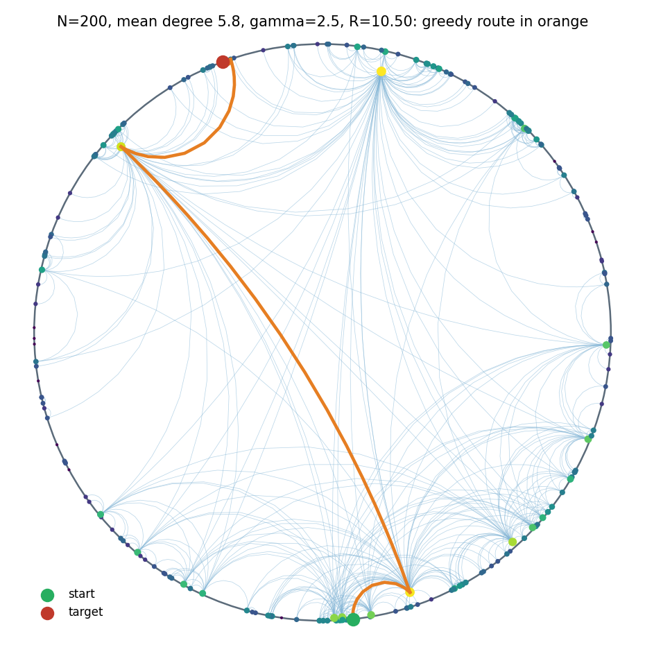
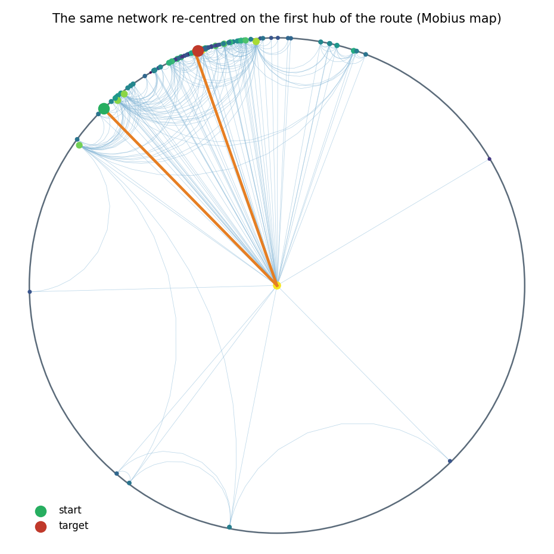
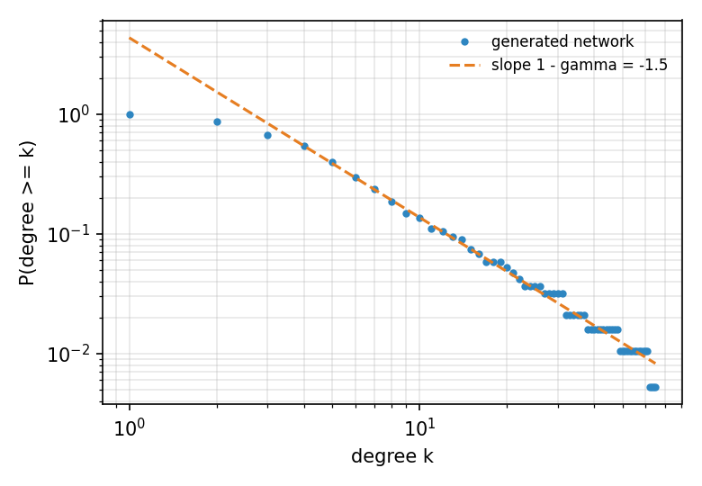

# ATLAS: Network Atlas, a hyperbolic network exhibit

Design and plan, version 1, 4 October 2026. Proposal for the lead; not part of the Master Plan yet.

Based on: D. Krioukov, F. Papadopoulos, M. Kitsak, A. Vahdat, M. Boguñá, *Hyperbolic Geometry of Complex Networks*, Phys. Rev. E 82, 036106 (2010), arXiv:1006.5169. Prototype and figures: `hypernet.py` in this folder.

---

## 0. Summary

**What.** An exhibit that shows a real-looking network (an "Internet" of 200 nodes) living in the hyperbolic plane. The visitor sees:

- why the network has a few huge hubs and many small nodes;
- why a message finds its way with no map, just by stepping "closer" each time.

**Why it fits ATLAS:**

- ATLAS already has a hyperbolic kernel, a Poincaré-disc map and a greedy beacon. The Lung airway uses the same idea: a tree fits in hyperbolic space.
- The exhibit reuses those parts and adds a second "beyond gaming" story next to the lung.

**Three views, cheapest first:**

| View | Where | What the visitor does | New code |
|---|---|---|---|
| **V1 Station disc** | Console web page and Spectator | Watches the network in the Poincaré disc; a greedy route animates hop by hop | Small: Python generator + one JS page |
| **V2 Floor map** | Headset, in Home, standing | A 2.4 m Poincaré disc lies on the floor; looking at a node re-centres the world on it (focus + context) | Medium: one blade, flat meshes |
| **V3 Walk the network** | Headset, in Curved Walk (S2) | Stands at a node in true hyperbolic space; beacons point along the real geodesics to its neighbours; "hops" carry the packet | Large: tile placement, beacons, hops |

**Recommendation:**

- Build V1, then V2.
- Keep V3 as a stretch goal, because a whole network does not fit a room (section 5).
- Start only after gate G7, or earlier only with the lead's agreement: the Master Plan allows only fixes until G1 to G6 are green (§12.3).
- V1 touches only the Station, so it can be prototyped without touching the phone app.

**Measured on the prototype** (N = 200, mean degree 5.8, γ = 2.5, T = 0, seed 7, 2,000 random pairs):

| Greedy routing using | Success | Mean hop stretch |
|---|---|---|
| **Hyperbolic distance** | **100 %** | **1.00** (every route as short as the shortest path) |
| Straight-line distance in the Poincaré picture | 74 % | 1.03 |

This is the headline the exhibit can show live: the same network, the same rule ("step closer"), and only the geometry changes.

---

## 1. Why hyperbolic geometry for networks

| Fact | Flat plane | Hyperbolic plane |
|---|---|---|
| Circumference of a circle of radius r | 2πr (grows linearly) | 2π sinh r ≈ π e^r (grows exponentially) |
| Nodes of a tree at depth r, b children each | b^r (exponential) | b^r fits without crowding |

Real networks are roughly tree-like. ISPs sit above regional networks, which sit above local ones; communities sit above sub-communities. A tree needs exponentially growing room, which only hyperbolic space has.

The paper places nodes in a hyperbolic disc and links the ones that are close. From that one rule, three things follow:

1. **Hubs.** Nodes near the centre are close to almost everyone, so they get many links. The degree distribution is a power law, P(k) ~ k^(-γ), with γ = 2α/ζ + 1 (eq. 29).
2. **Clustering.** Distance obeys the triangle inequality, so friends of friends are linked and triangles form.
3. **Navigation without a map.** Greedy forwarding (pass to the neighbour closest to the target) succeeds about 99.9 % of the time on Internet-like networks (§X.1) and survives the loss of 30 % of the links.

Radius means **popularity**; angle means **similarity**. Shortest paths dip towards the centre and back out, like going up to a common ancestor in a tree.

---

## 2. What the visitor should take away

| Moment | The visitor sees | The "aha" |
|---|---|---|
| Hubs | Three or four big nodes near the centre, most nodes on the rim | "The rich are in the middle and connected to everyone" |
| Room at the edge | Re-centre on any node: its neighbourhood opens up and the rest shrinks to the rim | "There is always room for more branches" |
| Two Compasses for networks | The same packet delivered twice: hyperbolic greedy arrives; flat-picture greedy gets stuck | "The geometry is what makes the map-free rule work" |
| Live number | Success rate and stretch over many random packets | Every claim backed by a number (rubric: geometric creativity 30 %, correct maths) |

Comparison with the rubric:

- **Geometric creativity:** the geometry is not decoration; it explains the network.
- **Educational value and "beyond gaming":** this is how the Internet and social networks are actually studied.
- **Documentation:** one maths card per moment.

---

## 3. The model

All formulas use ζ = 1, so one unit of hyperbolic distance is one curvature radius. In ATLAS that unit is **L metres**, the room's loop-fit: L5 = 1.88 m in `sample_3x3`.

| Quantity | Formula | Source |
|---|---|---|
| Exponent of the radial density | α = (γ − 1) / 2 | eq. 29 with ζ = 1 |
| Helper | ξ = α / (α − 1/2) | eq. 25 |
| Scale | ν = π k̄ / (2 ξ²) at T = 0; ν = k̄ sin(πT) / (2 T ξ²) for 0 < T < 1 | eqs. 25, 31; hot case of §VII |
| Disc radius | R = 2 ln(N / ν); for γ = 3 this is R = 2 ln(8N / (π k̄)) | eq. 13 |
| Radius of a node | r = arccosh(1 + u (cosh αR − 1)) / α, with u uniform in [0, 1] | exact inverse of the CDF of eq. 17 |
| Angle | θ uniform in [0, 2π) | |
| Distance | cosh x = cosh r cosh r′ − sinh r sinh r′ cos Δθ, with Δθ = π − abs(π − abs(θ − θ′)) | eq. 5 |
| Link, T = 0 | linked if x < R | eq. 8 |
| Link, T > 0 | p(x) = 1 / (e^((x − R) / (2T)) + 1) | eq. 41 |
| Greedy forwarding | next = the neighbour with the smallest x to the target; drop when no neighbour is closer | §X |
| Poincaré disc point | ρ = tanh(r / 2), at angle θ | conformal model |
| Re-centring on point a | z → (z − a) / (1 − ā z) | Möbius isometry of the disc |
| In the ATLAS kernel frame | P = (sinh r cos θ, sinh r sin θ, cosh r), metric diag(1, 1, −1), κ = −1 | lane B contract; `Geometry2.Distance` |

**Default parameters:** N = 200, k̄ = 6, γ = 2.5 (the Internet is about 2.1), T = 0 (the hot case adds randomness). These give R = 10.5 units.



*Figure 1. The prototype network in the Poincaré disc. Edges are drawn as true geodesics. Node size and colour follow degree. The orange line is a greedy route: from a rim node, through two hubs, to a far rim node, in 4 hops.*



*Figure 2. The same network re-centred on the first hub of the route by a Möbius isometry. Distances are unchanged; only the point of view moves. This is the V2 interaction.*



*Figure 3. The share of nodes with degree ≥ k on log-log axes. The tail follows the power law of slope 1 − γ (one hub has degree 65; the mean is 5.8).*

---

## 4. The three views

### V1: Station disc (Console and Spectator)

**Experience:**

- A Console page draws the network in the Poincaré disc.
- The operator picks two nodes, or presses *Random packet*.
- The route animates hop by hop: first with the hyperbolic rule, then with the flat-picture rule.
- A panel shows success rate and stretch over 1,000 random packets for both rules.
- The Spectator shows the same disc, so the audience can follow along.

**How:**

- `station/pipelines/atlas_pipelines/network.py` generates the network. It ports `hypernet.py` into the existing `atlas_pipelines` package, next to `airway.py`.
- It writes `network_<seed>.json` (section 6.3) and runs the routing study offline.
- `station/hub/wwwroot/js/network.js` draws geodesics as sampled arcs (the method of `hypernet.geodesic_disk`) on a canvas, in the style of `mapview.js`.

**Reuses:** the Hub's static file serving, the Console layout and `mapview.js` drawing helpers; on the Spectator, `Telemetry/Map/FlatTwinDisc.cs` (the Poincaré disc already drawn for S2).

**Cost:** no phone code and no frame budget. This is the lowest-risk way to show the idea to judges.

### V2: Floor map in the headset (standing)

**Experience:**

- In Home, a disc 2.4 m across lies on the floor, inside the free rectangle. It is the Poincaré disc of the network.
- Nodes are small posts whose height grows with log(degree); edges are thin geodesic arcs on the floor.
- Look at a node for 0.7 s (or point the gamepad at it and press A): the whole map glides so that node comes to the centre (a Möbius map over 0.6 s).
- Its neighbourhood opens up around the visitor's feet while the rest of the world shrinks to the rim. This is "focus + context" (Lamping and Rao's hyperbolic browser), and it shows why hubs are close to everything.
- *Send packet*: pick a target, and the route lights up hop by hop, with the hop count and the stretch on a caption chip.

**Why standing:**

- The visitor never walks in curved space, so comfort is not an issue.
- It works in the smallest rooms, including standing mode.
- It works before gate G2, the curved-walk comfort test, has passed.

**How:**

- The core is engine-free, in `Blades/Network/Core/`:
  - `NetworkModel` (load the JSON, distances);
  - `PoincareMap` (project, Möbius re-centre, ease between two centres);
  - `GreedyRouter`.
- The views use the look:
  - `NetworkFloorView` builds node posts and edge strips with `AtlasMeshBuilder`, colours from `AtlasPalette`, materials from `MaterialPool`;
  - the mesh is rebuilt only while a re-centre animates, in at most 3 merged meshes (nodes, edges, highlight).
- Twins:
  - gaze dwell on node targets registered in `GazeRegistry` (at most 64 at once: the nodes nearest the centre after projection);
  - gamepad: stick to move a cursor between nodes, A to re-centre, Y to send a packet.

**Budget:**

- 200 nodes × 1 post = 200 small boxes (about 2.4k triangles).
- 600 edges × 16 segments × 2 triangles ≈ 19k triangles.
- 3 draws per eye. Well inside the S0 row of §8.5.

### V3: Walk the network (Curved Walk, stretch goal)

**Experience:**

- The visitor stands *at* a node, in true hyperbolic space (S2, Mode 1), on its own tile.
- Its neighbours are shown as **beacons**: arrows on a ring around the visitor, each pointing along the true geodesic. The direction is the kernel's log map, as in the Lung's `AirwayBeacon`.
- The labels give each neighbour's distance and degree.
- Nodes within the fog radius (ρ = 3 units ≈ 5.6 m) are drawn as towers in their tiles; the visitor can walk to them.
- To follow an edge longer than the room allows, the visitor **hops**: dwell on the beacon, the world fades to black for 0.25 s, the kernel re-roots at the neighbour node, and the world fades back in.
- The packet game: deliver a packet to a target using only the beacons. Afterwards the Console shows the visitor's route beside greedy and shortest.

**How:**

- Node placement: the point P of each node (section 3) is snapped to the {4,5} tile graph by stepping from tile zero towards P (`TileGraph.Neighbour`, choosing the neighbour whose centre is nearest P). The node's offset inside that tile goes into the tile chart, as the airway is placed in `AirwayTreeBinding`.
- Hosting follows the Lung pattern: `NetworkWingHost` is registered with Curved Walk like `AirwayWingHost`.
- Hops reuse SpaceLab's fade and the kernel's re-root (`HolonomyWalkerKernel`), the same machinery as *Return Home*.

**Why it is a stretch goal:** see section 5.

---

## 5. The scale problem: why the whole network cannot be walked

In ATLAS one hyperbolic unit is L metres (1.88 m in a 3 × 3 m room). The disc radius grows only **logarithmically** with N, so even small networks are far too wide to walk:

| Network | R (units) | R in a 3 × 3 m room | Rim to rim through the centre |
|---|---|---|---|
| N = 200, k̄ = 6 | 10.5 | 19.8 m | about 40 m |
| N = 100, k̄ = 6 | 9.1 | 17.2 m | about 34 m |
| N = 60, k̄ = 5 | 8.5 | 15.9 m | about 32 m |
| N = 30, k̄ = 4 | 7.5 | 14.2 m | about 28 m |

Further facts:

- A link can be up to R long, so most neighbours sit beyond the fog (5.6 m).
- The greedy route in figure 1 covers 20.9 units, about 39 m of walking.
- Shrinking the units is not allowed. L is fixed by the room and by the comfort floor (L ≥ 1.4 m), and gains are not allowed (real walking only, Master Plan §10.1.4).

**Consequence:**

- V1 and V2 show the whole network at once, which is what the paper is about.
- V3 can only show the local view, and it needs hops.
- That is honest and still striking ("this is what being a router feels like"), but it is more work for less overview.

---

## 6. Architecture

### 6.1 Data flow

```
 Station PC                                      Phone
 ----------                                      -----
 atlas_pipelines/network.py                      StreamingAssets/networks/network_<seed>.json
   generate (N, k̄, γ, T, seed)       --bundle-->   (built in; no Station needed)
   greedy study (hyperbolic vs flat)                 |
   write network_<seed>.json                         v
        |                                         Blades/Network/Core  (engine-free)
        v                                           NetworkModel, PoincareMap, GreedyRouter
 Hub /api/network  ----------------------------->   |
 Console network.js (V1)                            v
 Spectator FlatTwinDisc (V1)                      Blades/Network  (views)
                                                    V2 NetworkFloorView in Home
        ^                                           V3 NetworkWingHost in Curved Walk
        |  events net.* and State
        +-----------------------------------------  LinkClient (unchanged)
```

### 6.2 Code layout

| Path | What | Lane |
|---|---|---|
| `station/pipelines/atlas_pipelines/network.py` + `tests/test_network.py` | Generator, greedy study, JSON writer (port of `hypernet.py`) | D |
| `station/hub/wwwroot/js/network.js`, Console tab "Network" | V1 drawing and packet animation | D |
| `ATLAS/Assets/Atlas/Blades/Network/Atlas.Blades.Network.asmdef` | New blade assembly; references `Atlas.World`, `Atlas.Kernel`, `Atlas.Rendering`, `Atlas.Input`, `Unity.Mathematics` | A or C |
| `Blades/Network/Core/NetworkModel.cs`, `PoincareMap.cs`, `GreedyRouter.cs` | Engine-free core (no `UnityEngine` type) | A or C |
| `Blades/Network/NetworkFloorView.cs`, `NetworkTwins.cs` | V2 meshes and gaze targets | A or C |
| `Blades/Network/Walk/NetworkWingHost.cs`, `NetworkBeaconView.cs` | V3 (stretch) | B |
| `Tests/Network/*` | EditMode tests, run by `tools/headless/verify.py` too | all |

**Rules this design keeps** (contracts F1 to F9; verification brief §1):

- Blades never reference Scan, Safety or App (F1). The blade plugs in through `ISpaceModule` and the Lung's host pattern.
- The core is engine-free (F2).
- Everything is built in code (F3). The JSON is data, not a scene.
- One shader, and no `MaterialPropertyBlock` (F7): meshes use the shared `AtlasVertex` layout and `MaterialPool`.
- No allocation per frame on the frame path. Meshes are rebuilt only during a re-centre, into preallocated buffers.
- Bump Guard is untouched and keeps working in every view.

### 6.3 Data file `network.json`

```json
{
  "schema": "atlas.network/1",
  "model": { "n": 200, "kbar": 6, "gamma": 2.5, "T": 0, "seed": 7, "zeta": 1, "R": 10.504 },
  "nodes": [ { "id": 0, "r": 9.84, "theta": 1.23, "degree": 4, "label": "AS-0" } ],
  "edges": [ [0, 17], [0, 42] ],
  "study": {
    "pairs": 2000,
    "hyperbolic": { "success": 1.0, "stretch": 1.0 },
    "flat_picture": { "success": 0.741, "stretch": 1.026 }
  }
}
```

### 6.4 Parameters, events and twins

| Kind | Name | Values | Purpose |
|---|---|---|---|
| Parameter | `net.file` | enum of bundled networks | Which network is shown |
| Parameter | `net.view` | `floor`, `walk` | V2 or V3 |
| Parameter | `net.rule` | `hyperbolic`, `flat` | Routing rule shown |
| Parameter | `net.recentreSeconds` | 0.3 to 1.5 (0.6) | Re-centre animation length |
| Parameter | `net.maxGazeNodes` | 16 to 64 (64) | Gaze targets registered at once |
| Event | `net.recentre` | `{node, r, degree}` | Each re-centre |
| Event | `net.packet` | `{src, dst, rule, hops, shortest, stretch, success}` | Each delivered or dropped packet |
| Event | `net.hop` (V3) | `{from, to, distance}` | Each hop |
| Twins | Re-centre | gaze dwell on the node / stick cursor + A | Rule 5 of the Master Plan |
| Twins | Send packet | gaze dwell on the *packet* chip / Y | |
| Twins | Switch rule | gaze dwell on the *rule* chip / X | |

Parameters are declared with `[AtlasParam]`, so the Console tuner shows them with no extra Console code.

---

## 7. Plan

The same style as the Master Plan: each task fits one coding agent, touches one lane's files, and has a binary acceptance test with numbers.

| ID | Task | Lane | Depends on | Output | Acceptance (binary) | Needs |
|---|---|---|---|---|---|---|
| NET-01 | Network generator and study | D | none | `atlas_pipelines/network.py`, pytest | Mean degree within 10 % of k̄ for N = 200 over 10 seeds; CCDF tail slope within 0.3 of 1 − γ; hyperbolic greedy success ≥ 99 % and flat-picture success ≤ 90 % over 2,000 pairs; output validates against `atlas.network/1` | Station |
| NET-02 | Network contract | D | NET-01 | `docs/contracts/network.md`, JSON schema | Schema checked in CI; two seeds bundled under `StreamingAssets/networks/` | Editor |
| NET-03 | V1 Console page | D | NET-01 | `network.js`, Console tab, `/api/network` | Draws 200 nodes and 580 edges in under 50 ms in a real browser; a packet animates hop by hop; node tests (`node --test`) green | Station |
| NET-04 | V1 on the Spectator | D | NET-02, P1-D07 | Disc in the Spectator's map panel | Same picture as the Console for the same seed (node positions equal to 1 px); ≤ 0.3 ms per frame | Station |
| NET-05 | Engine-free core | A or C | NET-02 | `NetworkModel`, `PoincareMap`, `GreedyRouter` + EditMode tests | Distances equal the Python ones to 1e-9; a Möbius re-centre preserves every pairwise hyperbolic distance to 1e-9; greedy routes equal the Python routes on 1,000 pairs | Editor |
| NET-06 | V2 floor map | A or C | NET-05 | `NetworkFloorView`, blade registration in Home | 3 draws per eye; ≤ 25k triangles; 0 B managed allocation per frame at rest; re-centre ≤ 2 ms CPU per frame | Editor, then phone in headset |
| NET-07 | V2 twins and packet | C | NET-06 | `NetworkTwins`, caption chip, `net.*` events | Every action by gamepad alone and by gaze alone; `net.packet` logged for 10 of 10 packets with hops and stretch equal to the core's | Phone in headset |
| NET-08 | Exhibit wiring | C | NET-07, P2-C08 | Exhibit sign in Home | Reachable from the exhibit menu; returns Home with the room unchanged (walls within 0.05 m) | Phone in headset |
| NET-09 | V3 node placement (stretch) | B | NET-05, P1-B04 | Snapping to tiles, towers in tiles | Every node's tile is the tile whose centre is nearest (checked against brute force on 200 nodes); WorldLint passes | Editor |
| NET-10 | V3 beacons and hops (stretch) | B | NET-09 | `NetworkWingHost`, `NetworkBeaconView` | Beacon bearing within 1° of the log map; a hop re-roots within 0.5 s with a fade and no visible pop | Phone in headset |
| NET-11 | Maths card and docs | B | NET-01 | Section in `docs/maths.md`, deck slide | Every formula of section 3 names a passing test; no claim beyond section 8 | Editor |

**Milestones:**

| Milestone | Tasks | What can be shown |
|---|---|---|
| **N1 Station disc** | NET-01 to NET-04, NET-11 | Judges watch hyperbolic vs flat routing on the Console and Spectator |
| **N2 Floor map** | NET-05 to NET-08 | Visitor re-centres the network around them in the headset |
| **N3 Walk** (stretch) | NET-09, NET-10 | Visitor routes a packet from inside hyperbolic space |

**Where it sits in the Master Plan:**

- It is not in the plan today. The lead would add it as a Tier B blade, next to the Playground and Lung tracks of Phase 2.
- **N1 and N2 should start only after G7.** The plan allows only fixes until G1 to G6 are green (§12.3).
- N1 lives entirely on the Station, so lane D can prototype it earlier without touching the phone.
- N3 depends on G2: the curved-walk comfort result decides whether visitors walk in S2 at all.

---

## 8. Claims we make and claims we avoid

| We say | We do not say |
|---|---|
| "This network was *generated* by the hyperbolic model of Krioukov et al. 2010; real networks share its hubs, clustering and navigability." | "This is the real Internet" (unless a real embedded map is used, and credited) |
| "With the hyperbolic rule, greedy delivery succeeded on X of Y random packets in *this* network." | "Greedy routing always works" (it is measured, not guaranteed) |
| "Flat-picture greedy fails more often on the same network." | "Euclidean geometry cannot route" (a different flat embedding could do better) |
| "Hyperbolic space has room for every branch of a tree." | Anything clinical about the Lung by analogy |

This follows the Master Plan's risk 19 (over-claiming the hyperbolic airway): numbers are measured, not assumed.

---

## 9. Risks

| Risk | Effect | Mitigation |
|---|---|---|
| Phase 1 not finished | Exhibit work steals time from the gates | Start after G7; N1 only on the Station |
| Clutter: 580 edges look like noise | The visitor sees a hairball | Show edges of the focus node and the route by default; all edges on a toggle; fade edges by distance from the centre |
| Nodes pile up on the rim (tanh(r/2) ≈ 1) | Rim nodes are hard to pick by gaze | Gaze targets only for the 64 nodes nearest the centre after re-centring; re-centre to reach the others |
| V3 too long to walk | Visitor fatigue, sickness | Hops with a fade; V3 stays a stretch goal; gated on G2 |
| Real Internet data licence | Cannot ship real data | Synthetic networks first; real data only with a cleared licence (open question 2) |

---

## 10. Open questions for the lead

1. Add the exhibit to the plan at all, and as which tier: B (demo) or C (roadmap)?
2. Real data:
   - Boguñá, Papadopoulos and Krioukov published a hyperbolic map of the Internet (*Sustaining the Internet with hyperbolic mapping*, Nature Communications, 2010). Is a real embedding worth the licence check?
   - Embedding any graph, for example the team's own code-dependency graph, needs an embedding tool (for example Mercator). Is that in scope?
3. Owner for V2: lane C (exhibits) or lane A (look)?
4. Which γ to show: 2.1 (Internet-like, a few giant hubs) or 2.5 (calmer picture)?

---

## 11. References

- D. Krioukov, F. Papadopoulos, M. Kitsak, A. Vahdat, M. Boguñá. *Hyperbolic Geometry of Complex Networks*. Phys. Rev. E 82, 036106 (2010). arXiv:1006.5169.
- M. Boguñá, F. Papadopoulos, D. Krioukov. *Sustaining the Internet with hyperbolic mapping*. Nature Communications 1, 62 (2010).
- R. Kleinberg. *Geographic routing using hyperbolic space*. INFOCOM 2007 (every tree has a greedy embedding in H²; already cited by the ATLAS plan for Two Compasses).
- J. Lamping, R. Rao. *The hyperbolic browser: a focus + context technique for visualizing large hierarchies*. Journal of Visual Languages and Computing 7 (1996).
- ATLAS Master Plan: §3 (spaces), §4.6 to §4.8 (Curved Walk and Aligned Cells), §8.5 (budgets), §10.1.4 (comfort rules), §10.2 (Lung airway, Two Compasses), §12.3 (if a gate fails).

---

## Appendix: reproduce the numbers

```
python hypernet.py --n 200 --kbar 6 --gamma 2.5 --T 0 --seed 7 --pairs 2000
```

Writes `figures/fig1_poincare_route.png`, `fig2_recentred.png`, `fig3_degrees.png` and `stats.json`:

- R = 10.504; mean degree 5.8; maximum degree 65;
- giant component 179 of 200 nodes; 580 edges;
- greedy hyperbolic: 100 % success, stretch 1.00;
- greedy flat-picture: 74.1 % success, stretch 1.03.
