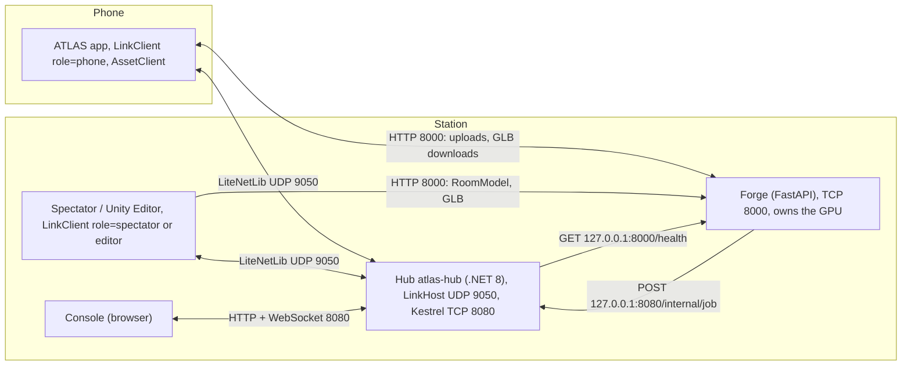
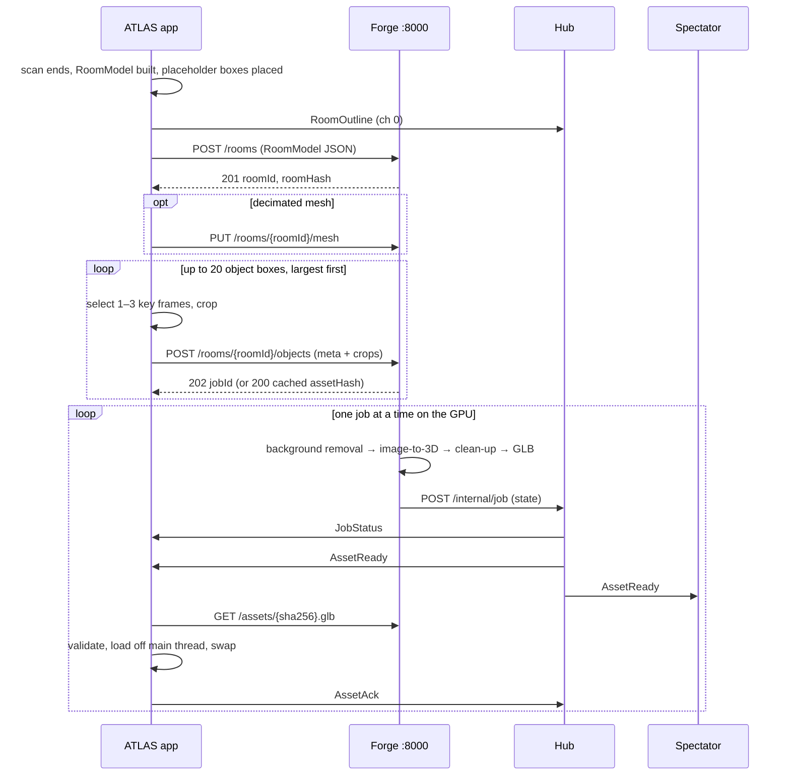

## 7. Phone ↔ Station link

Phase 1 ends with four link functions working together (D22): Spectator mirror, live tuning and operator Console, performance telemetry, and the scan and asset round-trip with furniture generated live per object (D20). The link is an accessory: the ATLAS app is complete without it (§7.5).

### 7.1 Topology and processes

| Process | Listens on | Role |
|---|---|---|
| Hub | UDP 9050 (the only LiteNetLib listener); TCP 8080 on `0.0.0.0` | Relays `State` to spectators and commands to the phone; writes logs; serves the Console |
| Forge | TCP 8000 on `0.0.0.0` | Stores RoomModels, runs object jobs, serves GLBs by hash; never sees live pose |
| ATLAS app, Spectator, Editors | nothing (clients) | Same `LinkClient`; the phone rejects every connection request |

- `Atlas.Link` is one plain C# library (asmdef with no engine references; no `UnityEngine` types) compiled into the app, the Spectator and the Hub (linked sources). It holds `LinkClient`, `LinkHost`, `ClockSync`, the message types of Appendix B (`StateMessage` among them) with their readers and writers, and `ParamRegistry`: the engine-free half of the parameter registry (ids, ranges, defaults, current values and the clamp). The Unity-side half, the `AtlasParamAttribute` scanner that binds fields to the registry at boot, is in `Atlas.Telemetry` (§6.2). (R4 §5.9)
- LiteNetLib 2.1.4, connection key `atlas-v1`; unicast to a known address only. Pairing: `http://<station>:8080/pair` shows a QR of `atlas://<ip>:9050`, read by the iOS Camera app; a typed-IP field and a DHCP-reserved default are the fallbacks. (R4 §3.7)
- The first `Connect` is made in hand during onboarding to raise the Local Network prompt, retried every 1 s. (BP §0.5, R4 §3.3)

### 7.2 Channels, encoding, clock and watchdog

| Ch | Delivery | Direction | Messages | Rate | Payload |
|---|---|---|---|---|---|
| 0 | ReliableOrdered | both | `Hello`, `Welcome`, `ParamManifest`, `ParamSet`, `SceneCmd`, `OperatorCmd`, `RoomOutline`, `Event`, `Log`, `JobStatus`, `AssetReady`, `AssetAck`, `Bye`, `Telemetry` | on demand; `Telemetry` 1 Hz | < 1 kB each |
| 1 | Sequenced | phone → Hub → spectators | `State` | 60 Hz, one per frame (30 Hz when the thermal ladder locks to 30 fps, §8.6; `link.stateHz` can lower it to 30 or 10) | 202 B (derived) |
| – | Unreliable | both | `TPing`, `TPong` | 8 at connect, then 1 Hz | 13 B, 29 B |
| HTTP | TCP | phone ⇄ Forge | RoomModel, crops, GLB | on demand | §7.4 |

- **Encoding.** `State`, `Telemetry`, `ParamSet`, `RoomOutline`, `TPing`, `TPong`: hand-packed little-endian through one reused `NetDataWriter` (zero allocation). Everything else: one type byte plus a UTF-8 JSON string (`JsonUtility` on the phone, `System.Text.Json` on the Hub), forwarded to the Console unchanged. `NetSerializer` is not used. (R4 §4)
- **Bandwidth.** `State` on the wire ≈ 234 B × 60 Hz ≈ 14 kB/s; no datagram reaches the 1,024-byte initial MTU (derived from R4 §5.2).
- **Send point.** `SendState` runs once per frame in `LateUpdate` after the kernel step, then `TriggerUpdate()`. LiteNetLib settings: `ChannelsCount 2`, `PingInterval 500`, `DisconnectTimeout 3000`, `UpdateTime 5`, `IPv6Enabled false`; Hub adds `AllowPeerAddressChange true`. (R4 §5.5)
- **Clock sync.** Four-timestamp exchange on `Stopwatch` microseconds: offset = ((t2 − t1) + (t3 − t4)) / 2. Eight exchanges 50 ms apart at connect, then 1 Hz; keep the minimum-RTT sample of the last 16; low-pass α = 0.1. The Hub clock is the reference for phone and spectators. (R4 §5.4)

| Watchdog state | Condition | Behaviour on the phone |
|---|---|---|
| CONNECTED | a packet within 500 ms | normal |
| DEGRADED | silent 500 ms–3 s (enter after 2 missed pings, leave after 2 s healthy) | `ParamSet` ignored |
| OFFLINE | peer disconnected | app unchanged; reconnect at 0.5, 1, 2, 4, 4 … s; asset client falls back to polling (§7.4) |
| RESYNC | just reconnected | `Hello` → `Welcome` → 8 pings → `ParamManifest`; Hub replays the last parameter snapshot and any unacknowledged `AssetReady` |

On `OnApplicationPause(false)` with no peer, the app calls `Connect` again. (R4 §3.5)

**Link indicator.** In hand: state dot (green, amber, grey), Hub address, RTT, loss, Forge reachability, "Reconnect", "Change IP". In the headset: one dot at the lower edge of both eyes, refreshed at 2 Hz, hidden while CONNECTED under demo lock. (R4 §5.7)

### 7.3 The four functions

#### 7.3.1 Spectator mirror

- **Flow.** `State` (channel 1) carries scene id, space id, the tile id as six `i64` for {4,5}, the tile-local double 3×3, eight parameters, and the head pose in the RoomModel anchor frame. The Spectator is the app's own render scene built with `ATLAS_SPECTATOR` (no ARKit); it sets the same kernel state and draws one mono camera. No video is sent.
- **Determinism.** The Spectator never integrates motion; it applies the received transform and re-anchors exactly as the phone does. `Hello` and `Welcome` carry `worldHash` = SHA-256 of (space id, tiling, generator seed and version, RoomModel hash, L in millimetres), truncated to 16 hex characters. `State.worldVer` bumps on any regeneration. On mismatch the Spectator shows "world mismatch" and re-fetches `GET /rooms/{roomId}`; it never draws a guessed world. (R4 §5.3)
- **Beside the mirror.** Flat-twin mini-map (the space's flat model with the walker's path); the RoomModel outline from `RoomOutline` with the walker's physical position and object boxes; the Bump Guard level (`State.bumpLevel`: 0 clear, 1 warn, 2 strong, 3 tracking lost) as a coloured bar.
- **Furniture.** The Spectator gets the relayed `AssetReady` and downloads the same GLBs.
- **Acceptance.** Tile ids equal on 100% of samples; photon-to-photon ≤ 150 ms (tests L5, L7, L8).

#### 7.3.2 Live tuning and operator Console

- **Registry.** Each parameter is registered once at boot: `{id u16, name, group, min, max, def, val, onRelease}`. The phone sends `ParamManifest` after `Welcome`; the Console builds its sliders from it with no further code. First set: `_HypL`, ρ (`curved.cullRho`: the fog is opaque there and the draw rule of §8.5 follows it), 4D slice w and rotation angles, render scale, MSAA, line width, IPD. (R4 §6.3)
- **Path.** Slider → WebSocket `{id, value}` → Hub → `ParamSet` → phone clamps to `[min, max]` and applies → the applied value returns in the next `State.p[]` or `Event param`. Parameters that regenerate geometry have `onRelease = true` and bump `worldVer`.
- **Presets and Bake** (`P1-D03`). A preset is saved and loaded as JSON on the Station (`/api/presets`, Appendix B.3); loading one replays all its values in one `ParamSet`. "Bake" writes a preset into the project defaults, so a build started with the Hub off has those values and the phone is correct with no Station.
- **On-device menu** (`P1-D13`). The same registry drives an in-headset list of the §12.4 parameters, opened by a gamepad chord. It needs no link, so each of them can be changed with the Station unreachable; every change is written to the phone's log.
- **Operator commands.** Exactly six: switch space (`SceneCmd`), and `OperatorCmd` `home`, `recentre`, `quality`, `cue`, `lock`. `cue` is the Console's **STOP** button (D22). It fires the Bump Guard cue at STRONG level (indicator, tone, continuous haptic) through `BumpCue.Fire`, the same local entry point Bump Guard uses (`P1-C14`). The world keeps rendering; nothing freezes. There is no "panic → passthrough" and no freeze (D19).
- **Lock.** `demoLock` (build flag or `OperatorCmd lock`) makes the phone ignore `ParamSet`; operator commands still work.
- **Acceptance.** Slider visible on the phone ≤ 100 ms; clamped; ignored under lock (L9, L10). With the link off, the on-device menu still changes every parameter of §12.2 and §12.4 (L22).

#### 7.3.3 Telemetry dashboard and CSV

- **Flow.** `AtlasPerfProbe` keeps a 3,600-frame ring buffer and emits one `Telemetry` row per second (91 B, derived), reliable, so the CSV has no holes. (R5 D3)
- **Fields.** Listed in Appendix B.2: frame-time percentiles, CPU and GPU times, draw calls, triangles, memory, thermal state, battery, tracking, quality settings, link health, Bump Guard and asset counters.
- **Storage.** The Hub appends `logs/<session>/perf.csv` (header row, one line per second), plus `state.bin`, `events.jsonl`, `phone.log`. The phone writes the same rows to `Application.persistentDataPath/perf/perf_<session>.csv` from a writer thread (`UIFileSharingEnabled` on), so a lost link loses nothing. What is kept from a session, and how it is deleted, is set out in §13.5.
- **Console.** A tile per field; line charts of frame-time p95 and fps; a thermal colour bar; Forge queue length.
- **Acceptance.** 15-minute soak: ≥ 895 rows, no gap > 2 s, PC and phone copies identical (L11).

#### 7.3.4 Scan and asset round-trip

See §7.4. Acceptance: every box that takes part (at most 20 per room) ends as a generated mesh or as a built-in fallback mesh; ≤ 60 s from job start to `AssetAck` per object (L15–L21).

### 7.4 Scan and asset round-trip

**Phone: capture and selection.**
- During the scan the app keeps a key-frame ring in memory: a new frame when the camera has moved ≥ 0.25 m or turned ≥ 15°, and gyro speed < 30°/s; at most 96 frames, each with camera pose and intrinsics (thresholds derived; tune at G6).
- When the RoomModel is final, the phone picks the objects that receive meshes: all of them, or the 20 largest boxes by volume when there are more. The rest keep their placeholder box (§4.5). Each job carries a triangle target in its `meta` (`triTarget`, Appendix B.4): clamp(60,000 ÷ n, 3,000, 5,000), where n is the number of objects that receive meshes. That is 5,000 up to twelve objects and 3,000 at twenty. The furniture of one room therefore never exceeds 60,000 triangles.
- Each picked box is projected into each key frame. A frame is a candidate when all eight corners are inside the image with a 5% margin, the projected bounding box covers 10–70% of the image, the camera is 0.6–3.0 m from the box, and LiDAR depth at the box centre is within 0.15 m of the expected distance (not occluded).
- Score = 0.4·min(area / 0.35, 1) + 0.3·centredness + 0.3·sharpness, where centredness = 1 − (offset of the box centre from the image centre ÷ half-diagonal) and sharpness = variance of the Laplacian on a 160-pixel thumbnail ÷ the scan's median (derived).
- Take the best frame, then up to two more whose azimuth about the box differs by ≥ 30° from every frame already taken. Zero candidates → no upload; the box is reported in the log and takes its built-in fallback mesh at once.
- Crop to the projected box padded by 12%, squared, ≤ 768 × 768, JPEG quality 85, on a worker thread. View 0 feeds generation; views 1–2 are retry inputs and colour samples (TripoSG takes one image: verify).

**Forge: job per object.**

| State | Work | Timeout |
|---|---|---|
| `queued` | Cache lookup by `sha256(view 0)`, the triangle target and `pipelineVer`; a hit goes straight to `ready` | – |
| `matting` | Background removal (`rembg`) | 10 s |
| `generating` | TripoSG on the RTX 5070 (BP §0.5) | 90 s, then one retry with view 1, then the hosted API if a key is configured (120 s) |
| `cleaning` | Up axis and the yaw in {0°, 90°, 180°, 270°} whose bounds best match the scanned box; scale to the box (≤ ±15% per axis); decimate to the triangle target sent with the job and regrid so no edge exceeds 0.25 m, ending at or below the target; nearest palette entry to the photo's dominant colour; vertex ambient occlusion; export GLB | 20 s |
| `ready` / `failed` | `AssetReady`, or `JobStatus failed` → the box takes its built-in fallback mesh | – |

- GLB contract: one mesh, `POSITION`, `NORMAL`, `TEXCOORD_0` (palette cell), `COLOR_0` (ambient occlusion), no textures, no material; box-local frame, origin at the base centre, +Y up, metres. The phone assigns the shared look material.
- One GPU job at a time; the queue is ordered by box volume, largest first.
- The `forge.backend` setting (§12.4) is sent in each job's `meta`. `local`, the default, runs the table above. `hosted` goes to the hosted API without trying the local generator. `cache` answers from the cache only: a miss fails the job at once and nothing is generated, on the Station or by a third party. With `off` the phone sends nothing. A picked box whose job fails, or is not sent because of this setting, takes its built-in fallback mesh.

**Phone: placement.**
- Placeholder: a box of the scanned dimensions, tinted by category, gridded at 0.25 m, present from the moment Home is built.
- On `AssetReady`: download to `persistentDataPath/assets/<sha256>.glb`, verify the SHA-256, load with glTFast asynchronously, instantiate at most one asset per frame, validate triangles ≤ 5,000 and bounds within ±10% of the box, then cross-fade placeholder to mesh over 0.3 s. Send `AssetAck {ok, loadMs, worstFrameMs}`. A rejected asset is not shown: the phone reports `ok: false` and the box takes its built-in fallback mesh.
- Without the Hub, the phone polls `GET /jobs?room=` every 2 s.
- Without the Forge, the placeholder box of every picked object is replaced by a mesh from the built-in fallback set (`P1-D12`): one CC0 mesh of at most 1.5k triangles per RoomPlan category, palette-mapped, shipped in the build and scaled to the box. The set is placed after 3 failed uploads (back-off 1, 2, 4 s). An attempt also counts as failed when no connection is made within 2 s (proposed), so the set is in place at most 9 s after the first attempt (derived: 3 × 2 s + 1 s + 2 s). A box with no candidate frame, a failed job or a rejected asset takes its built-in mesh at once. Each built-in mesh is tagged "built-in" in the log and on the Console. Uploads resume when the Forge returns, and each built-in mesh is then replaced by the generated one.
- The saved RoomModel stores `boxId → sha256`, so the pre-scan path (D21) loads furniture from the phone's cache with no Station.

**Privacy.** Only crops leave the phone; full camera frames are never uploaded or written to disk and the ring is cleared when cropping ends. The Forge holds crops in memory and deletes them when the job finishes. `FORGE_DEBUG_KEEP=1` keeps them for debugging and is for team sessions only: the Forge reports the flag in its status (`GET /health`) and the Console shows a red "crops kept" banner. The hosted fallback (D20) sends the crop to a third party whose retention we do not control. The booth sign's data line says so, the operator tells a walker from outside the team before the scan, and if they decline the operator sets `forge.backend` to `cache`, so their objects use the cache or the built-in set. Scan with no other person in view; a crop in which ARKit's human stencil covers > 5% of pixels is discarded (Extended: the human stencil is off by default, §8.2, and this check switches it on for the scan only). The room record, its mesh and the GLBs made for it are removed from the Forge with `DELETE /rooms/{roomId}` (Appendix B.4); §13.5 says what is kept from a session and when it is deleted.

| Budget | Value |
|---|---|
| RoomModel JSON | ≤ 300 kB (160 × 160 grid, base64; derived from R1 C.3) |
| Decimated room mesh | ≤ 2 MB; optional |
| Crop | ≤ 200 kB each; ≤ 3 per object |
| GLB | ≤ 1 MB; 1.5–5k triangles (§6.4), and no more than the target sent with its job |
| Furniture of one room | ≤ 20 meshes; ≤ 60,000 triangles in total (§4.5) |
| Worst frame during a swap | < 20 ms |

### 7.5 Link rules

1. Safety never touches the network. Bump Guard, tracking, the kernel and rendering never read link state. `OperatorCmd cue` is an extra trigger, never the only one.
2. Nothing in `Update`, `LateUpdate` or a render callback awaits the link. Sockets run on LiteNetLib's threads; HTTP, hashing, JPEG encoding, GLB parsing and file writes run off the main thread; received commands are queued and applied on the next frame.
3. Every remote parameter is clamped on the phone. Bump Guard has no registry parameter and no off switch: its thresholds and its depth rate are constants in code (§4.10).
4. With the Hub unplugged the app behaves identically apart from the link indicator; with the Forge unplugged, apart from the furniture, which is then the built-in fallback set (§7.4).
5. A receiver ignores unknown message ids and trailing bytes; a `proto` major mismatch is refused with a readable reason.
6. `Atlas.Link` allocates 0 B per frame in steady state.

### 7.6 Acceptance tests for gate G6

Own router, Station wired, phone in the headset. Loss and latency simulation is enabled on the Hub side (R4 §5.10). In L15 to L21 "every box" means every box that takes part in the round-trip: all of them, or the 20 largest when the room has more (§7.4).

| # | Test | Pass |
|---|---|---|
| L1 | Cold connect, permission already granted | CONNECTED ≤ 3 s p95 over 10 launches |
| L2 | First connect with the iOS prompt | CONNECTED ≤ 5 s after "Allow"; no restart |
| L3 | `State` rate at the Hub, 5-minute walk | ≥ 50 Hz mean (should: ≥ 58 Hz); loss < 2% |
| L4 | Phone → Hub latency, clock-corrected | p95 ≤ 25 ms, p99 ≤ 50 ms (should: p50 ≤ 10 ms) |
| L5 | Photon to Spectator (slow-motion video) | ≤ 150 ms |
| L6 | Clock offset over 10 min | jitter ≤ 2 ms p95 |
| L7 | Closed five-corner loop in S2 | tile ids equal on 100% of samples; `worldHash` equal |
| L8 | `worldHash` forced to differ | Spectator shows "world mismatch"; draws no world |
| L9 | Sliders for L, fog, ρ, w | visible ≤ 100 ms at p95; ≤ 250 ms at 10% loss; clamped; ignored under lock |
| L10 | Six operator commands | each takes effect ≤ 250 ms; `cue` (STOP) gives indicator, sound and haptic; the world does not change |
| L11 | Telemetry, 15-minute soak | ≥ 895 rows; no gap > 2 s; PC and phone CSV identical |
| L12 | Router off 10 s; Hub restarted; app backgrounded 10 s | OFFLINE ≤ 3.5 s; CONNECTED ≤ 5 s after return; parameters restored; no phone restart |
| L13 | Link on against Hub unplugged, 5 min each | main-thread p95 differs ≤ 0.2 ms; 0 B per frame from `Atlas.Link` |
| L14 | Station cable pulled while walking at an obstacle | Bump Guard cue identical; no frame over 33.8 ms (two vsync intervals + 0.5 ms, as in §11.2) |
| L15 | Room with ≥ 4 object boxes, Station up | 100% placeholders at Home entry; every box ends as mesh or fallback; ≤ 60 s job start → `AssetAck` each |
| L16 | Forge output check | every GLB has 1,500–5,000 triangles and no more than the target sent with its job; edges ≤ 0.25 m; longest side within 10% of the box (should: 5%); the room's furniture ≤ 60,000 triangles in total |
| L17 | Mesh swap | worst frame < 20 ms over 10 swaps |
| L18 | Same crops uploaded twice with the same triangle target | second run: 100% cache hits, no GPU job |
| L19 | Forge stopped before the scan | app enters Home; within 10 s of Home entry (proposed) every box holds its built-in fallback mesh (`P1-D12`: one CC0 mesh per RoomPlan category, ≤ 1.5k triangles, no edge over 0.25 m after scaling); after a Forge restart every box is replaced by its generated mesh |
| L20 | Privacy | after all jobs the Forge holds 0 crop files with the debug flag off; with `FORGE_DEBUG_KEEP=1` the Console shows the "crops kept" banner |
| L21 | No hosted key configured; local generator stopped | 0 requests leave the Station (packet capture on the Station); every box takes its built-in mesh |
| L22 | On-device menu with `link.enabled` off | every parameter of §12.2 and §12.4 can be changed from the gamepad; every change is in the phone's log |
