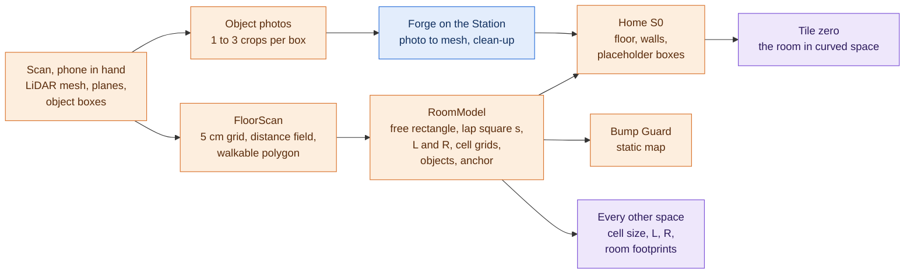

---

## 4. Scan your room into curved space

This section is the design that replaces the taped square. It covers the scan, the data it produces, how the room becomes Home and then tile zero, how the two hyperbolic modes work, and how the walker is kept from bumping into things.

### 4.1 The pipeline



Everything downstream reads the **RoomModel**. No space, and no use case, contains a room size of its own.

### 4.2 Scanning

Two paths, both supported (D21):

- **Self-scan (the headline).** The walker holds the phone, sweeps the room, confirms the outline shown on the floor, and puts the phone in the headset.
- **Pre-scan (the fast path).** A team member scans beforehand. The app saves the `ARWorldMap` with the RoomModel and relocalises when the next walker starts.

Four scan routes, from most robust to most detailed. Each later route adds to the earlier ones; the app always has a result from the highest route that succeeded.

| Route | What it uses | What it gives | Status |
|---|---|---|---|
| 1 Manual outline | Taps on the floor corners, or the path walked along the walls | Floor polygon | Core; always available |
| 2 FloorScan | LiDAR mesh with per-triangle classes, plus plane detection | Free floor with holes for furniture, wall directions, obstacle blobs | Core |
| 3 Object boxes | RoomPlan through AR Foundation's bounding-box manager (iOS 17+) | One oriented box per piece of furniture, with a category | Core; needed for live furniture |
| 4 Wall bridge | A Swift plugin around `RoomCaptureSession(arSession:)` | Clean walls, doors, windows and openings | Extended |

Facts that constrain the design (R1, verified against Apple and Unity documentation): AR Foundation exposes RoomPlan only as furniture boxes, so walls come from planes and the mesh unless route 4 is built; the LiDAR reaches about 5 m; glass and mirrors produce missing or phantom floor, which is why unknown cells are never treated as free and the walker confirms the outline; meshing and plane detection are switched off as soon as the scan is confirmed because they are a major source of heat.

What each of the phone's sensors does in ATLAS:

| Sensor | During the scan | While walking |
|---|---|---|
| Rear camera | ARKit tracking; key frames from which object photos are cropped | ARKit tracking |
| LiDAR | Classified room mesh, planes, furniture boxes; meshing and plane detection stop when the scan is confirmed | Live depth image for Bump Guard: 256 × 192, one with every camera frame (60 Hz), about 0.3 to 5 m, forwards only (§4.10) |
| IMU (gyroscope, accelerometer) | Part of ARKit's visual-inertial tracking | The same; plus the gyro rate for the optional rotation prediction (§8.7) |
| Taptic engine | | Bump Guard pulses |
| Screen, through the headset's lever | Confirm the outline (in hand) | One-button input twin |
| Wi-Fi | Uploads to the Forge | Link to the Station |

**FloorScan**, in outline (R1 §C.3):

```text
y0    = height of the largest plane classified Floor
grid  = 5 cm cells over the mesh's footprint
mark FLOOR  under every Floor triangle within 8 cm of y0, and under the walker's own path
mark OBST   under every triangle with a vertex between 0.10 m and 2.0 m above y0
FREE  = FLOOR minus OBST grown by one cell, intersected with the outline the walker confirmed; small holes closed; unseen cells stay not-free
SDF   = signed distance to the edge of FREE, in metres                    # reads 0.05 m less than the true distance to a wall or obstacle
WALK  = the connected part of {SDF > 0.25 m} that contains the walker     # 0.30 m from every wall and obstacle = body half-width + tracking error
axis  = dominant wall direction (length-weighted wall-plane normals)
rect  = largest rectangle inside WALK aligned to axis                      # the free rectangle, Wf × Df
boxes = oriented boxes of the OBST blobs, merged with the RoomPlan boxes
anchor = ARAnchor at the centre of rect; everything is stored relative to it
```

It runs off the main thread, once when the sweep ends and again if the walker corrects the outline.

### 4.3 The RoomModel

| Field | Content | Used by |
|---|---|---|
| `anchor` | Pose of the ARAnchor at the centre of the free rectangle; axis direction | Everything |
| `sdf` | Distance field on the 5 cm grid (positive inside free floor) | Bump Guard |
| `walkable` | Polygon with holes | Home floor, room fitting, Station view |
| `freeRect` | Wf × Df, centred on the anchor; already 0.30 m inside walls and furniture | Loop-fit, Glued cell, Aligned Cells grid, Impossible Rooms, breath lane |
| `lapSquare` | Side s; centred on the anchor (§4.4) | 3-4-5 walk, loop-fit |
| `curvature` | L for q = 5 and 6, R for q = 3 | S2, S3, S4 |
| `cells` | Glued cell size (rule below); Aligned Cells grid (n × m, side g; §4.7) | S1, S3 |
| `standing` | True when the free rectangle is smaller than 1.5 × 1.5 m (§4.4) | Dial, S1, S6 |
| `walls` | Wall segments with height; door and window openings where known | Home |
| `objects` | Per object: id, category, oriented box, state of its mesh (placeholder, requested, ready, built-in), content hash | Home, Forge, asset client |
| `quality` | Share of unknown cells inside the outline; scan route reached | Onboarding, risk checks |

**Glued cell (S1).** Along each side of the free rectangle: n = max(1, round(Wf / 1.5 m)), cell = Wf / n; likewise for Df (R6 §3.2). Cells come out between 1.12 and 2.25 m in any room large enough to walk (derived). For empty rooms measured wall to wall: a 3 × 3 m room (free rectangle 2.4 × 2.4 m) gives 2 × 2 cells of 1.20 m; a 4 × 5 m room gives 2 × 3 cells of 1.70 × 1.47 m; a 6 × 8 m room gives 4 × 5 cells of 1.35 × 1.48 m.

The schema and three sample rooms (3 × 3 m; a 3 × 4 m L-shape; 4 × 5 m with a table in the middle) are part of the contracts frozen at G0, so every lane can build against them before the first real scan exists. The same contracts hold a performance fixture, `budget_room`: 4 × 5 m with twelve stand-in objects of exactly 5,000 triangles each and no edge over 0.25 m. Budgets are measured on it; the three sample rooms stay for functional tests.

### 4.4 The loop-fit rule

```text
s = clamp( min(W, D) − 1.0 m , 1.0 m , 3.2 m )      # the rule (D11): W, D wall to wall in an empty rectangular room
  = clamp( min(Wf, Df) − 0.4 m , 1.0 m , 3.2 m )    # as computed from the scan: W = Wf + 0.6 m, D = Df + 0.6 m
L = s / 1.0613      (q = 5)        L = s / 1.3170   (q = 6)        R = 2 s / π   (q = 3)
```

The scan never measures W and D. It produces the free rectangle Wf × Df (§4.3), which already lies 0.30 m inside walls and furniture, so the code always uses the second line. In an empty rectangular room the two lines give the same s. The lap square is centred on the anchor and lies at least 0.20 m inside the free rectangle, so a walker on the lap keeps at least 0.5 m from the nearest wall or scanned obstacle. The table in §3.2 gives the resulting values.

- **Comfort floor.** The Curved-walk spike (gate G2) measures comfort at the loop-fit value. If the measured floor is higher than the loop-fit value for a small room, the dial uses the floor value and offers the exact loop-fit as an opt-in "strong" setting. Until G2 has run, the provisional floors are L ≥ 1.4 m and R ≥ 1.2 m.
- **Small rooms.** With less than 1.5 × 1.5 m of free floor (min(Wf, Df) < 1.5 m) the app selects standing mode and sets the RoomModel's `standing` flag. The walker looks and leans. The dial, the Slicer and the Glued view still work in place, with no lap markers and no prompt to walk (tasks `P1-B09`, `P1-A15`).
- **Large rooms.** The lap square is capped at 3.2 m so that a lap stays a short walk. The rest of the floor is still free to walk.

### 4.5 Home, and furniture that arrives while you watch

Home (S0) is the room rebuilt from the RoomModel: floor, walls and door openings as clean meshes on a 0.25 m grid in the shared palette, placed at the anchor so they coincide with the real ones. It is flat and registered: touching a virtual wall is touching the real wall.

Each scanned object starts as a **placeholder box** of the scanned size, tinted by category. In parallel:

1. During the scan the phone keeps, for each object box, the one to three camera frames in which the box is best seen (largest on screen, centred, sharp, from different sides), and crops them.
2. The crops go to the Forge on the Station with the box's size and category and the object's triangle target.
3. The Forge makes a mesh from the photo, then cleans it: oriented and scaled to the box, decimated to the triangle target, no edge longer than 0.25 m so it can bend, one palette colour taken from the photo, baked vertex shading.
4. The phone downloads the result, checks it against the asset contract (§6.4), and swaps the box for the mesh.

**The furniture budget.** At most 20 objects receive generated meshes, largest boxes first, which is also the order of the Forge's queue. Any further objects stay placeholder boxes. The triangle target for each object is clamp(60,000 ÷ n, 3,000, 5,000), where n is the number of objects that receive meshes, so the furniture of one room never exceeds 60,000 triangles. Whatever the target, the asset validator accepts only 1,500 to 5,000 triangles and no edge longer than 0.25 m.

The walker sees their room fill in. If the Forge cannot be reached, the placeholder boxes are replaced by the built-in fallback set: one CC0 mesh of at most 1,500 triangles per RoomPlan category, scaled to the box (task `P1-D12`). An object with no usable photo, or whose job fails, takes its mesh from the same set. §7.4 specifies the round-trip.

### 4.6 Mode 1 · Curved Walk

**The idea.** The walker's real displacement each frame is replayed in the hyperbolic plane. Walk one metre north in the room, move one metre along a geodesic in the world. Nothing is scaled and nothing is rotated behind the walker's back, so there is no conflict between eyes and balance.

**The update** (BP §4, R1 §F.4), once per frame, after the pose has been read:

```text
d = head.xz − previousHead.xz
if |d| > 0.2 m or tracking is not Normal:  d = 0          # ignore relocalisation jumps
U = U · Boost(d / L)                                       # 3×3, double precision; U is the walker's frame in the current tile
U = orthonormalise(U) with respect to diag(1, 1, −1)
if the walker has left the current tile through edge i:
    U = inverse(G[i]) · U ;  tile = Neighbour(tile, i) ;  rebuild the visible set
for each visible tile t:
    anchor[t] = inverse(U) · F[t]                          # product in double, cast to float last
    draw t only if it passes the draw rule of §8.5         # it reaches inside the fog radius and can be in view
```

`G[i]` is the fixed step to the neighbour across edge i, `F[t]` is the chain of steps from the current tile to tile t, and `inverse(M)` is `η·Mᵀ·η`. Because U is always expressed in the tile the walker stands in, its entries stay near 1 however far they travel, and precision never degrades.

**The picture** is made by the vertex shader, which lays every vertex out at its true distance and bearing from the head:

```hlsl
float3 p = mul(_Anchor, ExpH2(posOS.xz / _HypL));          // tile-local position → walker's frame
float2 t = LogH2(p) * _HypL;                               // true distance and direction, in metres
posWS    = float3(_HeadPosWS.x + t.x, posOS.y, _HeadPosWS.z + t.y);
```

Height is untouched: the floor stays level and at the real floor's height. Ordinary stereo projection then gives correct depth for each eye.

**What the walker sees.** Nearby things behave normally. Farther away, straight edges bow, rooms shrink quickly (at L = 1.88 m an object 5 m away looks about 0.4 of the size it would in flat space, and 0.3 at the fog edge), and there are many more of them than there should be: 45 tile centres lie within the fog radius ρ = 3, where a flat grid of the same spacing has 21.

**What cannot be true at the same time.** A flat floor cannot be mapped onto a curved surface without distortion (Gauss). We keep every step exactly 1:1, so we must give up registration: *the virtual world slips against the real room as the walker moves.* A lap of the room leaves the world turned (§3.3). Consequences, all designed for:

- The rebuilt room is content of tile zero, not a boundary. It starts exactly on the real room and drifts off as the walker laps.
- Virtual walls cannot be solid in this mode. When curvature turns on, the walls of tile zero sink to kerbs and corner posts, and anything solid-looking fades within 0.3 m of the head.
- Virtual furniture is no longer where the real furniture is. Bump Guard, which works in real coordinates, is what warns the walker (§4.10).
- "Return to Home" (one button) fades out, resets U and curvature, and fades in with the room registered again.

**How the room enters curved space.** The Home meshes are already stored relative to the room centre, in metres. Those coordinates are used directly as tile-local coordinates of tile zero, so the same shader places them with the exp map about the room centre: distances from the centre are exact, and at zero curvature the result is identical to Home. Each furniture mesh gets its own anchor at its scanned position so that it stays rigid instead of stretching (the exp map widens things by 11 % at 1.5 m from the centre when L = 1.88 m). Tiles that lie under the room's footprint are flagged Home and receive no generated props.

**Turning curvature on.** The walker stands on the mark at the room centre. Curvature ramps from zero to the dial value while they stand still, and never changes while the head moves faster than 0.1 m/s.

**Getting around.** Laps in one direction only carry the walker round a circle of tiles. To travel, mix loops: a lap round the left half of the room, then one round the right half, or a figure of eight. The world offers help: a post at every corner, towers, region colours, a home beacon, and the flat map.

### 4.7 Mode 2 · Aligned Cells

**The idea** (after Holonomy, TU Delft 2024). Cut the free floor into square cells. Each cell shows one tile of the same {4,5} tiling, drawn flat. Stepping across a cell edge moves to the neighbouring tile. On the real floor four cells meet at a corner; in the world five tiles do. So walking once round a corner post brings you back to the same cell but a different tile, and a fifth quarter-turn is needed to close the loop.

**The grid.**

```text
n = max(3, ceil(Wf_short / 1.5))     g = Wf_short / n     m = floor(Wf_long / g + 1e-6)
if g < 0.75 m:  n = 2, g = Wf_short / 2      # corner demo only: a 2 × 2 grid, five tiles round one post
```

Wf_short and Wf_long are the shorter and the longer side of the free rectangle (§4.3). For empty rooms measured wall to wall: a 3 × 3 m room (free rectangle 2.4 × 2.4 m) gives 3 × 3 cells of 0.8 m; a 4 × 5 m room gives 3 × 3 cells of 1.13 m; a 6 × 8 m room gives 4 × 5 cells of 1.35 m. Two interior corners are enough to reach every tile of the infinite tiling.

**Drawing it.** The tile under the walker and its row and column are placed directly. A cell seen "round a corner" can show different tiles depending on which side of the corner post the line of sight passes, so each such view is a separate instance of the cell, clipped per pixel against the lines from the eye through the posts ("gates"). No stencil buffer is needed, each eye uses its own position, and the corner post hides the seam (R1 §F.7). On a 3 × 3 grid this is 13, 15 or 17 instances depending on the walker's cell, and up to 57 on the largest grids (§8.5). An instance is one draw: the flat tile shell and its props are merged. Furniture is real and identical in every instance of its cell, so each object is drawn once per eye, unclipped, whenever any instance of its cell is drawn; it is never duplicated per instance (task `P1-B12`). Holonomy's own solution, seven stencil views, is the documented alternative.

**What stays true.** Everything is flat inside a cell, so the world is registered: the real walls are the edge of the grid, and furniture stays where it really is, drawn in whichever tile currently occupies its cell. This is the mode with published comfort evidence (65 users, no session ended for sickness).

**What it costs.** Each cell looks Euclidean. The geometry shows itself only at the posts and on the map. And the equivalent curvature is strong and not adjustable: it behaves like L ≈ 0.89 g, about 0.7 to 1.2 m.

### 4.8 The two modes side by side


| | Mode 1 · Curved Walk | Mode 2 · Aligned Cells |
|---|---|---|
| Where the curvature is | Everywhere, evenly | Only at the corner posts |
| Curvature per tile | −2π/5 | −2π/5: the same total, concentrated in four corners |
| Each step 1:1 | Yes | Yes |
| World matches the real room | No, it slips as you walk | Yes, always |
| Furniture touchable where seen | No | Yes |
| Curvature radius | From the room: 1.4 to 3 m | Fixed by the cell: about 0.7 to 1.2 m |
| Renderer | Log-map vertex warp | Flat tiles, clip gates |
| Meshes | Generated in the log chart; 16 or 8 grid cells per tile side (§3.4) | Plain flat squares |
| Comfort evidence | None published; our G2 spike | Holonomy: no sickness aborts |
| Role | The main world | The registered comparison, the comfort fallback, and the natural way to walk a tree (§10.2) |

One kernel serves both: the same tile ids, the same neighbour function, the same content hash, the same map. Switching mode keeps the walker in the same tile. The switch goes through a short fade because Mode 2 must re-register to the room.

For the documentation this pair is a result in itself. By the Gauss–Bonnet theorem a {4,5} tile carries total curvature −2π/5 however it is drawn. Mode 1 spreads it smoothly; Mode 2 is the polyhedral model that puts all of it into cone points of 450° at the corners. The walker can feel both.

### 4.9 Which spaces match the real room

| Space | Registered? | Walls and furniture you see are where they really are? |
|---|---|---|
| S0 Home | Yes | Yes |
| S1 Glued | Yes (the lattice is fixed to the floor) | Yes. Walls (as kerbs) and furniture are drawn once, where they really are; the copies of the cell fill the space around them |
| S2 Curved Walk | Only until the first step | No |
| S3 Aligned Cells | Yes | Yes |
| S4 Small Planet | Only until the first step | No |
| S5 Impossible Rooms | Yes, room by room | The real room's, yes; a virtual room's walls are virtual |
| S6 Slicer | Yes | Yes |

### 4.10 Bump Guard

The lead's decision (D19): the world is VR, nothing of the real room is drawn as a ghost, and the response to an imminent bump is **a warning cue and a haptic pulse**. Nothing freezes and nothing is replaced by a camera image. Bump Guard therefore has one job: predict contact early and say so clearly.

**Inputs** (all on the phone, all in real coordinates):

| Input | Source | Covers |
|---|---|---|
| Static clearance | The RoomModel distance field | Walls and furniture present at scan time, in every direction |
| Live depth | LiDAR depth image (256 × 192), processed in a Burst job. The subsampled image stamps the dynamic layer; seven sectors across ±35° of the view direction give the direction of a hazard and the fallback in the head frame | Anything new in front of the walker: a person, a moved chair, an opened door |
| Head velocity | Raw ARKit pose, low-passed over 0.2 s | Where the walker will be |
| Tracking state | ARKit | Tracking that is not Normal (Limited or NotTracking) |

**Logic**, every frame, before anything else:

```text
every depth frame:
  each depth sample that lands between 0.10 m and 2.0 m above the floor, and more than 0.3 m nearer
  than the static map predicts, marks its 5 cm cell in the dynamic layer and keeps the highest hit
  a dynamic cell is cleared only when a later depth ray passes over it below its stored height
  and lands farther away (it has been seen empty), or after 30 s without a new hit;
  leaving the depth image does not clear it
clear(p)  = min( static SDF at p , distance from p to the nearest dynamic cell )
now       = clear(head)
path(T)   = the smallest clear() along the straight line the head would cover in the next T seconds
level = STRONG  if now < 0.20 m or path(0.4 s) < 0.05 m, or ARKit tracking is not Normal for 0.5 s
        WARN    if now < 0.30 m or path(0.8 s) < 0.05 m
        CLEAR   otherwise          (relax only after 0.05 m and 0.3 s of margin)
direction = from the head towards the nearest hazard
```

Worked numbers (derived). The static SDF reads 5 cm less than the true distance to a wall, because the free floor stops one cell short of every obstacle (§4.2).

- Walking straight at a wall at 0.7 m/s: WARN starts 0.66 m from the wall, about 0.9 s before the head would reach it, and STRONG starts at 0.38 m. At 1.0 m/s WARN starts at 0.90 m and STRONG at 0.50 m. At 0.5 m/s WARN starts at 0.50 m.
- The lead time to predicted contact is at least 0.85 s at every speed from 0.3 to 1.0 m/s. Contact is predicted where the straight path reaches clear() = 0, which is 5 cm before the wall.
- Walking along a wall at half a metre raises nothing.
- Turning a corner of the lap square, where a wall is 0.5 m ahead, raises nothing if the walker is slower than 0.5 m/s at the corner. Faster than that, a WARN at the corner is a true warning (a WARN that starts within 0.5 m of a lap corner counts as a corner cue, §11.4.5). STRONG does not fire on the lap below 1.0 m/s.

These constants are starting values. They are confirmed, or changed in code, by the `BumpGuard_Replay` test (§11.1) on a recorded lap before G5. If no constants give both a lead of at least 0.6 s and a quiet lap, the lead chooses between a wider lap inset and accepting corner cues (open item 19, §14).

**Outputs.**

| Level | Warning cue | Haptic |
|---|---|---|
| WARN | A chevron at the edge of the view on the side of the hazard; a soft tick from that side | Two pulses per second |
| STRONG | The chevron grows and pulses; a clear tone | Continuous pulses, six per second |
| Tracking lost (ARKit tracking not Normal for 0.5 s) | A distinct "stand still" icon | Continuous pulses |
| Rescan advised (the static map disagrees with live depth; see the rules below) | A distinct "rescan" icon | As WARN: two pulses per second |

Haptics use the phone's own engine (felt through the headset) and the gamepad's rumble when a gamepad is in hand.

**Rules.**

- **Constants, not parameters.** The thresholds and the depth rate are constants in code. Bump Guard has no parameter in the registry and no off switch, so the Console cannot change it, and Bump Guard never reads the link.
- **Raw pose.** Bump Guard uses the raw pose. The curved-space frame ignores pose jumps; safety must not. On a pose jump of more than 0.2 m in one frame the new position is taken at once and the velocity filter is reset to zero, so a relocalisation never produces a look-ahead spike.
- **Tracking.** While ARKit tracking is not Normal (Limited or NotTracking) the static map is not trusted. From the first such frame Bump Guard uses live depth alone, in the head frame: the nearest return in the seven sectors is compared with the same thresholds, using the last valid speed. The "stand still" cue is raised at 0.5 s. The static map is used again only when tracking is Normal and the anchor is tracked.
- **Static map.** It follows the ARAnchor. Its error after walking is measured at G5 (§11.2). If the median disagreement between live depth and the static map on the walls in view exceeds 0.15 m for 2 s, Bump Guard shows the "rescan" icon with the WARN haptic and the session is rescanned.
- **Live depth.** LiDAR depth stays on while walking. It is read every frame the phone delivers one, which is 60 Hz with the chosen video format. The processing rate is a constant in code. It may be lowered in a rebuild, never below 15 Hz (at 1.0 m/s the walker moves 6.7 cm between samples), and protocol 11.4.5 must pass at the rate that ships. Processing fewer depth frames saves CPU only; it does not reduce the LiDAR's heat. That heat is measured at G4, by a soak with depth on against a soak with depth off and nobody in the headset, and it is budgeted, not avoided.
- **Depth sectors.** The seven sectors (±35°) give the direction of the cue and the head-frame fallback. The dynamic layer is stamped from the subsampled depth image.
- **Operator.** The Console's STOP button fires the same cue through the same local entry point, `BumpCue.Fire` (§7.3.2, task `P1-C14`). It is an extra source, never the only one.

**What it does not do, stated honestly.** It shows no picture of the obstacle. The LiDAR looks only where the head looks, so something approaching from the side or behind is covered only if it was in the scan. A LiDAR in a headset that looks level cannot see low obstacles close by: a chair back 0.9 m high drops out of a level view when the walker is about 1.6 m from it (for a head at 1.6 m, taking the depth image's vertical field of view as about 48°; protocol 11.4.5 records the real value). That is why the dynamic layer remembers what it has seen. Anything lower than 10 cm (cables, rug edges, door thresholds) is not covered. Glass and mirrors can be missed by the scan, and floor seen through glass or in a mirror may be counted as free until the walker corrects the outline. Sessions are therefore run only on one level floor with no stairs or step-down in or beside the walked area, with glass doors and mirrors left outside the confirmed outline, and with cables and loose objects removed. Wherever someone outside the team wears the headset, this plan also recommends a scan the walker has confirmed and a human spotter within reach. None of that changes what the software does; it is how we run sessions (§12, §13).
