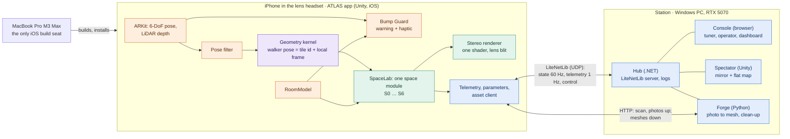

---

## 6. System architecture

### 6.1 Devices and processes



The colours are the four lanes (§9.2): green A, purple B, orange C, blue D. The principle from the older design stands and is now stricter: **the phone renders everything and decides everything that matters within a frame. The Station watches, tunes, measures and manufactures assets. If the Station is unplugged the walker notices nothing except that furniture is the built-in fallback set (§7.4), not generated meshes.**

### 6.2 Assemblies

One assembly definition per area. An assembly references only rows above it in this table.

| Assembly | Contains | May reference | Lane |
|---|---|---|---|
| `Atlas.Kernel` | `Iso2` (3 × 3 double isometries for negative, zero and positive curvature), exp and log maps, `TileId`, tile graph, `Mesh4D` and the slicing job | Mathematics, Burst, Collections. No scene types, so it runs in EditMode tests | B (4D part: A) |
| `Atlas.Link` | Message types, binary packing, clock sync, watchdog, client and host over LiteNetLib, `ParamRegistry` (the engine-free half) | Nothing from Unity. The same source compiles into the Hub | D |
| `Atlas.World` | `ISpaceModule`, SpaceLab, `RoomModel` types, world generator, archetypes, WorldLint | Kernel, Link (message and parameter types only) | A (`ISpaceModule`, SpaceLab) · B (generator, WorldLint) · C (RoomModel types) |
| `Atlas.Rendering` | Stereo rig, lens blit, shared shader and its includes, tile renderer, portal features, quality ladder | Kernel, World, URP | A (warp and gates includes, tile renderer: B) |
| `Atlas.Scan` | AR session set-up, scan routes, FloorScan and loop-fit (a core with no AR types, so it runs in EditMode tests), Home rebuild, photo capture, world map | Kernel, World | C |
| `Atlas.Safety` | Bump Guard and its warning cue and haptics (`BumpCue`) | World (RoomModel types only). **Never Link or Telemetry**; it uses no link type | C |
| `Atlas.Input` | Action map and twins | none | C |
| `Atlas.Telemetry` | Unity-side parameter binding (`AtlasParamAttribute` scanner), perf probe, HUD, event log, asset client | Link, World | D |
| `Atlas.App` | The boot scene's composition root: `AtlasFrameLoop` (§6.3), SpaceLab start-up, and the handler that turns operator commands into local calls (for example `cue` into `BumpCue.Fire`), so that Safety never sees a link type | Kernel, World, Rendering, Scan, Safety, Input, Telemetry | A |
| `Atlas.Spaces.*` | One assembly per space S0–S6 | Kernel, Link (message and parameter types only), World, Rendering, Input, Telemetry | S0: C · S1, S5, S6: A · S2, S3, S4: B |
| `Atlas.Blades.*` | The use cases, Phase 2 onwards ("blade" is the older documents' word for a use case) | All of the above | per use case |
| `Atlas.Spectator` | Windows only: consumes `State`, drives the mirror and the map | Rendering, World, Link, Spaces | D |

### 6.3 The phone's frame, in order

1. **Read**: ARKit pose (once, in Update), gamepad, the newest LiDAR depth image.
2. **Bump Guard**: uses the raw pose and the depth image. Sets the warning level. Runs before anything can be skipped.
3. **Pose filter**: rejects jumps over 0.2 m for the geometry.
4. **Kernel**: updates the walker's frame, handles a tile crossing, rebuilds the list of candidate tiles when the walker changes tile, and applies the draw rule of §8.5 every frame.
5. **Space module**: interaction, simulation, the slicer job.
6. **Upload**: per-tile anchors and parameters to materials. Where the hyperbolic warp is on, the draw rule of §8.5 is applied here, once for both eyes.
7. **Render**: each eye camera into its own render texture, then one lens blit to the screen that samples both.
8. **After the frame**: sample performance counters, send `State`, drain incoming parameter changes. Nothing in steps 1–7 waits for the network.

How the order is enforced: steps 2–6 are plain C# calls made in this order by one driver, `AtlasFrameLoop`, in the boot scene (assembly `Atlas.App`, lane A). It is marked `[DefaultExecutionOrder(100)]` so that it runs after the `TrackedPoseDriver` (Update only) and after every other script's Update. No other script reads the head pose or steps the kernel in its own Update (BP §4).

### 6.4 Contracts frozen at G0

Lanes work in parallel because these are agreed first and changed only with notice to all four lanes. Each lane writes the pages for the contracts it owns straight from this plan (`P1-X05` to `P1-X08`; no code is needed), and gate G0 (`P1-X02`) freezes them once the stubs for every interface compile in every assembly.

| Contract | What it fixes | Owner | Main consumers |
|---|---|---|---|
| `ISpaceModule` | How a space is configured from the RoomModel, entered, ticked, left, and how it describes itself to the Spectator | A | all |
| Kernel types | `Iso2`, `TileId`, `WalkerPose`, `ITileGraph`; unit hyperboloid with metric diag(1, 1, −1); lengths divided by L at the boundary | B | A, C, D |
| RoomModel schema | The fields of §4.3, coordinate frame, units; three sample rooms for functional tests, and the performance fixture `budget_room` (4 × 5 m, twelve stand-in objects of exactly 5,000 triangles each, no edge over 0.25 m) for budget tests | C | all |
| Shader include contract | Entry points and signatures of `AtlasCore.hlsl`, `AtlasWarp.hlsl`, `AtlasPortalClip.hlsl`, `AtlasGates.hlsl`; the single `UnityPerMaterial` block; every property id in `AtlasShaderIDs.cs` (edited by lanes A and B only; an id is added or changed only after all four lanes are told) | A and B | all |
| Parameter registry | How a tunable is declared (id, group, range, default) and reaches the Console. Bump Guard declares none: its thresholds and depth rate are constants in code (§4.10) | D | all |
| Link schema | Message ids, the `State` layout, the event format (Appendix B) | D | all |
| Asset contract | What a generated GLB must satisfy: one mesh, no textures or materials (the phone assigns the shared one), metres, Y up, origin at the centre of the box's base, longest edge ≤ 0.25 m, 1,500–5,000 triangles (the validator's hard range) and never more than the triangle target sent with its job. The target is clamp(60,000 ÷ n, 3,000, 5,000) when n objects receive meshes (§4.5) | D | C |
| Layer and stencil table | One row per room layer and stencil reference (1–15) | A | B |
| Frame loop | `AtlasFrameLoop` and its call order (§6.3, steps 2–6) | A | B, C |
| Scene ownership | Who may edit which scene and prefab (§9.3) | A | all |

### 6.5 Core interfaces

Names are binding. Bodies are free.

```csharp
// Atlas.Kernel -----------------------------------------------------------------
public readonly struct Iso2 {                       // 3×3 double; κ < 0 hyperbolic, 0 flat, > 0 spherical
    public static Iso2 Boost(double2 step, double kappa);   // move by a tangent vector (already divided by L)
    public static Iso2 Rot(double angle);
    public Iso2 Inverse();                                   // η·Mᵀ·η in H², transpose on S²
    public Iso2 Orthonormalised();
    public static Iso2 operator *(Iso2 a, Iso2 b);
}
public readonly struct TileId : IEquatable<TileId> {         // six Int64: X, Y, T in ℤ[φ] for {4,5}
    public TileId Step(int edge);                            // neighbour across edge 0..3; additions only
    public ulong ContentSeed(uint worldSeed);
}
public struct WalkerPose { public TileId Tile; public Iso2 Local; }   // never a global coordinate
public interface ITileGraph {
    int Q { get; }                                           // tiles per corner
    void VisibleSet(TileId centre, double rho, List<VisibleTile> into);   // id, step chain F[t], graph distance
}

// Atlas.World (ParamRegistry and StateMessage are declared in Atlas.Link) ---------
public interface ISpaceModule {
    SpaceId Id { get; }
    bool Registered { get; }                                 // does this space match the real room?
    void Configure(RoomModel room, ParamRegistry registry);  // every size comes from the RoomModel
    void Enter(in WalkerPose start);
    void Tick(in FrameContext frame);                        // after Bump Guard and the pose filter
    void Exit();
    void WriteState(ref StateMessage state);                 // what the Spectator needs to redraw this frame
}

// Atlas.Safety (RoomModel types from Atlas.World only; no type from Atlas.Link) ---
public enum BumpLevel { Clear, Warn, Strong, TrackingLost }
public interface IBumpGuard {
    BumpLevel Level { get; }
    float2 Direction { get; }                                // towards the hazard, in head space
    bool RescanAdvised { get; }                              // live depth and the static map disagree (§4.10)
    void Tick(in SensorFrame sensors);                       // first call of the frame; never awaits
}

// Atlas.Telemetry ----------------------------------------------------------------
[AttributeUsage(AttributeTargets.Field)]
public sealed class AtlasParamAttribute : Attribute { /* id, group, min, max, default */ }
```

`ParamRegistry` and `StateMessage` are declared in `Atlas.Link` (§7.1). That is why `Atlas.World`, and every assembly that implements `ISpaceModule`, references `Atlas.Link`, for its message and parameter types and nothing else. `Atlas.Safety` uses no link type: from `Atlas.World` it takes only the RoomModel types, so it compiles with no reference to `Atlas.Link` or `Atlas.Telemetry`. The assembly half of the test `Safety_Independence` (§11.1) checks both from G0.
