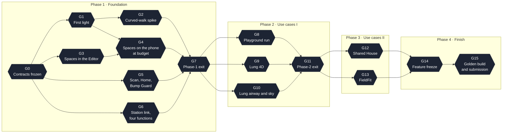

---

## 9. Build plan

### 9.1 How the plan is organised

- **By dependency, not by date.** Every task lists what it needs and what proves it is done. A task starts when its inputs exist. A phase ends when its exit gate passes.
- **Contracts first.** The start is wide: three set-up tasks and four sets of contract pages have no dependency, so every engineer and their agents have work from the first minute. They meet in gate G0, where the interfaces between lanes are frozen and stubbed. After that the four lanes do not wait for each other's code until the integration gates.
- **Editor first, phone last.** Only one Mac can build to the phones, so everything that can be proved in the Unity Editor or in a unit test is proved there. The phone is for acceptance.
- **Two levels.** People plan in **work areas**: {{P1_NAREAS_LC}} in Phase 1, a handful per lane, each a piece one person owns (§9.5.2); later phases have one to three areas per lane and use case (§9.6–9.8). Agents work on **tasks**: each task fits one coding agent, touches one lane's files, and has a binary acceptance test with numbers.
- **The plan's tables and diagrams come from one data set.** The Phase 1 graph has {{P1_NTASKS}} tasks and {{P1_NEDGES}} dependency edges, checked to be free of cycles; the diagrams below are generated from the same data as the tables.

### 9.2 The four lanes

| Lane | Phase 1 · Foundation | Phase 2 · Use cases I | Phase 3 · Use cases II | Phase 4 · Finish |
|---|---|---|---|---|
| **A · Platform, Look and Flat Spaces** | Project, build seat, stereo rig, lens blit, shared shader, SpaceLab, Glued (S1), Impossible Rooms (S5), Slicer and `Mesh4D` (S6), room content in Glued, thermal ladder, soak | Slicer toybox, equation sources, look of the Playground; the whole medical 4D runtime (worldtube, breath lane, scanner tilt, tasks) and the Lung director with its labels and credits | Shared House: sheets, door, second home, visitor | Look and audio, performance hardening, golden build |
| **B · Kernel and Curved Worlds** | Kernel, holonomy rig, warp shader, exact tile ids, tile meshes and renderer, world generator, Small Planet (S4), dial and 3-4-5 walk, Aligned Cells (S3), room as tile zero, room content in Aligned Cells | Lung Mission: airway wing in hyperbolic space, valve chambers, Two Compasses, needle sky | FieldFit: lens mathematics, lookup, composed final blit, blind-spot finder | Maths notes, correctness report, equation-card audit, figures |
| **C · Scan, Room and Safety** | AR session, FloorScan core (Editor), scan routes, RoomModel and loop-fit, Home (S0), object photos, Bump Guard with its warning cue and haptics, input, pose pipeline, onboarding, pre-scan path | Geometry Playground: the shell (director, guided walk, captions, twins, menu), the pointing probe, and the Glued and Impossible Rooms exhibits | Shared House: second scan, door fit, Bump Guard on the second sheet, peer link | Onboarding with outside walkers, comfort protocol, failure drills, rehearsals |
| **D · Link, Station and Forge** | `Atlas.Link`, Hub, tuner and Console, perf probe and telemetry, Spectator, flat-twin map, Forge and mesh clean-up, asset client, built-in fallback set, on-device menu, pairing | Lung Mission: the Station pipeline (`atlas case`), case packages, plan card, Lung panels on Console and Spectator | FieldFit: field presets, Console lens panel, Spectator heatmap, search task and logging; Shared House: peer relay (Extended) and two-plan flat twin | Judges' dashboard, session logs, metrics report, video capture, deck |
| Work packages | {{COUNTS_P1}} | {{COUNTS_P2}} | {{COUNTS_P3}} | {{COUNTS_P4}} |

The lane owner decides inside the lane. Anything that touches a contract (§6.4) is announced to all four before it is committed.

### 9.3 Shared resources and the rules that protect them

**The build seat (one Mac).**

1. Lane A's first jobs are the build chain (`P1-A02`, `P1-A13`) and the URP settings and the stereo rig (`P1-A03`, `P1-A04`). They take priority over every other lane-A task until G1 passes. Editor-only lane-A task `P1-A06` and the Editor part of `P1-A12` run alongside them as the graph in §9.5.5 allows.
2. Everyone runs the Unity Editor on their own machine. Native code is wrapped so the Editor and the Station build compile without it.
3. Device builds go out as a build train: one integration build at every gate, plus short on-request slots from a visible queue (who, branch, what is tested).
4. Prefer iteration that needs no rebuild: live tuning from the Console, replay of recorded RoomModels and pose logs in the Editor, kernel and graph logic as EditMode tests.
5. One bundle id and one signing account. A build signed by a different account cannot install over the existing one.

**The two phones.**

1. Phone A is the reference device for every published number. Phone B is lane C's working device (every one of lane C's Phase-1 tasks except the Editor-only FloorScan core, `P1-C15`, needs a phone), the hot-swap spare, and the second walker in Phase 3.
2. Hand-held before head-mounted: scan, link and input are debugged with the phone in the hand; the headset is for acceptance.
3. Record once, replay many times: the first good scan and a few walks are saved and replayed in the Editor by every lane.
4. A soak leaves a phone hot. Soaks are scheduled, not squeezed between someone else's measurements, and the thermal state is noted at the start of every measurement.

**The Station's GPU.** The RTX 5070 has 12 GB. The Forge's generator needs about 8 GB and owns the card while jobs are queued. The Spectator runs at modest settings beside it. The medical pipeline (`atlas case`, Phase 2) runs when the Forge is idle.

**Scenes and prefabs.** Unity scenes are single files, so each has exactly one owner.

| Asset | Owner | Rule |
|---|---|---|
| `Atlas_Boot` (XR origin, stereo rig, SpaceLab, bootstraps) | A | Nobody else edits it. Systems register themselves from their own scenes |
| `Space_Home` | C | One additive scene per space, one owner each |
| `Space_Glued`, `Space_Portal`, `Space_Slicer` | A | |
| `Space_CurvedWalk`, `Space_AlignedCells`, `Space_SmallPlanet` | B | |
| `Sys_Scan`, `Sys_BumpGuard`, `Sys_Onboarding` | C | Loaded additively by the boot scene |
| `Sys_Link`, `Sys_Hud`, `PC_Spectator` | D | The Spectator scene is never in the iOS build list |
| Use-case scenes (Phase 2 onwards) | The lane that owns the use case's runtime | Reference spaces through `ISpaceModule`; never copy their objects |
| `Sandbox_<name>` | Each engineer | Never in the build list |
| URP assets, Project Settings, layers, stencil table, package manifest | A | Changed only by A, announced first |
| The shared material and palette | A | Per-tile and per-room material instances are created at run time from a pool, never saved as assets |

**The shared shader.** Ownership of the four include files is in §8.3. A contract check runs at every gate: the shader is still reported SRP-Batcher compatible, and the draw-call count of the stress scene has not grown.

**Source control.** Text serialisation, visible meta files, UnityYAMLMerge as the merge tool, Git LFS for binaries. Small merges to one main branch. Tunables live in the parameter registry and in ScriptableObjects, one file per space, so tuning never touches a scene. Asset Store packs stay out of the repository.

### 9.4 Phases and gates



| Gate | Passes when (summary; full checklists in §11.3) |
|---|---|
| **G0** Contracts frozen | Every contract of §6.4 is written and stubbed; each lane's sandbox runs against the stubs |
| **G1** First light | Empty stereo scene at 60 fps on the phone; telemetry visible on the Station; anyone can install a build |
| **G2** Curved-walk spike | Five-corner loop closes within 0.25 m and three walkers from the team are comfortable at the loop-fit curvature (with a spotter: Bump Guard does not exist yet). Decides the default mode and the comfort floor |
| **G3** Spaces in the Editor | S1–S6 run in SpaceLab on the three sample rooms; all mathematics tests green |
| **G4** Spaces on the phone at budget | Every space S0–S6 meets the Must column cold, with the room's content, on the `budget_room` fixture; the 15-minute soak passes |
| **G5** Scan, Home and Bump Guard | Both scan paths end in a registered Home; Bump Guard passes its scripted test in the headset |
| **G6** Station link, four functions | Mirror, tuning and Console, telemetry, and the scan and asset round-trip all pass §7.6 |
| **G7** Phase-1 exit | A first-time walker goes from self-scan to every space, watched and tuned from the Station |
| **G8** Playground run | A first-time walker completes the guided run in two different rooms |
| **G9** Lung 4D | The four 4D pieces run on both case packages at budget |
| **G10** Lung airway and sky | Four forks walked without rescue; sky and plan card correct |
| **G11** Phase-2 exit | Playground and Lung Mission in one session by an outsider, hot, at budget |
| **G12** Shared House | Post Circling walked by three people with no contact |
| **G13** FieldFit | Blind spot found; search is faster with the lens than without |
| **G14** Feature freeze | Full path twice in a row on one phone without cooling; only fixes after this |
| **G15** Golden build and submission | Golden build runs with the Station unplugged; documents, video and metrics delivered |

Phase 3's packages depend technically only on Phase 1. They are placed after G11 because every lane is occupied until then.

### 9.5 Phase 1 · Foundation

#### 9.5.1 What is sequential and what is parallel

```text
THE START  (wide from the first minute: seven tasks with no dependency)
   X01 Build seat, signing, Unity (A)  ‖  X03 Station ready (D)  ‖  X04 Phones and network ready (C)
   X05 ‖ X06 ‖ X07 ‖ X08   Contract pages, one set per lane, written from this plan
   A01  Unity project and repository skeleton              after X01
   X02 = G0  Contracts frozen, stubs compile               after A01 and X05–X08

THEN FOUR LANES IN PARALLEL
   ‖  same wave: can run at the same time          →  a later wave: cannot start before the group on its left
Each entry is one work area: a piece a person owns and hands to their agents task by task.
Under it: its tasks in order, then what it waits for from outside the lane.

{{P1_LANES_TREE}}

GATES  (where lanes meet)
{{P1_GATES_TREE}}
```

Three facts from the graph:

- **Fourteen lane tasks need neither a phone nor the build seat**: URP settings, the shared look shader, the kernel, the holonomy rig, the warp shader, tile ids, tile meshes, the world generator, the FloorScan core, the link library, the Hub, the Spectator, the Forge and mesh clean-up. Thirteen of them never wait for a device task; the Spectator (`P1-D05`) waits for the SpaceLab host (`P1-A08`), which needs the stereo rig on the phone.
- **The longest chains have eleven tasks, and every one of them runs through the scan and Home**: X01 → A01 → A02 → C01 → C02 or C03 → C06 → C07, then either (A15, B11 or B12) → A14 → G4 → G7, or D10 → D12 → G6 → G7. So the first device build, the scan and the Home rebuild are the critical path. Start them as early as the graph allows and keep a phone free for lane C.
- **Lane B's integration tasks (B09, B11, B12) and lane A's (A15) wait for lane C's RoomModel and Home.** Until those exist, they are built against the three sample rooms and `budget_room` from G0.

**Waves.** A task's wave is one more than the highest wave among the tasks it depends on. Tasks in the same wave do not depend on each other, so they can all be in progress at once; a task may start as soon as its own dependencies are done, even if the rest of its wave is not. Read a column downwards to see one lane's order; read a row across to see what the four lanes (and their agents) can be doing at the same time.

{{P1_WAVES}}

#### 9.5.2 Overview: the work areas

{{P1_NAREAS}} work areas, a handful per lane. An area is the unit a person plans in, about the size of "Implement hyperbolic terrain generation" or "Build the Forge: object photos to furniture meshes"; the tasks inside it (§9.5.4 onwards) are the units handed to agents. An arrow means the area at its head needs something from the area at its tail.

```mermaid
{{P1_OVERVIEW_MMD}}
```

{{P1_AREAS}}

**Which areas can run at the same time.** Areas in the same step do not need each other. An area can be finished only after the areas it needs in earlier steps; work inside it often starts sooner (see the lane lines in §9.5.1).

{{P1_AREA_STEPS}}

Colours: green lane A, purple lane B, orange lane C, blue lane D, grey shared. Dashed boxes are inputs from other lanes or from the other diagram; dark hexagons are gates.

Cross-lane handovers are not drawn in the overview; they are listed in §9.5.3 and drawn in the lane diagrams.

#### 9.5.3 Cross-lane handovers

Every point where one lane's area unblocks another lane's area, with the tasks that carry it. These are the moments to talk.

{{P1_HANDOVERS}}

#### 9.5.4 All hands

{{P1_TABLE_X}}

#### 9.5.5 Lane A · Platform, Look and Flat Spaces

```mermaid
{{P1_LANE_A_MMD}}
```

Colours: green lane A, purple lane B, orange lane C, blue lane D, grey shared. Dashed boxes are inputs from other lanes or from the other diagram; dark hexagons are gates.


{{P1_TABLE_A}}

#### 9.5.6 Lane B · Kernel and Curved Worlds

```mermaid
{{P1_LANE_B_MMD}}
```

Colours: green lane A, purple lane B, orange lane C, blue lane D, grey shared. Dashed boxes are inputs from other lanes or from the other diagram; dark hexagons are gates.

{{P1_TABLE_B}}

#### 9.5.7 Lane C · Scan, Room and Safety

```mermaid
{{P1_LANE_C_MMD}}
```

Colours: green lane A, purple lane B, orange lane C, blue lane D, grey shared. Dashed boxes are inputs from other lanes or from the other diagram; dark hexagons are gates.

{{P1_TABLE_C}}

#### 9.5.8 Lane D · Link, Station and Forge

```mermaid
{{P1_LANE_D_MMD}}
```

Colours: green lane A, purple lane B, orange lane C, blue lane D, grey shared. Dashed boxes are inputs from other lanes or from the other diagram; dark hexagons are gates.

{{P1_TABLE_D}}

#### 9.5.9 Phase 1 gates

{{P1_TABLE_G}}

### 9.6 Phase 2 · Geometry Playground and Lung Mission

Two tracks run in parallel from G7. The specifications and the work-package tables are in §10.1 (Playground) and §10.2 (Lung Mission); the diagrams here show the order.

| Track | Lanes | Packages | Exit gate |
|---|---|---|---|
| Geometry Playground | C (shell; Glued and Impossible Rooms exhibits) and A (Slicer toybox, equation sources, look) | `P2-C01`–`P2-C17`, `P2-A01`–`P2-A04` | G8 |
| Lung Mission | D (Station pipeline, case packages, plan card), A (medical 4D runtime), B (airway wing, needle sky) | `P2-D01`–`P2-D13`, `P2-A20`–`P2-A32`, `P2-B01`–`P2-B12` | G9 (4D), G10 (airway and sky) |

Lane A serves both tracks, which departs from a strict "two lanes each" (open item 17 in §14): the Slicer toybox and the medical 4D runtime both build on lane A's `Mesh4D`. Lane A does `P2-A01` and `P2-A02` first, because `P2-A01` unblocks lane C's exhibit menu (`P2-C08`), then starts `P2-A20` onwards; `P2-A03` and `P2-A04` follow when their lane-C inputs land.

What is sequential:

- In the Playground everything hangs off the director (`P2-C01`); the exhibits wrap Phase 1 spaces and are independent of one another; the run (`P2-C11`) is last.
- In the Lung Mission the case contract (`P2-D01`) comes first. Lane D then produces the **illustrative** package (`P2-D02`) before the real one, so lanes A and B have data to build against without waiting for the full pipeline. The 4D runtime (lane A) and the airway wing (lane B) are independent of each other until the lesion chamber hand-over (`P2-B09`). The Lung director (`P2-A32`) stubs the beats that belong to lanes B and D, so G9 does not wait for the airway.
- G11 needs G8, G9 and G10, and then one combined session by someone from outside the team.

**Work areas, Phase 2**

The areas are for people; the packages inside them are for agents. An arrow from a gate into an area means work in that area can start at that gate; an arrow between areas means the second cannot be finished without the first.

```mermaid
{{P2_AREAS_MMD}}
```

Colours: green lane A, purple lane B, orange lane C, blue lane D; dark hexagons are gates.

{{P2_AREAS}}

The three diagrams below show the same phase package by package.

**Track: Geometry Playground**

```mermaid
{{P2_PLAYGROUND_MMD}}
```

Colours: green lane A, purple lane B, orange lane C, blue lane D, grey shared. Dashed boxes are inputs from other lanes or from the other diagram; dark hexagons are gates.

**Track: Lung Mission, data and 4D (lanes D and A, to G9)**

```mermaid
{{P2_LUNG_4D_MMD}}
```

Colours: green lane A, purple lane B, orange lane C, blue lane D, grey shared. Dashed boxes are inputs from other lanes or from the other diagram; dark hexagons are gates.

**Track: Lung Mission, airway and sky (lanes B and D, to G10)**

```mermaid
{{P2_LUNG_AIRWAY_MMD}}
```

Colours: green lane A, purple lane B, orange lane C, blue lane D, grey shared. Dashed boxes are inputs from other lanes or from the other diagram; dark hexagons are gates.

### 9.7 Phase 3 · Shared House and FieldFit

Two independent use cases, two lanes each; lane D adds two small packages to the Shared House (the peer relay and the two-plan flat twin). Specifications and work-package tables: §10.3 and §10.4. Packages marked Extended, Stretch or Blocked are drawn but feed no gate.

**Work areas, Phase 3**

An arrow from a gate into an area means work in that area can start at that gate; an arrow between areas means the second cannot be finished without the first.

```mermaid
{{P3_AREAS_MMD}}
```

Colours: green lane A, purple lane B, orange lane C, blue lane D; dark hexagons are gates.

{{P3_AREAS}}

The same phase package by package:

```mermaid
{{P3_MMD}}
```

Colours: green lane A, purple lane B, orange lane C, blue lane D, grey shared. Dashed boxes are inputs from other lanes or from the other diagram; dark hexagons are gates.

### 9.8 Phase 4 · Finish

Polish, evaluation, demo operations and documentation. Work-package table: §13.6. Feature freeze (G14) follows the look pass, the performance hardening and the failure drills; after it, only fixes, audio, documents and rehearsals. In the diagrams of §9.7 and §9.8 the start gate shows when a lane is free; the tables give the technical dependency (§9.4).

**Work areas, Phase 4**

An arrow from a gate into an area means work in that area can start at that gate; an arrow between areas means the second cannot be finished without the first.

```mermaid
{{P4_AREAS_MMD}}
```

Colours: green lane A, purple lane B, orange lane C, blue lane D; dark hexagons are gates.

{{P4_AREAS}}

The same phase package by package:

```mermaid
{{P4_MMD}}
```

Colours: green lane A, purple lane B, orange lane C, blue lane D, grey shared. Dashed boxes are inputs from other lanes or from the other diagram; dark hexagons are gates.

### 9.9 Working with AI coding agents

The tasks are sized and worded to be handed over. The rules that make that safe:

1. **One task, one branch, one merge request.** The branch name is the task id.
2. **An agent stays in its lane's folders.** It may read contracts and other lanes' public interfaces; it may not edit them. A contract change is made by a human and announced.
3. **The acceptance test comes first.** For anything provable in the Editor the agent writes the test from the acceptance cell, sees it fail, then implements.
4. **Parallel agents take tasks marked ‖** in §9.5.1: they touch different files by construction.
5. **A human runs every phone test** and records the numbers. An agent prepares the build, the test scene and the checklist.
6. **No agent merges on a red test or a broken shader contract.**
7. **Numbers in a task are part of the task.** If a budget cannot be met, the agent reports the measured value and stops; it does not relax the number.

A task brief, ready to paste:

```text
Task        P1-B04  Exact tile ids and the tile graph            Lane B
Read first  docs/contracts/kernel.md; this plan §3.4, §6.5, Appendix A.5
Depends on  P1-B01 (merged)
You own     Assets/Atlas/Kernel/Tiling/**  and its tests. Touch nothing else.
Deliver     TileId.cs, TileGraph.cs, Tests/TileIdTests.cs
Accept      - per-depth tile counts equal OEIS A377322 to depth 10
            - a walk round a vertex closes after exactly 5 steps
            - φ(X²+Y²) − T² = −1 for every generated tile (evaluated in Int128)
            - tile centres within ρ = 2 / 3 / 3.5 / 4 of a tile centre: 13 / 45 / 81 / 129; within 3.8425: 105
            - a tile crossing costs ≤ 0.5 ms in the Editor
Out of scope  rendering, materials, scenes, shader code
Report      test log; measured crossing cost; anything in the contract you could not satisfy
```
